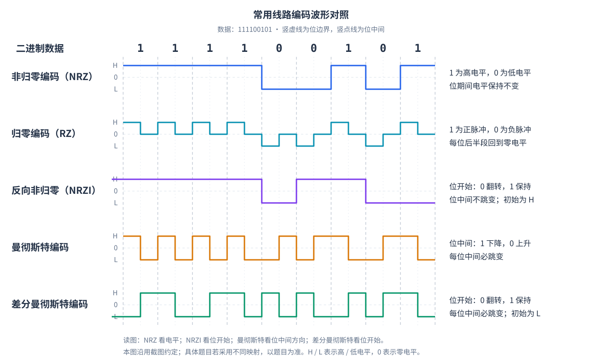

# 第 2 章 物理层

## 2.1 通信基础

### 2.1.1 数据、信号与信道

| 概念       | 含义                       | 例子或辨析                                   |
| ---------- | -------------------------- | -------------------------------------------- |
| 信息       | 消息中有意义的内容         | 一段文字表达的含义                           |
| 数据       | 信息的表示形式             | 字符编码、采样数值，可分为模拟数据与数字数据 |
| 信号       | 数据在传输过程中的物理表现 | 电压、电流、光脉冲、电磁波                   |
| 信源、信宿 | 信息的产生端、接收端       | 对应通信方向中的源与目的                     |
| 信道       | 某一方向上传递信号的通路   | 逻辑通信通路，不等于整根电缆                 |

数字信号按有限、可区分的状态承载数据；模拟信号的参数连续变化。**数字数据也能通过调制形成模拟信号，模拟数据也能经过采样、量化、编码形成数字数据。**

一条物理介质可以通过复用承载多个信道。不要把“电缆条数”“信道个数”“收发方向数”混为一谈。

### 2.1.2 传输方式

| 维度     | 类型     | 特征                                             |
| -------- | -------- | ------------------------------------------------ |
| 方向     | 单工     | 只允许一个方向传送                               |
| 方向     | 半双工   | 双方都能发，但不能同时发                         |
| 方向     | 全双工   | 双方可以同时发送                                 |
| 比特组织 | 串行     | 比特依次传送，线路较少，适合远距离               |
| 比特组织 | 并行     | 多个比特经多条通路同时传送，需处理通路间时序偏差 |
| 定时     | 异步传输 | 通常以字符为单位，用起始位、停止位等建立接收定时 |
| 定时     | 同步传输 | 连续传送数据块，由时钟或编码机制保持同步         |

异步不表示完全不需要同步，只是不会永久维持一个连续数据流的共同字符定时。

#### 不同以太网的典型通信方式

| 网络类型                     | 典型通信方式 |
| ---------------------------- | ------------ |
| 传统共享式同轴电缆以太网     | 半双工       |
| 集线器（Hub）连接的以太网    | 半双工       |
| 交换机连接的现代双绞线以太网 | 全双工       |
| 现代点对点光纤以太网         | 全双工       |

**共享式以太网通常采用半双工，现代交换式点对点以太网通常采用全双工。** 通信方式不能只根据传输介质判断，还应结合连接设备、链路结构和双工配置。

**基带传输** 直接传送经线路编码等处理的基带信号；**频带传输** 通过调制把信号搬移到适合信道的频段。教材中的“宽带传输”常指频带传输语境，不能直接等同于日常说的“高速宽带上网”。

### 2.1.3 码元、码元传输速率与信息传输速率

**码元（符号）** 是一个码元周期内发送的信号状态。一个码元可能表示一个比特，也可能表示多个比特。状态不仅可以由电平区分，也可以由幅度、相位或它们的组合区分。

#### 两种传输速率的定义

**调制速率 = 码元传输速率 = 码元率 = 波特率。** 这四个名称表示同一个概念，单位都是 **Baud（波特）** 。

408 中主要区分以下两种速率：

| 比较项   | 码元传输速率                                 | 信息传输速率                                       |
| -------- | -------------------------------------------- | -------------------------------------------------- |
| 定义     | 单位时间内传输的码元个数                     | 单位时间内传输的比特数（本节按教材中的比特率口径） |
| 常用名称 | 调制速率、码元率、码元速率、波特率           | 数据传输速率、信息速率、比特率                     |
| 本文符号 | $R_s$                                        | $R_b$                                              |
| 单位     | 波特，Baud；$1$ Baud 表示每秒传输 $1$ 个码元 | bit/s，也写作 b/s 或 bps                           |
| 直接计算 | $R_s=N_s/t$，$N_s$ 为时间 $t$ 内传输的码元数 | $R_b=N_b/t$，$N_b$ 为时间 $t$ 内传输的比特数       |

**码元传输速率看“每秒传几个码元”，信息传输速率看“每秒传多少比特”。** 两者通过“每个码元表示多少比特”联系起来。教材也可能用 $R_B$ 表示码元速率，应根据定义和单位辨认符号。

设码元周期为 $T_s$，码元速率为 $R_s$，每个码元有 $V$ 种可区分状态：

$$
\boxed{R_s=\frac1{T_s}}\qquad\text{单位：Baud（码元/s）}.
$$

若每个比特对应的时间为 $T_b$，则 $R_b=1/T_b$。速率单位采用十进制：$1$ kbit/s $=10^3$ bit/s，$1$ Mbit/s $=10^6$ bit/s；大写 B 表示字节，$1$ B $=8$ bit。

#### 两种速率的关系

在 $V=2^n$、每码元用固定长度表示 $n$ 个信息比特、忽略额外编码开销时：

$$
\boxed{n=\log_2V,\qquad R_b=R_s\log_2V}.
$$

因此也可以反求 $R_s=R_b/\log_2V$、$V=2^{R_b/R_s}$，且 $T_s=nT_b$。

| 每码元可选状态数 $V$ | 每码元表示的比特数 $n$ | 两种速率的关系                |
| -------------------- | ---------------------- | ----------------------------- |
| $2$                  | $1$                    | $R_b=R_s$，数值相同，单位不同 |
| $4$                  | $2$                    | $R_b=2R_s$                    |
| $8$                  | $3$                    | $R_b=3R_s$                    |
| $16$                 | $4$                    | $R_b=4R_s$                    |

例如，四种状态分别对应 `00`、`01`、`10`、`11`，发送 `00 11 01` 只需 $3$ 个码元，却表示了 $6$ bit。若每秒发送 $1000$ 个这样的码元，则码元速率为 $1000$ Baud，比特率为 $2000$ bit/s。

$R_b$ 的单位是 bit/s。若有纠错、线路编码等冗余，应区分**线路比特率** 和**有效信息速率** ，不能把冗余也算成有效数据。

若信道编码的码率为 $r=k/m$（每 $k$ 个信息比特编码成 $m$ 个编码比特），且没有其他开销，则有效信息速率为 $rR_s\log_2V$。

**波特率数码元，比特率数比特；波特率不是电平跳变次数。** 相邻码元可以相同而没有电平跳变。

**只有每码元恰好表示一个比特时，两种速率的数值才相等。** 不能仅凭“信号只有高、低两种电平”就判断二者相等：例如曼彻斯特编码若把每个半位信号单元计为一个码元，则一位数据占两个码元，码元速率是数据比特率的两倍。

#### 计算例题

**例 1：由码元周期和状态数求速率。** $V=16$、$T_s=5\ \mu s$：

$$
R_s=2\times10^5\ \mathrm{Baud},\qquad
R_b=2\times10^5\times4=8\times10^5\ \mathrm{bit/s}.
$$

发送 $1000$ B 数据，忽略开销，所需发送时间为

$$
t=\frac{1000\times8}{8\times10^5}=0.01\ \mathrm{s}=10\ \mathrm{ms}.
$$

**例 2：由两种速率反求状态数。** 已知码元速率为 $2400$ Baud、比特率为 $9600$ bit/s，采用无额外开销的固定长度二进制映射：

$$
n=\frac{R_b}{R_s}=\frac{9600}{2400}=4\ \mathrm{bit/码元},\qquad V=2^4=16.
$$

因此每个码元需要表示 $4$ bit，信号需要 $16$ 种可区分状态。

### 2.1.4 带宽、失真与码间串扰

#### 模拟信道的带宽：频率范围的宽度

**模拟信道的带宽** 是信道能够有效传输的频率范围的宽度，等于最高频率与最低频率之差：

$$
\boxed{W=f_{\max}-f_{\min}}.
$$

其中，$f_{\max}$ 为有效通频带的最高频率，$f_{\min}$ 为最低频率，$W$ 的单位为 **Hz（赫兹）** 。$1$ kHz $=10^3$ Hz，$1$ MHz $=10^6$ Hz。

例：某信道可有效传输的频率范围为 $300\sim3400$ Hz，则

$$
W=3400-300=3100\ \mathrm{Hz}=3.1\ \mathrm{kHz}.
$$

注意：带宽是频率范围的**宽度** ，不是最高频率本身。只有在低通模型中，若 $f_{\min}=0$，才有 $W=f_{\max}$。

#### “带宽”的两种常见含义

| 使用语境               | 含义                                 | 单位  |
| ---------------------- | ------------------------------------ | ----- |
| 模拟信道、频谱分析     | 有效通频带的宽度 $f_{\max}-f_{\min}$ | Hz    |
| 计算机网络中的链路带宽 | 链路的额定或最大数据传输速率         | bit/s |

例如，“信道带宽为 $3$ kHz”描述频率范围的宽度，“链路带宽为 $100$ Mbit/s”描述数据传输速率。**Hz 与 bit/s 不能直接换算。** 频率带宽与可达到的比特率之间，还取决于调制方式、信号状态数、噪声等条件，具体见后文的奈氏公式和香农公式。

#### 失真与码间串扰

信道对各频率成分的衰减和时延可能不同，使脉冲变形、展宽；相邻码元的波形重叠，妨碍判决，称为**码间串扰** 。传输速率过高、带宽受限等都会增加处理难度。

噪声则是额外叠加的干扰。**码间串扰和噪声不是同一问题：理想无噪声信道也需要控制码间串扰。**

## 2.2 信道极限速率

### 2.2.1 奈奎斯特定理（奈氏准则）

对带宽为 $W$ Hz 的**理想低通、无噪声信道** ，在无码间串扰的模型下，最高码元速率为

$$
\boxed{R_{s,\max}=2W}.
$$

若每码元有 $V$ 种可区分状态，则最高比特率为

$$
\boxed{R_{b,\max}=2W\log_2V}.
$$

奈氏公式把两个因素分开：**每秒最多多少码元 × 每码元携带多少比特。** $2W$ 的单位是 Baud，不一定等于最高 bit/s。

例：$W=3$ kHz，$V=16$：

$$
R_{b,\max}=2\times3000\times4=24000\ \mathrm{bit/s}.
$$

若题目反问达到速率 $R$ 至少需要多少状态，先求

$$
\log_2V\ge\frac R{2W}.
$$

固定长度二进制映射时，可取 $n=\lceil R/(2W)\rceil$ 位，最少使用 $2^n$ 个状态。这里使用的是低通模型；题目若明确给出带通调制的符号速率或另一带宽关系，应按该模型计算，不能重复套 $2W$。

### 2.2.2 香农定理

对带宽为 $W$ Hz、受加性高斯白噪声影响的信道，给定平均信号功率 $S$ 和带内噪声功率 $N$，容量为

$$
\boxed{C=W\log_2\left(1+\frac SN\right)}.
$$

$C$ 的单位为 bit/s，$S/N$ 必须是**无单位的功率比** 。

若信噪比以分贝给出：

$$
\boxed{\mathrm{SNR}_{\mathrm{dB}}=10\log_{10}\frac SN},\qquad
\boxed{\frac SN=10^{\mathrm{SNR}_{\mathrm{dB}}/10}}.
$$

| 信噪比  | 线性功率比 $S/N$ |
| ------- | ---------------- |
| $0$ dB  | $1$              |
| $10$ dB | $10$             |
| $20$ dB | $100$            |
| $30$ dB | $1000$           |

**$0$ dB 不是没有信号，而是信号功率等于噪声功率。** 功率比使用 $10\log_{10}$；不要直接套用于特定幅度比条件的 $20\log_{10}$。

香农容量是理论上限，不是某种实际编码的直接传输速率。在相应模型下，速率低于容量时可以通过适当编码使错误概率足够小；不能理解为有限长度编码一定完全无误码。

**保持带宽与信噪比有限，仅增加码元状态数不能无限提高可靠信息速率。** 更密集的状态也更难在噪声下区分。

### 2.2.3 公式选择与综合计算

| 题目给定             | 首先考虑                     |
| -------------------- | ---------------------------- |
| 码元速率、状态数     | $R_b=R_s\log_2V$             |
| 理想低通带宽、状态数 | 奈氏公式                     |
| 带宽、信噪比         | 香农公式，先把 dB 转成功率比 |
| 带宽、状态数、信噪比 | 在题设低通模型下比较两种上界 |

**信道的实际数据传输速率同时受到奈奎斯特定理和香农定理的限制。** 这意味着：两个定理分别给出了相应条件下的速率上限，实际速率不能超过其中任何一个。因此，当两种限制同时适用时，应以两个上限中较小的值为准，即

$$
R_b\le\min\left\{2W\log_2V,\ W\log_2(1+S/N)\right\}.
$$

取较小值只是上界比较，不能据此认定某个具体调制、编码方案一定恰好达到该值。

**例 1：同时受两种条件限制。** $W=3$ kHz，$V=4$，信噪比 $30$ dB：

$$
R_N=2\times3000\times2=12000\ \mathrm{bit/s},
$$

$$
C=3000\log_2(1001)\approx29902\ \mathrm{bit/s}.
$$

较严格的上界为 $12$ kb/s。若把状态数增加到 $64$，奈氏上界为 $36$ kb/s，此时香农容量约 $29.9$ kb/s 成为更严格的约束。

**例 2：反求所需信噪比。** 要让理论容量至少达到 $R$，必须满足

$$
\boxed{\frac SN\ge2^{R/W}-1}.
$$

$W=4$ kHz、目标 $R=16$ kb/s 时，$S/N\ge15$，即至少约 $11.76$ dB。该条件不是实际系统实现此速率的充分保证。

## 2.3 编码与调制

### 2.3.1 四种转换关系

| 原始数据 | 承载信号 | 典型方法                        |
| -------- | -------- | ------------------------------- |
| 数字数据 | 数字信号 | 线路编码：NRZ、NRZI、曼彻斯特等 |
| 数字数据 | 模拟信号 | 数字调制：ASK、FSK、PSK、QAM    |
| 模拟数据 | 数字信号 | PCM：采样、量化、编码           |
| 模拟数据 | 模拟信号 | 模拟调制：AM、FM、PM            |

**编码不都用于纠错。** 线路编码主要处理信号表示、同步及频谱等问题；信道编码主要通过冗余改善差错性能，二者用途不同。

### 2.3.2 常见线路编码

读波形前先标出**每一位的开始、中间和结束** ，再确认题目规定的映射规则。

| 编码                 | 判读规则                                 | 同步特点与代价                                     |
| -------------------- | ---------------------------------------- | -------------------------------------------------- |
| 非归零 NRZ（电平型） | 位期间保持电平，由高低电平表示 0、1      | 简单；连续相同比特可能长时间无跳变                 |
| 归零 RZ              | 每位的脉冲在位周期内返回零电平           | 脉冲较短，通常需要更宽频谱；具体同步性质取决于变体 |
| 反向非归零 NRZI      | 用位边界是否翻转表示数据                 | 按约定判断；某类连续比特可能没有跳变               |
| 曼彻斯特             | 每位中间必跳变，方向表示数据             | 自带定时信息，每位分两个半位信号间隔               |
| 差分曼彻斯特         | 每位中间必跳变；位开始处是否跳变表示数据 | 中间跳变用于同步，边界跳变表示信息                 |

**映射约定可能不同，题目给的规则优先。** 常见约定之一：NRZI“0 翻转、1 保持”；差分曼彻斯特“0 在开始处跳变、1 不跳变”。曼彻斯特的上升/下降对应 0 或 1，也须先读题。

例如 PPP 的一种 NRZI 表示明确采用“0 翻转、1 不翻转”，这不能推成所有 NRZI 应用都只有一种约定。

**曼彻斯特的两个半位间隔不能误当成两个原始数据比特。** 在常见教材模型中，它用两段信号表示一位信息；与二进制 NRZ 相比，具有约两倍的信号变化速率需求。涉及具体带宽时仍需按题目给定的模型。

#### **各种编码的特点**

**自同步能力** ：接收端能从接收到的信号中提取定时信息，使收发双方保持比特节拍同步，无需额外传送独立的时钟信号。

**曼彻斯特编码和归零编码（RZ）的主要优势都与时钟同步有关。** 曼彻斯特编码利用每位中间必有的跳变提供定时信息；本节所示的 RZ 编码利用每位非零脉冲返回零电平的跳变，帮助接收端提取时钟、保持同步。这里对 RZ 的结论以每位都有非零脉冲的形式为前提，不能直接推广到所有 RZ 变体。

| 对比项                         | 非归零 NRZ | 归零 RZ | 反向非归零 NRZI                          | 曼彻斯特 | 差分曼彻斯特 |
| ------------------------------ | ---------- | ------- | ---------------------------------------- | -------- | ------------ |
| 自同步能力                     | 无         | 有      | 配合适当的冗余编码或位填充，可实现自同步 | 有       | 有           |
| 带宽占用（截图中的“浪费带宽”） | 较省       | 较大    | 增加同步冗余后略有开销，通常较省         | 较大     | 较大         |
| 抗干扰能力（教材定性比较）     | 弱         | 弱      | 弱                                       | 强       | 强           |

理解与记忆：

- **NRZ** 连续相同比特时没有跳变，无法保证从信号中持续恢复时钟。
- **RZ** 在本图中每位都有非零脉冲并返回零电平，便于提取时钟；“有自同步能力”不能直接推广到所有 RZ 变体。
- **NRZI** 按“0 翻转、1 保持”的约定，连续 1 会长时间不跳变。增加冗余时，必须通过具体规则限制无跳变的长度；不是任意增加一位就能保证同步。
- **曼彻斯特、差分曼彻斯特** 每位中间必有跳变，便于同步，但通常需要更宽的频带。“浪费带宽”是相对 NRZ 的教学用语，不是无意义地占用带宽。
- **抗干扰强弱** 是截图中的定性记忆结论，不代表纠错能力，也不是所有信道条件下的绝对性能排序。

**以太网考点：传统 10 Mb/s 以太网采用曼彻斯特编码。** 截图中的“以太网默认使用曼彻斯特编码”应限定在这一语境，不能推广到所有速率的以太网。截图将归零写作“NR”，这里统一使用正确缩写 **RZ** 。

**常用编码波形对照（对应截图，二进制数据为 `111100101`）**

- **NRZ** ：1 为高电平、0 为低电平，位中间不变。
- **RZ** ：1 为正脉冲、0 为负脉冲，每位后半段返回零电平（零电平不同于低电平）。
- **NRZI** ：初始为高电平；位开始处 0 跳变、1 不跳变，位中间不变。
- **曼彻斯特** ：每位中间必跳变；本图约定 1 向下跳变、0 向上跳变。
- **差分曼彻斯特** ：初始为低电平；每位中间必跳变，位开始处 0 跳变、1 不跳变。

### 2.3.3 编码实例：同一数据，不同波形规则

数据为 `0101`。约定 H 为高电平、L 为低电平；NRZI 和差分曼彻斯特的初始电平为 H。

| 编码与本例约定                         | 第 1 位：0 | 第 2 位：1 | 第 3 位：0 | 第 4 位：1 |
| -------------------------------------- | ---------- | ---------- | ---------- | ---------- |
| NRZ：0=L、1=H                          | L          | H          | L          | H          |
| NRZI：0 翻转、1 保持                   | L          | L          | H          | H          |
| 曼彻斯特：0 为上升、1 为下降           | L→H        | H→L        | L→H        | H→L        |
| 差分曼彻斯特：0 起始翻转、1 起始不翻转 | L→H        | H→L        | H→L        | L→H        |

表中的箭头表示**位中间** 的电平变化。差分曼彻斯特第三位是 0：上一位结束于 L，第三位开始先翻转到 H，再在中间翻转到 L。

判读步骤：

1. 先确定编码类型和 0/1 约定。
2. NRZI 看每位开始处相对前一电平是否翻转。
3. 曼彻斯特看每位中间的跳变方向。
4. 差分曼彻斯特看位开始处是否跳变，中间必跳变只用于定时。
5. 差分编码若首位之前的电平未知、又无同步参照，首位可能无法唯一确定。

### 2.3.4 模拟数据数字化：PCM

脉冲编码调制 PCM 的步骤是

$$
\boxed{\text{采样}\to\text{量化}\to\text{编码}}.
$$

- **采样** ：在时间上离散化，取得一系列样值。
- **量化** ：把连续幅值映射到有限等级，会引入量化误差。
- **编码** ：给量化等级分配二进制码字。

对最高频率为 $f_{\max}$ 的低通带限信号，教材理想采样条件通常写为

$$
\boxed{f_s\ge2f_{\max}}.
$$

严格重建与实际滤波通常需要留有裕量，不能把任意信号恰好按临界频率采样都视为一定可恢复。**采样定理与奈氏无码间串扰公式虽然都有“2”，描述对象不同。**

若量化等级数为 $Q$，每个样本采用固定长度二进制编码：

$$
\boxed{n=\lceil\log_2Q\rceil,\qquad R_{\mathrm{PCM}}=f_s n}.
$$

例：最高频率 $4$ kHz，$256$ 个量化等级，按理想最低采样频率计算：

$$
f_s=8000\ \text{次/s},\qquad n=8,\qquad R=64000\ \mathrm{bit/s}.
$$

若 $30$ 路这样的数据复用，每帧取每路一个样本，另加 $16$ bit 开销，则每秒 $8000$ 帧：

$$
R=(30\times8+16)\times8000=2.048\ \mathrm{Mb/s}.
$$

**不要漏开销，也不要把每样本位数与每秒采样次数相加。**

### 2.3.5 数字调制：ASK、FSK、PSK、QAM

| 方式              | 用哪个参数区分码元                           |
| ----------------- | -------------------------------------------- |
| ASK，幅移键控     | 幅度                                         |
| FSK，频移键控     | 频率                                         |
| PSK，相移键控     | 相位                                         |
| QAM，正交幅度调制 | 两个正交分量的幅度组合，可对应不同幅度和相位 |

计算时先数出**总可区分状态数 $V$** ，再算 $\log_2V$，最后乘码元速率。

例：两路正交分量各有 $8$ 个独立幅值，全部组合有效，则 $V=8\times8=64$，每码元承载 $6$ bit。若码元速率为 $3000$ Baud，忽略编码开销：

$$
R_b=3000\times6=18000\ \mathrm{bit/s}.
$$

不能先得出 $6$ bit 后再乘 2，因为两路分量已经计入 $64$ 种组合。若题目直接给“16-QAM”，就有 $V=16$，无需另数幅度数和相位数。

## 2.4 信道复用

复用是让多个数据流共享一条物理传输资源。下面先掌握资源怎么划分；多点接入中的协调机制还会在数据链路层展开。

| 方式              | 分配什么     | 核心特点                                               |
| ----------------- | ------------ | ------------------------------------------------------ |
| 频分复用 FDM      | 不同频带     | 各路同时发送，通常需保护频带                           |
| 时分复用 TDM      | 周期性时隙   | 各路轮流使用信道，固定时隙即使无数据也可能闲置         |
| 统计时分复用 STDM | 动态分配时隙 | 按需发送，提高突发业务利用率；需要标识与缓存，可能排队 |
| 波分复用 WDM      | 不同光波长   | 光信号的频分复用                                       |
| 码分复用 CDM      | 不同码序列   | 同频同时间传送，接收端通过相关运算分离                 |

### 2.4.1 时分复用的速率计算

**介质的位速率大于单个信号的位速率；介质的带宽应足以容纳结合信号（复合信号）的带宽，实际通常还需留有余量。** 位速率还须满足各路信号的总位速率及必要开销。

固定 TDM 若每帧从 $N$ 路各取 $q$ bit，再加 $h$ bit 开销，帧率为 $f$：

$$
\boxed{R_{\mathrm{总}}=(Nq+h)f},\qquad R_{\mathrm{单路}}=qf.
$$

STDM 依赖并非所有用户持续满负载的统计特性。若各路同时持续输入超过输出能力，会排队甚至丢弃；它不意味着突破物理链路容量。

### 2.4.2 码分复用的内积判决

采用理想同步、等功率、正交码模型。每站分配长度为 $m$ 的码片序列，用 $+1,-1$ 表示。设 A 站序列为 $\boldsymbol c_A$：

$$
\frac{\boldsymbol c_A\cdot\boldsymbol c_A}{m}=1,\qquad
\frac{\boldsymbol c_A\cdot\boldsymbol c_B}{m}=0\quad(A\ne B).
$$

约定发送比特 1 时发送本码序列，发送比特 0 时发送反码序列，不发时贡献零向量。接收到叠加序列 $\boldsymbol r$ 后：

$$
\boxed{z_A=\frac{\boldsymbol r\cdot\boldsymbol c_A}{m}}.
$$

理想情况下，$z_A=+1$ 判为发送 1，$z_A=-1$ 判为发送 0，$z_A=0$ 判为未发送。实际存在噪声和功率差时不能机械要求结果恰好为这三个数。

例：

$$
\boldsymbol c_A=(1,1,-1,-1),\qquad
\boldsymbol c_B=(1,-1,1,-1).
$$

A 发 1、B 发 0，则

$$
\boldsymbol r=\boldsymbol c_A-\boldsymbol c_B=(0,2,-2,0),
$$

$$
z_A=\frac{4}{4}=1,\qquad z_B=\frac{-4}{4}=-1.
$$

若每数据比特用 $m$ 个码片表示，则码片速率为数据比特率的 $m$ 倍。**码片不是原始数据比特；同频同时间共享也不意味着每站可无限增加速率。**

## 2.5 传输介质与接口

### 2.5.1 导向介质

| 介质     | 结构与原理                         | 主要特点                                               |
| -------- | ---------------------------------- | ------------------------------------------------------ |
| 双绞线   | 两根绝缘铜线绞合，可有多对         | 绞合减少电磁干扰与串扰；UTP 无屏蔽，STP 有屏蔽         |
| 同轴电缆 | 中心导体、绝缘层、外导体屏蔽、护套 | 屏蔽较好，常见于有线电视等传输系统                     |
| 光纤     | 纤芯与包层构成导光结构             | 抗电磁干扰、衰减较小，适合高速和长距离；连接维护有要求 |

光纤教材模型利用纤芯折射率高于包层等条件导光。**光纤属于导向介质，不是因为使用光就属于无线。**

| 对比项       | 多模光纤                 | 单模光纤                       |
| ------------ | ------------------------ | ------------------------------ |
| 传播模式     | 多种模式                 | 一种空间传播模式               |
| 纤芯         | 相对较粗                 | 相对较细                       |
| 模间色散     | 存在，各模式到达时间不同 | 无模间色散，但仍可能有其他色散 |
| 教材典型用途 | 较短距离                 | 长距离、高速传输               |

**单模/多模描述传播模式，不描述单工/双工，也不能把多模理解为多个独立数据通道。** 光纤不是无限带宽、零损耗、零时延。

### 2.5.2 非导向介质

| 类型             | 特点与使用条件                                         |
| ---------------- | ------------------------------------------------------ |
| 无线电波         | 可支持较大范围覆盖；穿透、绕射能力与具体频率和环境有关 |
| 地面微波         | 方向性强，通常要求视距传播，可通过中继延伸距离         |
| 卫星通信         | 覆盖范围大；传播时延随轨道高度和路径变化               |
| 红外、自由空间光 | 方向性较强，易受遮挡影响，适合特定短距或视距场景       |

不要把所有卫星都当成固定的高时延系统。计算题若给轨道高度和路径，按 $\ell/v$ 算；一次地面经卫星到地面的单程路径已包含上行和下行。

### 2.5.3 物理层接口的四类特性

| 特性                 | 回答什么                 | 例子                                 |
| -------------------- | ------------------------ | ------------------------------------ |
| 机械特性             | 接口长什么样             | 接头尺寸、形状、引脚数量和排列       |
| 电气特性             | 电气信号如何约定         | 电压范围、阻抗、相关速率限制         |
| 功能特性             | 引脚或信号状态是什么意思 | 某线表示请求发送，某状态表示允许发送 |
| 过程特性（规程特性） | 操作按什么顺序发生       | 先请求、再允许、再发送、最后撤销     |

**电气看数值，功能看含义，过程看先后，机械看外形。** “物理地址”通常指 MAC 地址，它属于链路层寻址范畴，不属于物理层接口的四种特性。

## 2.6 物理层设备

### 2.6.1 中继器

中继器在物理层对数字信号进行**再生、整形和定时恢复** ，用于扩展传输距离。它不是只把信号和噪声一起线性放大的放大器。

中继器不按 MAC/IP 地址选择路径，不进行帧级存储转发，不靠 CRC 判断帧是否正确，也不能纠正已被错误判决的所有比特。连接网段应满足相应物理标准与速率兼容要求。

中继器不能无限串接：网络总传播时延、冲突检测及标准中的拓扑约束都会限制扩展范围。历史共享式以太网的 **5-4-3 规则** 针对特定中继拓扑：一条路径最多 5 个网段、4 个中继器，其中最多 3 个为可连接站点的混合网段；不能把它套到所有现代以太网。

### 2.6.2 集线器

**集线器是多端口中继器。收到数据后，会从除输入端口外的所有端口广播出去。** 更准确地说，它将输入端口收到的物理层信号再生后转发到其余所有端口，不查看目的 MAC 地址，也不根据地址选择输出端口。这里的“广播”描述信号向其他端口扩散，并不表示将原来的帧改成广播帧。

- **物理上是星形，逻辑上是总线形。** 各主机分别连接到集线器，形成物理星形拓扑；所有主机共享传输介质和冲突域，逻辑上相当于连接在同一条总线上。
- 所连接节点共享带宽和一个冲突域，采用半双工共享通信。
- 不分割广播域；兼容集线器相连后也不会自动形成独立冲突域。
- 向多端口转发信号，不等于把帧的目的地址改成广播地址。
- 信号到达某主机端口，不等于该主机的应用一定接收该帧。

若题目假设 $N$ 台主机理想均分速率为 $R$ 的集线器、忽略开销：

$$
\boxed{R_{\mathrm{平均}}=\frac RN}.
$$

这是平均份额，不是每个端口固定限速为 $R/N$，更不是每个端口独享 $R$。实际还存在冲突、退避和协议开销。

例：$8$ 台主机均分 $10$ Mb/s，共享网络总速率仍为 $10$ Mb/s，每台理想平均 $1.25$ Mb/s；只有一台发送时不必仍除以 8。

### 2.6.3 与二层交换机、路由器对比

| 设备             | 典型层次   | 是否看地址       | 冲突域与广播域                           |
| ---------------- | ---------- | ---------------- | ---------------------------------------- |
| 中继器、集线器   | 物理层     | 不看 MAC/IP 地址 | 均不隔离                                 |
| 网桥、二层交换机 | 数据链路层 | MAC 地址         | 隔离冲突域；同一 VLAN 内默认不隔离广播域 |
| 路由器           | 网络层     | IP 地址          | 隔离链路层广播域                         |

二层交换机各端口可独立转发，全双工点对点链路不运行共享式以太网的冲突争用机制。不要把“不同端口”自动当成“不同冲突域”：对集线器，这个判断不成立。
