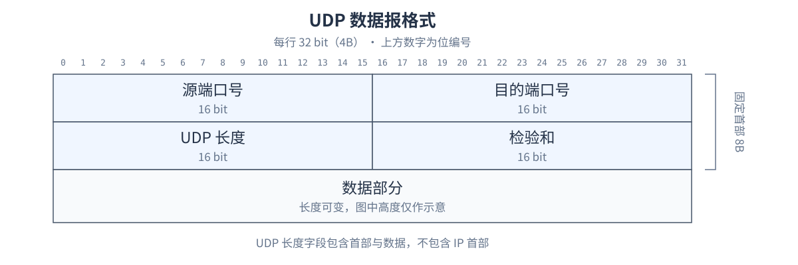
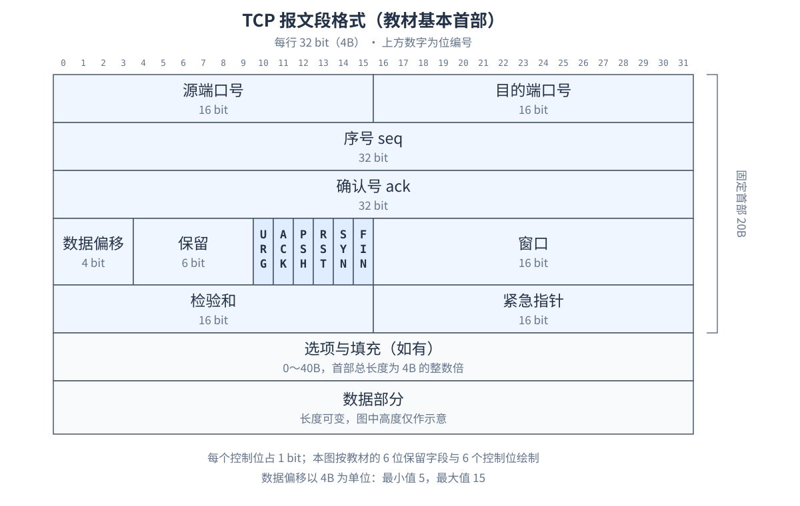
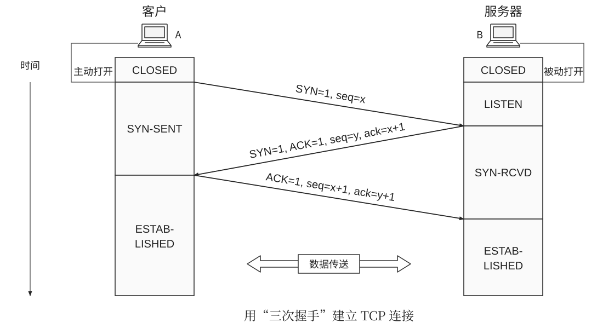
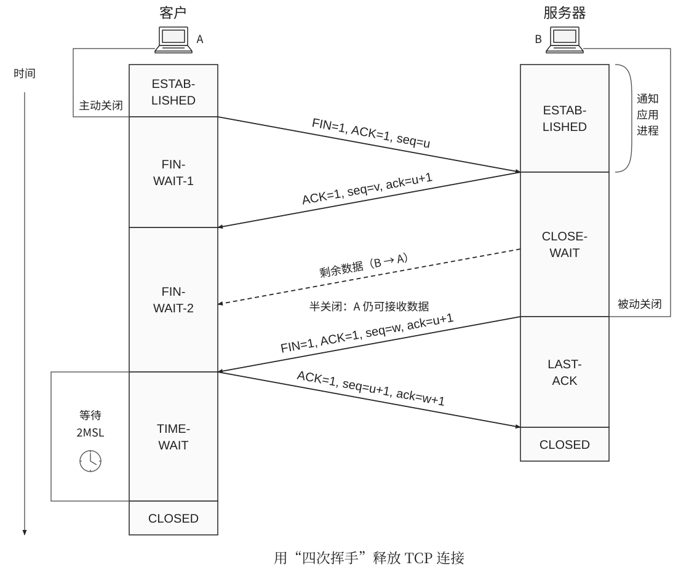
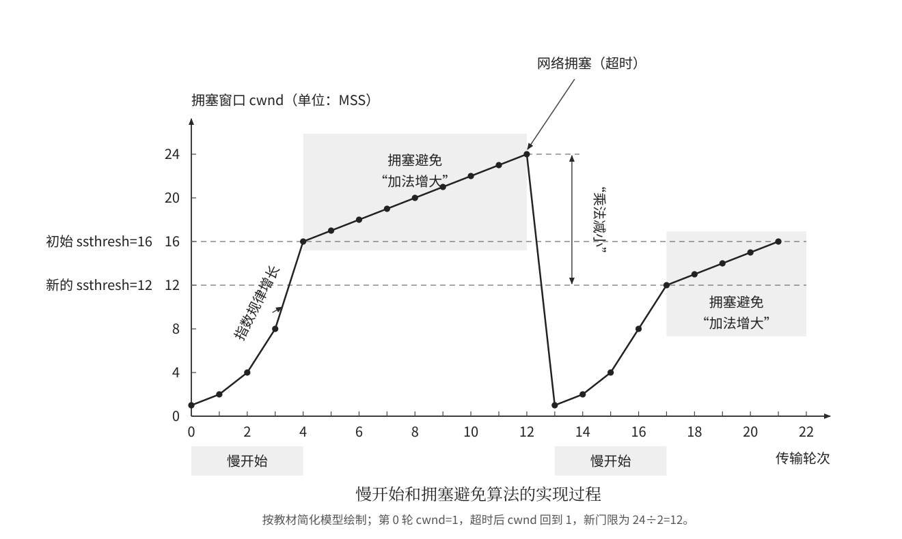
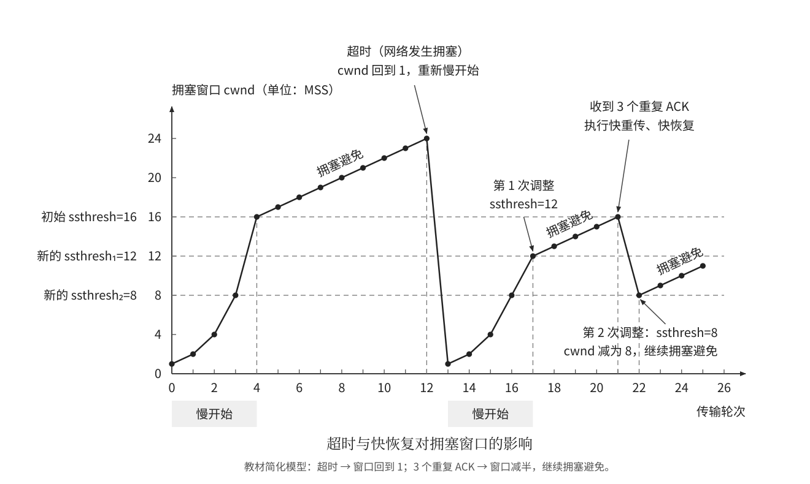
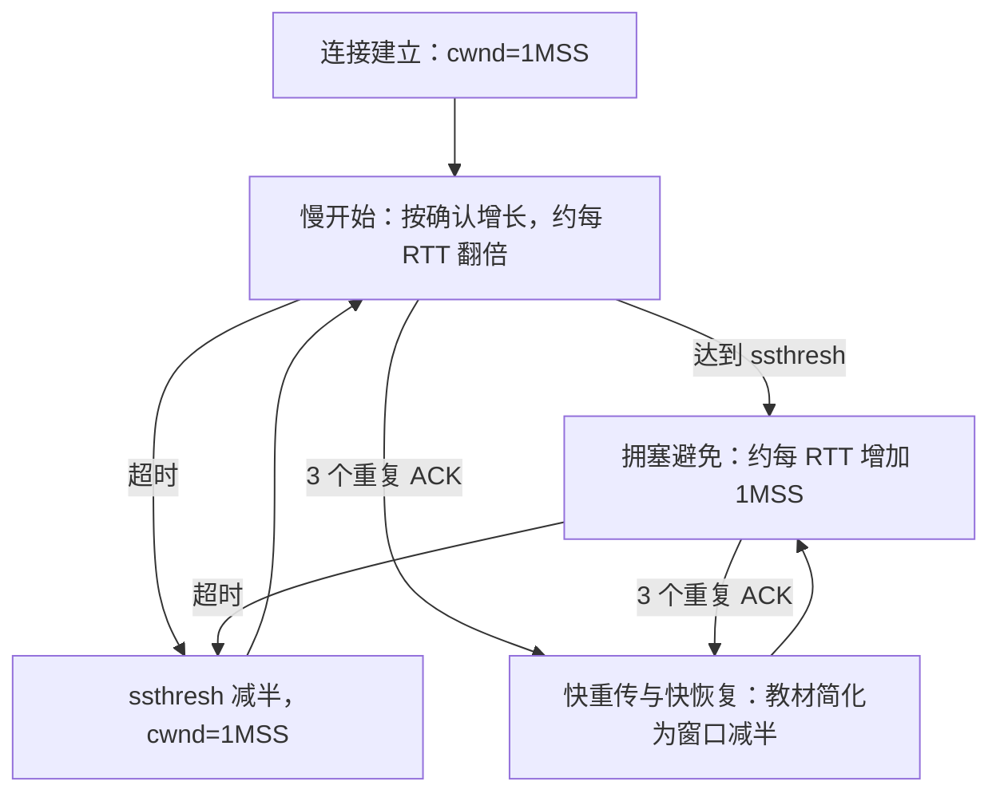

# 第 5 章 传输层

## 5.1 传输层提供的服务

### 5.1.1 传输层的功能与通信范围

传输层位于网络层之上、应用层之下，为运行在不同主机上的**应用进程提供逻辑通信** 。网络层解决分组如何到达目的主机，传输层进一步解决数据应交给该主机上的哪个应用进程。

| 层次       | 通信范围             | 主要寻址依据         | 典型数据单位           |
| ---------- | -------------------- | -------------------- | ---------------------- |
| 数据链路层 | 一段链路上的相邻节点 | MAC 地址等链路层地址 | 帧                     |
| 网络层     | 主机到主机           | IP 地址              | IP 数据报、分组        |
| 传输层     | 应用进程到应用进程   | 端口号，结合 IP 地址 | TCP 报文段、UDP 数据报 |

传输层主要有以下功能：

1. **端到端的逻辑通信** ：向应用进程屏蔽网络拓扑、路由和底层链路的差异。
2. **复用（发送方）与分用（接收方）** ：复用是发送方让多个应用进程共享传输服务；分用是接收方根据端口号等信息，把收到的数据交给对应的应用进程。
3. **差错检测** ：TCP、UDP 都能检查首部和数据部分，而 IPv4 首部检验和只检查 IP 首部。
4. **提供不同的传输服务** ：TCP 提供可靠的、面向连接的服务；UDP 提供无连接、尽最大努力交付的服务。

网络层与传输层的复用不要混淆：IP 根据“协议”字段把负载交给 TCP 或 UDP，传输层再结合端口等信息分用到应用进程。承载 TCP、UDP 时，**IPv4 首部的协议字段** 取值如下：

| 协议 | 协议字段的值 |
| ---- | ------------ |
| TCP  | 6            |
| UDP  | 17           |

这里的 **6、17 是 IP 协议号，不是 TCP、UDP 的端口号** 。

传输层的“逻辑连接”是端系统协议实体之间的关系，不表示沿途路由器建立了一条专用物理线路。普通路由器转发 IP 分组时，主要处理网络层及以下各层。

### 5.1.2 端口与端口号

**端口是传输层向应用层提供服务的逻辑接口。** 应用进程通过端口发送、接收数据；它与交换机、路由器上的物理接口不是同一概念。

端口号占 **16 位** ，取值为 $0\sim65535$。端口号具有本地主机范围内的意义，单独一个端口号不能唯一标识互联网中的进程。

| 分类                   | 范围         | 用途                              |
| ---------------------- | ------------ | --------------------------------- |
| 熟知端口号（系统端口） | 0～1023      | 为常见服务规定端口，如 HTTP 的 80 |
| 登记端口号（用户端口） | 1024～49151  | 为特定应用登记使用                |
| 动态端口号、短暂端口号 | 49152～65535 | 教材中供客户端临时使用的端口范围  |

实际操作系统的临时端口分配范围可以配置，做题按题干或教材给定范围判断。

**TCP 与 UDP 分别管理各自的端口空间。** 同一台主机可以同时使用 TCP 53 和 UDP 53；不能因为数值相同就认为两者发生冲突。

| 应用或协议   | 常见服务器端口 | 传输层协议                     |
| ------------ | -------------- | ------------------------------ |
| FTP 控制连接 | 21             | TCP                            |
| FTP 数据连接 | 20             | TCP，传统主动模式的服务器端口  |
| TELNET       | 23             | TCP                            |
| SMTP         | 25             | TCP，教材中的邮件传输端口      |
| DNS          | 53             | 常规查询常用 UDP，也支持 TCP   |
| TFTP         | 69             | UDP                            |
| HTTP         | 80             | TCP，按本章 HTTP/1.0、1.1 模型 |
| POP3         | 110            | TCP                            |
| IMAP         | 143            | TCP                            |
| SNMP         | 161            | UDP，常见查询端口              |

DHCP 使用 UDP，服务器端口为 **67** ，客户端端口为 **68** ；RIP 使用 UDP **520** 。端口表描述常用约定，具体题目指定其他端口时，以题目为准。

### 5.1.3 套接字与连接的标识

教材中常把一个通信端点写成：

$$
\text{套接字 Socket}=(\text{IP 地址},\text{端口号})
$$

一条 TCP 连接由两个端点共同确定，通常用四元组表示：

$$
(\text{源 IP},\text{源端口},\text{目的 IP},\text{目的端口})
$$

例：客户端 `192.0.2.10:50001` 访问服务器 `198.51.100.20:80`，另一个客户端可通过同一服务器的 80 端口建立另一条连接。**服务器端口相同，不等于 TCP 连接相同。**

若同时讨论不同传输层协议，还需区分 TCP、UDP，可写成含协议的五元组。操作系统中的 Socket 也是编程接口及相关对象的名称，做题时应结合语境理解。

### 5.1.4 无连接服务与面向连接服务

| 比较项             | UDP                          | TCP                              |
| ------------------ | ---------------------------- | -------------------------------- |
| 连接建立           | 不需要                       | 先建立连接，结束后释放           |
| 可靠性             | 尽最大努力交付               | 可靠、按序交付字节流             |
| 数据组织           | 面向报文，保留报文边界       | 面向字节流，不保留应用报文边界   |
| 通信方式           | 支持单播、多播和广播等       | 每条连接只有两个端点，支持全双工 |
| 首部长度           | 固定 8B                      | 最小 20B，最大 60B               |
| 流量控制、拥塞控制 | 协议本身不提供               | 提供                             |
| 常见应用           | DNS、DHCP、RIP、实时多媒体等 | 文件传输、邮件、传统 Web 等      |

UDP 接收方发现检验和差错时通常丢弃数据报，**UDP 本身不通过确认、重传补回丢失的数据** 。应用可以在 UDP 之上自行实现可靠性机制。

TCP 的可靠性不代表永远不会失败；它通过编号、确认、重传等机制实现可靠传输，在无法继续通信时会向应用报告连接异常。

## 5.2 UDP

### 5.2.1 UDP 数据报与面向报文

UDP 在 IP 的数据报服务之上主要增加**复用、分用和差错检测** 。其首部简单，无需握手，也无需维护 TCP 那样的连接状态。

“面向报文”表示：应用交给 UDP 的一份报文，由 UDP 添加首部后作为一份 UDP 数据报交给 IP；UDP 不为了形成连续字节流而拆分、合并应用报文。

**UDP 保留报文边界，不表示底层绝不分片。** 数据报过大时，IPv4 层仍可能分片；接收主机先完成 IP 重组，才向 UDP 提交完整数据报。

- 报文过长：可能引发 IP 分片，一片丢失就可能使整份 UDP 数据报无法交付。
- 报文过短：UDP、IP 等首部开销占比较大。
- 没有拥塞控制：UDP 不会像 TCP 那样自动按拥塞窗口调节发送量，但网络拥塞仍会导致排队、丢包和时延增大。

### 5.2.2 UDP 首部格式



| 字段       | 长度 | 含义                                       |
| ---------- | ---- | ------------------------------------------ |
| 源端口号   | 2B   | 标识发送端口，不使用时可填 0               |
| 目的端口号 | 2B   | 标识接收端口                               |
| 长度       | 2B   | **UDP 首部与数据部分的总长度** ，最小为 8B |
| 检验和     | 2B   | 用于检测 UDP 首部、数据及伪首部涉及的信息  |

收到数据后，UDP 根据目的端口等信息交给对应应用。若目的端口无人接收，在满足 ICMP 发送条件时，主机可返回 **ICMP 目的不可达中的端口不可达** 报文；不能说由 UDP 返回一个“UDP 差错报文”。

### 5.2.3 UDP 检验和与伪首部

在 IPv4 场景中，计算 UDP 检验和时，在 UDP 首部前临时加入 **12B 伪首部** ：

| 字段         | 长度 | 内容               |
| ------------ | ---- | ------------------ |
| 源 IP 地址   | 4B   | 发送方 IPv4 地址   |
| 目的 IP 地址 | 4B   | 接收方 IPv4 地址   |
| 全 0 字段    | 1B   | 0                  |
| 协议字段     | 1B   | 17，表示 UDP       |
| UDP 长度     | 2B   | UDP 首部与数据之和 |

**伪首部只参与检验和计算，不是 UDP 真正发送的首部，不计入 UDP 长度。** 它使检验和还能覆盖 IP 地址、协议号等信息，有助于检测误投递。

发送方计算过程：

1. 把 UDP 首部中的检验和字段置 0。
2. 将伪首部、UDP 首部、UDP 数据按顺序组成待计算内容。
3. 若数据部分为奇数字节，在末尾临时补一个全 0 字节，仅用于计算。
4. 每 16 位为一组，进行**反码加法** ：最高位产生的进位回卷到最低位继续相加。
5. 对最终结果逐位取反，写入检验和字段。

接收方对相同内容及收到的检验和求反码和；结果全为 1 时表示**未检测出差错** 。等价做法是再取反，检查是否全为 0。检验通过不代表绝对不存在漏检。

例：仅演示反码加法，两个 16 位字分别为 `0xFFFF`、`0x0001`：

```text
普通相加：0xFFFF + 0x0001 = 0x10000
进位回卷：0x0000 + 1      = 0x0001
逐位取反：~0x0001         = 0xFFFE
```

在 IPv4 中，UDP 检验和字段全 0 表示未启用检验和；若计算得到的检验和恰为全 0，则发送为全 1。IPv6 中普通 UDP 通信要求使用检验和，伪首部格式也与 IPv4 不同。

### 5.2.4 UDP 与 IPv4 分片计算

例：应用数据为 **8200B** ，UDP 首部 8B，IPv4 首部 20B，链路 MTU 为 1500B，无 IP 选项。

原始 UDP 数据报长 $8200+8=8208\text{B}$，原始 IP 总长度为 $8208+20=8228\text{B}$。每个非末片的 IP 数据部分最多为：

$$
\left\lfloor\frac{1500-20}{8}\right\rfloor\times8=1480\text{B}
$$

| 分片 | IP 数据部分 | IP 总长度 | 片偏移，单位为 8B | MF  |
| ---- | ----------- | --------- | ----------------- | --- |
| 1    | 1480B       | 1500B     | 0                 | 1   |
| 2    | 1480B       | 1500B     | 185               | 1   |
| 3    | 1480B       | 1500B     | 370               | 1   |
| 4    | 1480B       | 1500B     | 555               | 1   |
| 5    | 1480B       | 1500B     | 740               | 1   |
| 6    | 808B        | 828B      | 925               | 0   |

**UDP 首部只出现在第一片的 IP 数据部分开头。** 每个分片都有自己的 IP 首部，但不会各自重新添加一份 UDP 首部。片偏移从原始 IP 数据部分起点计算，不能把 IP 首部计入。

## 5.3 TCP

### 5.3.1 TCP 的主要特点

TCP 在不可靠的 IP 服务之上提供可靠传输，主要特点为：

- **面向连接** ：先建立连接，再传送数据，最后释放连接。
- **点对点** ：一条 TCP 连接只有两个端点，不提供广播、多播服务。
- **可靠交付** ：正常通信时向应用按序交付、不重复交付字节。
- **全双工** ：双方都能发送和接收，各自有发送缓存、接收缓存。
- **面向字节流** ：把应用数据看成连续字节序列，每个字节按序编号。

应用连续写入 100B、200B，TCP 可以合并后发送；一次写入的 300B，也可分成多个报文段。**应用写入次数、TCP 报文段数、接收应用读取次数之间没有一一对应关系。** 应用需要自行规定消息边界，例如使用长度字段或分隔符。

TCP 报文段长度受 MSS、可用发送窗口、当前缓存数据量等共同影响，不由应用每次写入的报文长度直接决定。

### 5.3.2 TCP 报文段首部



上图按教材基本首部的字段位宽绘制，保留字段为 6 位，URG、ACK、PSH、RST、SYN、FIN 各占 1 位；固定首部共 **20B** ，选项与填充最多 40B，首部总长度为 4B 的整数倍。选项与数据部分的高度仅作示意。

| 字段         | 长度   | 含义与考点                                      |
| ------------ | ------ | ----------------------------------------------- |
| 源、目的端口 | 各 2B  | 标识两端应用使用的端口                          |
| 序号 seq     | 4B     | 本报文段中第一个数据字节的序号                  |
| 确认号 ack   | 4B     | **期望收到对方下一个字节的序号** ，ACK=1 时有效 |
| 数据偏移     | 4 位   | 首部长度，单位 **4B** ，最小 5、最大 15         |
| 窗口         | 2B     | 本端通告的接收窗口，基本首部中以字节计          |
| 检验和       | 2B     | 检测 TCP 首部、数据及伪首部涉及的信息，必须使用 |
| 紧急指针     | 2B     | URG=1 时有效，与序号配合指出紧急数据的边界      |
| 选项与填充   | 0～40B | 如 MSS、窗口扩大、时间戳、选择确认等            |

教材常考的六个控制位如下；现代 TCP 还定义了其他控制位，基本题按给定首部判断。

| 标志位 | 作用与注意点                                         |
| ------ | ---------------------------------------------------- |
| URG    | 紧急指针有效                                         |
| ACK    | 确认号字段有效；连接建立后的报文段通常都置 ACK=1     |
| PSH    | 请求接收端尽快把数据交给应用，不必等缓存积累更多数据 |
| RST    | 复位连接，可用于异常终止或拒绝无效连接请求           |
| SYN    | 同步序号，用于连接建立                               |
| FIN    | 发送方声明本方向的数据发送结束，用于连接释放         |

**ACK 是标志位，ack 是确认号数值，两者不要混用。** ACK=1 不表示“确认号等于 1”，也不表示该报文段不能携带数据。

### 5.3.3 MSS、MTU 与首部长度计算

**MTU 是链路可承载的最大网络层分组长度，MSS 是一个 TCP 报文段中数据部分的最大长度。** MSS 不包括 TCP、IP 首部。

在题目不含额外封装、IPv4 无选项、TCP 无选项时：

$$
\text{MSS}=\text{MTU}-20-20
$$

以 MTU=1500B 为例，MSS 可为 1460B。若题目给出选项，应按实际首部长度扣除；TCP 数据偏移为 8 时，TCP 首部长 $8\times4=32\text{B}$。

MSS 选项在连接建立时通告本端愿意接收的最大 TCP 数据长度。两个方向分别通告，不能把 MSS 理解为整个连接固定且必然相同的发送长度。

### 5.3.4 序号与累计确认

TCP 的两个方向有**各自独立的序号空间** ，序号按模 $2^{32}$ 循环。普通数据报文段的 seq 表示该段第一个数据字节的序号。

若 A 发送 `seq=1001`、数据长度 300B，则数据字节编号为 $1001\sim1300$。B 连续正确接收这些数据后，返回 `ack=1301`。

$$
\text{后继数据序号}=\text{本段 seq}+\text{数据长度}
$$

对包含 SYN、FIN 的报文段，还应计入它们占用的序号：

$$
\text{后继序号}=\text{seq}+\text{数据长度}+\mathbf{1}_{\mathrm{SYN}}+\mathbf{1}_{\mathrm{FIN}}
$$

| 内容                 | 是否占用序号空间 |
| -------------------- | ---------------- |
| 每个数据字节         | 占用 1 个序号    |
| SYN，即使不携带数据  | 占用 1 个序号    |
| FIN，即使不携带数据  | 占用 1 个序号    |
| 不携带数据的普通 ACK | 不占用序号       |

**ack=N 表示 N 之前的所有字节均已连续收到，下一步期望 N。** 它不是“最后收到的字节编号”，也不是“本次收到的数据长度”。

例：B 先收到 $1001\sim1300$，丢失 $1301\sim1600$，又收到 $1601\sim1900$。在基本累计确认模型中，B 仍确认 `ack=1301`；待缺失部分补齐，若后续数据已缓存，就可直接确认 `ack=1901`。

接收方可以缓存失序数据，但只有补齐前面的空缺后，才能把后续字节按序交付应用。若题目给出 SACK，选择确认信息可额外说明哪些后续区间已经收到。

### 5.3.5 TCP 连接建立：三次握手

设客户端 A 的初始序号为 $x$，服务器 B 的初始序号为 $y$。B 先进入 LISTEN，A 主动打开连接。



| 次数 | 发送方向 | 核心内容                | 序号规则                         |
| ---- | -------- | ----------------------- | -------------------------------- |
| 1    | A→B      | 请求建立连接，SYN=1     | SYN 消耗 x，不能携带普通应用数据 |
| 2    | B→A      | 同意连接并确认 A 的 SYN | SYN 消耗 y，ack=x+1              |
| 3    | A→B      | 确认 B 的 SYN，ACK=1    | seq=x+1，ack=y+1，可携带数据     |

若第三次握手不带数据，它本身不再消耗序号，A 后续第一个数据字节的序号仍为 $x+1$。

三次握手用于确认双方的发送、接收能力，同步两个方向的初始序号，并协商有关参数。第三次握手还能避免服务器仅因一个滞留的旧 SYN 就把连接当作已经建立。

在忽略处理时延、链路对称、无丢包的简化模型中，从 A 发出 SYN 开始，A 在 **1RTT** 后可发送第三次握手及数据，B 在 **1.5RTT** 后收到它。不要把“客户端可发数据的时刻”与“服务器收到数据的时刻”混为一谈。

### 5.3.6 TCP 连接释放：四次挥手

TCP 是全双工的，两个方向分别关闭。设 A 先主动关闭，A 下一发送序号为 $u$；B 此时的发送序号为 $v$，之后可能继续发送数据，最终 FIN 的序号为 $w$。



A 发出 FIN 后，表示 **A→B 方向不再发送数据** ，不代表 B→A 也立即停止。B 确认后仍可继续发送尚未完成的数据，此时为半关闭状态。

FIN 占用一个序号；普通纯 ACK 不占用序号。因此 B 对 A 的 FIN 确认为 $u+1$，A 对 B 的 FIN 确认为 $w+1$。若 B 不再发送剩余数据，第二次确认与第三次 FIN 可以合并，释放过程未必恰好有四个独立报文段。

主动关闭方等待 **2MSL** 的主要目的：

1. 若最后的 ACK 丢失，B 可重传 FIN，A 仍能再次确认，使 B 正常关闭。
2. 让旧连接中滞留的报文段从网络中消失，减少它们对后续同端点连接的干扰。

MSL 为最长报文段寿命，**不是 RTT** 。若 TIME-WAIT 中再次收到需要确认的重传 FIN，会重新等待相应的 2MSL。一般是主动关闭方进入 TIME-WAIT；同时关闭时应按各自状态转移分析。

若题目假设 B 收到 A 的 FIN 后立即发送自己的 FIN、两个方向的单程时延均为 0.5RTT、无丢包且忽略处理时间，则从 A 发出第一个 FIN 起：A 在 1RTT 后发出最终 ACK 并开始 TIME-WAIT，B 在 1.5RTT 后收到最终 ACK 并关闭，A 在 **1RTT+2MSL** 后关闭。若 B 还需发送数据或等待应用关闭，则应额外计时。

### 5.3.7 TCP 可靠传输的实现

TCP 通过**检验和、字节编号、累计确认、重传以及滑动窗口** 协同实现可靠传输。发送方保留尚未确认的数据，收到累计确认后才能释放相应缓存并推进发送窗口左边界。

| 机制     | 解决的问题                                      |
| -------- | ----------------------------------------------- |
| 检验和   | 检测比特差错，错误数据不能作为正确数据交付      |
| 序号     | 确定字节位置，识别重复及失序数据                |
| 累计确认 | 告诉发送方当前连续收到哪里，允许捎带确认        |
| 超时重传 | 长时间没有确认时重新发送有关数据                |
| 快重传   | 根据重复 ACK 尽早判断缺失，不必等重传计时器超时 |
| 滑动窗口 | 允许连续发送多个报文段，提高链路利用率          |

**超时重传** ：重传计时器到期仍未收到相应确认，就重传未确认的数据。RTT 会随路径与负载变化，RTO 应根据 RTT 样本及其波动调整，不能固定认为 RTO=RTT。

常见估计写法为：

$$
\mathrm{RTO}=\mathrm{SRTT}+4\mathrm{RTTVAR}
$$

其中 SRTT 是平滑 RTT，RTTVAR 反映 RTT 偏差；实际算法还涉及计时粒度、上下界。发生超时后通常对 RTO 进行指数退避；重传报文段的确认存在归属歧义，不能随意把它作为新的 RTT 样本。计算题按题目给出的公式、初值和取样规则计算。

RTO 的完整计算与退避规则可参照 [RFC 6298](https://www.rfc-editor.org/rfc/rfc6298.html)。

**快重传** ：接收方发现序号空缺时发送指向缺口的重复 ACK。发送方收到 **3 个重复 ACK** 后，立即重传最早缺失的数据段。

```text
A 发送：段 1、段 2、段 3、段 4、段 5
B 收到：段 1，段 2 丢失，随后收到段 3、段 4、段 5
B 确认：首次确认段 1，再对段 3、4、5 各返回同一确认号
A 处理：收到 3 个重复 ACK，立即重传段 2
```

“3 个重复 ACK”不包含此前第一次出现该确认号的 ACK。累计确认丢失时，后续更大的累计确认可能覆盖它，所以**丢失一个 ACK 不一定触发重传** 。

TCP 采用累计确认，但不能据此直接套用“丢一段就必须把其后所有段全部重传”的 GBN 规则；接收缓存、快重传和 SACK 等都会影响实际重传行为。

### 5.3.8 TCP 流量控制与滑动窗口

**流量控制防止发送方发得过快，使接收方来不及接收和处理。** 接收方在 TCP 首部的窗口字段中通告接收窗口 rwnd，发送方据此限制未被确认的数据量。

窗口字段描述的是**发出该报文段的一方能接收多少数据** 。例如 B 发给 A 的 `rwnd=3000`，限制的是 A→B 方向的发送，而非 B→A 方向。

不考虑窗口扩大选项时，16 位窗口字段能直接表示的最大值为 $65535\text{B}$；使用窗口扩大选项后，可表示更大的接收窗口。

在忽略序号回绕的计算题中，若收到 `ack=N，rwnd=W`，对应的接收许可范围为：

$$
[N,\;N+W-1]
$$

已发送但未确认的数据也要占用发送窗口。若没有其他限制，则：

$$
\text{还能新发送的字节数}=\max(0,\;W-\text{已发送但未确认的字节数})
$$

例：B 返回 `ack=201，rwnd=300`，则许可字节为 $201\sim500$。若 A 已发送到 400，则 $201\sim400$ 的 200B 尚未被该确认覆盖，还能继续发送 $401\sim500$ 的 100B，不能重新发送 300B 新数据。

**累计确认推进左边界，窗口通告影响右边界。** 不能把收到 ACK 一概理解为“发送窗口一定整体向右移动同样长度”；接收方通告的窗口大小也可能变化。

下面沿用照片中的流量控制思路，设 A 已收到 B 的 `ack=1，rwnd=400`，之后 B 不再向 A 发送应用数据：

| B 发出的通告      | A 据此可发送的字节范围 | 说明                        |
| ----------------- | ---------------------- | --------------------------- |
| ack=1，rwnd=400   | 1～400                 | 初始许可 400B               |
| ack=201，rwnd=300 | 201～500               | 已确认 1～200，右边界为 500 |
| ack=501，rwnd=100 | 501～600               | 仅允许再容纳 100B           |
| ack=601，rwnd=0   | 暂停发送普通新数据     | 接收窗口已关闭              |

如果某一数据段丢失，即使接收方已经缓存后续数据，累计确认仍停留在第一个缺失字节处。

### 5.3.9 零窗口与持续计时器

**零窗口通知（Zero Window Advertisement）是 TCP 流量控制中的一种机制** ：接收方在报文段中通告接收窗口 `rwnd=0`，告诉发送方：“我的接收缓冲区满了，暂时别发数据了。”

发送方收到零窗口通知后，暂停普通新数据发送。待接收应用取走数据、缓存腾出空间，接收方可再通告非零窗口。

若这个**重新打开窗口的通知丢失** ，发送方可能一直等窗口更新，接收方又一直等新数据，形成等待。TCP 使用**持续计时器** 避免这种情况：

1. 发送方收到零窗口通告后，启动相应的持续计时机制。
2. 计时器到期，发送零窗口探测报文段。
3. 接收方返回确认，携带当前窗口值。
4. 窗口仍为 0 则继续探测；窗口已打开则恢复相应发送。

**持续计时器用于探测接收窗口，重传计时器用于处理未确认数据超时** ，二者目的不同。零窗口只限制一个方向，不能据此说整个 TCP 连接已经关闭。

#### TCP 四种主要计时器

| 计时器         | 作用                                | 触发情况                                                           |
| -------------- | ----------------------------------- | ------------------------------------------------------------------ |
| 重传计时器     | 超时重传尚未确认的报文段            | 发出需要确认的报文段后启动计时，到期仍未收到相应确认时重传         |
| 持续计时器     | 探测接收窗口，防止零窗口死锁        | 接收方通告 `rwnd=0`，发送方有待发送数据而需等待窗口重新打开        |
| 保活计时器     | 检测连接对端是否仍然存活            | 启用保活机制后，连接空闲达到规定时间，开始发送保活探测             |
| 时间等待计时器 | 保持 TIME-WAIT 状态，管理 2MSL 等待 | 通常由主动关闭方收到对端 FIN、发出最终 ACK 并进入 TIME-WAIT 时启动 |

保活通过空闲后的探测及响应判断连接情况；若连续多次探测没有响应，可按实现策略关闭连接。空闲时长、探测间隔和重试次数依实现与配置而定，**连接空闲不等于连接已经失效** 。

### 5.3.10 流量控制与拥塞控制

| 比较项 | 流量控制                 | 拥塞控制                       |
| ------ | ------------------------ | ------------------------------ |
| 目的   | 防止接收方来不及接收     | 防止网络负载超过承载能力       |
| 范围   | 端到端通信中的接收能力   | 网络中的链路、路由器及整体负载 |
| 依据   | 接收缓存、应用读取情况等 | ACK 反馈、丢包、超时等网络信号 |
| 变量   | 接收窗口 rwnd            | 拥塞窗口 cwnd                  |
| 调节者 | 接收方通告，发送方遵守   | 发送方维护并调整               |

发送窗口的上限同时受到两者约束：

$$
W=\min(\mathrm{rwnd},\mathrm{cwnd})
$$

因此，在基本字节窗口模型中：

$$
\text{可新发送量}=\max(0,\;\min(\mathrm{rwnd},\mathrm{cwnd})-\mathrm{FlightSize})
$$

FlightSize 表示已发送但尚未累计确认的数据量。做题要先统一单位：rwnd 常以字节给出，cwnd 有时以 MSS 个数给出，不能直接比较数值。

例：rwnd=6000B，cwnd=4MSS，MSS=1000B，已发未确认数据 2500B，则窗口上限为 4000B，当前还能新发送 $4000-2500=1500\text{B}$。

### 5.3.11 慢开始与拥塞避免

以下按照片与 408 常见题目的简化模型分析：**初始 cwnd=1MSS，rwnd 足够大，每段都及时确认，按传输轮次统计窗口** 。真实实现的初始窗口和 ACK 策略可能不同，题干有规定时优先按题干。

**慢开始** ：刚建立连接时不清楚网络承载能力，先少量发送，再根据确认逐步增加 cwnd。

- 教材基本模型中，每收到一个对新数据的确认，cwnd 增加 1MSS。
- 一个轮次内发出的数据均被确认后，cwnd 大致翻倍。
- 因而“慢开始”是初始窗口小，增长本身呈指数趋势，并非每轮只加 1。

**拥塞避免** ：达到慢开始门限 ssthresh 后，降低增长速度，理想模型中每经过一个 RTT，cwnd 增加约 1MSS，呈线性增长。

| cwnd 与 ssthresh 的关系 | 教材算法选择                 |
| ----------------------- | ---------------------------- |
| cwnd < ssthresh         | 慢开始                       |
| cwnd > ssthresh         | 拥塞避免                     |
| cwnd = ssthresh         | 教材允许任选，计算按题目约定 |

若初始 ssthresh=16MSS，常见轮次序列为：

```text
轮次：  1  2  3  4   5   6   7   8
cwnd：  1  2  4  8  16  17  18  19  （单位：MSS）
```

门限不是 2 的幂时要注意教材的截断约定。例如门限为 10MSS，通常按 `1→2→4→8→10→11…` 分析，不能直接从 8 跳到 16 而忽略门限。



图中横轴从**第 0 轮**开始编号，cwnd 以 MSS 为单位：第 4 轮达到初始门限 16，随后按轮次加 1；第 12 轮窗口为 24 时发生超时，新门限为 $24/2=12$，第 13 轮窗口降为 1，重新慢开始，到第 17 轮达到 12 后转入拥塞避免。**加法增大**表示拥塞避免阶段每轮约加 1MSS；**乘法减小**表示拥塞后把门限减为当时窗口的一半，超时后的 cwnd 则回到 1MSS。

### 5.3.12 超时、快重传与快恢复

**超时** 通常被当作较严重的拥塞信号。按本书简化模型，若发生超时时 cwnd=C，则：

$$
\mathrm{ssthresh}=\max(C/2,\;2\mathrm{MSS}),\qquad
\mathrm{cwnd}=1\mathrm{MSS}
$$

然后重新执行慢开始，达到新的门限后转入拥塞避免。门限取的是**拥塞发生时窗口的一半** ，不能减半旧的 ssthresh。

**快重传与快恢复** 利用 3 个重复 ACK 提前处理丢段。由于后续报文段仍能到达并产生重复 ACK，教材认为网络可能尚未严重拥塞，因此不必一律把 cwnd 降为 1。

| 事件         | 新 ssthresh               | 后续 cwnd，按教材简化模型 | 接着执行 |
| ------------ | ------------------------- | ------------------------- | -------- |
| 超时         | 原 cwnd 的一半，至少 2MSS | 1MSS                      | 慢开始   |
| 3 个重复 ACK | 原 cwnd 的一半，至少 2MSS | ssthresh                  | 拥塞避免 |

例：cwnd=24MSS 时超时，则 ssthresh=12MSS，cwnd=1MSS；之后按慢开始增长到 12MSS，再线性增长。若 cwnd=16MSS 时收到 3 个重复 ACK，则教材简化后的窗口为 8MSS，随后约每 RTT 增加 1MSS。



图中沿用从第 0 轮开始的编号：第 12 轮超时后，**第 1 次调整 ssthresh 为 12，并重新慢开始**；第 21 轮窗口为 16 时收到 3 个重复 ACK，**第 2 次调整 ssthresh 为 8，第 22 轮按简化模型使用 cwnd=8，并继续拥塞避免** 。

**完整 Reno 的快恢复过程与上表的简化画法有区别** ：收到第 3 个重复 ACK 后暂时置 `cwnd=ssthresh+3MSS`；收到覆盖恢复阶段相应新数据的确认后，再回落至 ssthresh。教材曲线常省略这一临时膨胀阶段，题目明确要求 Reno 细节时应按相应规则分析。

完整的快重传、快恢复规则可参照 [RFC 5681 §3.2](https://www.rfc-editor.org/rfc/rfc5681.html#section-3.2)。

严格算法中，门限计算与当时的在途数据量有关；408 简化题常假定 cwnd 已被充分使用，因而直接按 cwnd 减半。若题目另外给出在途数据量、取整规则或具体算法，不能机械套用简化表。



### 5.3.13 窗口、吞吐率与传输时间

当发送窗口为 W 字节、RTT 为 T 秒，忽略丢包及其他开销，窗口对吞吐率的限制约为：

$$
\text{吞吐率}\leq\frac{W}{T}\quad(\text{B/s})
$$

结合链路速率 R（bit/s），可写成理想上界：

$$
\text{吞吐率}\leq\min\left(R,\frac{8W}{T}\right)\quad(\text{bit/s})
$$

想持续填满一条链路，窗口通常至少应覆盖相应带宽时延积。若题目另计发送时延、ACK 长度、处理时延，则应画时间线，不能直接把上式当作精确结果。

例：MSS=1000B，初始 cwnd=1MSS，ssthresh=4MSS，rwnd 足够大，按轮次使用窗口 `1、2、4、5、6…`。要发送 18000B，即 18MSS：

| 轮次 | 本轮最多发送 | 累计最多发送 |
| ---- | ------------ | ------------ |
| 1    | 1MSS         | 1MSS         |
| 2    | 2MSS         | 3MSS         |
| 3    | 4MSS         | 7MSS         |
| 4    | 5MSS         | 12MSS        |
| 5    | 6MSS         | 18MSS        |

在每轮数据及确认于一个 RTT 内完成的理想模型中，从开始发数据到收到全部数据的确认需要 **5RTT** 。若从请求建立 TCP 连接计时，并允许第三次握手携带首批数据，则再计 1RTT，总计 **6RTT** 。若 RTT=10ms，平均应用数据速率为：

$$
\frac{18000\times8}{0.060}=2.4\times10^6\text{bit/s}=2.4\text{Mbit/s}
$$

**“最后一字节到达接收方”与“发送方收到最终确认”不是同一时刻。** 题目要求哪一种结束条件，就应把时间线画到哪一步。

### 5.3.14 TCP 计算题检查顺序

1. 区分 seq、ack、ACK 标志位，先确定两个方向的初始序号。
2. 确认长度是应用数据、TCP 报文段、IP 数据报还是完整帧的长度。
3. 算序号时按字节累计，额外计入 SYN、FIN；纯 ACK 不占序号。
4. 用累计确认寻找第一个缺失字节，不按“最后收到哪个段”直接确认。
5. 将 rwnd、cwnd、MSS 换为同一单位，再扣除已发未确认数据。
6. 画拥塞窗口曲线前，确定初值、门限、超时或重复 ACK 事件，以及事件发生在哪一轮。
7. 计算时间前，明确是否包括 DNS、TCP 建连、数据发送、最终确认和连接释放。
8. 核对单位：1B=8bit；ms 换为 s；片偏移单位 8B，TCP 数据偏移单位 4B。
