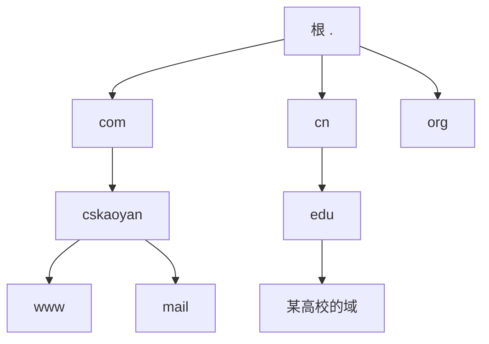
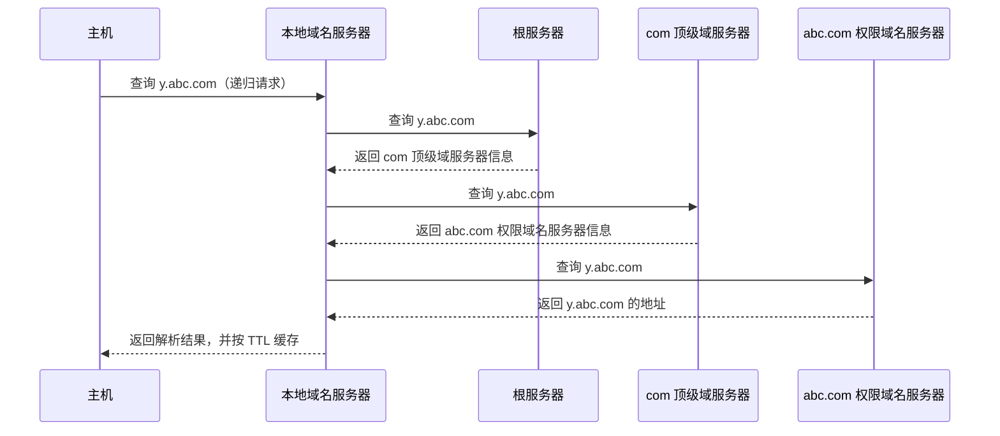
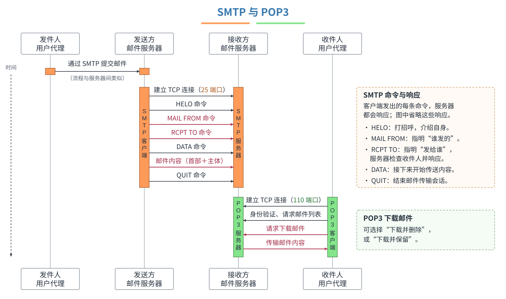
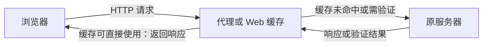

# 第 6 章 应用层

## 6.1 网络应用模型

### 6.1.1 应用层与应用层协议

应用层直接为用户的应用进程提供网络服务。**应用层协议规定进程之间交换哪些报文、报文的格式与含义，以及发送和响应报文的规则。** 浏览器、邮件客户端等应用程序使用协议完成通信，协议不等于应用程序本身。

应用进程通过传输层服务交换数据。典型网络应用模型有客户/服务器模型（C/S）和对等模型（P2P）。

### 6.1.2 客户/服务器模型 C/S

C/S 模型中，**客户是服务请求方，服务器是服务提供方** 。服务器先启动，监听约定的地址、端口；客户主动发出请求，服务器处理后返回结果。

从功能分工看，**客户通常面向用户，位于前端** ，负责用户交互、发起请求和展示结果；**服务器通常面向任务，位于后端** ，负责处理请求、执行业务逻辑和管理数据。

| 特征     | 说明                                                 |
| -------- | ---------------------------------------------------- |
| 角色分工 | 客户主动请求，服务器被动等待并处理请求               |
| 地址要求 | 客户需知道服务器地址；服务器不必预先知道所有客户地址 |
| 服务方式 | 一个服务器可并发服务多个客户                         |
| 管理方式 | 便于集中管理用户、权限和共享资源                     |
| 局限     | 服务器的计算能力、带宽可能成为瓶颈，故障可能影响服务 |

**客户主动请求服务，不表示服务器只能被动返回数据。** 在协议支持且通信通道已建立等条件下，服务器也可主动向客户端推送数据，用于消息通知、实时状态更新等，例如通过 WebSocket 推送新消息。应区分“谁发起服务请求或建立连接”和“谁发送数据”。

Web、FTP、电子邮件等常采用 C/S 模型。客户、服务器描述的是**某次通信中的进程角色** ，不能仅看硬件性能或计算机外形判断。

### 6.1.3 P2P 模型

P2P 模型中的节点可直接交换资源，不固定划分纯粹的客户与服务器。一个节点下载文件时是请求方，向其他节点上传文件时又是提供方。

| 比较项     | C/S                        | P2P                                  |
| ---------- | -------------------------- | ------------------------------------ |
| 服务提供者 | 主要由服务器提供           | 多个对等节点共同提供                 |
| 节点角色   | 请求方与提供方分工相对固定 | 同一节点可同时请求和提供服务         |
| 数据路径   | 常由服务器提供或中转       | 节点之间可直接传送                   |
| 扩展性     | 受服务器资源限制           | 新节点也可贡献存储、计算和上传带宽   |
| 健壮性     | 集中服务点故障可能影响较大 | 通常不因单个普通节点退出而整体失效   |
| 管理难度   | 较易统一管理               | 节点动态加入、退出，协调与管理更复杂 |

P2P 能减轻中心服务器压力，提高资源利用率，但也会消耗各节点的 CPU、内存、磁盘和网络带宽。**P2P 不代表绝对没有服务器** ：某些系统仍使用服务器完成目录、身份或节点发现，文件内容由节点直接交换。

**P2P 网络是在底层网络之上，由对等节点在应用层构成的逻辑网络（覆盖网络）** 。节点之间的逻辑连接表示应用进程之间的通信关系，不要求两台主机之间有直接的物理链路；实际数据仍可能经过多台路由器转发。因此，P2P 的应用层对等关系不等于底层路由器全互连，逻辑网络拓扑与物理网络拓扑应分别理解。

## 6.2 域名系统 DNS

### 6.2.1 DNS 的作用

DNS 是互联网使用的**分布式、层次化命名系统** 。用户使用易记的域名，解析器通过 DNS 获取与域名相关的资源记录，典型用途是把域名解析为 IP 地址。

**在 Internet 上提供访问的主机必须有 IP 地址，但不一定有域名。** IP 地址用于网络层寻址，域名便于用户记忆和使用；DNS 提供名称解析服务，拥有域名不是主机进行 IP 通信的必要条件。

域名与 IP 地址不是一一对应关系：一个域名可对应多个 IP，多个域名也可指向同一 IP。域名层次也不要求与 IP 地址的网络层次、主机物理位置一一对应。

DNS 属于**应用层** 。传统 DNS 使用服务器端口 **53** ，普通查询常用 UDP；TCP 也可用于 DNS，例如区域传送、某些较大响应或 UDP 响应截断后的重试。

### 6.2.2 层次域名空间

域名空间采用树状结构，根在最上层。域名由若干标号组成，以点 `.` 分隔；**越靠右层次越高** 。

以 `www.cskaoyan.com` 为例：

| 标号     | 所属层次 | 含义示例               |
| -------- | -------- | ---------------------- |
| com      | 顶级域名 | 通用顶级域             |
| cskaoyan | 二级域名 | com 之下的一个域       |
| www      | 三级标号 | 该域中的主机或服务名称 |

根用空标号表示，完整域名可写为 `www.cskaoyan.com.`，最后一个点通常省略。主机名不一定叫 `www`；`www` 也不是访问网页所必需的固定协议前缀。



域名命名的常见考点：

- 传统主机域名标号使用字母、数字和连字符，比较时不区分英文字母大小写。
- 单个标号最多 **63 个字节** ；完整域名的 DNS 线格式最多 255 字节，包含长度字节和根标号，不能简单等同于任意 255 个可见字符。
- 不同上级域下可以使用相同的下级标号，只要完整名称不同即可。
- 顶级域名包括国家和地区顶级域，如 `cn`、`us`；通用顶级域，如 `com`、`org`、`edu`、`net`；基础设施域，如反向解析使用的 `arpa`。

### 6.2.3 域名服务器与区

DNS 把域名空间的管理权逐级委派。**区（zone）是一个服务器实际负责、具有管理权限的域名空间范围** ，不一定等于某个域及其所有下级域；已被委派出去的子域可由其他服务器管理。

**同一 IP 子网中，不同主机的域名到 IP 地址映射可以由不同的权限域名服务器维护。** DNS 按域名空间划分管理范围，IP 子网按地址前缀划分，两者没有必然对应关系；同一 DNS 区内的域名也可指向不同 IP 子网中的主机。

**权限域名服务器又称权威域名服务器（authoritative name server）** ，两种名称指同一概念，本笔记统一使用“权限域名服务器”。

| 服务器类型     | 职责                                               |
| -------------- | -------------------------------------------------- |
| 根域名服务器   | 知道顶级域服务器信息，可指引查询到相应顶级域       |
| 顶级域名服务器 | 管理相应顶级域的委派信息，指引到下级权限域名服务器 |
| 权限域名服务器 | 对其负责的区给出权威记录，例如主机地址             |
| 本地域名服务器 | 接受主机解析请求，利用缓存或继续查询，返回解析结果 |

本地域名服务器又称默认域名服务器、递归解析器，常由 ISP、学校、企业或公共 DNS 服务提供。**本地域名服务器不是域名树中的一个固定层次** ，也不要求物理上位于本机所在局域网。

根服务器通常返回“下一步去问谁”，并非保存全球所有主机的完整 IP 映射。教材说的 13 个根服务器是 13 个逻辑标识，实际服务由分布在多地的众多实例提供。

常见资源记录可作如下区分：

| 记录类型 | 作用                         |
| -------- | ---------------------------- |
| A        | 域名对应的 IPv4 地址         |
| AAAA     | 域名对应的 IPv6 地址         |
| NS       | 指出域名服务器               |
| CNAME    | 域名别名指向另一个域名       |
| MX       | 指出接收某域邮件的邮件服务器 |
| PTR      | 反向解析中由地址查名称       |

### 6.2.4 递归查询与迭代查询

**递归查询：把后续解析任务交给被查询服务器。** 被查询者继续查询其他服务器，最后向请求者返回结果或失败信息。

**迭代查询：本次给出答案或下一步应查询的服务器信息。** 若未得到最终结果，请求者再自行向下一台服务器查询。

典型组合是：**主机向本地域名服务器递归查询，本地域名服务器向其他服务器迭代查询** 。

在这种典型方式下，**主机进行域名解析时，只需知道本地域名服务器的 IP 地址，无需预先知道根、顶级域或权限域名服务器的 IP 地址** 。主机把待解析域名交给本地域名服务器，由它利用缓存或继续查询获得结果。本地域名服务器的 IP 地址通常通过 DHCP 自动获取，也可手动配置。

**最终由客户端最初请求的本地域名服务器，把解析得到的 IP 地址返回给客户端。** 例如，权限域名服务器先把地址回答给本地域名服务器，再由本地域名服务器回答客户端。这里宜说“最初请求的服务器”；传统 DNS 普通查询常用 UDP，无需先建立连接。

例：无任何相关缓存，本地解析器查询 `y.abc.com`：



在该例的简化 UDP 模型中，共 **4 次查询、4 次回答，即 8 个 UDP 报文** 。其中主机与本地服务器是一问一答，本地服务器对外有三组查询与回答；并不是每次都必须执行完整的八报文流程。

若采用全递归示意模型，则后续查询可以由根、顶级域等逐级代为进行，答案再沿查询链返回。实际公共根服务通常不为普通客户承担完整递归解析，考试按题图给定方式分析。

### 6.2.5 DNS 缓存与查询时延

DNS 可缓存地址记录、域名服务器记录等，并用 **TTL** 控制缓存有效期。缓存减少查询报文数量、降低时延和上级服务器负担；记录到期后需要重新获取，避免长期使用旧映射。

- 主机已有有效缓存：可能无需发出 DNS 网络查询。
- 本地域名服务器已有最终答案：通常直接向主机回答。
- 缓存中已有相应顶级域或权限域名服务器信息：可跳过部分上级查询。

如果主机到本地域名服务器 RTT 为 $T_0$，本地服务器串行访问根、顶级域、权限域名服务器的 RTT 分别为 $T_1,T_2,T_3$，忽略报文发送和处理时间，则：

$$
T_{\mathrm{DNS}}=T_0+T_1+T_2+T_3
$$

已缓存的查询步骤不再计时。要区分题目说的是“主机到各 DNS 服务器的 RTT”还是“本地解析器到各服务器的 RTT”，不能不看拓扑直接相加。

DNS 的 TTL 是**记录缓存有效时间** ，IP 首部的 TTL 用于限制分组在网络中的存活，两者不是同一字段、同一机制。

## 6.3 文件传输协议 FTP

### 6.3.1 FTP 的工作原理

FTP 使用 **C/S 模型和 TCP** ，在不同硬件、操作系统的主机之间提供可靠的文件传输，并支持登录、目录操作、文件类型选择和访问权限管理等。

**FTP 允许客户指定文件的类型和格式** ，以适应不同系统间的数据表示差异。例如，文件类型可选择 ASCII 文本类型或二进制（图像）类型；文件格式涉及文本的格式控制方式。这些是传输时的数据表示约定，不能简单等同于文件扩展名。

| 传输类型         | 适用文件与处理方式                                                                                       |
| ---------------- | -------------------------------------------------------------------------------------------------------- |
| ASCII            | 适用于 ASCII 文本文件，可进行换行符等文本表示转换                                                        |
| Binary（二进制） | 图像、声音、视频等非文本文件应采用此类型，按原始字节传输，避免文本转换破坏数据；也可用于原样传输文本文件 |

**选择 ASCII 或 Binary 的依据是数据表示及是否需要文本转换，而非文件是否加密。** 加密文件应按二进制数据传输；含中文等非 ASCII 字符的文本，通常也采用 Binary 保留原始编码字节。

服务器先监听控制端口 21。客户发起连接后，服务器处理该客户的会话，并可继续接受其他客户；教材常用“主进程接受请求，从属进程处理会话”描述并发服务过程。

FTP 是**有状态协议** ：会话中需要维护登录身份、当前目录及传输参数等状态。匿名 FTP 允许按服务器规定的匿名身份访问公开文件，不表示任何文件都可任意读写。

### 6.3.2 控制连接与数据连接

FTP 使用两类独立 TCP 连接：

| 比较项       | 控制连接                       | 数据连接                            |
| ------------ | ------------------------------ | ----------------------------------- |
| 传输内容     | 登录、目录操作、传输命令与响应 | 文件内容、目录列表等数据            |
| 服务器端口   | 通常为 21                      | 主动模式常用 20，被动模式为协商端口 |
| 持续时间     | 通常贯穿整个 FTP 会话          | 通常按数据传输任务建立、结束后关闭  |
| 能否传输文件 | 不承担文件内容的传输           | 实际承担文件内容的传输              |

**文件传输结束，不等于控制连接同时关闭。** 同一个控制会话可先后执行多次文件传输。

**带外传送指控制信息和数据信息通过不同的通信连接分开传送。** FTP 采用带外传送：控制连接传送命令与响应，数据连接传送文件内容、目录列表等数据。这里“带外”指应用使用独立连接，不是 TCP 首部中的 URG 紧急机制。

### 6.3.3 主动模式 PORT 与被动模式 PASV

两种模式的控制连接均由客户主动连接服务器 21 端口；差别在于**谁主动建立数据连接** 。上传、下载的文件方向不能用于判断主动、被动模式。

| 比较项           | 主动模式 PORT                      | 被动模式 PASV                        |
| ---------------- | ---------------------------------- | ------------------------------------ |
| 提供监听数据端口 | 客户端                             | 服务器                               |
| 端口通知方式     | 客户通过 PORT 告知服务器           | 服务器通过 PASV 响应告知客户         |
| 数据连接发起方   | 服务器                             | 客户端                               |
| 服务器数据端口   | 教材传统模型为 20                  | 服务器临时选择并通告的端口           |
| 常见网络影响     | 客户侧 NAT、防火墙可能阻碍入站连接 | 客户主动建立两类连接，较易通过该限制 |

```text
控制连接：客户临时端口  ──主动连接──> 服务器 21

主动数据：客户监听端口  <──主动连接── 服务器 20
被动数据：客户临时端口  ──主动连接──> 服务器通告的数据端口
```

### 6.3.4 FTP 与远程文件访问

FTP 通常把远程文件传到本地再处理，修改后再上传。网络文件系统 NFS 等则允许应用按远程文件的指定位置进行读写，不必总是完整下载、上传整个文件。

**FTP 使用 TCP，TFTP 使用 UDP** ，两者不是同一个协议的两种端口配置。TFTP 的常见服务器端口为 69。

## 6.4 电子邮件

### 6.4.1 电子邮件系统的组成

电子邮件采用**异步通信、存储转发** 的方式。发送方把邮件交给邮件服务器，邮件到达接收方服务器后存入邮箱；收件人可稍后读取，通信双方不必同时在线。

电子邮件系统主要由**用户代理、邮件服务器和邮件协议** 组成。

| 组成        | 作用                                             |
| ----------- | ------------------------------------------------ |
| 用户代理 UA | 为用户提供撰写、显示、处理和发送邮件等功能       |
| 邮件服务器  | 接收、转发邮件，维护发送队列与收件人的邮箱       |
| 邮件协议    | SMTP 负责提交、传输；POP3、IMAP 负责访问收件邮箱 |


同一邮件服务器在向别处发送邮件时是 SMTP 客户，在接收邮件时又是 SMTP 服务器。这里的“客户、服务器”依某次 TCP 通信的角色而定。

**SMTP 是推送协议，POP3 是拉取协议。** 前者由发送方发起把邮件交给接收端，后者由读取邮件的用户代理发起请求。

### 6.4.2 邮件地址、信封、首部与主体

邮件地址的基本形式为：

```text
本地邮箱名@邮件域名
例如：alice@example.com
```

`example.com` 表示邮箱所属的邮件域，具体接收该域邮件的服务器可通过 DNS 的 **MX 记录** 确定，再查询该服务器名称对应的地址。

电子邮件分为**信封与内容** 。邮件内容又分为首部与主体，两者之间使用一个空行分隔。

```text
From: alice@example.com
To: bob@example.net
Subject: Study notes

Here are today's notes.
```

| 部分     | 作用                                               |
| -------- | -------------------------------------------------- |
| 信封     | 邮件传递所需信息，如 SMTP 的信封发件人与信封收件人 |
| 内容首部 | 描述发件人、收件人、主题等，常见 From、To、Subject |
| 内容主体 | 实际文字、附件等内容                               |

SMTP 的 `MAIL FROM`、`RCPT TO` 是协议命令，不是邮件内容首部中的 `From:`、`To:` 字段；二者用途相关，但不能当成同一字段。

### 6.4.3 MIME：多用途互联网邮件扩展

传统 SMTP 以 **7 位 ASCII** 邮件传输为基本模型，直接承载非 ASCII 文字、图像、音频和视频存在限制。MIME 规定内容类型、组织方式和编码方法，使这些内容能够通过邮件系统传递。

MIME 主要扩展：

1. 增加内容首部字段，说明 MIME 版本、内容类型、编码方法等。
2. 定义多种内容格式，支持文字、图像、音频、视频及多部分邮件。
3. 定义传输编码方法，把有关内容编码为适合传输的形式，接收方再还原。

| 常见 MIME 字段            | 作用                                    |
| ------------------------- | --------------------------------------- |
| MIME-Version              | 说明使用的 MIME 版本                    |
| Content-Type              | 说明内容类型，如 text/plain、image/jpeg |
| Content-Transfer-Encoding | 说明传输编码，如 base64                 |
| Content-ID                | 标识某一内容实体                        |
| Content-Description       | 对内容作文字描述                        |

多部分邮件可使用 `multipart` 与边界标记组织正文和附件。**MIME 扩展邮件内容的表示方式，并不替代 SMTP 负责邮件传输；Base64 编码也不等于加密。**

### 6.4.4 SMTP 的工作过程

SMTP 使用 **TCP** 。教材中服务器的熟知端口为 **25** ，过程分为连接建立、邮件传送、连接释放三个阶段。

这里 SMTP 的“连接建立、释放”包括应用层问答，不能与底层 TCP 三次握手、四次挥手混为一谈。SMTP 命令必须先有可用的 TCP 连接。

| 阶段       | 常见命令或响应                | 含义                       |
| ---------- | ----------------------------- | -------------------------- |
| 建立会话   | 220，HELO 或 EHLO，250        | 服务就绪，发送方介绍自身   |
| 指定发件人 | MAIL FROM:<alice@example.com> | 给出信封发件人             |
| 指定收件人 | RCPT TO:<bob@example.net>     | 给出信封收件人，可重复多次 |
| 发送内容   | DATA，服务器返回 354          | 准备接收邮件内容           |
| 内容结束   | 单独一行的点，即 CRLF.CRLF    | 标志邮件数据结束           |
| 结束会话   | QUIT，服务器返回 221          | 结束 SMTP 会话             |



`RCPT TO` 允许在发送大段内容前处理收件人是否可接受的问题，例如服务器可返回 550 拒绝；某次返回 250 表示该阶段接受，并不保证用户已阅读或之后绝无投递故障。

SMTP 负责把邮件交给邮件服务器，**不负责收件人从自己的邮箱中读取邮件** 。一次 TCP 会话也可以按协议流程传送多封邮件，无需每封都重新建立连接。

### 6.4.5 POP3 与 IMAP

POP3 是邮局协议的第 3 版，使用 **TCP 110** 。用户代理连接邮件服务器并认证后，读取邮箱中的邮件。

POP3 常见使用方式包括：

- **下载并保留** ：邮件下载到本地，服务器仍保留副本。
- **下载并删除** ：邮件下载后，按会话中的删除操作从服务器移除。

不能认为 POP3 只要成功读取邮件就必然立即删除。其基本工作方式较简单，远程文件夹和多设备状态同步能力较弱。

IMAP 使用 **TCP 143** ，强调在服务器上管理邮箱，支持文件夹、邮件状态同步、搜索及选择性获取内容。例如可以先读首部，或只获取某个 MIME 部分，不必先下载大附件。

| 比较项   | SMTP                 | POP3               | IMAP                     |
| -------- | -------------------- | ------------------ | ------------------------ |
| 主要用途 | 提交、传输邮件       | 从服务器读取邮件   | 访问、同步和管理远程邮箱 |
| 常见端口 | TCP 25               | TCP 110            | TCP 143                  |
| 基本动作 | 推送                 | 拉取               | 远程访问与同步           |
| 内容处理 | 将邮件交给接收服务器 | 常按邮件下载到本地 | 可选择部分内容获取       |

上表是教材中的基本端口约定，实际加密访问和邮件提交服务还可使用其他端口，题目有规定时按题目判断。

### 6.4.6 基于 Web 的电子邮件

使用浏览器收发邮件时，**浏览器与 Web 邮件服务之间使用 HTTP/HTTPS** ；不同邮件服务器之间的邮件传递仍通常使用 SMTP。

```text
发件人浏览器 ──HTTP/HTTPS──> Web 邮件服务
                                │
                              SMTP
                                ↓
收件人浏览器 <──HTTP/HTTPS── 接收方 Web 邮件服务
```

因此，“发送邮件一定由用户的浏览器直接运行 SMTP”“浏览器读取邮件一定使用 POP3”都不能成立，要先看当前是哪两个实体之间的通信。

## 6.5 万维网 WWW 与 HTTP

### 6.5.1 万维网的概念与组成

万维网 WWW 是运行在互联网上的分布式信息系统，用超链接把资源联系起来，采用 C/S 模型：浏览器请求资源，Web 服务器返回资源。

**互联网是底层互连网络，万维网是其上的一种应用。** 电子邮件、FTP 等也使用互联网，但不因此都属于 WWW。

| 技术 | 作用                                        |
| ---- | ------------------------------------------- |
| URL  | 统一资源定位符，指出资源的位置和访问方式    |
| HTTP | 规定浏览器与 Web 服务器请求、响应资源的规则 |
| HTML | 超文本标记语言，描述网页内容结构及链接等    |

一个 Web 页面常由**基本 HTML 文件和若干引用对象** 构成，如图像、样式表、脚本等。获取基本 HTML 不等于已经获取整个页面，引用对象通常还要另外请求。

### 6.5.2 URL 的结构

常见 URL 可表示为：

```text
协议方案://主机名:端口/路径?查询参数#片段
例如：https://www.example.com:443/notes/index.html?chapter=6#http
```

| 部分     | 示例              | 含义                         |
| -------- | ----------------- | ---------------------------- |
| 协议方案 | https             | 使用何种访问方式             |
| 主机名   | `www.example.com` | 提供资源的主机名称           |
| 端口     | 443               | 访问的服务端口，可按默认省略 |
| 路径     | /notes/index.html | 资源路径                     |
| 查询     | chapter=6         | 传给服务的查询参数           |
| 片段     | http              | 客户端使用的资源内部位置     |

HTTP 的默认端口为 **80** ，HTTPS 的默认端口为 **443** 。主机名部分不区分大小写，但路径、查询参数是否区分大小写取决于相应规则或服务器，不能说整个 URL 都不区分大小写。

片段标识符通常由浏览器处理，不作为 HTTP 请求目标发送给服务器。

### 6.5.3 HTTP 的工作过程

以下按照片中的 **HTTP/1.0、HTTP/1.1 over TCP** 模型讨论。

1. 用户输入 URL 或单击超链接，浏览器确定协议、主机和资源路径。
2. 若没有可用地址缓存，先通过 DNS 解析主机名。
3. 若没有可复用连接，与服务器相应端口建立 TCP 连接。
4. 浏览器发送 HTTP 请求，如 `GET /index.html HTTP/1.1`。
5. 服务器返回 HTTP 响应，包括状态信息、首部及可能的资源内容。
6. 浏览器解析 HTML、显示内容，并按需继续请求引用对象。
7. 连接按协议和首部规定保留或关闭。

访问过程中还可能用到 ARP、DHCP、IP、链路层协议等，但不能认为每次请求网页都必然重新执行 DHCP、ARP 或 DNS，是否需要取决于地址配置和缓存状态。

HTTP/1.0、1.1 通过 TCP 获得可靠字节流服务；**HTTP 自身不靠重新实现 TCP 的序号、确认、重传保证底层可靠传输** 。其他 HTTP 版本的承载方式可能不同，不能把教材的 TCP 模型推广为所有版本的绝对规律。

### 6.5.4 HTTP 无状态与 Cookie

**HTTP 的无状态指协议不要求服务器为后续请求记住此前请求的会话状态。** 这与底层 TCP 是否保持连接是两个问题：持续连接仍可承载无状态的 HTTP 请求。

网站可使用 Cookie、会话数据库等识别用户：

1. 客户首次访问时，服务器生成有关标识或状态数据。
2. 服务器在响应首部中加入 `Set-Cookie`。
3. 浏览器按作用域等规则保存 Cookie。
4. 后续符合条件的请求带上 `Cookie` 首部，服务器据此关联会话。

Cookie 可以辅助登录状态、购物车、个性化内容等功能，但不能因此说 HTTP 协议变为 FTP 那样固有的会话状态模型。

### 6.5.5 非持续连接与持续连接

**非持续连接** ：典型情况下，每个对象都通过单独的 TCP 连接获取，传输完毕后关闭连接。HTTP/1.0 的基本模型采用这种方式。

**持续连接** ：同一 TCP 连接上可先后交换多组请求与响应，减少反复握手的开销。HTTP/1.1 默认使用持续连接，除非协议条件或 `Connection: close` 等要求关闭。

HTTP/1.1 的持续连接规则可参照 [RFC 9112 §9.3](https://www.rfc-editor.org/rfc/rfc9112.html#section-9.3)。

| 比较项       | 非持续连接                   | 持续连接                         |
| ------------ | ---------------------------- | -------------------------------- |
| TCP 连接复用 | 一个对象通常对应一条连接     | 同一连接可获取多个对象           |
| 建连开销     | 每个对象通常重新付出握手开销 | 首次建连后可复用                 |
| 并发方式     | 浏览器可建立多条并行连接     | 可串行请求，也可按模型使用流水线 |
| 典型教材模型 | HTTP/1.0                     | HTTP/1.1                         |

持续连接又分为：

- **非流水线** ：收到前一个响应后，才发送下一个请求。
- **流水线** ：无需等待前一响应即可连续发出多个请求；HTTP/1.1 中响应仍按请求顺序返回。

流水线不等于为每个对象建立一条并行 TCP 连接，也不等于 HTTP/2 的多路复用。

### 6.5.6 HTTP 页面访问时延计算

设客户端与服务器 RTT 为 T，忽略 DNS、HTTP 请求发送时间、服务器处理时间，并假定连接上没有额外 TCP 窗口或慢开始限制。

使用一条新 TCP 连接获取一个对象的基本时间为：

$$
T_{\text{一个对象}}=2T+t_{\mathrm{传输}}
$$

其中 1RTT 用于 TCP 建连，另 1RTT 用于请求到达服务器、响应开始到达客户；对象内容的发送时延另外计算。常假定第三次握手可携带 HTTP 请求，不另为纯 ACK 增加 1RTT。

若网页有 1 个基本 HTML 和 m 个引用对象，均在同一服务器，只有解析完 HTML 才知道引用对象，忽略对象传输时间：

| 访问方式                          | 理想总时延               |
| --------------------------------- | ------------------------ |
| 非持续连接，所有对象串行          | $2(m+1)T$                |
| 持续连接，非流水线                | $(m+2)T$                 |
| 持续连接，引用对象一次流水请求    | $3T$                     |
| 非持续连接，引用对象至多 p 路并行 | $2T+2\lceil m/p\rceil T$ |

这里流水线的 3RTT 分别为：TCP 建连 1RTT、获取 HTML 1RTT、发出全部引用对象请求并获得响应 1RTT。m=0 时只需获取 HTML，为 2RTT。

例：HTML 引用 3 幅图像，RTT=20ms，忽略所有对象传输时间：

- 非持续、串行：$2\times4\times20=160\text{ms}$。
- 持续、非流水线：$(3+2)\times20=100\text{ms}$。
- 持续、一次流水：$3\times20=60\text{ms}$。
- 非持续，3 幅图像可同时建立 3 条连接：$2\times20+2\times20=80\text{ms}$。

题目给出对象长度 L、速率 R 时，应计入 $L/R$ 及相应排队、瓶颈串行化时间；**并行传输不等于每条连接都独占整个瓶颈链路速率** 。有 DNS 查询再加对应解析时间，有现成 TCP 连接则不重复计握手时间。

若对象较大、MSS 较小或初始拥塞窗口有限，完整传输可能经历多个 RTT，应结合第五章的 TCP 窗口变化计算，不能机械套用 2RTT。

### 6.5.7 HTTP 请求与响应报文

HTTP/1.x 报文的基本结构为**开始行、首部行、空行和可选消息体** 。行以 CRLF 结束；首部后必须有空行，不能以“没有消息体”为由省略这一边界。

```text
请求：
方法 请求目标 HTTP版本 CRLF
首部字段名: 值 CRLF
...
CRLF
消息体（可选）

响应：
HTTP版本 状态码 原因短语 CRLF
首部字段名: 值 CRLF
...
CRLF
消息体（按状态和方法等规则确定）
```

请求示例：

```http
GET /notes/index.html HTTP/1.1
Host: www.example.com
Accept-Language: zh-CN
Connection: close

```

第一行是请求行，`/notes/index.html` 为请求目标，`Host` 指定目标主机。使用持续连接并不要求每条 HTTP/1.1 请求都显式写 `Connection: Keep-Alive`。

响应示例：

```http
HTTP/1.1 200 OK
Content-Type: text/plain; charset=utf-8
Content-Length: 5
Connection: close

hello
```

响应第一行称为**状态行** 。`Content-Type` 说明内容类型，`Content-Length` 以字节给出消息体长度；消息体可以是二进制数据，不能把“首部主要为文本格式”理解为“HTTP 只能传文本”。

常见请求方法：

| 方法    | 作用                                            |
| ------- | ----------------------------------------------- |
| GET     | 获取目标资源的表示                              |
| HEAD    | 获取与 GET 对应的响应首部，不返回该资源的消息体 |
| POST    | 向资源提交数据，具体处理由资源规定，如提交表单  |
| PUT     | 用请求内容创建或替换指定目标资源                |
| DELETE  | 请求删除指定资源                                |
| CONNECT | 建立到目标的隧道，常用于经代理访问 HTTPS        |

不能把 HEAD 理解为“只取请求首部”；它是请求服务器返回相应响应首部。

### 6.5.8 HTTP 状态码

| 类别 | 含义       | 常见示例                                           |
| ---- | ---------- | -------------------------------------------------- |
| 1xx  | 信息性响应 | 100 Continue                                       |
| 2xx  | 成功       | 200 OK，202 Accepted                               |
| 3xx  | 重定向等   | 301 Moved Permanently，302 Found，304 Not Modified |
| 4xx  | 客户端错误 | 400 Bad Request，403 Forbidden，404 Not Found      |
| 5xx  | 服务器错误 | 500 Internal Server Error，503 Service Unavailable |

**404 表示未找到相应资源，不表示网络一定断开** ；客户既然收到了 HTTP 状态码，说明这次至少已经收到了应用层响应。

304 用于条件请求，表示缓存中的表示可继续使用，响应不再携带该资源的完整消息体；它与返回新内容的 200 应区分。

### 6.5.9 Web 缓存与代理服务器

Web 缓存保存可复用的响应，代理可代表客户向原服务器请求资源。代理可以同时具有两种角色：面向浏览器是服务器，面向原服务器又是客户。



- **有效缓存命中** ：直接返回缓存中的响应，减少访问原服务器的时延与外部链路负载。
- **缓存未命中** ：代理向原服务器请求，收到响应后按缓存规则保存并转发。
- **需要验证** ：可使用带条件的 GET，如携带 `If-Modified-Since` 或 `If-None-Match`；资源未变化时，服务器可返回 304。

命中并不表示完全没有网络时延，客户到代理之间仍需通信。缓存也不能无限期无条件使用，需遵守有效期和验证规则。

若题目给出命中率 h，命中与未命中的完整平均时延分别为 $D_{\mathrm{hit}}$、$D_{\mathrm{miss}}$，则：

$$
\overline D=hD_{\mathrm{hit}}+(1-h)D_{\mathrm{miss}}
$$

先确认未命中时延是否已经包括客户到代理的时间，避免重复相加。

### 6.5.10 HTTP 抓包与封装长度辨析

观察 HTTP 报文时，应按封装层次逐层定位：

```text
以太网帧首部 → IP 首部 → TCP 首部 → HTTP 报文
```

若不含 VLAN 标签，以太网首部 14B，IPv4 首部 20B，TCP 首部 20B，则：

| 部分         | 从 0 开始的字节偏移 | 从 1 开始的字节位置 |
| ------------ | ------------------- | ------------------- |
| 以太网首部   | 0～13               | 1～14               |
| IPv4 首部    | 14～33              | 15～34              |
| TCP 首部     | 34～53              | 35～54              |
| TCP 数据起点 | 54                  | 第 55 字节          |

若 TCP 数据恰好从 HTTP 请求开头开始，则可看到 `GET` 的 ASCII 十六进制值 `47 45 54`；但 TCP 分段后，某个段也可能从 HTTP 报文中间开始。

**TCP 数据区承载的是整个 HTTP 报文，包括 HTTP 自身的请求行、首部、空行及可能的消息体。** 不能把 TCP 数据长度直接当成网页文件大小或 HTTP 消息体长度。

实际解析应读取 IPv4 IHL 和 TCP 数据偏移字段，不能永远固定减去 14+20+20。链路 MTU 限制 IP 数据报长度；以太网首部、FCS 等不计入普通以太网的 1500B MTU。

## 6.6 常见协议与综合题辨析

### 6.6.1 协议与端口汇总

| 协议或服务 | 传输层协议      | 常用服务器端口  | 核心用途                       |
| ---------- | --------------- | --------------- | ------------------------------ |
| DNS        | UDP、TCP        | 53              | 域名解析                       |
| FTP 控制   | TCP             | 21              | 文件传输命令、响应             |
| FTP 数据   | TCP             | 主动模式常为 20 | 文件、目录列表传输             |
| TFTP       | UDP             | 69              | 简单文件传输                   |
| SMTP       | TCP             | 25              | 邮件服务器间传输等教材基本场景 |
| POP3       | TCP             | 110             | 读取邮件                       |
| IMAP       | TCP             | 143             | 访问、同步和管理邮箱           |
| HTTP/1.x   | TCP             | 80              | Web 请求与响应                 |
| HTTPS      | 本章按 TCP 模型 | 443             | 受 TLS 保护的 HTTP 通信        |
| TELNET     | TCP             | 23              | 远程终端                       |
| SNMP       | UDP             | 161             | 网络管理查询等                 |
| DHCP       | UDP             | 67，客户为 68   | 动态地址配置                   |
