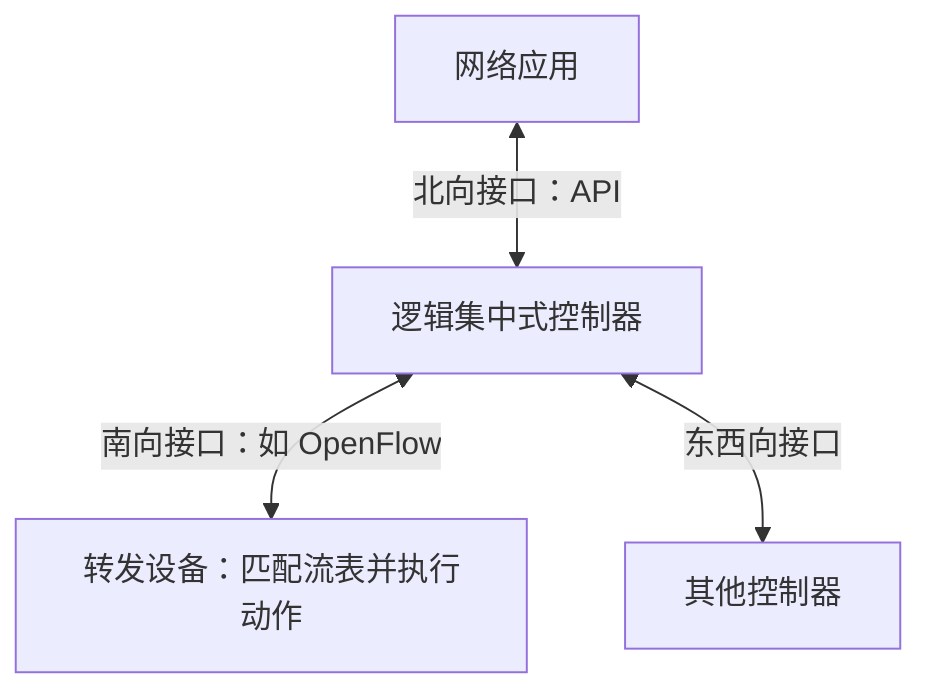

# 第 4 章 网络层

## 4.1 网络层的功能

### 4.1.1 服务范围与异构网络互连

网络层提供**主机到主机** 的通信，把分组从源主机经过多个网络和多段链路送到目的主机。传输层在此基础上提供**进程到进程** 的通信。

互联网可以连接采用不同物理层、数据链路层协议的网络。共同使用 IP 协议后，上层可以把这些异构网络看成一个统一的**虚拟互连网络（IP 网络）** ，无需处理每段底层网络的具体差异。

| 中继设备         | 主要工作层次     | 主要作用                           |
| ---------------- | ---------------- | ---------------------------------- |
| 中继器、集线器   | 物理层           | 再生或转发信号                     |
| 网桥、二层交换机 | 数据链路层       | 根据 MAC 地址转发帧                |
| 路由器           | 网络层           | 互连不同网络，根据 IP 地址转发分组 |
| 网关             | 可涉及网络层以上 | 在不同协议或应用之间进行转换       |

教材中“网络互连”通常指使用路由器连接网络。历史文献也可能把路由器称为网关；**默认网关** 在本章中通常就是本网络的路由器接口。

TCP/IP 的网络层向上提供**无连接、尽最大努力交付的数据报服务** ：

- 发送前不建立网络层连接。
- 每个分组独立转发，可能经过不同路径。
- 不保证必达、按序到达、只到达一次，也不保证时延上界。
- 可靠交付通常由 TCP 等端系统中的上层协议实现。

**IP 不可靠不等于 IP 完全不检错。** IPv4 检查首部校验和，但没有通过编号、确认、重传保证整个数据报可靠交付。

### 4.1.2 路由与转发

| 比较项       | 路由选择                         | 分组转发                   |
| ------------ | -------------------------------- | -------------------------- |
| 要回答的问题 | 到目的网络应该走什么路径         | 当前分组应该从哪个接口发出 |
| 工作范围     | 根据网络拓扑、度量和策略计算路由 | 一台路由器内的一次处理     |
| 主要依据     | 路由算法、路由协议、人工配置     | 转发表与分组首部           |
| 所属平面     | 控制平面                         | 数据平面（转发平面）       |
| 结果         | 生成、维护路由信息               | 选择输出接口和下一跳       |

**路由表侧重路由计算和管理，转发表侧重快速查找和实际转发。** 转发表可以由路由表导出；408 题目有时统称为“路由表”，需要结合上下文理解。

### 4.1.3 数据报服务与虚电路服务

两者都属于分组交换。虚电路是预先建立的**逻辑连接** ，不等于独占一条物理线路。

| 比较项         | 数据报服务                   | 虚电路服务                                   |
| -------------- | ---------------------------- | -------------------------------------------- |
| 建立连接       | 不需要                       | 先建立，传输后释放                           |
| 分组携带的信息 | 完整的目的地址等             | 建立阶段使用完整地址，传输阶段使用虚电路号   |
| 路径           | 各分组独立转发，可能不同     | 同一条虚电路的分组沿预先确定的路径传送       |
| 分组顺序       | 不保证有序                   | 通常按序交付                                 |
| 中间节点的状态 | 无需为每次通信维护虚电路状态 | 维护虚电路号与接口等映射                     |
| 故障影响       | 可以通过路由更新绕行         | 经过故障节点或链路的虚电路可能中断           |
| 可靠性         | 本章 IP 数据报不保证可靠交付 | 教材中的虚电路服务模型可由网络承担可靠性控制 |
| 资源使用       | 多个通信共享链路             | 多条虚电路也可以共享链路，不必独占带宽       |

虚电路通信的三个阶段：**建立 → 数据传输 → 释放** 。虚电路号通常具有链路或节点局部意义，不必在整个网络中保持同一个编号。

**连接方式与可靠性要分别判断。** “面向连接”本身不能证明具体协议一定可靠，也不能证明已经预留专用带宽。

### 4.1.4 SDN 的基本概念

软件定义网络（SDN）的核心是**控制平面与数据平面分离** 。控制器从全局角度计算和管理网络行为，转发设备按照下发的流表处理分组。



| 接口       | 连接对象         | 作用                     |
| ---------- | ---------------- | ------------------------ |
| 北向接口   | 应用与控制器     | 应用表达网络策略和需求   |
| 南向接口   | 控制器与转发设备 | 下发流表、收集设备状态等 |
| 东西向接口 | 控制器之间       | 交换信息，支持控制器协同 |

控制器是**逻辑集中** 的，可以由多个服务器实现；数据平面仍可以分布在多个设备上。控制器不需要亲自转发所有用户分组。

- 优点：具有全局视图，便于统一优化；可编程，便于调整策略；转发设备可以简化。
- 局限：控制器的可靠性、安全性和处理能力会影响网络，需要考虑冗余与扩展。

### 4.1.5 拥塞控制

**拥塞** 是网络中的分组数量或负载超过处理、缓存或传输能力，导致时延增大、分组丢失、吞吐量下降的现象。

| 比较项       | 流量控制                   | 拥塞控制                         |
| ------------ | -------------------------- | -------------------------------- |
| 关注对象     | 发送方与接收方             | 网络整体                         |
| 主要目的     | 防止接收方来不及接收和处理 | 防止网络承载能力不足             |
| 典型限制因素 | 接收缓存、接收处理速度     | 链路带宽、路由器缓存和处理能力等 |

网络负载增加时，正常吞吐量先增加，接近容量后增长趋缓；严重拥塞时，负载继续增加而有效吞吐量反而下降。丢包引发的重传还可能进一步加剧拥塞。

| 控制方法 | 思路                                     | 特征                     |
| -------- | ---------------------------------------- | ------------------------ |
| 开环控制 | 预先设计接纳、调度、丢弃等策略，防止拥塞 | 不依赖当前网络状态的反馈 |
| 闭环控制 | 检测拥塞，反馈信息，再调整网络行为       | 依赖反馈，动态调节       |

只增加某一种资源不一定根治拥塞，因为瓶颈可能转移，资源之间也可能相互制约。

## 4.2 IPv4

### 4.2.1 IPv4 数据报的格式

IPv4 数据报由**首部 + 数据部分** 组成。固定首部为 **20 B** ；存在选项时，首部长度可以增加，最大为 **60 B** ，且必须是 4 B 的整数倍。

| 字段                   | 位数 | 含义与考点                                              |
| ---------------------- | ---- | ------------------------------------------------------- |
| 版本                   | 4    | IPv4 的值为 4                                           |
| 首部长度 IHL           | 4    | **单位为 4 B** ；取值 5～15，对应 20～60 B              |
| 区分服务               | 8    | 表达服务类别等；本章计算一般不展开                      |
| 总长度                 | 16   | **单位为 1 B** ；包含首部与数据，最大 65535 B           |
| 标识 Identification    | 16   | 同一原始数据报的各分片使用相同标识，辅助重组            |
| 标志 Flags             | 3    | 保留位、DF、MF；DF 表示禁止分片，MF 表示后面还有分片    |
| 片偏移 Fragment Offset | 13   | **单位为 8 B** ；本片数据起点相对原始数据部分起点的位置 |
| 生存时间 TTL           | 8    | 每经过一个转发路由器减 1；减至 0 时丢弃，防止无限循环   |
| 协议                   | 8    | 标识数据部分承载的协议，接收方据此分用数据              |
| 首部校验和             | 16   | **只检查 IPv4 首部，不检查数据部分**                    |
| 源地址                 | 32   | 源接口的 IPv4 地址                                      |
| 目的地址               | 32   | 目的接口的 IPv4 地址                                    |
| 可选字段、填充         | 可变 | 按需添加选项，并填充到 4 B 的整数倍                     |

**三个长度字段的单位：首部长度 4 B，总长度 1 B，片偏移 8 B。**

$$
\boxed{H=4\times\mathrm{IHL}},\qquad
\boxed{D=L-H},\qquad
\boxed{\text{本片数据起始字节}=8\times\text{片偏移}}.
$$

其中，$H$ 为首部字节数，$L$ 为数据报总字节数，$D$ 为数据字节数。

#### 协议字段的常见取值

IPv4 首部的**协议字段占 8 位** ，用于标识数据部分承载的协议，常见取值如下：

| 协议 | 协议字段的值 |
| ---- | ------------ |
| ICMP | 1            |
| IGMP | 2            |
| TCP  | 6            |
| UDP  | 17           |
| OSPF | 89           |

其中，**ICMP、IGMP 属于网络层协议** ，报文直接封装在 IP 数据报中；TCP、UDP 属于传输层协议。协议字段的值是 **IP 协议号，不是端口号** 。

#### 标志位的辨析

- **DF=1** ：禁止分片。如果数据报超过出口链路 MTU，路由器不能强行分片，应丢弃，并在满足条件时向源主机报告需要分片。
- **DF=0** ：允许分片，但不表示一定已经分片。
- **MF=1** ：原始数据报在本片之后还有数据分片。
- **MF=0** ：没有后续分片；可能是最后一个分片，也可能是根本未分片的数据报。
- 判断“未分片”应结合 **MF=0 且片偏移=0** ，不能只看 MF。

#### TTL 与首部校验和

TTL 在本章按“路由器跳数限制”理解。交换机转发以太网帧，不会因此减少 IP 的 TTL。

路由器要继续转发数据报时，会减少 TTL，并更新首部校验和。若 TTL 原值为 1，经过第一个路由器时减至 0，便不能继续转发。

IPv4 首部校验和使用 **16 位反码求和** ：把校验和字段先置 0，按 16 位字求和，将进位回卷加到低 16 位，再按位取反。接收方检查时把校验和一起求和，正确结果应为全 1。

**IPv4 首部校验和出错时，直接丢弃 IP 数据报，不发送 ICMP 差错报文。** 因为首部已经不可信，包括源地址在内的信息可能损坏，不能据此发送差错报告。

**IPv4 首部校验和不使用 TCP/UDP 的伪首部。** 普通路由转发中，源、目的 IP 地址通常不变，但 TTL 和首部校验和会变化；分片或 NAT 还可能改变其他字段。

#### 十六进制首部读法

若首部中对应字段为：

```text
首字节：45
总长度：05 DC
标志与片偏移：20 00
TTL：40
协议：11
```

则：版本为 4，IHL 为 5，首部长 20 B；总长度 `0x05DC=1500 B`；`0x2000` 表示 DF=0、MF=1、片偏移=0；TTL=`0x40=64`；协议=`0x11=17`，即 UDP。

多字节字段按**网络字节序，即高位字节在前** 解释。例如 `05 DC` 是 `0x05DC`，不能颠倒为 `0xDC05`。IP 地址的 4 个字节分别转换成十进制，再写成点分十进制。

### 4.2.2 IPv4 数据报分片

#### 分片与重组的基本规则

**MTU 是链路层能承载的上层数据大小。** 对承载 IPv4 的链路来说，整个 IPv4 数据报的首部和数据之和不能超过 MTU；以太网 MAC 首部、尾部不计入这个 IP 大小。

**以太网的 MTU（最大传输单元）通常为 1500 B。** 因此，一个无需分片的 IPv4 数据报，其首部与数据的总长度通常不能超过 1500 B；若 IP 首部为 20 B，则数据部分最多为 $1500-20=1480$ B。这里的 1500 B 不包含以太网帧首部和尾部。

- IPv4 可由源主机或中间路由器分片，前提是 DF=0。
- 各分片都是独立的 IP 数据报，都有自己的首部。
- 各分片的标识继承原始数据报；总长度、MF、片偏移等按本片情况设置。
- **仅目的主机重组** ，中间路由器不负责把分片合并为原始数据报。
- 目的主机结合源地址、目的地址、协议、标识等区分原始数据报，再按片偏移放置数据。
- **除原始数据报的最后一个分片外，各分片的数据长度必须是 8 B 的整数倍。**

首部中的“标识”用于区分和重组数据报，不能当作可靠传输中用于按序交付的序号。

#### 分片计算公式

设题目规定每片首部均长 $H$ B，出口 MTU 为 $M$ B，待分片数据长度为 $D$ B，则非末片最多承载：

$$
\boxed{P=8\left\lfloor\frac{M-H}{8}\right\rfloor}\quad\text{B}.
$$

**先扣掉首部，再向下取 8 的整数倍。** 计算第 $i$ 片时：

$$
\text{片总长度}=H+\text{本片数据长度},\qquad
\text{片偏移}=\frac{\text{该片之前原始数据的字节数}}8.
$$

设 $C=M-H$ 为一个分片能承载的数据上限。按“尽量装满每个非末片”的规则，若原始数据报需要分片（$D>C$），最少片数为：

$$
\boxed{n=1+\left\lceil\frac{D-C}{P}\right\rceil}.
$$

**最后一个分片可以承载最多 $C$ B，不必向下取 8 的整数倍。** 常见题目中，$M-H$ 恰好能被 8 整除，此时 $C=P$，公式可简化为 $n=\lceil D/P\rceil$；不能把这个简式无条件套到所有 MTU 上。

若原始数据报本来就满足 $H+D\le M$，则无需分片；此时不能因为 $D$ 不是 8 的整数倍就强行切片。存在 IP 选项时，各片首部是否相同应按题目给出的复制规则处理。

#### 例 1：总长 4000 B，MTU 为 1500 B

原始首部 20 B、标识 777、DF=0，则原始数据为 $4000-20=3980$ B。非末片最多承载 $1480$ B，分为 3 片：

| 分片 | 对应原始数据的字节位置（从 0 开始） | 数据长度 | 总长度 | 片偏移 | MF  | 标识 |
| ---- | ----------------------------------- | -------- | ------ | ------ | --- | ---- |
| 1    | 0～1479                             | 1480 B   | 1500 B | 0      | 1   | 777  |
| 2    | 1480～2959                          | 1480 B   | 1500 B | 185    | 1   | 777  |
| 3    | 2960～3979                          | 1020 B   | 1040 B | 370    | 0   | 777  |

检查：数据长度之和为 3980 B；总长度之和为 4040 B，比分片前多了两份首部，即 40 B。

#### 例 2：MTU 减去首部后不能被 8 整除

若 MTU=1000 B、每片首部=20 B，则 $M-H=980$ B，但非末片只能承载：

$$
P=8\left\lfloor980/8\right\rfloor=976\text{ B}.
$$

不能直接让一个非末片装 980 B 数据，因为下一片的起点无法用整数片偏移表示。

若原始数据共 1954 B，可以分成 976 B 与 978 B 两片：末片不要求 8 B 对齐，978 B 不超过 980 B。最少片数为 $1+\lceil(1954-980)/976\rceil=2$，直接用 $\lceil1954/976\rceil$ 会错误地算成 3 片。

#### 再次分片

某片进入更小 MTU 的链路后，还可能再次分片。**新片偏移仍相对于最初原始数据报的数据起点** ：

$$
\boxed{\text{新片偏移}=\text{原片偏移}+\frac{\text{新片在原片数据中的起点}}8}.
$$

例如例 1 中第 2 片（数据 1480 B、原片偏移 185、MF=1）再经过 MTU=620 B 的链路，每片首部仍为 20 B，可拆成：

| 新分片 | 数据长度 | 总长度 | 新片偏移 | MF  |
| ------ | -------- | ------ | -------- | --- |
| 2-1    | 600 B    | 620 B  | 185      | 1   |
| 2-2    | 600 B    | 620 B  | 260      | 1   |
| 2-3    | 280 B    | 300 B  | 335      | 1   |

三个新分片的 MF 都为 1，因为原始数据报后面仍有例 1 的第 3 片。**再次分片产生的最后一个小片继承原片的 MF；不能一律设为 0。**

### 4.2.3 IPv4 地址与分类编址

IPv4 地址长 **32 位，即 4 B** ，通常写成 4 个十进制数，每个数为 0～255，例如 `192.168.5.56`。

**IP 地址标识网络接口。** 一台主机或路由器可以有多个接口及多个地址；不同接口可能连接不同子网。地址由网络部分和主机部分构成，具体边界由编址方式或前缀长度确定。

**多归属主机** ：一台主机通过不同的网络接口，同时连接到不同网络。各接口分别配置对应网络的 IP 地址；**连接不同网络的接口，其 IP 地址的网络号（网络前缀）不同** 。

例如，一台主机的有线接口为 `192.168.1.10/24`，无线接口为 `192.168.2.10/24`，分别连接 `192.168.1.0/24` 和 `192.168.2.0/24`，属于多归属主机。判断网络号时，应结合各接口的子网掩码或前缀长度，而不只比较 IP 地址是否不同。

#### 分类地址

| 类别 | 前导位 | 首字节范围                     | 默认网络前缀         | 默认掩码      | 普通网络的最大可用主机数 |
| ---- | ------ | ------------------------------ | -------------------- | ------------- | ------------------------ |
| A 类 | `0`    | 普通网络为 1～126；0、127 特殊 | /8                   | 255.0.0.0     | $2^{24}-2$               |
| B 类 | `10`   | 128～191                       | /16                  | 255.255.0.0   | $2^{16}-2$               |
| C 类 | `110`  | 192～223                       | /24                  | 255.255.255.0 | $2^8-2=254$              |
| D 类 | `1110` | 224～239                       | 不按普通单播网络划分 | —             | 多播地址                 |
| E 类 | `1111` | 240～255                       | 不按普通单播网络划分 | —             | 保留、特殊用途           |

分类编址的理论可用网络数：A 类为 $2^7-2=126$，B 类为 $2^{14}$，C 类为 $2^{21}$。这些是教材中的分类容量，不能当作现实中所有对应地址都可分配的结论。

**分类地址主要用于理解历史编址和相关题目。CIDR 中不能只根据首字节判断网络号长度。**

#### 常见特殊地址

下表按普通 IPv4 子网及教材的特殊地址规则判断。✅ 表示在所注明的范围内可以使用，❌ 表示不能使用；“源地址、目的地址”指 **IP 数据报首部中的地址字段** 。

| 地址或形式                               | 能否作为源地址 | 能否作为目的地址 | 含义                                   | 使用范围与做题注意                                                                   |
| ---------------------------------------- | -------------- | ---------------- | -------------------------------------- | ------------------------------------------------------------------------------------ |
| 网络号为 Y，主机部分全 0                 | ❌             | ❌               | 网络地址，表示网络或子网本身           | 用于路由表、转发表中的目的网络前缀，一般不能作为数据报的源、目的主机地址             |
| 网络号为 Y，主机部分全 1                 | ❌             | ✅               | 该网络的直接广播地址（定向广播地址）   | 向指定网络广播；不能作为源地址，可以在明确允许时跨路由器，默认禁止转发               |
| 网络号为 0，主机号为 Y（Y 非全 0、全 1） | ✅，仅初始化时 | ❌               | 表示本网络中主机号为 Y 的主机          | 教材中的历史特殊形式：主机获知完整 IP 地址的初始化过程可用作源地址，不是普通通信地址 |
| `0.0.0.0`（网络号、主机号均全 0）        | ✅，仅初始化时 | ❌               | 表示本网络上的本主机，尚未指定完整地址 | 如未获得 IP 地址的 DHCP 客户端发送 Discover、首次 Request 时用作源地址               |
| `255.255.255.255`（32 位全 1）           | ❌             | ✅               | 受限广播地址                           | 向本地网络广播，路由器不转发这种广播                                                 |
| `127.x.x.x`，如 `127.0.0.1`              | ✅，仅本机内部 | ✅，仅本机内部   | 环回地址，表示本机                     | 属于 `127.0.0.0/8`，用于本机软件通信或环回测试，不发送到物理网络                     |

##### 受限广播与定向广播的转发区别

- **受限广播 `255.255.255.255`：绝对不能通过路由器转发。** 只在发送方所在的本地网络内广播。
- **定向广播：可以在允许的配置下跨路由器，但默认禁止，需要显式配置。** 例如 `192.168.2.0/24` 的定向广播地址为 `192.168.2.255`；允许转发时，分组可先路由到目标网络，再在该网络内广播。路由器默认禁止接收、转发此类广播。

**记忆：受限广播始终不转发；定向广播默认不转发，明确允许后才可能跨网。**

**网络地址可以出现在路由表的“目的网络”列，不表示它可以作为 IP 分组的目的主机地址。** 表中 Y 表示对应字段的有效普通取值；不能把主机部分全 0 的网络地址与主机部分全 1 的广播地址混用。

**默认路由的目的网络地址和子网掩码都是 `0.0.0.0`，目的前缀写成 `0.0.0.0/0`。** 它能匹配所有 IPv4 目的地址，但按最长前缀匹配规则，仅在没有更具体的匹配路由时采用。这里的 `0.0.0.0` 是路由表中的目的网络地址，不是给主机分配的地址，也不是把数据报的目的地址填写为 `0.0.0.0`。

`{0, Y}` 与 `0.0.0.0` 作为源地址的初始化限制，以及广播、环回地址的使用范围。

“主机部分全 0/全 1”必须根据掩码判断。例如 `192.168.1.64/26` 的主机部分是低 6 位，该地址虽然末字节不是 0，仍然是网络地址。

### 4.2.4 子网划分、子网掩码与 CIDR

#### 子网划分

传统分类编址原为“网络号 + 主机号”，划分子网后，从原主机部分借若干位，形成：

$$
\text{IP 地址}=\text{网络号}+\text{子网号}+\text{主机号}.
$$

外部可以仍把该单位看作一个网络，内部按子网细分。借用主机位能增加子网数量，但每个子网的主机容量减小。

若从 `/p` 的地址块借 $s$ 位，使用统一的 `/p+s` 前缀，则：

$$
\boxed{\text{子网数}=2^s},\qquad
\boxed{\text{每个普通子网的可用主机地址数}=2^{32-p-s}-2}.
$$

现代题目一般允许使用全 0、全 1 子网，**子网数通常不减 2** ；主机数减 2 是扣除各子网的网络地址与广播地址。若题干明确采用早期限制，按其约定处理。

**普通 IPv4 子网划分时，至少保留 2 位主机位** ，即 $h=32-p-s\ge2$，网络前缀最长为 `/30`。因为主机号全 0、全 1 分别用于网络地址和广播地址；若只保留 1 位，两个地址都被占用，没有可分配给普通主机的地址。保留 2 位时，可用主机地址数为 $2^2-2=2$。

该规则适用于按 $2^h-2$ 计算容量的普通子网；`/31` 点对点链路、`/32` 主机路由属于另行说明的特殊情况。

#### 子网掩码

掩码长 32 位，由连续的 1 后接连续的 0 组成：1 对应网络部分，0 对应主机部分。CIDR 的 `/p` 表示前 $p$ 位为网络前缀。

$$
\boxed{\text{网络地址}=\text{IP 地址}\ \mathrm{AND}\ \text{子网掩码}}.
$$

广播地址是在网络地址的基础上，把主机部分全部置为 1。

| 前缀 | 掩码            | 地址总数 | 普通子网可用地址数 |
| ---- | --------------- | -------- | ------------------ |
| /20  | 255.255.240.0   | 4096     | 4094               |
| /24  | 255.255.255.0   | 256      | 254                |
| /25  | 255.255.255.128 | 128      | 126                |
| /26  | 255.255.255.192 | 64       | 62                 |
| /27  | 255.255.255.224 | 32       | 30                 |
| /28  | 255.255.255.240 | 16       | 14                 |
| /29  | 255.255.255.248 | 8        | 6                  |
| /30  | 255.255.255.252 | 4        | 2                  |

`/32` 在转发表中表示特定主机路由。点对点链路在传统 408 题目中通常使用 `/30`；明确使用 `/31` 时，两端可各使用一个地址，无需扣除网络、广播地址。

#### CIDR 地址块

无分类域间路由选择（CIDR）取消固定的 A/B/C 类边界，使用：

$$
\text{IP 地址}=\text{网络前缀}+\text{主机号}.
$$

| 性质               | 结论                         |
| ------------------ | ---------------------------- |
| `/p` 的地址总数    | $2^{32-p}$                   |
| 地址块中的最小地址 | 网络前缀保留，主机位全 0     |
| 地址块中的最大地址 | 网络前缀保留，主机位全 1     |
| 普通子网的可用范围 | 最小地址 + 1，到最大地址 − 1 |
| 前缀越长           | 地址块越小、路由越具体       |
| 前缀越短           | 地址块越大、覆盖范围越广     |

**只有 IP 地址而没有前缀长度，通常无法确定它属于哪个 CIDR 地址块。** CIDR 也不妨碍单位在已经获得的地址块内部继续划分子网。

例：`128.14.32.5/20`，掩码为 `255.255.240.0`。第三字节的块跨度为 $256-240=16$，32 落在 32～47 这一块中：

- 网络地址：`128.14.32.0`。
- 广播地址：`128.14.47.255`。
- 可用范围：`128.14.32.1`～`128.14.47.254`。
- 地址总数：$2^{12}=4096$；普通子网可用地址数为 4094。

#### 同一子网的判定与默认网关

主机发送数据前，使用本接口的掩码判断目的地址是否位于本地子网：

$$
(\text{自身 IP}\ \mathrm{AND}\ M)\stackrel{?}= (\text{目的 IP}\ \mathrm{AND}\ M).
$$

- 相等：执行直接交付，在本链路上发送给目的主机。
- 不相等：根据路由选择下一跳，普通主机通常交给默认网关。

默认网关一般是**与主机处在同一子网的路由器接口地址** 。要配置实际接口地址，不能填该子网的网络地址或广播地址。

### 4.2.5 定长子网划分与 VLSM

#### 定长子网掩码 FLSM

所有子网使用相同前缀长度。优点是配置简单；缺点是按最大需求统一分配，容易浪费地址。

例：已有 `208.115.21.0/24`，三个部门分别有 50、20、5 台主机，每个部门还需一个路由器接口。实际需求为 51、21、6 个可分配地址。

最大需求为 51，要满足 $2^h-2\ge51$，取 $h=6$，即使用 `/26`。整个 `/24` 可分成 4 个 `/26`：

| 子网   | 网络地址          | 可用地址范围 | 广播地址 |
| ------ | ----------------- | ------------ | -------- |
| 部门 1 | 208.115.21.0/26   | .1～.62      | .63      |
| 部门 2 | 208.115.21.64/26  | .65～.126    | .127     |
| 部门 3 | 208.115.21.128/26 | .129～.190   | .191     |
| 备用   | 208.115.21.192/26 | .193～.254   | .255     |

每个子网均有 62 个可用地址。表中的简写均保留前 3 个字节 `208.115.21`。

#### 变长子网掩码 VLSM

各子网可以使用不同前缀，按实际需求选择大小。常用步骤：

1. 统计每个子网所需的**全部接口地址** ，包括题目要求的路由器接口、服务器等。
2. 从最大需求开始，对普通子网找最小 $h$，满足 $2^h-2\ge\text{需求}$。
3. 子网前缀为 `/32-h`，地址块大小为 $2^h$。
4. 在原地址块内按大小分配，起始地址必须对齐对应地址块边界。
5. 检查各子网不重叠、不越界，并标出网络地址、广播地址和可用范围。

对上例，可采用：

| 子网   | 地址需求 | 前缀             | 地址块范围 | 可用地址范围       |
| ------ | -------- | ---------------- | ---------- | ------------------ |
| 部门 1 | 51       | 208.115.21.0/26  | .0～.63    | .1～.62，共 62 个  |
| 部门 2 | 21       | 208.115.21.64/27 | .64～.95   | .65～.94，共 30 个 |
| 部门 3 | 6        | 208.115.21.96/29 | .96～.103  | .97～.102，共 6 个 |

共分配 $64+32+8=104$ 个地址，剩余 $256-104=152$ 个。**剩余连续地址不一定能直接表示成一个 CIDR 地址块** ，仍要检查大小是否为 2 的幂、起点是否对齐。

### 4.2.6 路由聚合与最长前缀匹配

#### 路由聚合

把若干较小地址块用一个较大的公共前缀表示，减少路由表项。例如：

```text
206.1.0.0/17
206.1.128.0/17
          ↓ 聚合
206.1.0.0/16
```

对某台路由器来说，要把原表项直接替换成聚合表项，还要保证对这些目的网络采用聚合后的转发动作是正确的，例如都能由同一个下一跳到达。

精确聚合要满足：地址块可连续拼成一个完整的 2 的幂大小块，并按该块边界对齐。找公共前缀的方法是**把地址写成二进制，从最高位开始找连续相同的位** 。

例如 `192.168.4.0/24`、`.5.0/24`、`.6.0/24`、`.7.0/24` 可以聚合为 `192.168.4.0/22`。但 `.5.0/24` 与 `.6.0/24` 的最小覆盖前缀也是 `/22`，会额外覆盖 `.4.0/24` 和 `.7.0/24`，不能把它当作只包含原两个网络的精确聚合。

#### 最长前缀匹配

目的地址 $D$ 匹配一条网络前缀 $N/p$ 的条件为：

$$
\boxed{D\ \mathrm{AND}\ M_p=N}.
$$

若同时匹配多条表项，选择**前缀长度最长** 的表项。特定主机路由 `/32` 最具体，默认路由 `/0` 最不具体。

| 目的前缀          | 下一跳或输出接口 |
| ----------------- | ---------------- |
| 0.0.0.0/0         | A                |
| 192.168.0.0/16    | B                |
| 192.168.10.0/24   | C                |
| 192.168.10.128/25 | D                |
| 192.168.10.200/32 | E                |

- 目的 `192.168.10.200`：选择 E（/32）。
- 目的 `192.168.10.180`：选择 D（/25）。
- 目的 `192.168.10.100`：选择 C（/24）。
- 目的 `192.168.20.1`：选择 B（/16）。
- 目的 `8.8.8.8`：选择 A（/0）。

**最长前缀匹配不是比较下一跳距离，也不是选最短前缀。** 表项可以按前缀长度降序排列来便于查找，但题目给出的原表不一定已经排序。

### 4.2.7 网络地址转换 NAT

#### 私有地址

| 私有地址块     | 地址范围                     |
| -------------- | ---------------------------- |
| 10.0.0.0/8     | 10.0.0.0～10.255.255.255     |
| 172.16.0.0/12  | 172.16.0.0～172.31.255.255   |
| 192.168.0.0/16 | 192.168.0.0～192.168.255.255 |

私有地址可在不同专用网络中重复使用，在公共互联网中不作为普通公网目的地址路由。**172 开头并非全部是私有地址** ，只有第二字节为 16～31 的上述范围是私有地址。

NAT 把内网地址转换为公网地址，缓解 IPv4 地址不足。普通 NAT 主要转换 IP 地址；**NAPT（地址和端口转换）** 还转换传输层端口，使多个内部端点共享一个公网 IP。教材往往把这个常见形式也简称 NAT。

#### NAPT 的转发过程

设内网主机 `10.0.0.1:3345` 访问服务器 `128.119.40.186:80`，NAT 路由器公网地址为 `138.76.29.7`，分配端口 5001：

| 阶段             | 源 IP:端口        | 目的 IP:端口      |
| ---------------- | ----------------- | ----------------- |
| 内网请求         | 10.0.0.1:3345     | 128.119.40.186:80 |
| 转换后的公网请求 | 138.76.29.7:5001  | 128.119.40.186:80 |
| 服务器响应       | 128.119.40.186:80 | 138.76.29.7:5001  |
| 转换后的内网响应 | 128.119.40.186:80 | 10.0.0.1:3345     |

NAT 表保存内外端点的对应关系，区分 TCP、UDP 等协议。出站转换源地址、源端口；返回时依据映射还原目的地址、目的端口。

- 动态映射：内部主机发起通信时建立，结束或超时后回收。
- 静态映射、端口转发：预先配置公网端点到内网服务器的映射，使外部能够访问指定服务。
- 普通路由器转发通常不修改源、目的 IP；NAT 会修改相关 IP 字段，NAPT 还修改端口并更新相应校验和。

**NAT 路由器的基本转发仍属于网络层，但 NAPT 的处理还涉及传输层端口。** 不能把公网端口直接理解为内网原端口。

### 4.2.8 网络层转发分组的过程

转发表常见字段是：**目的网络前缀、子网掩码或前缀长度、下一跳 IP、输出接口** 。

1. 从 IP 首部取出最终目的地址 $D$。
2. 根据 $D$ 查转发表，选择最长匹配前缀。
3. 如果是直连网络，则从对应接口直接交付给目的主机；否则发给选中的下一跳路由器。
4. 若没有任何更具体的匹配，尝试默认路由；若连默认路由也没有，则丢弃，并在适当条件下报告目的不可达。
5. 对需要链路层地址的出口网络，解析**当前下一跳** 的 MAC 地址，重新封装链路层帧并发送。

实际处理还包括检查首部、处理 TTL 和校验和、必要时分片等。

**转发表通常只指出下一跳，不存放该数据报从源到目的的完整路径。** 下一台路由器再次依据自己的转发表作决定。

**下一跳 IP 用于确定链路层交付对象，不会因此替换 IP 首部中的最终目的 IP。** 普通路由转发时，IP 的目的仍是最终目的主机，当前帧的目的 MAC 才是下一跳接口。

### 4.2.9 地址解析协议 ARP

#### IP 地址与 MAC 地址

| 比较项         | IP 地址              | MAC 地址                                |
| -------------- | -------------------- | --------------------------------------- |
| 本章所属层     | 网络层               | 数据链路层                              |
| 结构           | 分层，含网络前缀     | 通常视为平面地址                        |
| 封装位置       | IP 数据报首部        | MAC 帧首部                              |
| 用途           | 支持跨网络的主机通信 | 当前链路上的帧交付                      |
| 经过普通路由器 | 源、目的通常不变     | 按出链路重新封装，源、目的 MAC 通常改变 |

**不考虑 NAT 的普通 IP 转发过程中，IP 数据报的源 IP 地址和目的 IP 地址始终不变；经过路由器进入下一段以太网链路时，MAC 帧的源 MAC 地址和目的 MAC 地址会重新设置。**

- **源 IP、目的 IP** ：分别标识最初的源主机和最终的目的主机，保持端到端不变。
- **帧源 MAC** ：当前链路上发送该帧的接口的 MAC 地址，如路由器的出口接口。
- **帧目的 MAC** ：当前链路上下一跳接收接口的 MAC 地址；最后一段链路才是最终目的主机的 MAC 地址。

MAC 地址的变化发生在**路由器解封装、为下一段链路重新封装** 时；同一链路上的普通二层交换机转发帧，不会改写帧的源、目的 MAC 地址。这里比较的是地址字段，IPv4 的 TTL 和首部校验和仍会在路由器转发时更新；隧道等特殊封装应另行区分内、外层地址。

ARP 解析**同一局域网或广播域中的 IPv4 地址对应的 MAC 地址** 。408 教材将其归入网络层；ARP 报文直接封装在链路层帧中，**不封装在 IP 数据报里** 。

每台主机和路由器维护 ARP 高速缓存，保存 IP→MAC 映射。动态表项会老化，具体生存时间取决于实现，教材中的时间例子不必当作固定协议常量。

#### ARP 的基本过程

主机 A 已确定当前链路的下一跳 IPv4 地址为 B：

1. 查 ARP 缓存。若已有 B 的有效映射，直接使用，不必再广播查询。
2. 缓存未命中，A 发出 ARP 请求，包含 A 自己的 IP、MAC 及要查询的 B 的 IP。
3. 请求帧的目的 MAC 为 **FF-FF-FF-FF-FF-FF** ，在本广播域广播。
4. B 发现查询对象是自己，通常向 A **单播 ARP 响应** ，告知自己的 MAC。
5. A 保存 B 的映射，再用 B 的 MAC 封装待发送数据帧；B 也可以学习请求中 A 的映射。

**ARP 请求广播、普通响应单播；请求广播不穿过路由器。** ARP 请求中的目标 MAC 可以尚未知，但承载请求的以太网帧目的 MAC 是广播地址。

#### 四种典型使用情形

| 当前发送者 | 最终目的位置         | 本次 ARP 要解析谁                  |
| ---------- | -------------------- | ---------------------------------- |
| 主机       | 同一子网中的主机     | 最终目的主机                       |
| 主机       | 其他网络中的主机     | 本网络的下一跳，通常为默认网关接口 |
| 路由器     | 出口直连网络中的主机 | 最终目的主机                       |
| 路由器     | 非直连网络中的主机   | 出口网络中的下一跳路由器接口       |

**跨网发送时，不会广播查询远端目的主机的 MAC。** ARP 只能解决当前链路上的交付。

#### 跨两个路由器时，地址怎样变化

设路径为 `H1 → R1 → R2 → H2`，R1-L、R1-R 分别为 R1 左右接口，R2-L、R2-R 同理。以下假定三段均使用以太网，且没有 NAT、隧道：

| 所在链路 | IP 源地址 | IP 目的地址 | 帧源 MAC    | 帧目的 MAC  |
| -------- | --------- | ----------- | ----------- | ----------- |
| H1 到 R1 | H1 的 IP  | H2 的 IP    | H1 的 MAC   | R1-L 的 MAC |
| R1 到 R2 | H1 的 IP  | H2 的 IP    | R1-R 的 MAC | R2-L 的 MAC |
| R2 到 H2 | H1 的 IP  | H2 的 IP    | R2-R 的 MAC | H2 的 MAC   |

若所需 ARP 缓存均为空，且不考虑额外背景报文，这次单向发送会在三段链路上分别查询 R1-L、R2-L、H2，共 3 次 ARP 请求和 3 次响应。每经过一个路由器，还需减少 TTL 并更新 IPv4 首部校验和。

### 4.2.10 动态主机配置协议 DHCP

DHCP 是**应用层协议** ，使用 **UDP** ：服务器端口 **67** ，客户端端口 **68** 。它可自动配置 IP 地址、子网掩码、默认网关、DNS 服务器、租期等。

#### 首次获得地址：DORA

| 顺序 | 报文                | 发送方向      | 作用与常见地址                                                             |
| ---- | ------------------- | ------------- | -------------------------------------------------------------------------- |
| 1    | DHCP Discover，发现 | 客户端→服务器 | 寻找服务器；客户端尚无地址，源 IP 为 0.0.0.0，目的 IP 为 255.255.255.255   |
| 2    | DHCP Offer，提供    | 服务器→客户端 | 提供候选 IP、租期等配置信息；源 IP 为服务器地址                            |
| 3    | DHCP Request，请求  | 客户端→服务器 | 选择一个 Offer；初次选择时广播，使其他服务器得知其选择，源 IP 仍为 0.0.0.0 |
| 4    | DHCP ACK，确认      | 服务器→客户端 | 确认租约，客户端据此完成配置                                               |

教材图示通常把首次分配中的 Offer、ACK 也画成广播。**实际服务器响应可根据客户端的广播标志及接收能力使用广播或单播** ，不应把 DHCP 全部报文记为永远广播。

客户端可能收到多个 Offer，但一次选取其中一个。DHCP Request 在初次选择阶段广播，并不代表客户端打算同时租用所有候选地址。

#### 租约续期

| 时刻或事件                                | 客户端行为                                  |
| ----------------------------------------- | ------------------------------------------- |
| 租期经过约 50%（默认 T1）                 | 向原服务器单播 DHCP Request 请求续租        |
| 租期经过约 87.5%（默认 T2），尚未续租成功 | 广播 DHCP Request，尝试向可用服务器重新绑定 |
| 收到 DHCP ACK                             | 按确认内容更新租约                          |
| 收到 DHCP NAK，或租约最终到期且未续租     | 停止使用该地址，重新获取配置                |
| 主动提前结束租约                          | 可向服务器发送 DHCP Release                 |

50% 和 87.5% 是默认值，服务器可以配置。续租时客户端已有地址，不能再把所有 Request 的源地址写成 0.0.0.0。

初始阶段客户端尚无 IP，又不知道服务器 IP，需要广播；UDP 无需建立连接，适合该过程。需要跨子网获取配置时，可借助 **DHCP 中继** ，不能认为普通路由器会直接转发 Discover 的受限广播。

### 4.2.11 网际控制报文协议 ICMP

ICMP 用于报告网络差错、交换控制和探测信息。它属于**网络层** ，封装在 IP 数据报中，IPv4 协议字段为 **1** ；不使用 TCP/UDP 端口。

**ICMP 报告差错，不负责把丢失的数据重传回来，也不使 IP 自动变成可靠协议。**

#### 差错报告报文

差错报告通常发送给**引起差错的原始数据报的源主机** ，而非替源主机向目的主机继续投递原数据。

| 类型               | 类型值 | 典型触发情形                                 |
| ------------------ | ------ | -------------------------------------------- |
| 终点不可达         | 3      | 网络、主机或端口不可达；禁止分片而报文过大等 |
| 时间超过           | 11     | 路由器把 TTL 减至 0；目的主机重组等待超时    |
| 参数问题           | 12     | 首部中出现无法正确处理的参数                 |
| 改变路由（重定向） | 5      | 路由器告知主机可以使用更合适的下一跳         |
| 源点抑制           | 4      | 历史教材中用于请求源主机降低发送速率         |

**源点抑制已废弃** ，只作为旧知识点辨认，不能当作现代 IP 拥塞控制的常规机制。

经典 ICMP 差错报文除自己的首部外，还携带原始 IP 首部和原始数据部分的前 8 B 等信息，帮助源主机确定是哪次发送出了问题。

#### 不发送 ICMP 差错报告的典型情形

- **IPv4 首部校验和出错：直接丢弃数据报，不发送 ICMP 差错报告。**
- 对 ICMP 差错报告报文本身，不再产生 ICMP 差错报告。
- 对一个分片数据报中**非首片** 的错误，不产生此类差错报告。
- 对目的为广播或多播的 IPv4 数据报，不产生此类差错报告。
- 对源地址不能有效标识单个源主机的特殊数据报，不产生此类差错报告。

第一条是“对差错报告不再报告差错”，不是“任何 ICMP 报文都不能触发差错”。例如路由探测中的 ICMP 回送请求也可以因 TTL 耗尽引起时间超过。

#### 询问报文与应用

| 报文或应用             | 原理                                                     |
| ---------------------- | -------------------------------------------------------- |
| 回送请求、回送回答     | 类型分别为 8、0，探测目的主机可达性并估计往返时间        |
| 时间戳请求、时间戳回答 | 教材中的询问信息类型；不是本章 TTL 字段                  |
| Ping                   | 使用 ICMP 回送请求和回答，无需先建立 TCP 连接            |
| Traceroute / Tracert   | 逐步增大 TTL，利用沿途路由器的 ICMP 时间超过报文发现路径 |

Traceroute 的探测分组可以使用 UDP、ICMP 或 TCP，取决于实现。经典 UNIX UDP traceroute 到达终点后常收到 ICMP 端口不可达；Windows tracert 常使用 ICMP 回送探测。**共同考点是递增 TTL 和 ICMP 时间超过，不是探测分组一定采用某一种传输协议。**

Ping 没有收到回答，只能说明该次探测未成功，不能单凭这一点证明所有业务通信都不可能成功。

## 4.3 IPv6

### 4.3.1 IPv6 的主要特点

IPv6 地址从 IPv4 的 **32 位** 扩大到 **128 位，即 16 B** ，地址空间为 $2^{128}$，是 IPv4 地址空间的 **$2^{96}$ 倍** 。

| 比较项       | IPv4                     | IPv6                                 |
| ------------ | ------------------------ | ------------------------------------ |
| 地址长度     | 32 位                    | 128 位                               |
| 基本首部     | 常用 20 B，最多 60 B     | **固定 40 B**                        |
| 长度字段     | 总长度包括首部和数据     | 有效载荷长度不包括 40 B 基本首部     |
| 首部校验和   | 有                       | 基本首部没有                         |
| 跳数限制     | TTL                      | Hop Limit                            |
| 可选功能     | 基本首部内的选项等       | 由扩展首部实现                       |
| 分片位置     | 源主机或中间路由器       | **仅源主机**                         |
| 目的地址类型 | 单播、多播、广播等       | 单播、多播、任播，**没有广播地址**   |
| 配置方式     | 可手工配置、使用 DHCP 等 | 可自动配置，也可按需要使用 DHCPv6 等 |

IPv6 简化基本首部，允许扩展首部，便于路由器处理；提供通信类别、流标号等字段，支持对不同流进行相应处理。

**IPv6 地址更大，不代表首部更小** ：IPv6 基本首部 40 B，大于 IPv4 常用的 20 B。支持安全相关扩展也不等于所有 IPv6 通信自动加密、自动可靠。

“IPv6 支持自动配置”表示可以不依靠人工逐台配置，不能理解为 IPv6 禁止或永远不需要 DHCPv6。

### 4.3.2 IPv6 数据报的基本首部

IPv6 数据报由**基本首部 + 有效载荷** 组成；有效载荷包括扩展首部和上层数据。

| 字段         | 位数 | 含义                                     |
| ------------ | ---- | ---------------------------------------- |
| 版本         | 4    | 值为 6                                   |
| 通信类别     | 8    | 区分数据报类别、优先级等                 |
| 流标号       | 20   | 标识需要作为一个流处理的一组分组         |
| 有效载荷长度 | 16   | 基本首部之后的字节数，**包括扩展首部**   |
| 下一个首部   | 8    | 指出紧接着的扩展首部类型，或上层协议类型 |
| 跳数限制     | 8    | 路由器转发时减 1，减至 0 时丢弃          |
| 源地址       | 128  | 发送方 IPv6 地址                         |
| 目的地址     | 128  | 接收方 IPv6 地址                         |

上述位数相加为 $320$ 位，即 40 B。对本章考虑的普通 IPv6 数据报：

$$
\boxed{\text{IPv6 总长度}=40\text{ B}+\text{有效载荷长度}}.
$$

与 IPv4 相比，基本首部取消了 IHL、首部校验和、标识、分片标志、片偏移等字段；分片相关字段移入**分片扩展首部** 。

**IPv6 中间路由器不能分片。** 出口 MTU 不足时，路由器丢弃报文，并使用 ICMPv6“分组太大”向源主机反馈；由源主机调整发送大小或进行源端分片。

### 4.3.3 IPv6 地址与缩写

#### 三种目的地址类型

| 类型           | 含义                     | 交付对象                 |
| -------------- | ------------------------ | ------------------------ |
| 单播 Unicast   | 标识一个接口             | 唯一的目的接口           |
| 多播 Multicast | 标识一组接口             | 组中的各个接收接口       |
| 任播 Anycast   | 一组接口使用同一任播地址 | 其中按路由度量最近的一个 |

**任播是“送到其中一个”，多播是“送到组中各接收者”。** 任播的“最近”依据网络路由度量，不一定是地理距离最近。

#### 冒号十六进制与压缩

IPv6 地址分为 8 组，每组 16 位，写作 4 个十六进制数字，各组用冒号分隔。

```text
完整地址：4BF5:0000:0000:0000:BA5F:039A:000A:2176
去前导零：4BF5:0:0:0:BA5F:39A:A:2176
压缩零组：4BF5::BA5F:39A:A:2176
```

两条基本规则：

1. 每组的**前导零** 可省略，全零组未被压缩时保留 `0`；不能任意删除组内或末尾的零。
2. 连续的全零组可用 `::` 表示，但**一个地址中最多出现一次 `::`** ，否则无法确定各处省略的组数。

展开时先数已经写出的组，再把 `::` 补成恰好 8 组。例如 `2001:db8::1` 已写 3 组，所以省略了 5 个全零组。

#### 常见特殊前缀

| 地址或前缀   | 含义                                                   |
| ------------ | ------------------------------------------------------ |
| `::/128`     | 未指定地址，不能作为普通目的地址                       |
| `::1/128`    | 环回地址                                               |
| `FF00::/8`   | 多播地址范围                                           |
| `FE80::/10`  | 链路本地单播地址范围，路由器不向其他链路转发           |
| 全局单播地址 | 用于全局单播，通常可按全局路由前缀、子网与接口标识组织 |

`/p` 表示 IPv6 地址的前 $p$ 位是前缀，剩余 $128-p$ 位属于后续地址部分。不能把“每组 16 位”误当作“整个 IPv6 地址只有 16 位”。

### 4.3.4 IPv4 向 IPv6 过渡

| 策略     | 原理                                             | 考点                                                      |
| -------- | ------------------------------------------------ | --------------------------------------------------------- |
| 双协议栈 | 主机或路由器同时支持 IPv4、IPv6                  | 可分别与两种网络通信，按目的地址类型使用对应协议栈        |
| 隧道技术 | 把完整 IPv6 数据报封装在 IPv4 数据报的数据部分中 | 隧道内部按外层 IPv4 转发，出口去掉外层封装后继续处理 IPv6 |

隧道的内层、外层有各自的源和目的地址。**封装不等于把原 IPv6 首部改写成 IPv4 首部** ，原 IPv6 数据报完整地位于外层数据部分。

## 4.4 路由算法与路由协议

### 4.4.1 静态路由与动态路由

路由算法根据拓扑、链路代价和策略计算路由。“最优”必须先说明度量：可能是跳数最少，也可能是链路总代价最低，不一定是物理距离最短。

| 比较项     | 静态路由                         | 动态路由                     |
| ---------- | -------------------------------- | ---------------------------- |
| 路由来源   | 管理员人工配置                   | 运行路由协议计算和更新       |
| 网络变化时 | 通常需要人工调整                 | 可以依据变化自动调整         |
| 开销       | 较小，无需为学习路由持续交换信息 | 有计算、存储和协议通信开销   |
| 适用情形   | 简单、稳定的小网络或固定出口     | 规模较大、拓扑可能变化的网络 |

**动态路由不意味着所有算法都必须掌握完整拓扑** ：距离向量与链路状态的已知信息不同。

### 4.4.2 距离向量算法 DV

距离向量算法基于 **Bellman–Ford** 思想。节点 $x$ 需要知道：到各邻居的链路代价 $c(x,v)$、邻居通告的距离向量，以及自己当前的距离向量。

设 $d_x(y)$ 为 $x$ 到目的 $y$ 的最小代价，则：

$$
\boxed{d_x(y)=\min_{v\in\text{邻居}(x)}\{c(x,v)+d_v(y)\}}.
$$

理解为：**分别计算“先到邻居的代价 + 邻居声称到目的的代价”，取最小值，并记录对应邻居作为下一跳。**

例：链路代价为 $c(x,y)=2$、$c(y,z)=1$、$c(x,z)=7$。初始时 $x$ 只知道直连信息，到 $z$ 的代价为 7；收到 $y$ 的通告后：

$$
d_x(z)=\min\{2+1,\ 7+0\}=3.
$$

因此改走 $x\to y\to z$。节点反复交换、更新，最终距离向量稳定，这称为**收敛** 。

特点：与直接邻居交换距离向量，不必预先获得完整拓扑；但依赖邻居计算结果，故障后可能出现环路与“计数到无穷”问题。RIP 是典型协议。

若题目按“轮次”交换信息，同一轮通常使用**上一轮已通告的信息** 进行计算，不能随意把某个节点本轮刚计算出的新值传遍全网。

### 4.4.3 链路状态算法 LS

**链路状态** 描述本节点与哪些邻居相连，以及相应链路的代价。基本过程：

1. 发现邻居、了解本地链路状态与代价。
2. 生成自己的链路状态通告。
3. 通过洪泛将通告传播到相应范围内的路由器。
4. 收集通告，建立链路状态数据库和拓扑图。
5. 以自己为根运行 **Dijkstra 算法** ，生成最短路径树和路由表。

**传播的是本地链路状态，汇总后获得完整拓扑；不是把自己的完整路由表洪泛给别人。** OSPF 是典型协议。

#### Dijkstra 做题步骤

初始化已确定最短路径的集合 $S=\{s\}$，记录源点 $s$ 到各点的当前距离。每轮选择 $S$ 外距离最小的节点 $u$ 加入 $S$，再对其邻居 $v$ 松弛：

$$
D(v)\leftarrow\min\{D(v),\ D(u)+c(u,v)\}.
$$

更新时同时记录前驱。最后从目的点沿前驱反推完整路径；**路由表中的下一跳是从源点出发的第一个邻居，不一定等于目的点的前驱** 。

例：无向链路 `A—B=2`、`A—C=5`、`B—C=1`、`B—D=6`、`C—D=2`，以 A 为源：

| 步骤   | 已确定集合 S | 到 B 的当前距离 | 到 C 的当前距离 | 到 D 的当前距离 |
| ------ | ------------ | --------------- | --------------- | --------------- |
| 初始   | A            | 2               | 5               | $\infty$        |
| 加入 B | A、B         | 2               | 3               | 8               |
| 加入 C | A、B、C      | 2               | 3               | 5               |
| 加入 D | A、B、C、D   | 2               | 3               | 5               |

最终 A 到 C 的路径为 `A→B→C`，代价 3；到 D 为 `A→B→C→D`，代价 5。A 到 C、D 的下一跳都是 B。

#### DV 与 LS 对比

| 比较项           | 距离向量 DV              | 链路状态 LS              |
| ---------------- | ------------------------ | ------------------------ |
| 交换的内容       | 到各目的的距离向量       | 自身邻接关系与链路代价   |
| 交换方式         | 与直接邻居交换           | 经邻居洪泛到相应区域     |
| 是否掌握拓扑     | 不要求完整拓扑           | 构建相应范围的拓扑       |
| 计算算法         | Bellman–Ford             | Dijkstra                 |
| 对邻居结果的依赖 | 依赖邻居通告的路径距离   | 根据收集的拓扑独立计算   |
| 典型问题         | 计数到无穷、坏消息传播慢 | 数据库、洪泛和计算有开销 |
| 典型协议         | RIP                      | OSPF                     |

LS 避免了 DV 的计数到无穷问题，通常收敛更快，但不能据此断言任何拓扑变化过程中都绝不出现暂时不一致。

### 4.4.4 自治系统与分层路由

**自治系统（AS）** 是在统一管理和路由策略下组织的一组网络和路由器，对外表现为统一的路由策略，由自治系统号 ASN 标识。

互联网规模大，不同管理单位也不希望向外暴露全部内部细节，因此采用分层路由：

| 类型             | 使用范围               | 典型协议  |
| ---------------- | ---------------------- | --------- |
| 内部网关协议 IGP | 一个 AS 内，域内路由   | RIP、OSPF |
| 外部网关协议 EGP | 不同 AS 之间，域间路由 | BGP       |

这里的 EGP 是协议**类别名称** 。一个边界路由器可以同时运行 IGP 与 BGP：前者处理内部可达性，后者交换跨 AS 的路由信息。

### 4.4.5 路由信息协议 RIP

#### 基本规定

RIP 是 IGP，采用距离向量算法。教材按以下规则计算距离：

- 路由器到自己的直连网络，距离为 **1** 。
- 每多经过一个路由器，距离增加 1。
- 选择**跳数最少** 的路径，不直接比较带宽、时延或拥塞程度。
- 有效距离最大为 **15** ；**16 表示不可达** 。
- 每项核心信息为：**目的网络、距离、下一跳** 。
- RIP 使用 **UDP 520 端口** ，按 TCP/IP 分层归入应用层。

RIP 只与直接相邻路由器交换路由信息；周期更新通常每 **30 s** 发送一次距离向量。拓扑变化也可触发更新。通常 **180 s** 未收到相应路由的有效更新，就把该路由标记为不可达。

距离上限限制了适用网络规模。不能把“16 表示不可达”记成“允许有效跳数为 16”。

#### 路由表更新规则

收到邻居 X 通告的表后，先将其作为“经 X 到达目的”的候选路由：**距离加 1，下一跳改为 X** ；距离超过上限按 16 处理。

| 本地原表的情况                           | 更新动作                                  |
| ---------------------------------------- | ----------------------------------------- |
| 没有到该目的网络的路由                   | 对可达的新目的加入表项                    |
| 已有路由，原下一跳就是 X                 | 使用 X 的新信息更新，**距离变大也要更新** |
| 已有路由，原下一跳不是 X，候选距离更小   | 替换为经 X 的更短路由                     |
| 已有路由，原下一跳不是 X，候选距离不更小 | 保留原表项（按教材简化规则）              |

**同下一跳时采用最新信息；不同下一跳时优先比较距离。** 不能把所有更新都简化为只取新旧距离中的较小者。

#### 例：R6 收到 R4 的通告

R6 原表：

| 目的网络 | 距离 | 下一跳 |
| -------- | ---- | ------ |
| Net2     | 3    | R4     |
| Net3     | 4    | R5     |

R4 发来的表：

| 目的网络 | R4 通告的距离 | R4 通告的下一跳 |
| -------- | ------------- | --------------- |
| Net1     | 3             | R1              |
| Net2     | 4             | R2              |
| Net3     | 1             | 直接交付        |

R6 将距离统一加 1、候选下一跳统一改为 R4，得到更新结果：

| 目的网络 | 更新后距离 | 更新后下一跳 | 原因                                           |
| -------- | ---------- | ------------ | ---------------------------------------------- |
| Net1     | 4          | R4           | 新目的，加入                                   |
| Net2     | 5          | R4           | 原下一跳就是 R4，采用最新信息，即使从 3 变成 5 |
| Net3     | 2          | R4           | 比原先经 R5 的距离 4 更小                      |

R4 通告中写的 R1、R2，并不会直接变成 R6 的下一跳；R6 必须先把分组发给与自己相邻的 R4。

#### 好消息快，坏消息慢

发现更短路径时，新距离容易逐步传播。但发生故障后，邻居可能仍通告旧路径，两台路由器互相误以为对方还有可用路径，距离便不断增加，直到 16。

例如 R1 到 N 的旧距离为 4，R2 经 R1 到 N 的距离为 5。R1 发现 N 不可达，却先收到 R2 的旧通告 5，于是误认为可经 R2 到 N，改为 6；R2 又改为 7……最终到 16 才收敛。

这就是**计数到无穷** ，此处的“无穷”由 RIP 定义为 16。水平分割、毒性逆转、触发更新等机制可减轻问题，但不能把基础更新规则下的坏消息传播视为总是立即完成。

### 4.4.6 开放最短路径优先协议 OSPF

#### 基本特点

OSPF 是 IGP，采用**链路状态算法和 Dijkstra 算法** 。报文直接封装在 IP 数据报中，协议字段为 **89** ，**不使用 TCP 或 UDP 端口** ，教材归入网络层。

- 传播本路由器的邻接关系与链路代价，通过洪泛使同一区域内的路由器获得相应通告。
- 各路由器以自己为根独立计算最短路径，度量是路径总代价，不限定为最少跳数。
- 支持可变长子网掩码与无分类编址。
- 对等代价路径可以进行负载分担；支持鉴别等功能。
- 通过序号、老化和确认等机制维护链路状态信息。

**同一区域内的路由器可以拥有一致的链路状态数据库，但它们的路由表通常不同，因为计算的源节点不同。**

#### 区域 Area

OSPF 可把一个 AS 划分为多个区域，减少洪泛范围、拓扑信息量与路由计算规模。

| 概念                    | 作用                                   |
| ----------------------- | -------------------------------------- |
| 普通区域                | 在区域内部维护详细链路状态信息         |
| 主干区域 Area 0         | 组织区域间的路由信息传递               |
| 区域边界路由器 ABR      | 连接区域，传递区域间路由信息           |
| 自治系统边界路由器 ASBR | 与 AS 外部交换路由信息，可引入外部路由 |

典型区域间路径为：**源区域 → 区域边界路由器 → 主干区域 → 区域边界路由器 → 目的区域** 。区域不是另一个 AS，**不同区域的详细 LSDB 也不必相同** 。

#### 五种 OSPF 分组

| 分组         | 常用缩写 | 作用                               |
| ------------ | -------- | ---------------------------------- |
| 问候         | Hello    | 发现邻居、维护关系、确认双向可达性 |
| 数据库描述   | DD / DBD | 交换链路状态数据库的摘要           |
| 链路状态请求 | LSR      | 请求自己缺少或过期的链路状态信息   |
| 链路状态更新 | LSU      | 传送链路状态通告 LSA               |
| 链路状态确认 | LSAck    | 确认收到的链路状态通告             |

**LSA 是链路状态通告；LSU 是携带 LSA 的分组，两者不是同一个名称。**

#### 工作过程与定时

1. 使用 Hello 发现和维护邻居。
2. 交换 DD 摘要，发现缺少或过期的 LSA。
3. 使用 LSR 请求详细信息，对方通过 LSU 提供，接收后确认，实现数据库同步。
4. 链路变化时生成新的 LSA，可靠洪泛，在数据库更新后重新计算路由。
5. 即使拓扑不变，也要周期性刷新通告，避免信息老化失效。

常见 Hello 间隔为 **10 s** ，邻居失效间隔为 **40 s** ，但具体值与网络类型、配置有关，题干另有条件时按其条件计算。LSA 常规刷新间隔为 **30 min** ，最大老化时间为 **60 min** 。

“OSPF 只在链路变化时发送信息”是与 RIP 周期发送完整距离向量对比时的简化说法。**Hello 要周期发送，LSA 也会周期刷新**。

### 4.4.7 边界网关协议 BGP

#### 基本作用

BGP 用于自治系统之间的路由信息交换，属于外部网关协议类别，采用**路径向量** 思想。它基于 **TCP，端口 179** ，教材按协议封装归入应用层。

不同 AS 的度量和策略可能不同，域间选路还要考虑管理、经济、安全等策略，因此 BGP 寻找的是**满足策略且可达的合适路由** ，不保证全网时延最小或路由器跳数最少。

| 会话类型 | 对等方的位置 | 作用                            |
| -------- | ------------ | ------------------------------- |
| eBGP     | 不同 AS      | 交换跨 AS 的路由信息            |
| iBGP     | 同一 AS 内   | 在 AS 内传播 BGP 学到的路由信息 |

BGP 对等关系建立在 TCP 会话上，是逻辑关系；不能简单认定所有 BGP 对等方都必须物理直连。**iBGP 仍是 BGP，不会因此替代 IGP 对内部路径的计算。**

#### 路由属性与下一跳解析

本章重点路由信息可写成：

$$
\text{BGP 路由}=\langle\text{目的前缀},\ \text{AS-PATH},\ \text{NEXT-HOP},\ \ldots\rangle.
$$

| 属性       | 含义                                                         |
| ---------- | ------------------------------------------------------------ |
| AS-PATH    | 到达目的前缀所经的自治系统路径；不列出每个 AS 内的全部路由器 |
| NEXT-HOP   | 到该目的前缀应到达的 BGP 下一跳地址                          |
| LOCAL-PREF | 本地偏好，由管理策略决定；数值越大越优先                     |

当自己的 AS 号已经出现在收到的 AS-PATH 中，通常说明该路由可能形成 AS 级环路，应拒绝相应路由。

**BGP 的 NEXT-HOP 不一定就是当前设备可直接发送帧的邻居。** 路由器还要使用 IGP 或已有路由，确定如何到达该 NEXT-HOP，再得到实际转发下一跳和输出接口。

例：AS2 的内部路由器 R4 收到到 X 的 BGP 路由，BGP 下一跳在外部邻接边界处。R4 先确定出口边界路由器 R2，再由 IGP 找到到 R2 的路径 `R4→R3→R2`，因此实际转发表中到 X 的下一跳可以是 **R3** ，完整路径再经 R2 离开 AS2。

#### 按教材简化规则选择 BGP 路由

按题目指定的属性顺序比较。照片中的简化顺序是：

1. **LOCAL-PREF 更大** 的路由优先。
2. 偏好相同时，**AS-PATH 更短** 的路由优先。
3. 仍不能区分时，选择到出口的 **IGP 代价更小** 的路径，即“热土豆路由”，尽早将流量送出本 AS。
4. 仍相同时，按题目给出的 BGP 标识符等规则打破平局。

实际 BGP 选路还有其他属性与规则，不能把本章简化顺序当作所有设备完整的选路过程。

**策略优先于单纯的路径长度。** AS-PATH 短也不保证实际转发的路由器少，因为其中一个 AS 内可能还要经过很多路由器。

#### 四种 BGP 报文

| 报文         | 作用                                      |
| ------------ | ----------------------------------------- |
| OPEN         | TCP 建立后交换身份与参数，初始化 BGP 会话 |
| UPDATE       | 通告可达路由、撤销原有路由                |
| KEEPALIVE    | 保持 BGP 会话，确认对等方活跃             |
| NOTIFICATION | 通知检测到的差错，通常随后关闭会话        |

首次建立会话时传递需要通告的路由，之后主要发送变化部分，不必周期发送整个 BGP 路由表。教材常用 KEEPALIVE **60 s** 、保持时间 **180 s** 的例子，具体时间可以协商或配置。

**一个 UPDATE 可以携带多个共享同一组路径属性的目的前缀，也可以撤销多个前缀** ，并非只能增加一个目的网络。

### 4.4.8 RIP、OSPF、BGP 总对比

| 比较项           | RIP                          | OSPF                         | BGP                                     |
| ---------------- | ---------------------------- | ---------------------------- | --------------------------------------- |
| 主要使用范围     | AS 内                        | AS 内                        | AS 间，并通过 iBGP 在 AS 内传播相关信息 |
| 类别             | IGP                          | IGP                          | 外部网关协议类别                        |
| 算法思想         | 距离向量                     | 链路状态                     | 路径向量                                |
| 主要选择依据     | 跳数最少                     | 链路总代价最低               | 策略、路径属性等                        |
| 直接承载协议     | UDP                          | IP                           | TCP                                     |
| 端口或 IP 协议号 | UDP 520                      | IP 协议号 89                 | TCP 179                                 |
| 教材层次归属     | 应用层                       | 网络层                       | 应用层                                  |
| 主要交换对象     | 直接相邻路由器               | 经洪泛传播到区域内路由器     | BGP 会话对等方                          |
| 主要交换内容     | 距离向量、路由表信息         | 本地链路状态                 | 目的前缀和路径属性                      |
| 更新特点         | 周期更新，也有触发更新       | 变化触发、周期维护与刷新     | 初始通告后主要增量更新，另有保活        |
| 重要限制或辨析   | 15 有效、16 不可达；坏消息慢 | 同区 LSDB 可相同，路由表不同 | AS-PATH 不等于具体路由器路径            |

**路由协议属于控制功能，与“普通分组转发依据目的 IP”是不同问题。** RIP、BGP 使用传输层承载，不会把路由器的普通 IP 转发功能变成应用层功能。

## 4.5 IP 多播

### 4.5.1 多播的概念

多播（组播）是向**加入指定组的接收者** 发送数据。源主机发出一份分组，网络在需要分支的地方复制，避免给每个接收者分别发送相同数据。

| 方式 | 接收对象             | 相同数据的发送特点           |
| ---- | -------------------- | ---------------------------- |
| 单播 | 一个指定接口         | 多个接收者通常分别发送多份   |
| 广播 | 广播域内的所有接收者 | 不区分是否参加某个业务组     |
| 多播 | 指定多播组的接收者   | 沿转发树传递，到分支点再复制 |

例如视频源向 90 台主机传递相同视频片段，逐个单播要发送 90 份；多播可从源端发出 1 份，随后由网络按分支复制。某条共享链路上的份数应按其实际转发关系计算，不能把“源只发送一份”误解为“整个网络永远只有一个分组副本”。

IP 多播需要沿途路由器和相应链路支持，仍属于**尽最大努力交付** 。常见多播应用数据使用 UDP；普通 TCP 连接是一对一的，不提供这样的 IP 多播交付。

### 4.5.2 IPv4 多播地址

IPv4 多播使用 D 类地址，前 4 位为 `1110`，范围为：

$$
\boxed{224.0.0.0\sim239.255.255.255}\quad(224.0.0.0/4).
$$

- 多播地址标识一个组，主机可以加入或退出组。
- **多播地址用作目的地址，不作为普通源地址** ；源地址仍是发送接口的单播地址。
- 多播 IP 数据报不保证可靠交付；不对 IPv4 多播数据报产生 ICMP 差错报告。
- IP 的协议字段仍表示载荷协议，不能因为目的地址为多播地址就把协议字段固定写成某个“多播协议号”。

例如：承载 UDP 数据时协议号为 **17** ；承载 IGMP 报文时协议号为 **2** 。D 类地址的 28 个组标识位形成 $2^{28}$ 种编码，但其中包含保留或特定用途地址，不能把整个范围都当作任意业务可自由分配。

### 4.5.3 以太网硬件多播与地址映射

IPv4 多播在以太网上映射到的 MAC 地址范围为：

```text
01-00-5E-00-00-00 ～ 01-00-5E-7F-FF-FF
```

MAC 地址的**前 25 位固定** ，后 **23 位** 取 IPv4 多播地址的低 23 位。多播 IP 地址除前导 `1110` 外还有 28 位，因此映射时丢弃其中高 5 位。

$$
\boxed{\text{每个这样的多播 MAC 地址对应 }2^5=32\text{ 个 IPv4 多播地址}}.
$$

便于计算的逐字节规则：若多播地址为 `a.b.c.d`，对应 MAC 为：

```text
01:00:5E:(b AND 0x7F):c:d
```

冒号后各字节写成两位十六进制。例：

| 多播 IP       | 十六进制    | 对应以太网多播 MAC |
| ------------- | ----------- | ------------------ |
| 224.128.64.32 | E0.80.40.20 | 01-00-5E-00-40-20  |
| 224.0.64.32   | E0.00.40.20 | 01-00-5E-00-40-20  |

二者对应同一个 MAC，所以接收了该 MAC 帧，并不能证明 IP 载荷一定属于主机所加入的组；还需在 IP 层按多播目的地址检查。

### 4.5.4 IGMP 与多播路由协议

IGMP 是**网际组管理协议** ，在主机与本地多播路由器之间维护组成员关系，报文直接封装在 IP 中，IP 协议号为 **2** 。

| 功能                       | IGMP                           | 多播路由协议                             |
| -------------------------- | ------------------------------ | ---------------------------------------- |
| 主要参与者                 | 主机、本地多播路由器           | 网络中的多播路由器                       |
| 主要解决的问题             | 本地子网上是否有某组的接收成员 | 如何把数据转发到含接收成员的网络         |
| 是否负责计算跨网络转发路径 | 不负责                         | 负责维护相应转发关系                     |
| 是否掌握全网组成员总数     | 不因此掌握                     | 也不能由 IGMP 的本地报告直接推得全网数量 |

基本过程：主机加入组时报告成员关系；本地路由器周期查询，确认组在本链路上是否仍有接收者。至少有一个成员响应即可表明该组在该网络仍有接收者；不必统计组中每台主机的身份和总数。

用**多播转发树** 解释跨网传递：沿共享路径发送，在分支节点复制，各链路避免无谓重复。以源为根的模型中，同一组由不同源发送时，可以对应不同的转发树。

**IGMP 管理本地成员关系，多播路由协议管理跨网转发。** 二者作用不能互换。

## 4.6 移动 IP

### 4.6.1 概念与组成

移动 IP 允许主机改变接入网络时，仍保持其**归属地址（永久 IP 地址）** ，让上层会话可以继续使用原有地址。以下采用教材中含归属代理、外地代理的移动 IPv4 模型。

| 概念         | 含义                                                       |
| ------------ | ---------------------------------------------------------- |
| 移动节点 MN  | 可在网络间移动的主机，持有归属地址                         |
| 归属网络     | 归属地址所属的原始网络                                     |
| 归属代理 HA  | 归属网络中的代理，截获发给移动节点的分组，并转发到当前位置 |
| 被访网络     | 移动节点当前接入的外地网络                                 |
| 外地代理 FA  | 被访网络中的代理，协助登记、接收隧道分组并交付             |
| 转交地址 COA | 指示移动节点当前位置，作为隧道转交的地址                   |

**归属地址表示持续使用的身份，转交地址表示当前转交位置。** 移动到另一个网络时，COA 可变化，归属地址保持不变。

仅把电脑移到新网络，再通过 DHCP 获得另一个 IP，不能据此称为移动 IP；本章关键在于接入位置变化后仍维持原有归属地址。

### 4.6.2 移动 IP 通信过程

1. **在归属网络中** ：按普通 IP 方式通信。
2. **移动到被访网络** ：发现外地代理，获得或确定 COA，通过登记使 HA 知道“归属地址→当前 COA”的对应关系。
3. **通信者 B 向移动节点 A 发送** ：B 仍把 A 的归属地址作为目的地址。分组先到归属网络，由 HA 截获。
4. **HA 隧道转发** ：把原始 IP 分组封装在新的 IP 分组中，外层目的为 COA，经过隧道到达 FA 或相应隧道终点。
5. **在被访网络交付** ：解封装，恢复原始分组，再交付给 A。
6. **A 向 B 发送** ：教材基本模型中，仍使用归属地址作为原始分组的源地址，经被访网络发向 B，不必先绕回 HA。
7. **再次移动或返回** ：再次移动时更新 COA 登记；返回归属网络时取消相应登记，恢复本地直接通信。


这形成典型的**三角路由** ：B→HA→A 与 A→B 的路径可能不对称。题干若另外规定使用反向隧道，则按规定分析返回路径。

### 4.6.3 内层、外层地址的辨析

例：A 的归属地址为 `131.8.6.7/16`，归属网络为 `131.8.0.0/16`；移动到被访网络后，COA 为 `15.5.6.7`。

| 分组所在阶段            | 源地址          | 目的地址               |
| ----------------------- | --------------- | ---------------------- |
| B 发出的原始 IP 分组    | B 的 IP         | A 的归属地址 131.8.6.7 |
| HA 封装后的外层 IP 分组 | HA 的隧道源地址 | COA 15.5.6.7           |
| 隧道内部承载的原始分组  | B 的 IP         | 仍为 131.8.6.7         |
| 解封装后交付给 A 的分组 | B 的 IP         | 131.8.6.7              |
| A 发给 B 的原始分组     | 131.8.6.7       | B 的 IP                |

**通信者不必知道 A 当前在哪个被访网络，也不必把原始目的地址改为 COA。** COA 用于 HA 向当前位置转交；隧道封装增加外层首部，内层的归属地址仍保留。

## 4.7 网络层设备

### 4.7.1 冲突域与广播域

**冲突域** 是共享介质、可能出现介质争用和冲突的一组节点；**广播域** 是能够接收同一链路层广播帧的一组节点。

| 设备                       | 工作层次   | 转发涉及的层次 | 是否分隔冲突域           | 是否分隔广播域               |
| -------------------------- | ---------- | -------------- | ------------------------ | ---------------------------- |
| 中继器、集线器（Hub）      | 物理层     | 第 1 层        | 否，连接的节点仍共享介质 | 否                           |
| 网桥、二层交换机（Switch） | 数据链路层 | 第 1、2 层     | 是，分隔共享冲突范围     | 默认同一 VLAN 内不分隔广播域 |
| 路由器（Router）           | 网络层     | 第 1、2、3 层  | 是，隔开各连接网段       | 是，连接不同广播域           |

在传统计数题中，交换机各端口把共享冲突范围分开；现代交换式**全双工** 链路本身不存在 CSMA/CD 冲突，不能据“每端口分隔冲突域”推断全双工仍会发生碰撞。

交换机配置 VLAN 后，不同 VLAN 属于不同广播域；不能把“任何交换机都只有一个广播域”作为绝对结论。路由器普通转发不会把收到的以太网广播帧原样广播到其他网络。

### 4.7.2 路由器的组成和功能

路由器互连不同网络并转发分组。其核心结构可以分为：

| 部分                   | 主要组件                             | 作用                                 |
| ---------------------- | ------------------------------------ | ------------------------------------ |
| 路由选择部分，控制平面 | 路由选择处理机、路由协议、路由表     | 计算、更新和维护路由信息             |
| 分组转发部分，数据平面 | 输入端口、交换结构、输出端口、转发表 | 收取分组，查找表项，送到正确输出端口 |

**输入端口 → 交换结构 → 输出端口** 是普通数据分组在路由器内部的主要处理路径。输入、输出常为同一物理接口的两个处理方向，图中分开绘制是便于理解。

各接口都具有相应物理层、数据链路层和网络层处理能力：

1. 输入端口接收物理信号，恢复比特流。
2. 链路层处理帧，检查并去掉链路层封装，取出 IP 数据报。
3. 网络层检查首部，根据目的 IP 查转发表并进行相应处理。
4. 交换结构把分组送到选定的输出端口。
5. 输出端口按出链路重新封装，发送信号。

路由协议和本机控制报文由相应控制处理模块处理。缓存用于暂存待处理、待发送分组；缓存不足时可能丢包。

“路由器工作在网络层”描述主要转发决策的层次，不表示路由器不处理物理层、数据链路层，也不表示它不会运行 RIP、BGP 等由传输层承载的控制协议。

**路由器与二层交换机的传统比较：路由器需要检查和处理的信息更多，处理更复杂，通常转发速度较慢、处理时延较大。** 路由器除处理底层封装外，还要处理 IP 首部、查找网络前缀、更新 TTL 等；二层交换机主要根据 MAC 地址转发帧。实际性能还取决于硬件、链路速率和负载，不能据此断言所有路由器都比所有交换机慢。

注意区分**处理时延与传输时延** ：传输时延（发送时延）为 $t=L/R$，由发送的数据长度 $L$ 和链路传输速率 $R$ 决定；相同 $L$、$R$ 下，不能仅因设备是路由器就认为传输时延更大。

### 4.7.3 路由表的构造与分组转发

**路由表通常记录到达目的网络的下一跳信息，无需为所有目的主机各存一条路由，也不保存到每个目的的完整路径。** 一条网络前缀路由可以覆盖该网络内的多台主机；特定主机路由 `/32` 是按需设置的例外。常见字段包括目的网络、子网掩码或前缀长度、下一跳和输出接口。

从拓扑构造某台路由器的表时：

1. 先列出其各接口所在的**直连网络前缀** 。
2. 对非直连网络，根据题目给定路径或协议计算下一跳。
3. 下一跳应能经指定输出接口到达，不能直接填写一个不可由该接口交付的远端路由器地址。
4. 题目要求时配置默认路由，并检查是否可以正确聚合。
5. 使用测试目的地址进行最长前缀匹配，确认表项范围和接口正确。
