# 数据结构知识点

## 章节目录

- [第一章：绪论](#section-1)
  - [数据结构](#section-1-1)
  - [算法特性](#section-1-2)
  - [好算法的目标](#section-1-3)
- [第二章：线性表](#section-2)
  - [线性表的特点](#section-2-1)
  - [顺序表存储结构描述](#section-2-2)
  - [插入的平均移动次数](#section-2-3)
  - [删除的平均移动次数](#section-2-4)
  - [按值查找的平均比较次数](#section-2-5)
  - [按序号查找](#section-2-6)
  - [单链表存储结构描述](#section-2-7)
  - [双链表存储结构描述](#section-2-8)
- [第三章：栈、队列和数组](#section-3)
  - [栈的基本概念](#section-3-1)
  - [顺序栈存储结构描述](#section-3-2)
  - [共享栈](#section-3-3)
  - [链栈存储结构描述](#section-3-4)
  - [栈的应用：中缀表达式转后缀表达式](#section-3-10)
  - [队列的基本概念](#section-3-5)
  - [顺序队列存储结构描述](#section-3-6)
  - [循环队列（牺牲一个存储单元）](#section-3-7)
  - [循环队列（设置 size 或 tag）](#section-3-8)
  - [链式队列存储结构描述](#section-3-9)
  - [稀疏矩阵的压缩存储](#section-3-11)
- [第四章：串](#section-4)
  - [KMP：部分匹配值 PM 数组](#section-4-3)
  - [KMP：next 数组](#section-4-1)
  - [KMP：nextval 数组](#section-4-2)
  - [KMP：时间复杂度](#section-4-4)
- [第五章：树与二叉树](#section-5)
  - [结点的度与树的度](#section-5-1)
  - [树的基本性质](#section-5-2)
  - [二叉树的基本概念](#section-5-3)
  - [正则二叉树](#section-5-4)
  - [二叉树的链式存储结构](#section-5-5)
  - [非递归中序遍历](#section-5-9)
  - [非递归先序遍历](#section-5-10)
  - [非递归后序遍历](#section-5-11)
  - [二叉树的层序遍历](#section-5-8)
  - [线索二叉树](#section-5-6)
  - [中序线索化](#section-5-12)
  - [中序线索二叉树：首结点与后继结点](#section-5-13)
  - [树转二叉树：空指针与结点数](#section-5-7)
  - [并查集](#section-5-14)
- [第六章：图](#section-6)
  - [有向图：度、出度与入度](#section-6-1)
  - [无向图：度数之和与边数](#section-6-2)
  - [连通分量与极大连通子图](#section-6-3)
  - [极大连通子图与极小连通子图](#section-6-4)
  - [生成树与生成森林](#section-6-5)
  - [邻接矩阵存储结构](#section-6-6)
  - [邻接表存储结构](#section-6-7)
  - [图的遍历：BFS 与 DFS](#section-6-9)
  - [最小生成树：Prim 与 Kruskal](#section-6-10)
  - [最短路径：BFS、Dijkstra 与 Floyd](#section-6-11)
  - [有向无环图（DAG）表示算术表达式](#section-6-12)
  - [拓扑排序](#section-6-8)
  - [关键路径与 AOE 网](#section-6-13)
  - [图算法时间复杂度汇总](#section-6-14)
- [第七章：查找](#section-7)
  - [顺序查找：哨兵与平均查找长度](#section-7-1)
  - [有序顺序表的顺序查找](#section-7-2)
  - [折半查找（二分查找）](#section-7-3)
  - [分块查找（索引顺序查找）](#section-7-4)
  - [二叉排序树（BST）](#section-7-5)
  - [静态与动态查找表](#section-7-6)
  - [平衡二叉树的旋转](#section-7-7)
  - [红黑树的性质](#section-7-9)
  - [红黑树插入](#section-7-10)
  - [红黑树删除](#section-7-8)
  - [B 树](#section-7-11)
  - [B+ 树](#section-7-12)
  - [散列查找](#section-7-13)
- [第八章：排序](#section-8)
  - [排序算法复杂度与稳定性对比](#section-8-1)
  - [排序算法与存储结构](#section-8-2)
  - [直接插入排序](#section-8-3)
  - [折半插入排序](#section-8-4)
  - [希尔排序](#section-8-5)
  - [冒泡排序](#section-8-6)
  - [简单选择排序](#section-8-7)
  - [快速排序](#section-8-8)
  - [堆排序](#section-8-9)
  - [归并排序](#section-8-10)
  - [基数排序](#section-8-11)
  - [计数排序](#section-8-12)
  - [外部排序](#section-8-13)

## <span style="color: #3498db;">第一章：绪论</span> <span id="section-1"></span>

### 数据结构 <span id="section-1-1"></span>

数据结构包括：逻辑结构、存储结构、数据的运算。

算法的设计取决于逻辑结构，算法的实现依赖于所选择的存储结构。

数据的逻辑结构分为：线性结构和非线性结构。

存储结构：顺序存储、链式存储、索引存储、散列存储。

逻辑结构独立于存储结构。

存储结构与逻辑结构密切相关。

### 算法特性 <span id="section-1-2"></span>

有穷性、确定性、可行性、输入、输出。

### 好算法的目标 <span id="section-1-3"></span>

正确性、可读性、健壮性、高效率与低存储量需求。

## <span style="color: #3498db;">第二章：线性表</span> <span id="section-2"></span>

### 线性表的特点 <span id="section-2-1"></span>

- 元素个数有限。
- 元素为数据元素，并且数据类型相同。
- 逻辑上有顺序性。

### 顺序表存储结构描述 <span id="section-2-2"></span>

#### **静态**

```cpp
#define MaxSize 50

typedef int ElemType;

typedef struct {
    ElemType data[MaxSize];
    int length;
} SqList;
```

#### **动态**

```cpp
#define InitSize 100

typedef struct {
    ElemType *data;
    int MaxSize, length;
} SeqList;

L.data = new ElemType[InitSize];
L.MaxSize = InitSize;
```

### 插入的平均移动次数 <span id="section-2-3"></span>

在第 $i$ 个位置插入的概率为 $p_i=\frac{1}{n+1}$，此时需要移动 $n-i+1$ 个元素。

平均移动次数：

$$
\sum_{i=1}^{n+1}p_i(n-i+1)=\frac{n}{2}.
$$

### 删除的平均移动次数 <span id="section-2-4"></span>

在第 $i$ 个位置删除的概率为 $p_i=\frac{1}{n}$，此时需要移动 $n-i$ 个元素。

平均移动次数：

$$
\sum_{i=1}^{n}p_i(n-i)=\frac{n-1}{2}.
$$

### 按值查找的平均比较次数 <span id="section-2-5"></span>

$p_i=\frac{1}{n}$，查找成功时的平均比较次数：

$$
\sum_{i=1}^{n}p_i\cdot i=\frac{n+1}{2}.
$$

### 按序号查找 <span id="section-2-6"></span>

顺序表按序号查找的时间复杂度为 $O(1)$。

### 单链表存储结构描述 <span id="section-2-7"></span>

```cpp
typedef int ElemType;

typedef struct LNode {
    ElemType data;
    struct LNode *next;
} LNode, *LinkList;
```

- `data` 为数据域，`next` 为指向后继结点的指针域。
- `LNode` 是结点类型，`LinkList` 是指向结点的指针类型，等价于 `LNode *`。

### 双链表存储结构描述 <span id="section-2-8"></span>

```cpp
typedef int ElemType;

typedef struct DNode {
    ElemType data;
    struct DNode *prior, *next;
} DNode, *DLinkList;
```

- `data` 为数据域，`prior` 指向前驱结点，`next` 指向后继结点。
- `DNode` 是结点类型，`DLinkList` 是指向结点的指针类型，等价于 `DNode *`。
- 注意：成员声明 `struct DNode *prior, *next;` 的末尾需要分号。

## <span style="color: #3498db;">第三章：栈、队列和数组</span> <span id="section-3"></span>

### 栈的基本概念 <span id="section-3-1"></span>

栈是只允许在一端进行插入和删除操作的线性表，这一端称为**栈顶**，另一端称为**栈底**。

栈具有 **后进先出（LIFO）** 的特点。

**上溢与下溢**：

- **上溢**：栈的存储空间已满，仍尝试入栈，即“满了还写”。
- **下溢**：栈已空，仍尝试出栈或读取栈顶元素，即“空了还读”。

**合法出栈序列数（卡特兰数）**：对于 $n$ 个不同元素，入栈顺序固定时，合法出栈序列数为

$$
C_n = \frac{1}{n+1} C_{2n}^{n}.
$$

其中，$C_{2n}^{n}$ 表示从 $2n$ 个元素中选取 $n$ 个的组合数。

### 顺序栈存储结构描述 <span id="section-3-2"></span>

```cpp
#define MaxSize 50

typedef int ElemType;

typedef struct {
    ElemType data[MaxSize];
    int top;
} SqStack;
```

- `data` 存放栈中元素，`top` 为栈顶元素的数组下标。
- 初始化：`S.top = -1;`。
- 栈空条件：`S.top == -1`。
- 栈满条件：`S.top == MaxSize - 1`，即 `S.top == 49`。
- 栈中元素个数：`S.top + 1`。

### 共享栈 <span id="section-3-3"></span>

两个栈共享一个一维数组，数组下标范围为 `0` 到 `MaxSize - 1`。两个栈分别以数组两端为栈底，向中间增长。

- **0 号栈**：初始化 `top0 = -1;`，入栈时栈顶下标增大；栈空条件为 `top0 == -1`。
- **1 号栈**：初始化 `top1 = MaxSize;`，入栈时栈顶下标减小；栈空条件为 `top1 == MaxSize`。
- **栈满条件**：`top0 + 1 == top1`，即两个栈顶相邻，中间没有空闲位置。

共享栈可以让两个栈共用空闲空间，提高存储空间的利用率。

### 链栈存储结构描述 <span id="section-3-4"></span>

栈采用链式存储时称为**链栈**，通常以单链表的表头作为栈顶。

**链栈的入栈和出栈操作都在链头进行**：入栈采用头插法，出栈删除链头的元素结点，两者的时间复杂度均为 $O(1)$。带头结点时，操作的是头结点之后的第一个元素结点。

```cpp
typedef struct LinkNode {
    ElemType data;
    struct LinkNode *next;
} LiStack;
```

- `data` 为数据域，`next` 为指向下一个结点的指针域。
- 此处 `LiStack` 是结点类型，栈顶指针可声明为 `LiStack *top;`。
- 不带头结点时，初始化为 `top = NULL;`，栈空条件为 `top == NULL`。

### 栈的应用：中缀表达式转后缀表达式 <span id="section-3-10"></span>

**手算：加括号，运算符后移，再去括号。**

1. 根据运算优先级和结合性，为每次运算加上括号。
2. 将每个运算符移到它对应的右括号前，即两个操作数之后。
3. 去掉所有括号，得到后缀表达式。

例如：

```text
中缀表达式：A+B*(C-D)-E/F
加全括号：  ((A+(B*(C-D)))-(E/F))
运算符后移：((A(B(CD-)*)+)(EF/)-)
后缀表达式：ABCD-*+EF/-
```

**计算机处理：使用运算符栈，从左到右扫描中缀表达式。**

以下规则针对二元运算符 `+`、`-`、`*`、`/`：`*`、`/` 的优先级高于 `+`、`-`，同级运算按从左到右的顺序进行。

1. 遇到 **操作数**：直接加入后缀表达式。
2. 遇到 **左括号 `(`**：直接入栈。
3. 遇到 **右括号 `)`**：右括号不入栈，依次弹出栈顶运算符并加入后缀表达式，直到遇到左括号；将左括号弹出并丢弃。左右括号都不加入后缀表达式。
4. 遇到 **运算符**：若栈顶运算符的优先级大于或等于当前运算符，则弹出栈顶运算符并加入后缀表达式，继续比较；直到栈空、栈顶为 `(`，或栈顶运算符的优先级低于当前运算符，再将当前运算符入栈。
5. **扫描结束**：依次弹出栈中剩余运算符，加入后缀表达式。

记忆：**操作数直接输出，左括号直接入栈，右括号弹到左括号；当前运算符遇到更高或同级运算符就弹栈，最后清空栈。**

#### 完整转换过程：`A+B*(C-D)-E/F`

使用运算符栈保存尚未输出的运算符，从左到右依次扫描中缀表达式。比较优先级时：

- 当前运算符的优先级高于栈顶运算符，或栈顶为 `(`，则直接入栈；栈空时也直接入栈。
- 当前运算符的优先级低于或等于栈顶运算符，则依次弹出栈顶运算符并加入后缀表达式，直到栈空、栈顶为 `(`，或遇到优先级更低的栈顶运算符，再将当前运算符入栈。
- 扫描完所有字符后，依次弹出栈中剩余运算符，加入后缀表达式。

下表中，**待处理序列包含当前扫描项**；“栈内”和“后缀表达式”统一记录**本步处理完成后**的状态。栈内从左到右为栈底到栈顶，`空` 表示没有元素。

| 步骤 | 待处理序列      | 栈内（栈底 → 栈顶） | 后缀表达式    | 扫描项 | 说明                                                                            |
| ---- | --------------- | ------------------- | ------------- | ------ | ------------------------------------------------------------------------------- |
| 1    | `A+B*(C-D)-E/F` | 空                  | `A`           | `A`    | `A` 加入后缀表达式                                                              |
| 2    | `+B*(C-D)-E/F`  | `+`                 | `A`           | `+`    | 栈空，`+` 入栈                                                                  |
| 3    | `B*(C-D)-E/F`   | `+`                 | `AB`          | `B`    | `B` 加入后缀表达式                                                              |
| 4    | `*(C-D)-E/F`    | `+ *`               | `AB`          | `*`    | `*` 的优先级高于栈顶 `+`，`*` 入栈                                              |
| 5    | `(C-D)-E/F`     | `+ * (`             | `AB`          | `(`    | 左括号直接入栈                                                                  |
| 6    | `C-D)-E/F`      | `+ * (`             | `ABC`         | `C`    | `C` 加入后缀表达式                                                              |
| 7    | `-D)-E/F`       | `+ * ( -`           | `ABC`         | `-`    | 栈顶为 `(`，`-` 直接入栈                                                        |
| 8    | `D)-E/F`        | `+ * ( -`           | `ABCD`        | `D`    | `D` 加入后缀表达式                                                              |
| 9    | `)-E/F`         | `+ *`               | `ABCD-`       | `)`    | 遇到右括号，弹出 `-` 加入后缀表达式，再弹出并丢弃 `(`                           |
| 10   | `-E/F`          | `-`                 | `ABCD-*+`     | `-`    | 当前 `-` 优先级低于栈顶 `*`、等于其下方的 `+`，依次弹出 `*`、`+`，再将 `-` 入栈 |
| 11   | `E/F`           | `-`                 | `ABCD-*+E`    | `E`    | `E` 加入后缀表达式                                                              |
| 12   | `/F`            | `- /`               | `ABCD-*+E`    | `/`    | `/` 的优先级高于栈顶 `-`，`/` 入栈                                              |
| 13   | `F`             | `- /`               | `ABCD-*+EF`   | `F`    | `F` 加入后缀表达式                                                              |
| 14   | 空              | 空                  | `ABCD-*+EF/-` | 无     | 扫描结束，依次弹出剩余的 `/`、`-`，加入后缀表达式                               |
| 15   | 空              | 空                  | `ABCD-*+EF/-` | 无     | 结束                                                                            |

最终得到后缀表达式：**`ABCD-*+EF/-`**。

### 队列的基本概念 <span id="section-3-5"></span>

队列是只允许在一端插入、另一端删除的线性表：**队尾入队，队头出队**，具有 **先进先出（FIFO）** 的特点。

### 顺序队列存储结构描述 <span id="section-3-6"></span>

```cpp
#define MaxSize 50

typedef struct {
    ElemType data[MaxSize];
    int front, rear;
} SqQueue;
```

- `front` 指向队头元素，`rear` 指向队尾元素的下一个位置，即下一次入队的位置。
- 初始状态：`Q.front = Q.rear = 0;`。
- 队空条件：`Q.front == Q.rear`。

### 循环队列（牺牲一个存储单元） <span id="section-3-7"></span>

将顺序队列的数组在逻辑上视为首尾相接，指针通过取模运算循环移动。

**入队**：先判满，再将元素存入队尾，最后更新 `rear`。

```cpp
Q.data[Q.rear] = x;
Q.rear = (Q.rear + 1) % MaxSize;
```

**出队**：先判空，再取出队头元素，最后更新 `front`。

```cpp
x = Q.data[Q.front];
Q.front = (Q.front + 1) % MaxSize;
```

为区分队空与队满，**牺牲一个存储单元**：

| 状态或数量         | 判断条件或计算公式                       |
| ------------------ | ---------------------------------------- |
| 队空               | `Q.front == Q.rear`                      |
| 队满               | `(Q.rear + 1) % MaxSize == Q.front`      |
| 队列长度           | `(Q.rear + MaxSize - Q.front) % MaxSize` |
| 最多存放的元素个数 | `MaxSize - 1`，此处为 `49`               |

注意：判断相等使用 `==`，赋值使用 `=`。

### 循环队列（设置 size 或 tag） <span id="section-3-8"></span>

还可以通过增加 `size` 或 `tag` 成员来区分队空和队满。这是两种可分别采用的方法，都能存放 `MaxSize` 个元素，无须牺牲一个存储单元；`front`、`rear` 仍按取模方式循环移动。

**设置 `size`：记录当前元素个数。**

- 初始化：`Q.front = Q.rear = 0; Q.size = 0;`。
- 成功入队后：`Q.size++;`。
- 成功出队后：`Q.size--;`。
- 队空条件：`Q.size == 0`。
- 队满条件：`Q.size == MaxSize`。
- 队列长度：`Q.size`。

**设置 `tag`：记录最近一次成功操作是入队还是出队。**

- 初始化：`Q.front = Q.rear = 0; Q.tag = 0;`。
- 成功入队后：`Q.tag = 1;`。
- 成功出队后：`Q.tag = 0;`。
- 队空条件：`Q.front == Q.rear && Q.tag == 0`。
- 队满条件：`Q.front == Q.rear && Q.tag == 1`。

`tag` 只有在 `front == rear` 时才用于区分队空和队满；单凭 `tag == 0` 或 `tag == 1` 不能判断队列状态。入队、出队失败时不修改 `size` 或 `tag`。

这两种方法中，队满时 `front == rear`，原来的取模长度公式会得到 `0`。采用 `size` 时直接读取 `Q.size`；采用 `tag` 时，队满的长度为 `MaxSize`，其余情况可使用 `(Q.rear + MaxSize - Q.front) % MaxSize`。

### 链式队列存储结构描述 <span id="section-3-9"></span>

```cpp
typedef struct LinkNode {
    ElemType data;
    struct LinkNode *next;
} LinkNode;

typedef struct {
    LinkNode *front, *rear;
} LinkQueue;
```

- `LinkNode` 为队列结点类型，`LinkQueue` 为链式队列类型。
- `front` 为队头指针，`rear` 为队尾指针；入队在队尾进行，出队在队头进行。
- **带头结点**时，`front` 指向头结点，`rear` 指向队尾结点；队空时 `Q.front == Q.rear`，两者都指向头结点。
- **不带头结点**时，`front` 指向队头元素结点，`rear` 指向队尾元素结点；队空时两者均为 `NULL`。
- 删除最后一个元素结点时，要同时更新 `rear`：带头结点时令 `Q.rear = Q.front;`，不带头结点时令 `Q.front = Q.rear = NULL;`。

注意：元素类型写作 `ElemType`；成员声明 `struct LinkNode *next;` 的末尾需要分号。本节与链栈中的 `LinkNode` 定义是独立示例，合并到同一程序时只需保留一份结点定义。

### 稀疏矩阵的压缩存储 <span id="section-3-11"></span>

稀疏矩阵中，**非零元素的个数远少于矩阵元素总数**。压缩存储时，仅存储非零元素，每个非零元素用一个三元组表示：

$$
(i, j, a_{ij}) = (\text{行号},\text{列号},\text{元素值}).
$$

还需记录矩阵的行数、列数和非零元素个数；未存储的位置默认值为 $0$。

**常见存储方式：**

| 存储方式             | 组织方式与特点                                                                                                                                                                          |
| -------------------- | --------------------------------------------------------------------------------------------------------------------------------------------------------------------------------------- |
| 数组存储（顺序存储） | 将三元组存入数组，通常按行号递增、同行内按列号递增排列，称为三元组表。插入、删除时可能需要移动其他三元组。                                                                              |
| 链式存储（十字链表） | 每个非零元素结点保存行号、列号、元素值，以及指向同行下一个非零元素的 `right` 指针和同列下一个非零元素的 `down` 指针，并设置各行、各列的头指针。适用于非零元素需要频繁插入和删除的场景。 |

**易错点：压缩存储后，失去了按矩阵行、列下标随机存取的特性。** 不能再像普通二维数组一样，由 $(i,j)$ 直接计算元素的存储地址，而需查找对应的三元组或结点。三元组表本身用数组存储，并不代表可以按矩阵下标随机存取。

## <span style="color: #3498db;">第四章：串</span> <span id="section-4"></span>

### KMP：部分匹配值 PM 数组 <span id="section-4-3"></span>

模式串 $P$ 的下标从 $1$ 开始。**`PM[j]`：看前 $j$ 个字符（包括第 $j$ 位），计算最长相等前后缀的长度，不加 $1$。** 前缀和后缀都不能等于这前 $j$ 个字符构成的整个字符串；没有非空相等前后缀时，长度记为 $0$。

**例：** 模式串为 `ababaa`：

| $j$            | 1   | 2   | 3   | 4    | 5     | 6      |
| -------------- | --- | --- | --- | ---- | ----- | ------ |
| 前 $j$ 个字符  | a   | ab  | aba | abab | ababa | ababaa |
| 最长相等前后缀 | 无  | 无  | a   | ab   | aba   | a      |
| `PM[j]`        | 0   | 0   | 1   | 2    | 3     | 1      |

**与 `next` 的区别：** `PM[j]` 看前 $j$ 个字符，直接取长度；`next[j]` 看前 $j-1$ 个字符，取长度再加 $1$。因此，在本节从 $1$ 开始编号的约定下：

$$
\mathrm{next}[1]=0,\qquad
\mathrm{next}[j]=\mathrm{PM}[j-1]+1\quad(j\ge2).
$$

**记忆公式（$j\ge2$）：**

> next[j] = PM[j-1] + 1 = j-右滑次数 = j- (已经匹配字符数 - 对应的部分匹配值)

这里“右滑次数”指右移的位数；已经匹配字符数为 $j-1$，对应的部分匹配值为 `PM[j-1]`。

### KMP：next 数组 <span id="section-4-1"></span>

本节采用**模式串下标从 $1$ 开始**的约定，模式串记为 $P$。

**定义：** 对于 $j\ge2$，`next[j]` 等于**第 $j$ 位之前的字符串（不包括第 $j$ 位）中，最长相等前后缀的长度加 $1$**。

- 前缀从字符串开头取，后缀从字符串末尾取；两者都不能等于整个字符串本身。
- 没有非空的相等前后缀时，最长长度记为 $0$，所以 `next[j] = 1`。
- **特殊约定：`next[1] = 0`**，不能直接套用“长度加 $1$”计算。

匹配过程中，若主串当前字符与 `P[j]` 失配，主串指针不回退，模式串指针回退到 `next[j]`，再尝试匹配。若回退到 $0$，则主串指针前进一位，模式串从第 $1$ 位重新开始匹配。

**例：** 模式串为 `ababaa`，逐位计算：

| $j$ | `P[j]` | 第 $j$ 位之前的字符串 | 最长相等前后缀   | 长度 | `next[j]` |
| --- | ------ | --------------------- | ---------------- | ---- | --------- |
| 1   | a      | 空串                  | —                | —    | 0（约定） |
| 2   | b      | a                     | 无非空相等前后缀 | 0    | 1         |
| 3   | a      | ab                    | 无非空相等前后缀 | 0    | 1         |
| 4   | b      | aba                   | a                | 1    | 2         |
| 5   | a      | abab                  | ab               | 2    | 3         |
| 6   | a      | ababa                 | aba              | 3    | 4         |

例如，`next[2]` 只看第 $2$ 位之前的 `a`；`a` 本身不能作为前后缀，因此长度为 $0$，得到 `next[2] = 0 + 1 = 1`。

**易错点：求 `next[j]` 时，不包含 `P[j]`。** 例如求 `next[6]` 看的是 `ababa`，而不是整个模式串 `ababaa`。

### KMP：nextval 数组 <span id="section-4-2"></span>

`nextval` 是对 `next` 的优化，用于**跳过必然再次失配的比较**。若 `P[j]` 已与主串当前字符失配，而 `P[next[j]]` 又等于 `P[j]`，回退后还会失配，因此继续沿回退位置跳转。

先置 **`nextval[1] = 0`**。对于 $j\ge2$，按 $j$ 从小到大计算：

- 如果 `P[j] != P[next[j]]`，那么 `nextval[j] = next[j]`。
- 如果 `P[j] == P[next[j]]`，那么 `nextval[j] = nextval[next[j]]`。

其中，$0$ 表示特殊的回退状态，不是模式串中的字符下标，无需比较 `P[0]`。

**例：** 对于模式串 `ababaa`：

| $j$           | 1   | 2   | 3   | 4   | 5   | 6   |
| ------------- | --- | --- | --- | --- | --- | --- |
| 模式串 `P[j]` | a   | b   | a   | b   | a   | a   |
| `next`        | 0   | 1   | 1   | 2   | 3   | 4   |
| `nextval`     | 0   | 1   | 0   | 1   | 0   | 4   |

- $j=2$：`P[2] = b` 与 `P[1] = a` 不同，所以 `nextval[2] = next[2] = 1`。
- $j=3$：`P[3] = P[1] = a`，所以 `nextval[3] = nextval[1] = 0`。
- $j=4$：`P[4] = P[2] = b`，所以 `nextval[4] = nextval[2] = 1`。
- $j=5$：`P[5] = P[3] = a`，所以 `nextval[5] = nextval[3] = 0`。
- $j=6$：`P[6] = a` 与 `P[4] = b` 不同，所以 `nextval[6] = next[6] = 4`。

### KMP：时间复杂度 <span id="section-4-4"></span>

设**主串长度为 $n$，模式串长度为 $m$**。

1. 构造 `next` 数组：$O(m)$。
2. 使用 `next` 匹配主串：$O(n)$。

因此，KMP 算法的总时间复杂度为

$$
\boxed{T(n,m)=O(m+n)}.
$$

使用 `nextval` 优化后，总时间复杂度仍为 $O(m+n)$。

## <span style="color: #3498db;">第五章：树与二叉树</span> <span id="section-5"></span>

### 树的基本概念 <span id="section-5-1"></span>

- **树的度**：树中所有结点的度的最大值。
- **树的路径长度**：从树根到每个结点的路径长度的总和。

### 二叉树的基本概念 <span id="section-5-3"></span>

- **二叉树**：每个结点至多拥有两棵子树，分别称为**左子树**和**右子树**。
- **空二叉树也是二叉树**，其结点数为 $n=0$。非空二叉树由一个根结点及其左、右两棵互不相交的二叉树组成，左、右子树都可以为空。
- **二叉树是有序的**：左、右子树有区别，不能任意交换。即使某个结点只有一棵子树，也要区分它是左子树还是右子树。

注意：这里的“有序”指**左、右子树的位置有区别**，并不要求结点的值按大小排列；二叉树不一定是二叉排序树。

### 正则二叉树 <span id="section-5-4"></span>

**正则二叉树**：每个分支结点均有 $2$ 个孩子，即仅有度为 $0$ 或 $2$ 的结点，**不存在度为 $1$ 的结点**。

- 度为 $0$ 的结点是叶子结点。
- 度为 $2$ 的结点是分支结点，左右孩子都存在。

### 二叉树的链式存储结构 <span id="section-5-5"></span>

```cpp
typedef struct BiTNode {
    ElemType data;
    struct BiTNode *lchild, *rchild;
} BiTNode, *BiTree;
```

### 非递归中序遍历 <span id="section-5-9"></span>

**左 → 根 → 右**：沿左孩子不断入栈；左子树处理完后，出栈并访问当前结点，再转向右子树。

```cpp
void InOrder(BiTree T)
{
    BiTNode *S[MaxSize];
    int top = -1;
    BiTNode *p = T;

    while (p != nullptr || top != -1)
    {
        if (p != nullptr)
        {
            S[++top] = p;
            p = p->lchild;
        }
        else
        {
            p = S[top--];
            visit(p);
            p = p->rchild;
        }
    }
}
```

### 非递归先序遍历 <span id="section-5-10"></span>

**根 → 左 → 右**：在结点入栈时访问，再沿左孩子向下；出栈时转向该结点的右子树。

```cpp
void PreOrder(BiTree T)
{
    BiTNode *S[MaxSize];
    int top = -1;
    BiTNode *p = T;

    while (p != nullptr || top != -1)
    {
        if (p != nullptr)
        {
            visit(p);
            S[++top] = p;
            p = p->lchild;
        }
        else
        {
            p = S[top--];
            p = p->rchild;
        }
    }
}
```

### 非递归后序遍历 <span id="section-5-11"></span>

**左 → 右 → 根**：沿左孩子不断入栈，用 `r` 记录最近访问的结点。查看栈顶时，若右孩子存在且尚未访问，先遍历右子树；否则出栈并访问栈顶结点。

```cpp
void PostOrder(BiTree T)
{
    BiTNode *S[MaxSize];
    int top = -1;
    BiTNode *p = T;
    BiTNode *r = nullptr;

    while (p != nullptr || top != -1)
    {
        if (p != nullptr)
        {
            S[++top] = p;
            p = p->lchild;
        }
        else
        {
            p = S[top];
            if (p->rchild != nullptr && p->rchild != r)
            {
                p = p->rchild;
            }
            else
            {
                p = S[top--];
                visit(p);
                r = p;
                p = nullptr;
            }
        }
    }
}
```

- `BiTree` 已是 `BiTNode *` 的别名，因此 `p`、`r` 应声明为 `BiTNode *` 或 `BiTree`；写成 `BiTree *` 会变成二级指针。
- 三种遍历均使用栈 `S`，`top == -1` 表示栈空；`S[++top] = p` 为入栈，`S[top--]` 为出栈，`S[top]` 仅查看栈顶。
- 后序遍历中，`r` 指向右孩子时，表示该右子树已遍历完；访问当前结点后令 `p = nullptr`，避免再次沿其左孩子入栈。
- 代码沿用上文的 `lchild`、`rchild`，分别对应 `left`、`right`；`visit(p)` 需按题目要求自行定义。
- 设树高为 $h$，`MaxSize` 至少为 $h$ 即可容纳栈中结点；代码未作栈满检查。若单次访问为 $O(1)$，三种遍历的时间复杂度均为 $O(n)$，栈中最多保存 $O(h)$ 个结点指针；固定数组实际占用 $O(\text{MaxSize})$ 空间。

### 二叉树的层序遍历 <span id="section-5-8"></span>

```cpp
void LevelOrder(BiTree T)
{
    if (T == nullptr)
        return;

    BiTNode* Q[MaxSize];
    int front = 0, rear = 0;

    Q[rear++] = T;

    while (front != rear)
    {
        BiTNode* p = Q[front++];

        visit(p);

        if (p->lchild != nullptr)
            Q[rear++] = p->lchild;

        if (p->rchild != nullptr)
            Q[rear++] = p->rchild;
    }
}
```

- `front` 指向下一个待出队元素，`rear` 指向下一个入队位置；`front == rear` 时队列为空。
- `Q[rear++] = T` 表示先入队，再将 `rear` 加一；`Q[front++]` 表示先取出队头元素，再将 `front` 加一。
- `visit(p)` 表示访问结点，需按题目要求自行定义。
- 这里使用**非循环顺序队列**，出队后不复用数组位置，因此 `MaxSize` 必须不小于树的总结点数；代码未作队满检查。
- 设树有 $n$ 个结点，每个结点入队、出队各一次；若单次访问为 $O(1)$，时间复杂度为 $O(n)$。数组占用 $O(\text{MaxSize})$ 辅助空间，按总结点数配置容量时为 $O(n)$。

### 线索二叉树 <span id="section-5-6"></span>

利用二叉链表中的空孩子指针，指向结点在**指定遍历序列**中的前驱或后继，这样的指针称为**线索**。

```cpp
typedef struct ThreadNode {
    ElemType data;
    struct ThreadNode *lchild, *rchild;
    int ltag, rtag;
} ThreadNode, *ThreadTree;
```

- 若某结点**无左子树**，则将 `lchild` 作为线索，指向它在指定遍历序列中的**前驱结点**。
- 若某结点**无右子树**，则将 `rchild` 作为线索，指向它在指定遍历序列中的**后继结点**。
- 原有的左、右孩子指针保留，用 `ltag`、`rtag` 区分孩子指针与线索。

| 标志   | 值为 `0`            | 值为 `1`            |
| ------ | ------------------- | ------------------- |
| `ltag` | `lchild` 指向左孩子 | `lchild` 为前驱线索 |
| `rtag` | `rchild` 指向右孩子 | `rchild` 为后继线索 |

前驱、后继由采用的遍历次序决定，可分别构成先序、中序或后序线索二叉树。不带头结点时，遍历序列中首结点的前驱线索、末结点的后继线索为 `NULL`。

### 中序线索化 <span id="section-5-12"></span>

沿用上文的 `ThreadNode`、`ThreadTree` 定义，在中序遍历的过程中建立前驱、后继线索。

**前提：** 输入为尚未线索化的二叉树，所有结点的 `ltag`、`rtag` 均初始化为 `0`，空孩子指针为 `nullptr`。

```cpp
void InThread(ThreadTree p, ThreadNode* &pre)
{
    if (p == nullptr)
        return;

    InThread(p->lchild, pre);

    if (p->lchild == nullptr)
    {
        p->lchild = pre;
        p->ltag = 1;
    }

    if (pre != nullptr && pre->rchild == nullptr)
    {
        pre->rchild = p;
        pre->rtag = 1;
    }

    pre = p;

    InThread(p->rchild, pre);
}

void CreateInThread(ThreadTree T)
{
    if (T == nullptr)
        return;

    ThreadNode *pre = nullptr;
    InThread(T, pre);

    if (pre->rchild == nullptr)
    {
        pre->rtag = 1;
    }
}
```

- `pre` 始终记录中序遍历中最近处理的结点；处理当前结点 `p` 时，`pre` 就是它的中序前驱。`ThreadNode* &pre` 是**指针的引用**，递归调用对 `pre` 的修改会保留到调用者中。
- 当前结点没有左孩子时，将其左指针指向 `pre`；前驱结点没有右孩子时，将前驱的右指针指向当前结点 `p`，建立后继线索。
- `pre` 初值为 `nullptr`，所以首结点的前驱线索为空。线索化结束后，`pre` 指向中序序列的最后一个结点；它的右指针为空，将 `rtag` 设为 `1`，表示后继线索为空。
- 本实现不带头结点，且不能直接对已线索化的树重复调用，否则递归可能沿线索返回已处理的结点。
- 设结点数为 $n$、树高为 $h$，时间复杂度为 $O(n)$，递归栈的辅助空间复杂度为 $O(h)$。

### 中序线索二叉树：首结点与后继结点 <span id="section-5-13"></span>

**前提：** 二叉树已经完成中序线索化，且以下两个函数传入的 `p` 均非空；沿用上文不带头结点的结构。

```cpp
ThreadNode* FirstNode(ThreadTree p)
{
    while (p->ltag == 0)
        p = p->lchild;

    return p;
}

ThreadNode* NextNode(ThreadNode *p)
{
    if (p->rtag == 0)
        return FirstNode(p->rchild);
    else
        return p->rchild;
}
```

- `FirstNode(p)`：查找以 `p` 为根的子树中，中序序列的第一个结点。只要 `ltag == 0`，就沿真实左孩子向下；遇到左线索时停止，不能再沿左指针走向前驱。
- `NextNode(p)`：查找 `p` 的中序后继。若 `rtag == 0`，后继为右子树中序序列的第一个结点；若 `rtag == 1`，右指针本身就是后继线索，直接返回。
- 中序序列最后一个结点的后继为 `nullptr`，因此对它调用 `NextNode` 会返回 `nullptr`。
- 设树高为 $h$，`FirstNode` 的时间复杂度为 $O(h)$；`NextNode` 在沿后继线索时为 $O(1)$，进入右子树查找时为 $O(h)$。两者的辅助空间复杂度均为 $O(1)$。

### 树转二叉树：空指针与结点数 <span id="section-5-7"></span>

将一棵**非空树**按**左孩子、右兄弟**表示法转换为二叉树：左指针指向第一个孩子，右指针指向下一个兄弟。设转换后的二叉链表中，有 $L$ 个空左指针、$R$ 个空右指针，则：

| 原树中的结点数量         | 公式      |
| ------------------------ | --------- |
| 叶子结点数               | $L$       |
| 非终端结点（分支结点）数 | $R-1$     |
| 总结点数                 | $n=L+R-1$ |

- **叶子结点数为 $L$**：原树中没有孩子的结点，转换后左指针为空；有孩子的结点，左指针指向第一个孩子。
- **非终端结点数为 $R-1$**：原树中每个非终端结点的孩子构成一条兄弟链，每条链的最后一个孩子的右指针为空；此外，根结点没有兄弟，其右指针也为空。因此 $R=\text{非终端结点数}+1$。
- **总结点数为 $L+R-1$**：将叶子结点数与非终端结点数相加即可。也可由二叉链表共有 $n+1$ 个空指针，得到 $L+R=n+1$。

注意：这里的叶子结点、非终端结点均指**原树中的结点类别**。

**遍历对应关系（按“左孩子、右兄弟”表示法转换，同一行的遍历序列相同）：**

| 树       | 森林     | 二叉树   |
| -------- | -------- | -------- |
| 先根遍历 | 先序遍历 | 先序遍历 |
| 后根遍历 | 中序遍历 | 中序遍历 |

### 并查集 <span id="section-5-14"></span>

并查集用于维护若干个**互不相交的集合**，用双亲数组 `S` 表示森林，每棵树代表一个集合。

- `S[x] >= 0`：`S[x]` 是结点 `x` 的双亲下标。
- `S[x] < 0`：`x` 是根结点，也是所在集合的代表。采用按大小合并时，根结点保存**集合元素个数的相反数**。
- `Find(S, a) == Find(S, b)` 表示 `a`、`b` 属于同一集合。
- `Size` 为元素总数，需预先定义；数组 `S` 至少有 `Size` 个元素，元素编号为 `0` 到 `Size - 1`。

#### 初始化与查找

初始化后，每个元素各自构成一个集合，根结点的值均为 `-1`。查找时沿双亲指针向上，直到遇到负值，返回根结点的下标。

```cpp
void Initial(int *S)
{
    for (int i = 0; i < Size; i++)
    {
        S[i] = -1;
    }
}

int Find(int *S, int x)
{
    while (S[x] >= 0)
    {
        x = S[x];
    }

    return x;
}
```

#### 普通合并

先查找两个元素所在集合的根；若不同，就将 `root2` 挂到 `root1` 下。

```cpp
void Union(int *S, int a, int b)
{
    int root1 = Find(S, a);
    int root2 = Find(S, b);
    if (root1 == root2)
        return;
    else
    {
        S[root2] = root1;
    }
}
```

**注意：** 此版本仅维护集合关系，不更新根结点中的集合大小。若需要按大小合并，应从初始化开始统一使用下面的 `NewUnion`；不能混用这个未维护大小的 `Union`。

#### 按大小合并（小树挂到大树下）

根结点的值越小，集合越大。例如 `-5` 表示含有 $5$ 个元素，比 `-2` 对应的集合大。合并时先累加两个负值，再修改小树根结点的双亲。

```cpp
void NewUnion(int *S, int a, int b)
{
    int root1 = Find(S, a);
    int root2 = Find(S, b);
    if (root1 == root2)
        return;

    if (S[root1] > S[root2])
    {
        S[root2] += S[root1];
        S[root1] = root2;
    }
    else
    {
        S[root1] += S[root2];
        S[root2] = root1;
    }
}
```

#### 路径压缩查找

下面是 `Find` 的优化版本，使用时**替换上面的普通 `Find`**，两个同名、同参数函数不能同时定义。

先找到根结点，再沿原查找路径，将所有经过的非根结点直接挂到根结点下。

```cpp
int Find(int *S, int x)
{
    int root = x;
    while (S[root] >= 0)
    {
        root = S[root];
    }

    while (root != x)
    {
        int temp = S[x];
        S[x] = root;
        x = temp;
    }

    return root;
}
```

- `temp` 保存原双亲，避免修改 `S[x]` 后丢失继续向上的路径。
- 路径压缩只改变非根结点的双亲，不改变集合归属，也不改变根结点保存的集合大小，可与 `NewUnion` 配合使用。
- 设元素总数为 $n$：初始化时间为 $O(n)$；普通合并可能形成长链，查找最坏为 $O(n)$；仅按大小合并时，查找最坏为 $O(\log n)$。合并函数包含两次查找，时间复杂度受查找影响，找到根后的连接操作为 $O(1)$。
- **按大小合并与路径压缩同时使用**时，查找、合并的均摊时间复杂度**远小于 $O(n)$，接近常数时间**（严格表示为 $O(\alpha(n))$，其中 $\alpha$ 为反阿克曼函数，增长极慢）。数组占用 $O(n)$ 空间，以上函数的额外辅助空间均为 $O(1)$。

## <span style="color: #3498db;">第六章：图</span> <span id="section-6"></span>

### 有向图：度、出度与入度 <span id="section-6-1"></span>

有向图中，顶点 $v$ 的**出度** $OD(v)$ 是以 $v$ 为起点的弧的条数，**入度** $ID(v)$ 是以 $v$ 为终点的弧的条数。

$$
\boxed{TD(v)=OD(v)+ID(v)}.
$$

即：**顶点的度 = 出度 + 入度**。

### 无向图：度数之和与边数 <span id="section-6-2"></span>

设无向图 $G=(V,E)$ 有 $n$ 个顶点、$e=|E|$ 条边，则

$$
\boxed{\sum_{i=1}^{n}TD(v_i)=2e}.
$$

即：**所有顶点的度数之和 = 边数的 $2$ 倍**。每条边对度数之和贡献 $2$，因此这里指的是全图的度数之和。

### 连通分量与极大连通子图 <span id="section-6-3"></span>

**无向图的连通分量，就是它的极大连通子图。**

- **连通**：子图中任意两个顶点之间都有路径。
- **极大**：包含该连通部分的全部顶点，以及原图中这些顶点之间的全部边；无法再从原图中加入其他顶点及相应的边，使扩充后的子图仍然连通。
- 连通图只有 $1$ 个连通分量，即它本身；非连通图有多个连通分量，孤立顶点也单独构成一个连通分量。

**注意：** “极大”不等于“最大”，连通分量不一定是全图中顶点最多的连通部分。

### 极大连通子图与极小连通子图 <span id="section-6-4"></span>

以下讨论均针对**无向图**。

| 概念         | 判断要点                                                                       |
| ------------ | ------------------------------------------------------------------------------ |
| 极大连通子图 | 在原图中扩充到不能再扩充的连通子图，即连通分量；包含其顶点之间在原图中的全部边 |
| 极小连通子图 | 保持顶点集不变，删除任意一条边都会使其不再连通，即一棵树                       |

- **极大看扩充**：不能再加入原图中的其他顶点及相应的边，保持连通。
- **极小看删边**：所有边都是维持连通所必需的，没有多余的边，因此不存在回路。

**连通无向图的生成树，是包含原图全部顶点的极小连通子图。**

- **必须包含原图的全部顶点**，边只能从原图中选取；仅仅是原图中的一棵树，还不能保证是生成树。

**记忆：连通分量是极大连通子图；生成树是包含原图全部顶点的极小连通子图。**

### 邻接矩阵存储结构 <span id="section-6-6"></span>

```cpp
#define MaxVertexNum 100

typedef char VertexType;
typedef int EdgeType;

typedef struct {
    VertexType vex[MaxVertexNum];
    EdgeType edge[MaxVertexNum][MaxVertexNum];
    int vexnum, arcnum;
} MGraph;
```

带权图的邻接矩阵中，$\infty$ 通常表示两个顶点之间没有直接相连的边。

#### 邻接矩阵的幂与路径数量

设 $A$ 是无权图的 $0/1$ 邻接矩阵，使用**普通矩阵乘法**，则

$$
\boxed{(A^n)[i][j]=\text{从顶点 }i\text{ 到顶点 }j\text{、长度恰为 }n\text{ 的路径数量}}.
$$

- 长度 $n$ 指经过的**边数**，不是顶点数；有向图中必须沿弧的方向行走。
- 例如，设图有 $m$ 个顶点，则 $(A^2)[i][j]=\sum_{k=0}^{m-1}A[i][k]A[k][j]$，统计所有经过中间顶点 $k$ 的两步路径 $i\to k\to j$。
- $(A^n)[i][i]$ 表示从 $i$ 出发，经过恰好 $n$ 条边后回到 $i$ 的闭游走数量。

### 邻接表存储结构 <span id="section-6-7"></span>

```cpp
#define MaxVertexNum 100

typedef char VertexType;

typedef struct ArcNode
{
    int adjvex;
    struct ArcNode* nextarc;
} ArcNode;

typedef struct VNode
{
    VertexType data;
    ArcNode* firstarc;
} VNode;

typedef struct
{
    VNode vex[MaxVertexNum];
    int vexnum, arcnum;
} ALGraph;
```

邻接表不唯一。

### 图的遍历：BFS 与 DFS <span id="section-6-9"></span>

```cpp
bool visited[MaxVertexNum];

void BFSTraverse(Graph G)
{
    for(int i = 0; i < G.vexnum; i++)
        visited[i] = false;

    for(int i = 0; i < G.vexnum; i++)
    {
        if(!visited[i])
            BFS(G, i);
    }
}

void BFS(ALGraph G, int i)
{
    int Q[MaxVertexNum];
    int front = 0, rear = 0;

    visit(G.vex[i].data);
    visited[i] = true;
    Q[rear++] = i;

    while(front < rear)
    {
        int j = Q[front++];
        ArcNode* p = G.vex[j].firstarc;
        while(p != nullptr)
        {
            int k = p->adjvex;
            if(!visited[k])
            {
                visit(G.vex[k].data);
                visited[k] = true;
                Q[rear++] = k;
            }
            p = p->nextarc;
        }
    }
}

void BFS(MGraph G, int i)
{
    int Q[MaxVertexNum];
    int front = 0, rear = 0;

    visit(G.vex[i]);
    visited[i] = true;
    Q[rear++] = i;
    while(front < rear)
    {
        int j = Q[front++];
        for(int k = 0; k < G.vexnum; k++)
        {
            if(G.edge[j][k] != 0 && !visited[k])
            {
                visit(G.vex[k]);
                visited[k] = true;
                Q[rear++] = k;
            }
        }
    }
}

void DFSTraverse(Graph G)
{
    for(int i = 0; i < G.vexnum; i++)
        visited[i] = false;
    for(int i = 0; i < G.vexnum; i++)
    {
        if(!visited[i])
            DFS(G, i);
    }
}

void DFS(ALGraph G, int i)
{
    visit(G.vex[i].data);
    visited[i] = true;
    int j;
    for(ArcNode* p = G.vex[i].firstarc; p != nullptr; p = p->nextarc)
    {
        j = p->adjvex;
        if(!visited[j])
            DFS(G, j);
    }
}

void DFS(MGraph G, int i)
{
    visit(G.vex[i]);
    visited[i] = true;
    for(int j = 0; j < G.vexnum; j++)
    {
        if(G.edge[i][j] != 0 && !visited[j])
        {
            DFS(G, j);
        }
    }

}
```

DFS 的时间复杂度和 BFS 完全一样。

| 存储结构 | 时间复杂度 | 辅助空间复杂度 |
| -------- | ---------- | -------------- |
| 邻接矩阵 | $O(V^2)$   | $O(V)$         |
| 邻接表   | $O(V+E)$   | $O(V)$         |

固定顶点编号和遍历起点，**广度优先生成树和深度优先生成树**：

- 采用邻接矩阵存储，按顶点编号顺序扫描时，生成树唯一。
- 采用邻接表存储，邻接点排列顺序可不同，生成树不一定唯一。

### 最小生成树：Prim 与 Kruskal <span id="section-6-10"></span>

设无向连通带权图有 $V$ 个顶点、$E$ 条边。最小生成树包含全部顶点，共有 $V-1$ 条边，且边权之和最小。

| 算法    | 核心选边规则                                                                                                     | 时间复杂度（常用实现）             | 适用情况 |
| ------- | ---------------------------------------------------------------------------------------------------------------- | ---------------------------------- | -------- |
| Prim    | 从任意一个顶点开始，每次选择一条权值最小的边，要求其一端在已选顶点集合中，另一端在集合外；加入该边及集合外的顶点 | $O(V^2)$（邻接矩阵与顺序扫描）     | 稠密图   |
| Kruskal | 将所有边按权值从小到大排序，依次考察；只要加入当前边不会形成回路，就选它                                         | $O(E\log_2 E)$（排序与高效并查集） | 稀疏图   |

- **Prim：从一个点扩展一棵树。** 每次从已选集合与未选集合之间的所有边中选最小边；选满 $V-1$ 条边后结束。
- **Kruskal：从多个分量逐步合并。** 初始每个顶点自成一个连通分量，通常用并查集判环：边的两端属于不同集合时才选入，并合并集合；选满 $V-1$ 条边后结束。
- **记忆：Prim 选跨集合的最小边，看顶点数；Kruskal 按边权排序并避环，看边数。**

#### 最小生成树的唯一性

**只要无向连通带权图中没有权值相同的边，其最小生成树就唯一。** 边权互不相同时，每个割上的最小权边唯一，按最小生成树的割性质，该边必被选入，因此不会产生不同的最小生成树。

**边权互不相同是最小生成树唯一的充分条件，不是必要条件。** 存在相同权值的边，最小生成树也可能唯一。例如，图本身就是一棵树时，无论边权是否重复，其生成树都只有它自身。

### 最短路径：BFS、Dijkstra 与 Floyd <span id="section-6-11"></span>

设图有 $V$ 个顶点、$E$ 条边。

#### Dijkstra：单源最短路径

用于求**一个源点到其余所有顶点的最短路径**，要求图中边权非负。

**Dijkstra 算法允许图中存在回路（环）。** 它不要求图是有向无环图；在边权非负的前提下，绕环不会使路径权值变小，零权环也不会妨碍算法求出最短距离。**有环不等于有负权边，判断能否使用 Dijkstra 的关键是边权是否非负。**

1. 初始化：源点 $s$ 的距离 $dist[s]=0$，其余顶点距离为 $+\infty$，所有顶点均未确定最短距离。
2. 每次从未确定最短路径的顶点中，选取距源点最近的顶点 $u$，将其最短距离确定。
3. 利用 $u$ 更新其邻接顶点的距离：对每个尚未确定最短距离的邻接顶点 $v$，比较原距离与经过 $u$ 的距离，取较小者。
4. 重复上述过程，直到所有顶点处理完毕；若未确定顶点的最小距离为 $+\infty$，说明剩余顶点不可达，可提前结束。

核心更新公式（$w(u,v)$ 为边权）：

$$
\boxed{dist[v]=\min\{dist[v],\ dist[u]+w(u,v)\}}.
$$

**时间复杂度：$O(V^2)$**（邻接矩阵与顺序扫描实现）。

#### Floyd：所有顶点对之间的最短路径

用于求**各顶点之间的最短路径**，允许有负权边，但不能有负权回路。

初始化距离矩阵：$dist[i][i]=0$，有边时填入边权，无边时填入 $+\infty$（重边取最小权值）。

依次让每个顶点 $k$ 作为中间点，查看**第 $k$ 列谁能到 $k$、第 $k$ 行 $k$ 能到谁**，将两者距离相加，与原距离比较，取较小值更新矩阵。

核心公式：

$$
\boxed{dist[i][j]=\min\{dist[i][j],\ dist[i][k]+dist[k][j]\}}.
$$

- **循环顺序：$k$ 必须放在最外层**，内部再遍历 $i,j$。
- 只有 $i$ 能到 $k$ 且 $k$ 能到 $j$ 时，才用两段距离之和更新，避免将表示无穷大的数直接参与加法。
- **时间复杂度：$O(V^3)$**，距离矩阵占用 $O(V^2)$ 空间。

#### 三种最短路径算法对比

| 比较项                   | BFS                                | Dijkstra                       | Floyd                        |
| ------------------------ | ---------------------------------- | ------------------------------ | ---------------------------- |
| 用途                     | 单源最短路径                       | 单源最短路径                   | 所有顶点对之间的最短路径     |
| 无权图                   | 适用                               | 适用（边权视为 $1$）           | 适用（边权视为 $1$）         |
| 非负权带权图             | 不适用一般情形                     | 适用                           | 适用                         |
| 有负权边、无负权回路的图 | 不适用                             | 不适用                         | 适用                         |
| 有负权回路的图           | 不适用                             | 不适用                         | 不适用于求完整的有限最短距离 |
| 时间复杂度               | 邻接矩阵 $O(V^2)$；邻接表 $O(V+E)$ | $O(V^2)$（邻接矩阵与顺序扫描） | $O(V^3)$                     |

**记忆：BFS 按层扩展；Dijkstra 每次确定一个距源点最近的顶点；Floyd 每轮增加一个允许经过的中间点。** BFS 也适用于所有边权均为同一非负值的情形。有负权回路时，能够经过该回路的相关路径可无限降低权值，因此不存在有限的最短距离。

### 有向无环图（DAG）表示算术表达式 <span id="section-6-12"></span>

**核心规则：从叶子结点开始，按照括号、运算优先级和结合规则，自底向上构造表达式；相同的操作数或相同的子表达式共用结点，不能重复创建。**

- **叶子结点表示操作数**，如变量、常量；同一个操作数只创建一个结点。
- **内部结点表示运算符**，有向边由运算符结点指向其操作数或子表达式结点。
- 创建运算符结点前，先检查是否已有**运算符相同、对应位置的孩子结点也相同**的结点；若有则直接复用，否则新建。
- **注意操作数顺序：** 对减法、除法等运算，必须区分左右操作数，如 $a-b$ 与 $b-a$ 不能共用同一个减法结点。

例如，$(a+b)\times(a+b)$ 中，$a$、$b$ 各建一个叶子结点，$a+b$ 只建一个加法结点，乘法结点的左右操作数均引用该加法结点，共有 **$4$ 个结点**。

**记忆：自底向上建图，重复部分共用。** DAG 可以共享公共子表达式，从而减少结点和重复计算。

### 拓扑排序 <span id="section-6-8"></span>

$$
\boxed{\text{存在拓扑排序}\iff\text{有向图中不存在有向环}}.
$$

| 项目                   | 结论              |
| ---------------------- | ----------------- |
| 适用范围               | 有向无环图（DAG） |
| 无法输出全部顶点       | 图中存在有向环    |
| 时间复杂度（邻接表）   | $O(V+E)$          |
| 时间复杂度（邻接矩阵） | $O(V^2)$          |

**核心步骤：** 反复选取入度为 $0$ 的顶点并输出，删除该顶点的出边（将各后继顶点的入度减 $1$），直到没有入度为 $0$ 的顶点。若输出顶点数少于 $V$，则图中存在有向环。

#### 逆拓扑排序

**每次选择出度为 $0$ 的顶点并输出，删除该顶点及其入边**（将各前驱顶点的出度减 $1$），重复直到所有顶点输出。若仍有顶点未输出，却已找不到出度为 $0$ 的顶点，则图中存在有向环。

**记忆：拓扑排序选入度 $0$、删出边；逆拓扑排序选出度 $0$、删入边。**

#### DFS 实现拓扑排序

对有向无环图沿出边进行 DFS，**在一个顶点的所有后继都处理完毕、即将退出该顶点的 DFS 时，才记录该顶点**。

1. 遍历全部顶点，对每个未访问的顶点启动 DFS，确保覆盖全图。
2. 每个顶点在 DFS 结束时入栈（按完成顺序记录）。
3. 全部 DFS 结束后，依次出栈，即得到一个拓扑序列。

$$
\boxed{\text{DFS 完成顺序（后序）为逆拓扑序列；将其逆序即为拓扑序列}}.
$$

例如，$A\to B\to C$ 的 DFS 完成顺序为 $C,B,A$，逆序后得到拓扑序列 $A,B,C$。**DFS 首次访问顶点的顺序不一定是拓扑序列。**

若还需判环，可将顶点标记为“未访问、正在访问、已完成”三种状态：遇到指向**正在访问**顶点的边，说明存在有向环，不能生成拓扑序列；指向已完成顶点的边不代表存在环。

DFS 拓扑排序的时间复杂度：邻接表为 $O(V+E)$，邻接矩阵为 $O(V^2)$；辅助空间复杂度为 $O(V)$。

### 关键路径与 AOE 网 <span id="section-6-13"></span>

**AOE 网是用有向无环图描述工程活动的网络：顶点表示事件，有向边表示活动，边权表示活动的持续时间。** 一个事件只有在其所有入边对应的活动都完成后才能发生，其出边对应的活动才能开始。

从源点到汇点的路径中，**路径长度（活动持续时间之和）最大**的路径称为关键路径，其长度决定整个工程的最短完成时间。

#### 四个时间量

设活动 $a_i$ 对应边 $v_p\to v_q$，持续时间为 $t_i$；$w(j,k)$ 表示边 $v_j\to v_k$ 的权值。

| 符号    | 含义                                        | 计算方法                                                       |
| ------- | ------------------------------------------- | -------------------------------------------------------------- |
| $ve(k)$ | 事件 $v_k$ 的最早发生时间                   | 按拓扑序从前往后，取各前驱事件最早时间加活动时间的**最大值**   |
| $vl(k)$ | 事件 $v_k$ 的最迟发生时间（不推迟工程完工） | 按逆拓扑序从后往前，取各后继事件最迟时间减活动时间的**最小值** |
| $e(i)$  | 活动 $a_i$ 的最早开始时间                   | 等于起点事件的最早发生时间：$e(i)=ve(p)$                       |
| $l(i)$  | 活动 $a_i$ 的最迟开始时间（不推迟工程完工） | 等于终点事件的最迟发生时间减活动时间：$l(i)=vl(q)-t_i$         |

事件时间的递推公式：

$$
\boxed{ve(k)=\max_{v_j\to v_k}\{ve(j)+w(j,k)\}},
$$

$$
\boxed{vl(k)=\min_{v_k\to v_j}\{vl(j)-w(k,j)\}}.
$$

对具有唯一源点 $s$ 和汇点 $t$ 的 AOE 网，取 $ve(s)=0$，先算出工程最短完成时间 $T=ve(t)$，再取 $vl(t)=T$，逆向计算其余事件的 $vl$。

#### 关键活动与关键路径的判定

活动的时间余量为

$$
\boxed{d(i)=l(i)-e(i)}.
$$

**若 $l(i)-e(i)=0$，则活动 $a_i$ 是关键活动。** 从源点到汇点，由关键活动连接成的完整路径就是关键路径。

- **关键路径上的所有活动均是关键活动。** 判定时先找时间余量为 $0$ 的活动，再沿这些边连接出完整路径。
- **关键路径可能不止一条**，各条关键路径的长度均等于工程的最短完成时间。
- **记忆：事件最早顺推取最大，事件最迟逆推取最小；活动最早看起点，活动最迟看终点再减时长；最迟减最早为 $0$，就是关键活动。**

### 图算法时间复杂度汇总 <span id="section-6-14"></span>

设 $V$（书中记为 $n$）为顶点数，$E$（书中记为 $e$）为边数。按教材中的常用实现整理：

| 算法     | 邻接矩阵 | 邻接表         |
| -------- | -------- | -------------- |
| Dijkstra | $O(V^2)$ | —              |
| Floyd    | $O(V^3)$ | —              |
| Prim     | $O(V^2)$ | —              |
| Kruskal  | —        | $O(E\log_2 E)$ |
| DFS      | $O(V^2)$ | $O(V+E)$       |
| BFS      | $O(V^2)$ | $O(V+E)$       |
| 拓扑排序 | $O(V^2)$ | $O(V+E)$       |
| 关键路径 | $O(V^2)$ | $O(V+E)$       |

**说明：** “—”表示原表未列出该实现的复杂度，不表示算法无法使用该存储结构。Kruskal 的主要开销是对全部边排序，并用并查集判环，表中复杂度按已取得边集计算。

**记忆：** 邻接矩阵下，除 Floyd 为 $O(V^3)$ 外，表中其余列出的算法均为 $O(V^2)$；邻接表下，DFS、BFS、拓扑排序、关键路径均为 $O(V+E)$，Kruskal 为 $O(E\log_2 E)$。

## <span style="color: #3498db;">第七章：查找</span> <span id="section-7"></span>

### 顺序查找：哨兵与平均查找长度 <span id="section-7-1"></span>

#### 顺序表与查找代码

```c
typedef struct {
    ElemType *elem;
    int TableLen;
} SSTable;

int SearchSeq(SSTable ST, ElemType key)
{
    int i;
    ST.elem[0] = key;  // 设置哨兵
    for (i = ST.TableLen; ST.elem[i] != key; i--)
        ;             // 空循环体，从后向前查找
    return i;         // 返回元素下标；返回 0 表示查找失败
}
```

设表长为 $n=ST.TableLen$，有效元素存放在 $ST.elem[1\ldots n]$，另需为 $ST.elem[0]$ 预留哨兵位置。这里假定 $ElemType$ 可直接用 `!=` 比较；若元素是记录，应比较其关键字。

**哨兵的作用：** 将待查关键字放在下标 $0$ 处，保证查找一定停止，从而省去循环中对下标是否越界的判断。它会修改 $ST.elem[0]$，但不占用有效元素的位置。

#### 平均查找长度 ASL

ASL 是查找过程中关键字比较次数的平均值。在各元素被查找的概率相等时：

$$
\boxed{ASL_{\text{成功}}=\frac{1+2+\cdots+n}{n}=\frac{n+1}{2}}.
$$

查找失败时，比较完 $n$ 个有效元素，还要与哨兵比较一次，因此

$$
\boxed{ASL_{\text{失败}}=n+1}.
$$

**记忆：成功平均比较 $(n+1)/2$ 次；失败比较 $n+1$ 次，包含哨兵。** 最坏时间复杂度为 $O(n)$。

### 有序顺序表的顺序查找 <span id="section-7-2"></span>

设 $n\ge1$，表中关键字互不相同，按递增顺序存储。从前向后顺序查找时，若遇到表中关键字**大于**待查关键字，即可提前判定失败；若扫描完全部元素仍未找到，也判定失败。

在各元素被查找的概率相等时，成功查找仍需比较 $1,2,\ldots,n$ 次，因此

$$
\boxed{ASL_{\text{成功}}=\frac{n+1}{2}}.
$$

查找失败对应 $n+1$ 个区间：第一个关键字之前、相邻关键字之间、最后一个关键字之后。**假设这 $n+1$ 个失败区间等概率**，比较次数依次为 $1,2,\ldots,n,n$，故

$$
\boxed{
ASL_{\text{失败}}
=\frac{1+2+\cdots+n+n}{n+1}
=\frac{n}{2}+\frac{n}{n+1}
}.
$$

**判定树理解：** 按递增顺序从前向后查找，可将成功结点看成一棵只有右孩子的单支树；待查值大于当前关键字时继续向右，小于时落入对应的失败区间。最后两个失败区间均需比较 $n$ 次。

**注意：** 此处失败 ASL 按与表中关键字的比较计数，不额外比较哨兵；利用有序性提前结束查找，才有上述结论。若仍直接使用前面的 `SearchSeq` 代码，失败时依旧比较 $n+1$ 次。

### 折半查找（二分查找） <span id="section-7-3"></span>

**适用条件：顺序存储，且表中元素按关键字有序。** 以下代码以递增有序表为例，使用与前文一致的 `elem` 字段。

```cpp
#include <iostream>
using namespace std;

typedef int ElemType;

typedef struct {
    ElemType *elem;
    int TableLen;
} SSTable;

int BinarySearch(SSTable L, ElemType key)
{
    int low = 0, high = L.TableLen - 1, mid;
    while (low <= high)
    {
        mid = (high - low) / 2 + low;
        if (key == L.elem[mid])
            return mid;
        else if (key < L.elem[mid])
            high = mid - 1;
        else
            low = mid + 1;
    }

    return -1;
}
```

- **下标约定：** 本例有效元素存放在 `elem[0..TableLen-1]`，不设置哨兵；与前面的哨兵顺序查找采用不同的下标范围。
- **返回值：** 查找成功返回元素下标（可能为 $0$），失败返回 $-1$。
- **核心规则：** 查找区间为闭区间 `[low, high]`。每次比较中间元素，若关键字较小则查左半区间，较大则查右半区间，更新边界时排除已比较的 `mid`。
- **中点计算：** `mid = low + (high - low) / 2`，向下取整，并避免直接计算 `low + high` 可能造成的整数溢出。
- **复杂度：** 最坏时间复杂度为 $O(\log_2 n)$，本迭代实现的辅助空间复杂度为 $O(1)$。

#### 判定树与存储结构

- **折半查找的判定树是一棵平衡二叉树。** 每个成功结点对应表中的一个关键字，左子树对应较小的关键字，右子树对应较大的关键字。
- 对 $n\ge1$，以根为第 $1$ 层，成功结点构成的判定树高度为 $h=\lceil\log_2(n+1)\rceil$，一次查找最多比较 $h$ 个关键字，因此最坏时间复杂度为 $O(\log_2 n)$。
- **折半查找不适用于链式存储结构。** 它要求能按下标快速访问中间元素，而链表需要沿指针逐个移动才能找到中间结点，不能保证上述对数时间复杂度。

#### 利用判定树计算成功、失败 ASL

设表中 $n$ 个关键字互不相同，根结点位于第 $1$ 层；将判定树的每个空孩子位置补为一个**失败结点（外部结点）**，共 $n+1$ 个，分别对应 $n+1$ 个查找失败区间。

| 查找结果 | 对应结点                 | 关键字比较次数         |
| -------- | ------------------------ | ---------------------- |
| 成功     | 表中关键字对应的成功结点 | 该结点的层数           |
| 失败     | 查找区间对应的失败结点   | 该失败结点的层数减 $1$ |

若各关键字被查找的概率相等，则

$$
\boxed{ASL_{\text{成功}}=\frac{\text{所有成功结点的层数之和}}{n}}.
$$

若各失败区间出现的概率相等，则

$$
\boxed{ASL_{\text{失败}}=\frac{\text{所有失败结点的（层数减 }1\text{）之和}}{n+1}}.
$$

例如，$n=7$ 时，成功结点在第 $1,2,3$ 层分别有 $1,2,4$ 个，$8$ 个失败结点均在第 $4$ 层，因此

$$
ASL_{\text{成功}}=\frac{1\times1+2\times2+4\times3}{7}=\frac{17}{7},
\qquad
ASL_{\text{失败}}=\frac{8\times(4-1)}{8}=3.
$$

**记忆：成功数层数，失败数到其父结点为止的比较次数；失败结点本身不参与关键字比较。** 若概率不相等，则按各结点或失败区间的概率加权求和。

### 分块查找（索引顺序查找） <span id="section-7-4"></span>

**核心要求：块内可以无序，块间必须有序。** 以关键字递增为例，前一块中的最大关键字小于后一块中的最小关键字，即前一块的所有元素均小于后一块的所有元素。

将查找表划分为若干块，并建立**索引表**：

- 每个索引项包含**对应块的最大关键字**和**该块的起始地址**。
- 索引表按各块的**最大关键字递增排列**。

**查找分两步：**

1. **查索引表，确定块。** 可采用顺序查找或折半查找，找到第一个最大关键字大于或等于待查关键字的块；若不存在这样的块，则查找失败。
2. **在块内顺序查找。** 根据起始地址进入该块，逐个比较，找到则成功；扫描完该块仍未找到，则失败。

**记忆：块内无序、块间有序；索引存最大值和起始地址；先找块，再查块内。**

### 二叉排序树（BST） <span id="section-7-5"></span>

#### 定义与性质

二叉排序树又称二叉查找树，**可以是一棵空树**；若非空，则满足以下性质（按关键字互不相同讨论）：

- 左子树若非空，其所有结点的关键字均**小于**根结点的关键字。
- 右子树若非空，其所有结点的关键字均**大于**根结点的关键字。
- 左、右子树也分别是二叉排序树。

**中序遍历二叉排序树，得到递增的有序关键字序列。**

#### 查找效率与 ASL

二叉排序树的查找效率取决于树高。在随机插入次序等通常的平均情形下，平均查找时间为 $O(\log_2 n)$；树形保持平衡时，查找的最坏时间复杂度也为 $O(\log_2 n)$。

**最差树形是退化为单支树**，例如按关键字递增或递减次序依次插入。此时，各关键字等概率被查找的成功平均查找长度为

$$
\boxed{ASL_{\text{成功，最差树形}}=\frac{1+2+\cdots+n}{n}=\frac{n+1}{2}}.
$$

**注意区分：** $(n+1)/2$ 是最差树形下的成功 ASL；单次查找最坏需比较 $n$ 个关键字，时间复杂度为 $O(n)$。

#### 删除结点的三种情况

| 待删除结点的情况           | 删除方法                                                                       |
| -------------------------- | ------------------------------------------------------------------------------ |
| 叶结点                     | 直接删除，并将父结点指向它的指针置空                                           |
| 只有一棵非空子树           | 用其非空子树的根结点接替它的位置，即将该子树直接上移                           |
| 同时拥有左、右两棵非空子树 | 用其中序直接前驱或直接后继的关键字及相应记录代替它，再删除原来的前驱或后继结点 |

- **直接前驱：** 左子树中关键字最大的结点，从左孩子开始沿右孩子指针找到最右结点。
- **直接后继：** 右子树中关键字最小的结点，从右孩子开始沿左孩子指针找到最左结点。
- 直接前驱没有右孩子，直接后继没有左孩子，因此后续删除可归结为“叶结点”或“只有一棵非空子树”的情况。若删除的是根结点，还需相应更新根指针。

**记忆：叶子直接删，单子树直接接，双子树找前驱或后继替换，再删原替代结点。**

### 静态与动态查找表 <span id="section-7-6"></span>

- **静态查找表：** 采用顺序表存储并使用二分查找。
- **动态查找表（需频繁插入、删除）：** 选择二叉排序树作为逻辑结构，可采用平衡二叉树。

### 平衡二叉树的旋转 <span id="section-7-7"></span>

**LL、RR 单旋转；LR、RL 双旋转。**

| 类型 | 调整方法       |
| ---- | -------------- |
| LL   | 右单旋         |
| RR   | 左单旋         |
| LR   | 先左旋，再右旋 |
| RL   | 先右旋，再左旋 |

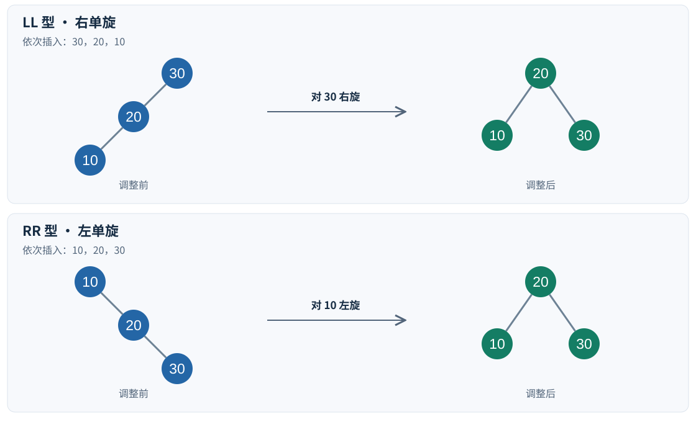

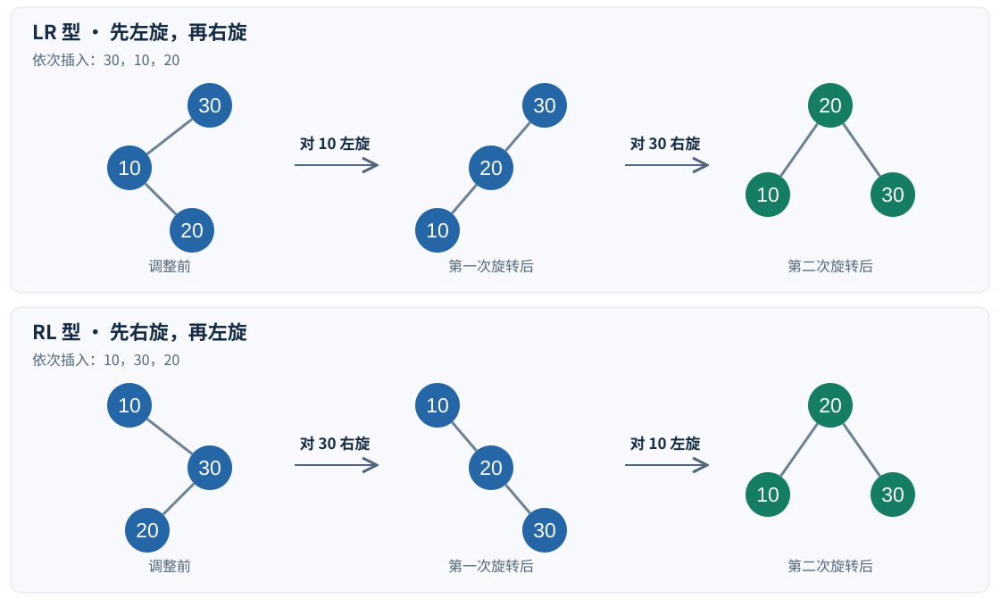

**左旋：右孩子上升成为新的根，原根下降成为它的左孩子。**

**右旋：左孩子上升成为新的根，原根下降成为它的右孩子。**

#### AVL 删除

先按二叉排序树规则删除，再沿删除路径自下向上寻找失衡结点，根据失衡结点及其较高孩子的左右高度判断 LL、RR、LR、RL 型并旋转，调整后继续向上检查，直到整棵树恢复平衡。

**判断口诀：沿着高度高的往下走。**

#### AVL 树的最少结点数

高度为 $h$ 的 AVL 树要使结点数最少，就让左右子树高度分别为 $h-1$ 和 $h-2$，再加上根结点，因此

$$
\boxed{N_h=N_{h-1}+N_{h-2}+1},\qquad h\ge2.
$$

约定空树高度为 $0$，则 $N_0=0$，$N_1=1$。

### 红黑树的性质 <span id="section-7-9"></span>

红黑树首先是一棵**二叉排序树（BST）**，所以左小右大。除此之外，还要满足以下规则：

1. 每个结点不是红色就是黑色。
2. 根结点是黑色。
3. 所有叶结点（**NIL 空结点**）都是黑色。
4. 红色结点的孩子必须是黑色，不能出现连续两个红色结点。
5. 从任意结点到其所有后代 NIL 结点的路径，包含的黑色结点数相同。

**黑高的定义：** 结点 $x$ 的黑高 $bh(x)$，是从 $x$ 出发（**不包括 $x$ 自身**），到任意一个后代 NIL 叶结点的路径上黑色结点的数量。

$$
\boxed{\text{红黑树的黑高}=bh(root)}.
$$

**计数约定：NIL 要计入黑高，但不计入实际结点数。**

- **黑高：** 不计自身，计 NIL。
- **树高：** 计实际结点，不计 NIL。
- **路径长度：** 按边数计算，题目要求到 NIL 就要算上通向 NIL 的那条边。

**高度性质：**

- 从根到 NIL 的最长路径长度不超过最短路径长度的 **$2$ 倍**。
- 含 $n$ 个内部结点（不含 NIL 空结点）的红黑树，高度满足

  $$
  \boxed{h\le2\log_2(n+1)}.
  $$

#### AVL 树与红黑树对比

| 比较项                           | AVL 树                                                       | 红黑树                                         |
| -------------------------------- | ------------------------------------------------------------ | ---------------------------------------------- |
| 平衡程度                         | **高度平衡的二叉查找树**，任意结点的左右子树高度差不超过 $1$ | **适度平衡的二叉查找树**，通过颜色规则约束树高 |
| 查询效率                         | 平衡条件更严格，树高上界更小，通常查询效率更优               | 平衡条件较宽松，查找路径可能更长               |
| 查找、插入、删除的最坏时间复杂度 | 均为 $O(\log_2 n)$                                           | 均为 $O(\log_2 n)$                             |

其中 $n$ 为树中的实际结点数。**AVL 查询效率通常更优，是树高和比较次数方面的优势；两者查找的时间复杂度仍为同一数量级，并非每次查询 AVL 都更快。**

**记忆：AVL 高度平衡，红黑树适度平衡；AVL 查询通常更优，两者查找、插入、删除均为 $O(\log_2 n)$。**

### 红黑树插入 <span id="section-7-10"></span>

**新插入的结点初始为红色。**

| 插入后情况                     | 操作                 |
| ------------------------------ | -------------------- |
| 父结点是黑色                   | 直接结束             |
| 父结点红色、叔叔红色           | 只变色，然后向上检查 |
| 父结点红色、叔叔黑色（含 NIL） | 旋转 + 变色          |

#### 父红、叔红：只变色

**父结点和叔叔染黑，祖父染红，再从祖父向上检查。最终根结点必须染黑。**

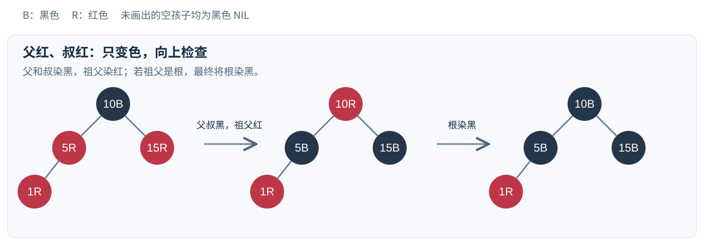

#### 父红、叔黑：旋转 + 变色

记新结点为 $N$，父结点为 $P$，祖父结点为 $G$，按 $G\to P\to N$ 的左右关系判断类型。

| 类型 | 旋转操作                               | 颜色调整             |
| ---- | -------------------------------------- | -------------------- |
| LL   | 对祖父 $G$ 右旋                        | 上升结点黑，原祖父红 |
| RR   | 对祖父 $G$ 左旋                        | 上升结点黑，原祖父红 |
| LR   | 先对父结点 $P$ 左旋，再对祖父 $G$ 右旋 | 上升结点黑，原祖父红 |
| RL   | 先对父结点 $P$ 右旋，再对祖父 $G$ 左旋 | 上升结点黑，原祖父红 |

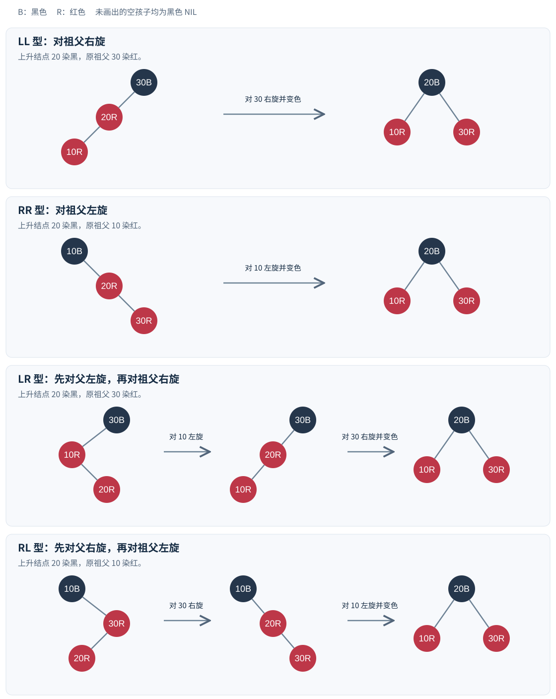

### 红黑树删除 <span id="section-7-8"></span>

#### 1. 删除红色叶结点

直接删除。

#### 2. 删除只有一个孩子的黑结点

黑结点只有一个孩子时，该孩子一定为红色（否则不满足左右黑高相同）。**直接用此红结点代替待删除结点，并将红色变为黑色。**

#### 3. 删除黑色叶结点

记删除后的待调整位置为 $x$，父结点为 $p$，兄弟为 $w$，兄弟的两个孩子分别为近侄 `near` 和远侄 `far`。以下按 $x$ 在 $p$ 左侧、$w$ 在右侧记录。

**① 兄弟为红色：** 此时两个侄子一定是黑色，故不适合借黑。将 $w$ 染黑、$p$ 染红，将 $w$ 提根（即对 $p$ 左旋），转为兄弟是黑色的情况继续处理。

**② 兄弟为黑色：**

| 情况             | 处理方法                                                                              |
| ---------------- | ------------------------------------------------------------------------------------- |
| 两个侄子都是黑色 | 将 $w$ 染红，并将双黑上移至 $p$，继续向上处理；遇红结点则染黑结束，到根则消去额外黑色 |
| 近侄红、远侄黑   | 先将近侄染黑、兄弟染红，再对兄弟 $w$ 右旋；变成近侄黑、远侄红，继续按下一种情况处理   |
| 远侄红           | 远侄染黑，$w$ 继承 $p$ 的颜色，$p$ 染黑，再对 $p$ 左旋                                |

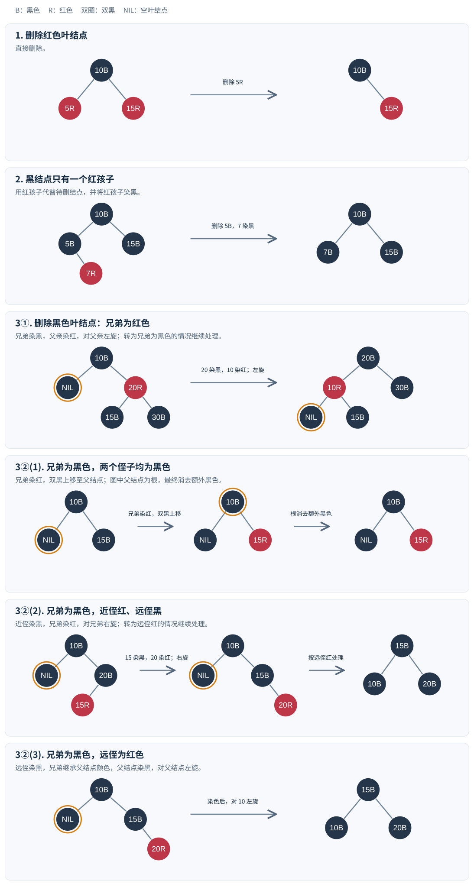

### B 树 <span id="section-7-11"></span>

$$
\boxed{m\text{ 阶 B 树：每个结点最多有 }m\text{ 棵子树}}.
$$

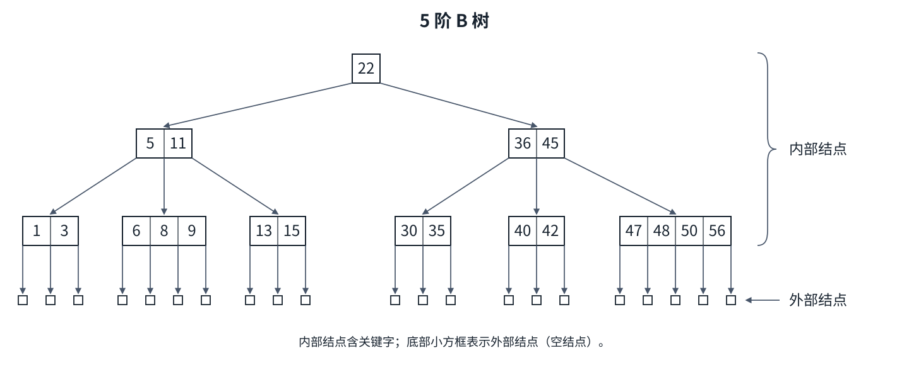

任意含关键字的结点，其子树个数等于关键字个数加 $1$（包括指向外部结点的空子树）：

$$
\boxed{\text{子树个数}=\text{关键字个数}+1}.
$$

- **B 树为空时，没有结点。**
- **B 树非空时，根结点至少有 $1$ 个关键字，也就是至少有 $2$ 棵子树**（包括空子树）。
- **除根结点外，非叶结点至少有 $\lceil m/2\rceil$ 棵子树，至少有 $\lceil m/2\rceil-1$ 个关键字。** 此处叶结点指外部空结点，子树数包括空子树。

$$
\boxed{\text{非根、非叶结点的最少子树数}=\left\lceil\frac m2\right\rceil,
\qquad
\text{最少关键字数}=\left\lceil\frac m2\right\rceil-1}.
$$

#### 外部结点数

**含有 $n$ 个关键字的 $m$ 阶 B 树，有 $n+1$ 个外部结点，与阶数 $m$ 无关。** 外部结点指查找失败时到达的**空结点**，不含关键字，不是最底层含关键字的结点。

设含关键字的结点共有 $q$ 个。每个这样的结点有“关键字数 $+1$”棵子树，所以子树指针总数为 $n+q$；其中 $q-1$ 个指向其他含关键字的结点，其余指向外部空结点，因此

$$
\boxed{\text{外部结点数}=(n+q)-(q-1)=n+1}.
$$

#### 结点数、关键字总数与高度的关系

讨论**非空 $m$ 阶 B 树**，设关键字总数为 $n$，高度为 $h$，记 $t=\lceil m/2\rceil$（$m\ge3$）。**高度按含关键字的结点层数计算：根为第 $1$ 层，外部空结点不计入高度。**

##### 1. 单个结点的关键字数量

设一个含关键字的结点有 $p$ 棵子树、$k$ 个关键字，子树数包括指向外部空结点的空子树，则

$$
k=p-1,\qquad p\le m.
$$

对**非根结点**，还有 $p\ge t$，因此

$$
\boxed{t-1\le k\le m-1}.
$$

若有 $q$ 个非根、含关键字的结点，则这些结点中的关键字总数 $K$ 满足

$$
\boxed{q(t-1)\le K\le q(m-1)}.
$$

**根结点是例外：最少只有 $1$ 个关键字，不能直接套用非根结点的下限。**

##### 2. 固定高度时，结点数与关键字总数的范围

**最多：** 每个结点都有 $m-1$ 个关键字，每个非底层结点都有 $m$ 个孩子。各层含关键字的结点数为 $1,m,m^2,\ldots,m^{h-1}$，故

$$
\text{结点数}_{\max}=1+m+m^2+\cdots+m^{h-1},
$$

$$
\boxed{n_{\max}=(m-1)(1+m+\cdots+m^{h-1})=m^h-1}.
$$

**最少：** 根结点只有 $1$ 个关键字；当 $h\ge2$ 时，根只有 $2$ 个孩子，其余非底层结点只有 $t$ 个孩子。各层含关键字的结点数为 $1,2,2t,\ldots,2t^{h-2}$，故

$$
\text{结点数}_{\min}=1+2\sum_{j=0}^{h-2}t^j,
$$

$$
\boxed{n_{\min}=1+2(t-1)\sum_{j=0}^{h-2}t^j=2t^{h-1}-1}.
$$

当 $h=1$ 时，上式中的求和为空，最少结点数与最少关键字数均为 $1$，结论仍成立。

##### 3. 由关键字总数求高度范围

由 $n_{\min}\le n\le n_{\max}$，得

$$
\boxed{2\left\lceil\frac m2\right\rceil^{h-1}-1\le n\le m^h-1}.
$$

整理得

$$
\boxed{\log_m(n+1)\le h\le1+\log_{\lceil m/2\rceil}\frac{n+1}{2}}.
$$

因为高度为整数，取整后为

$$
\boxed{\left\lceil\log_m(n+1)\right\rceil\le h\le1+\left\lfloor\log_{\lceil m/2\rceil}\frac{n+1}{2}\right\rfloor}.
$$

**记忆：求最小高度，让结点尽量装满；求最大高度，让结点尽量少装。根最少 $1$ 个关键字、$2$ 棵子树，其他含关键字结点最少 $t-1$ 个关键字、$t$ 棵子树。**

#### 插入：分裂结点

以下示例均为 **5 阶 B 树**：每个结点最多有 $4$ 个关键字，非根、含关键字的结点至少有 $2$ 个关键字。各例独立进行。

原树如下，现在插入关键字 **32**：

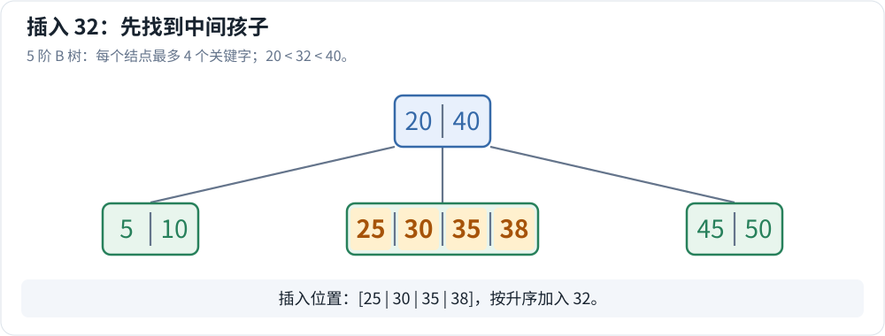

因为 $20<32<40$，将 32 插入中间孩子，保持有序，得到：

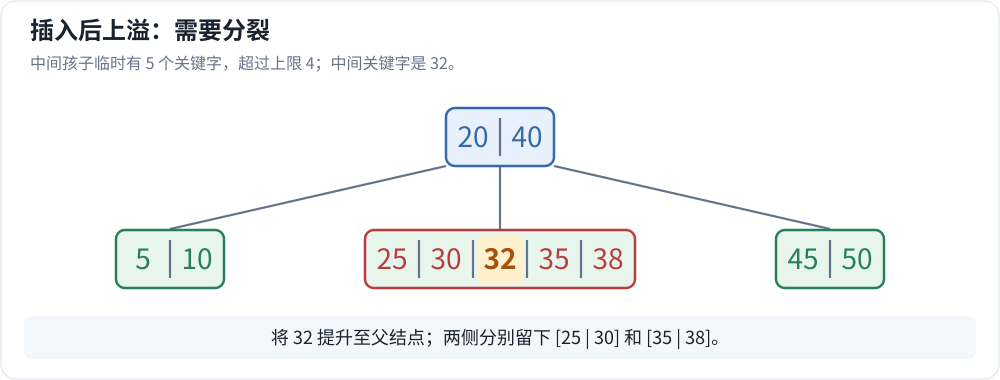

此时有 $5$ 个关键字，超过上限，必须**分裂结点**：将中间关键字 **32 提升到父结点**，左边留下 `[25 | 30]`，右边留下 `[35 | 38]`。

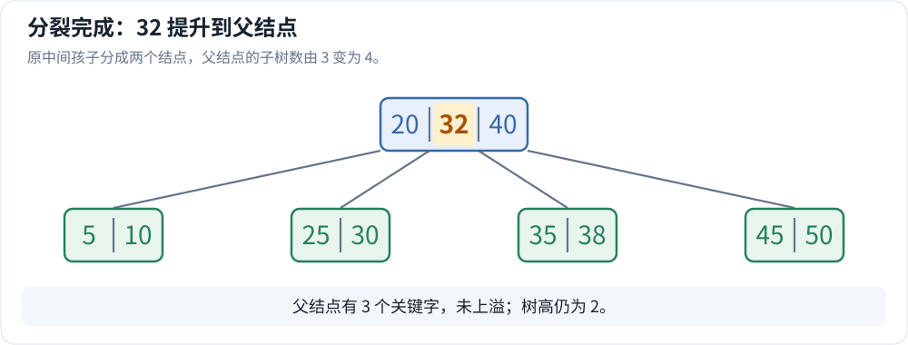

父结点变为 `[20 | 32 | 40]`，未超过上限，插入结束，树高不变。

#### 删除：直接删除、向兄弟借、合并

##### 情况 1：直接删除

从最底层结点 `[25 | 30 | 35]` 中删除 **35**，剩下 `[25 | 30]`，仍有 $2$ 个关键字，满足下限，直接删除即可。


##### 情况 2：关键字不足，向兄弟借

回到下面这棵树，删除左侧结点中的 **5**：

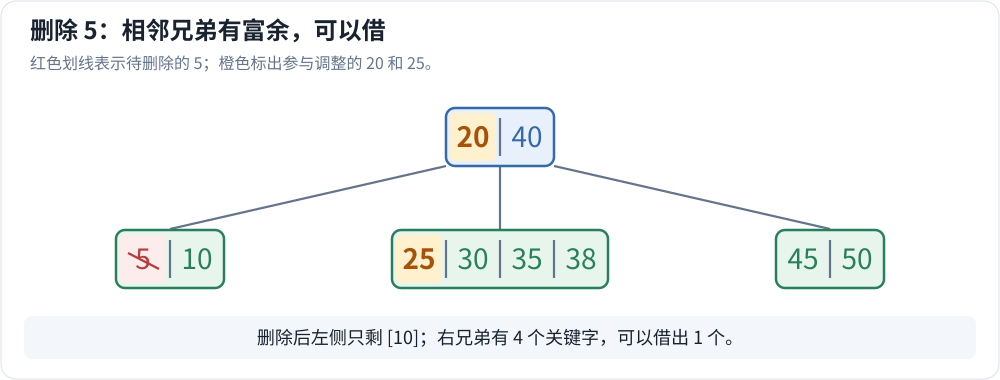

删除后，左侧只剩 `[10]`，少于下限 $2$；右侧相邻兄弟 `[25 | 30 | 35 | 38]` 有富余，可以借。

**借的过程要经过父结点：父结点中的 20 下移，兄弟中的 25 上移。**

- 左侧孩子：`[10]` → `[10, 20]`。
- 父结点：`[20, 40]` → `[25, 40]`。
- 右侧相邻兄弟：`[25, 30, 35, 38]` → `[30, 35, 38]`。

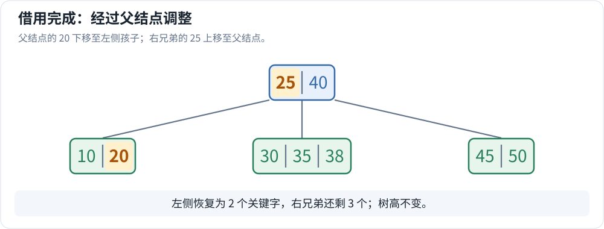

##### 情况 3：兄弟没有富余，合并

换成下面这棵树，仍然删除 **5**：

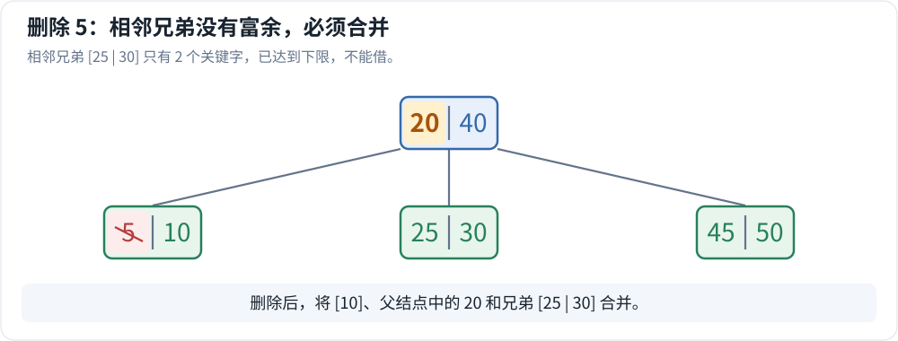

删除后，左侧只剩 `[10]`，而相邻兄弟 `[25 | 30]` 恰好只有 $2$ 个关键字，不能借。

将**当前结点 `[10]`、父结点中的分隔关键字 20、相邻兄弟 `[25 | 30]`** 合并为：

```text
[10 | 20 | 25 | 30]
```

父结点失去 20，变为 `[40]`；它是根结点，允许只有 $1$ 个关键字，调整结束，树高不变。

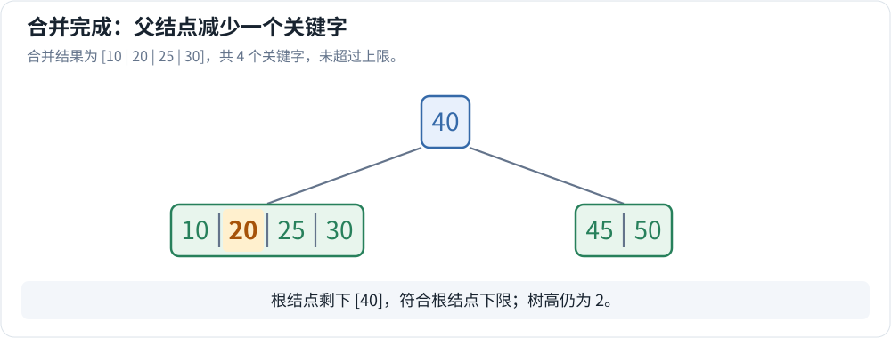

### B+ 树 <span id="section-7-12"></span>

#### 分支结点的子树数与关键字数

**分支结点就是非叶结点。** 对于 $m$ 阶 B+ 树：

| 分支结点类型 | 最少子树数         | 最多子树数 |
| ------------ | ------------------ | ---------- |
| 非叶根结点   | $2$                | $m$        |
| 其余分支结点 | $\lceil m/2\rceil$ | $m$        |

**每个分支结点的关键字个数等于其子树个数。** 设关键字个数为 $k$，子树个数为 $p$，则

$$
\boxed{k=p}.
$$

**注意与 B 树区分：B 树中，含 $k$ 个关键字的结点有 $k+1$ 棵子树；B+ 树中，分支结点的关键字数与子树数相同。**

#### 叶结点存储与顺序链接

- **所有关键字及其对应的记录指针均存储在叶结点中。**
- 叶结点内的关键字按**升序排列**。
- 相邻叶结点通过指针按**关键字顺序链接**，便于顺序遍历和范围查找。
- **分支结点仅包含引导查询的关键字和指向各子结点的指针，不存储记录指针。** 分支结点中的关键字作为索引使用，叶结点中仍保存相应关键字及其记录指针。

#### 两种查找方式

**B+ 树既支持从根结点开始的多路查找，也支持顺序查找。**

- **多路查找：** 从根结点出发，利用分支结点中的索引关键字逐层向下，最终到叶结点中找到关键字及对应的记录指针。
- **顺序查找：** 从最左侧叶结点开始，沿叶结点之间的指针，按关键字升序依次查找。范围查找时，也可以先定位范围起点，再沿叶结点链表向后扫描。

**记忆：分支只导航，数据在叶上；关键字数等于子树数，叶结点有序相连；既能多路查找，也能顺序查找。**

### 散列查找 <span id="section-7-13"></span>

#### 散列函数的构造要求

1. **定义域完整：** 必须包含需要处理的全部关键字，计算结果应是有效的散列地址。
2. **分布均匀：** 使关键字对应的地址尽可能均匀地分布在地址空间中，减少冲突。
3. **计算简单：** 能在较短时间内计算出散列地址。

#### 同义词与冲突

- **同义词（同义关键字）：** 不同关键字的散列地址相同，即 $key_1\ne key_2$，但 $H(key_1)=H(key_2)$。
- **冲突：** 不同关键字要占用同一个散列地址的现象。

**记忆：同义词描述关键字之间的关系，冲突描述争用同一地址的现象。**

#### 装填因子与查找效率

装填因子用 $\alpha$ 表示：

$$
\boxed{\alpha=\frac{n}{m}}.
$$

- $n$：散列表中已经存放的关键字个数。
- $m$：散列表的长度，即槽位总数。

**装填因子越大，散列表越满，通常冲突越多，平均查找长度 ASL 越大，查找效率越低。**

在散列均匀、冲突处理方法一定的通常分析中，**平均查找长度主要依赖于装填因子 $\alpha$，不直接依赖于 $n$ 或 $m$ 单独的大小**。实际查找效率还与散列函数和冲突处理方法有关。

#### 开放定址法中的聚集

**聚集：** 处理冲突时，多个关键字集中占用某些位置，使后续查找或插入需要更长的探测序列；其中的关键字不一定互为同义词。

**采用开放定址法解决冲突时，发生聚集的主要原因是冲突处理方法选择不当。** 例如线性探测容易形成连续占用区，原本散列地址不同的关键字也可能在探测过程中争用同一位置，使聚集进一步扩大。

#### 查找成功与查找失败的 ASL

以下按**开放定址法**讨论，假设表中有可探测到的空位置且无删除标记。查找时从 $H(key)$ 开始，按题目规定的冲突处理方法依次探测；**查找长度按探测位置数计算，终止位置也计入。**

##### 查找成功

**从 $H(key)$ 开始查找，直到找到该关键字。** 从初始位置到找到关键字为止，探测的位置总数就是该关键字的成功查找长度；若在初始位置就找到，查找长度为 $1$。

当各关键字被查找的概率相等时，设表中有 $n$ 个关键字，第 $i$ 个关键字的成功查找长度为 $L_i$，则

$$
\boxed{ASL_{\text{成功}}=\frac{\text{所有关键字的成功查找长度之和}}{\text{关键字个数}}=\frac{\sum_{i=1}^{n}L_i}{n}}.
$$

##### 查找失败

**从每一个可能的初始散列地址出发，按规定的探测序列查找，直到遇到空位置。** 最后遇到的空位置也要计入查找长度；若初始位置就是空位置，失败查找长度为 $1$。

当各初始散列地址出现的概率相等时，设共有 $r$ 个可能的初始散列地址，从第 $j$ 个地址出发的失败查找长度为 $U_j$，则

$$
\boxed{ASL_{\text{失败}}=\frac{\text{各初始散列地址的失败查找长度之和}}{\text{可能的初始散列地址个数}}=\frac{\sum_{j=1}^{r}U_j}{r}}.
$$

**注意：失败 ASL 的分母是可能的初始散列地址个数，不一定等于散列表长度。** 例如表长为 $13$、$H(key)=key\bmod11$，且余数 $0\sim10$ 均可能出现，则只从这 $11$ 个初始地址分别计算，分母为 $11$；探测过程中仍可能访问表中其他位置。

**记忆：成功按关键字逐个算，失败按初始地址逐个算；成功数到找到，失败数到空位，终止位置都要算。**

## <span style="color: #3498db;">第八章：排序</span> <span id="section-8"></span>

### 排序算法复杂度与稳定性对比 <span id="section-8-1"></span>

设 $n$ 为待排序记录数；$k$ 为计数排序的关键字取值范围大小；$d$ 为基数排序的关键字位数，$r$ 为每一位的基数（桶数）。空间复杂度指**辅助空间复杂度**，递归栈也计入。

| 排序算法     | 最好时间       | 平均时间       | 最坏时间                        | 辅助空间                        | 稳定性 |
| ------------ | -------------- | -------------- | ------------------------------- | ------------------------------- | ------ |
| 直接插入排序 | $O(n)$         | $O(n^2)$       | $O(n^2)$                        | $O(1)$                          | 稳定   |
| 折半插入排序 | $O(n\log_2 n)$ | $O(n^2)$       | $O(n^2)$                        | $O(1)$                          | 稳定   |
| 希尔排序     | 与增量序列有关 | 与增量序列有关 | 与增量序列有关，常见为 $O(n^2)$ | $O(1)$                          | 不稳定 |
| 冒泡排序     | $O(n)$         | $O(n^2)$       | $O(n^2)$                        | $O(1)$                          | 稳定   |
| 简单选择排序 | $O(n^2)$       | $O(n^2)$       | $O(n^2)$                        | $O(1)$                          | 不稳定 |
| 快速排序     | $O(n\log_2 n)$ | $O(n\log_2 n)$ | $O(n^2)$                        | 平均 $O(\log_2 n)$，最坏 $O(n)$ | 不稳定 |
| 堆排序       | $O(n\log_2 n)$ | $O(n\log_2 n)$ | $O(n\log_2 n)$                  | $O(1)$                          | 不稳定 |
| 二路归并排序 | $O(n\log_2 n)$ | $O(n\log_2 n)$ | $O(n\log_2 n)$                  | $O(n)$                          | 稳定   |
| 计数排序     | $O(n+k)$       | $O(n+k)$       | $O(n+k)$                        | $O(n+k)$                        | 稳定   |
| 基数排序     | $O(d(n+r))$    | $O(d(n+r))$    | $O(d(n+r))$                     | $O(n+r)$                        | 稳定   |

**稳定性的含义：关键字相同的记录，排序后的相对次序保持不变。** 表中稳定算法按保持相同关键字原有次序的通常实现讨论；例如折半插入时应将新记录插入已有相同关键字之后。

**记忆：希尔、简单选择、快速、堆排序不稳定；其余表中算法的通常实现稳定。**

### 排序算法与存储结构 <span id="section-8-2"></span>

| 适用的存储结构                       | 排序算法                                                     |
| ------------------------------------ | ------------------------------------------------------------ |
| **主要适合顺序表（按教材常用实现）** | **折半插入排序、希尔排序、堆排序、快速排序**                 |
| **顺序表和链表均可使用**             | **直接插入排序、冒泡排序、简单选择排序、归并排序、基数排序** |

- **折半插入排序：** 需要快速访问中间位置，依赖顺序表的随机访问。
- **希尔排序：** 按增量访问间隔位置，适合顺序表。
- **堆排序：** 利用顺序存储的完全二叉树，通过下标快速定位父、子结点。
- **快速排序：** 教材常用的划分过程按数组下标从两端扫描，主要适合顺序表；也存在链表版本，因此不能绝对地说它只能用于顺序表。

第二类算法可以通过顺序扫描、修改结点链接等方式在链表上实现，其中**归并排序尤其适合链表**，**基数排序可采用链式队列完成分配与收集**。

**记忆：折半、希尔、堆、快，主要用顺序表；直接插入、冒泡、简单选择、归并、基数，两种存储均可。**

### 直接插入排序 <span id="section-8-3"></span>

**第一趟从第二个元素开始，第一个元素单独构成初始有序区。**

从第二个元素开始，依次取出待插入元素，与前面有序区**从后往前比较**，将比它大的元素依次后移，直到找到合适位置并插入。

#### 示例：将 4 插入有序区

当前序列为 `2, 5, 8 | 4, 7`，左侧 `2, 5, 8` 已经有序，现在取出 **4**。这展示的是**第三趟**插入，第一趟处理的是第二个元素 **5**。

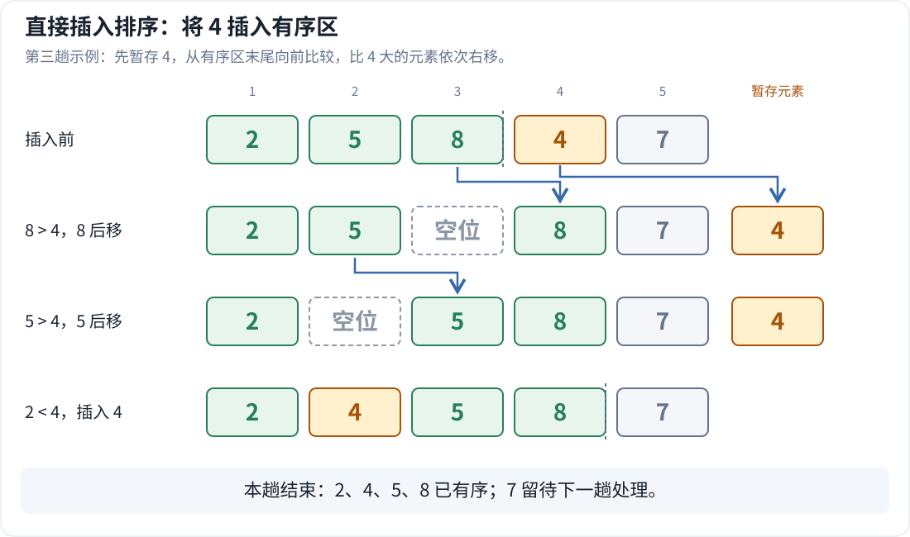

### 折半插入排序 <span id="section-8-4"></span>

从第二个元素开始，先用 temp 保存待插入元素，再通过折半查找确定插入位置 low，将 A[low] 到 A[i−1] 的元素从后往前依次后移一位，最后将 temp 放入 A[low]。

### 希尔排序 <span id="section-8-5"></span>

先按增量 d 分组，对每组分别进行直接插入排序，然后不断缩小增量，直到 d = 1，完成最后一趟排序

### 冒泡排序 <span id="section-8-6"></span>

从前往后依次比较相邻两个元素，如果前面的大于后面的，就交换位置。每一趟把当前未排序区的最大元素放到最后。

### 简单选择排序 <span id="section-8-7"></span>

每一趟从未排序区中找到最小元素，与未排序区的第一个元素交换，逐渐扩大前面的有序区

### 快速排序 <span id="section-8-8"></span>

每次选取一个基准元素（pivot），通过一趟划分，将比它小的元素放到左边，比它大的元素放到右边，然后递归排序左右两部分。

```cpp
int Partition(int A[], int low, int high)
{
    int pivot = A[low];

    while(low < high)
    {
        while(low < high && A[high] >= pivot)
            high--;

        A[low] = A[high];

        while(low < high && A[low] <= pivot)
            low++;

        A[high] = A[low];
    }

    A[low] = pivot;
    return low;
}

void QuickSort(int A[], int low, int high)
{
    if(low >= high)
        return;

    int pivotPos = Partition(A, low, high);

    QuickSort(A, low, pivotPos - 1);
    QuickSort(A, pivotPos + 1, high);
}
```

#### 示例：第一趟划分

以 `5, 2, 8, 1, 7, 3` 为例，选 **5** 作为基准，采用挖坑法，从右向左、从左向右交替扫描。图中的“空”表示当前可被覆盖的位置。

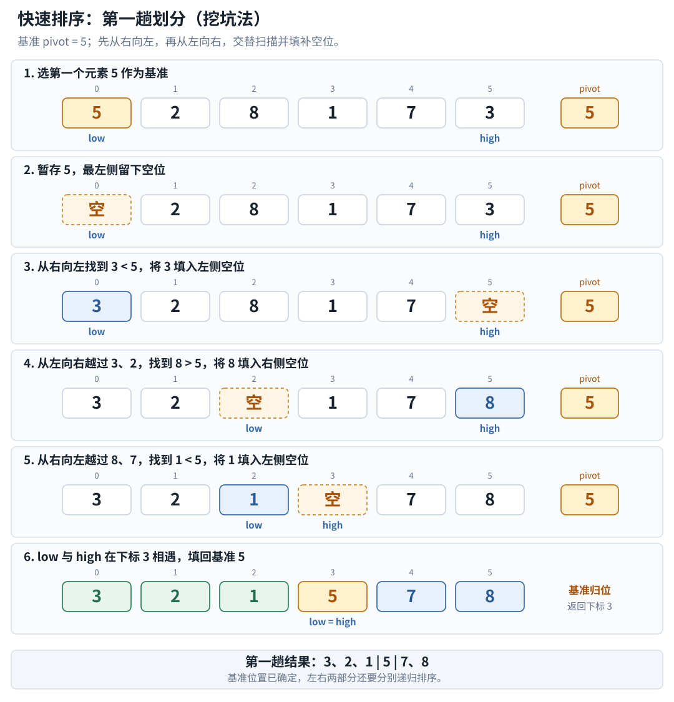

第一趟结果为 `3, 2, 1 | 5 | 7, 8`，基准 **5** 的最终位置已确定，再递归排序左右两部分。

### 堆排序 <span id="section-8-9"></span>

大根堆是一棵完全二叉树，每个非叶结点的值都不小于其孩子结点的值，堆顶是当前堆中的最大值。使用大根堆进行堆排序，最终得到**升序序列**。

#### 初始建堆

结点编号从 1 开始时，从最后一个非叶结点 $\lfloor n/2\rfloor$ 开始，自下而上，依次向前处理，直到根结点，对每个结点进行向下调整：

1. 将当前结点与其**较大的孩子**比较；若只有一个孩子，则与该孩子比较。
2. 若当前结点较小，则交换二者，继续检查被换下去的结点，沿交换路径向下调整。
3. 直到当前结点不小于其孩子，或到达叶结点，停止本次调整。

所有非叶结点处理完毕，建堆完成。自下而上处理，保证每次调整一个结点时，它的左右子树已经分别满足大根堆性质。

#### 排序过程

1. 将堆顶最大值与当前堆的最后一个元素交换，最大值便放到了最终位置。
2. 将堆的大小减 1，末尾已排好序的元素不再参与调整。
3. 对新的堆顶进行向下调整，恢复大根堆性质。
4. 重复以上操作，直到堆中只剩一个元素，排序完成。

**每次缩小堆后，只需对根结点向下调整，无须重新建立整个堆。** 因为交换只改变了根结点的值，并移除了末尾叶结点，左右子树仍然分别满足大根堆性质。

#### 堆的插入与删除

- **插入元素：** 将新元素放在堆的末尾，保持完全二叉树的形状；再依次与父结点比较，若不满足堆性质，就向上交换，直到满足堆性质或到达根结点。最多从叶结点调整到根结点，时间复杂度为 $O(\log_2 n)$。
- **删除堆顶：** 用堆的最后一个元素覆盖堆顶，将堆的大小减 1，再从根结点向下调整，时间复杂度为 $O(\log_2 n)$。
- **删除指定位置的元素：** 用最后一个元素覆盖该位置，将堆的大小减 1；若新元素与父结点不满足堆性质，则向上调整，否则按需向下调整。删除末尾元素时直接缩小堆即可。**已知删除位置时**，删除操作的时间复杂度为 $O(\log_2 n)$；若还需按值查找位置，最坏查找时间为 $O(n)$。

#### 堆的基本操作复杂度

以下按顺序存储、迭代调整计算，时间为最坏情况上界，空间为辅助空间，不计堆本身的存储及数组扩容。

| 操作                           | 时间复杂度     | 辅助空间复杂度 |
| ------------------------------ | -------------- | -------------- |
| 添加／插入元素                 | $O(\log_2 n)$  | $O(1)$         |
| 删除元素（已知位置）           | $O(\log_2 n)$  | $O(1)$         |
| 建堆（自底向上，逐个向下调整） | $O(n)$         | $O(1)$         |
| 建堆（从空堆开始，逐个插入）   | $O(n\log_2 n)$ | $O(1)$         |

**两种建堆方式要区分：** 自底向上建堆时，大部分结点靠近叶结点，向下调整的距离很短，总时间为 $O(n)$；逐个插入建堆时，每次插入最多需要 $O(\log_2 n)$ 时间，最坏总时间为 $O(n\log_2 n)$。

#### 堆排序的复杂度

1. 初始建堆：$O(n)$。
2. 反复取出堆顶：共 $n-1$ 次，每次交换后向下调整最多需要 $O(\log_2 n)$ 时间，这一阶段总时间为 $O(n\log_2 n)$。
3. 总时间复杂度：$O(n)+O(n\log_2 n)=O(n\log_2 n)$。

使用迭代方式向下调整时，堆排序的辅助空间复杂度为 $O(1)$；堆排序是**不稳定排序**。

### 归并排序 <span id="section-8-10"></span>

二路归并排序采用**分治思想**：将序列不断分成两半，直到每组只有一个元素（单个元素天然有序），再逐层将相邻的两个有序段合并，最终得到整个有序序列。

#### 双指针合并与辅助数组

数组实现中，预先分配一个长度为 $n$ 的辅助数组 `temp`，在整个排序过程中复用。递归划分时只需传递区间边界，无须实际创建两个子数组。

假设当前两个有序段为 `A[left..mid]` 和 `A[mid+1..right]`：

1. 用指针 `i`、`j` 分别指向两个有序段的首元素，用 `k` 指向 `temp` 中当前区间的写入位置，初始为 `left`。
2. 比较 `A[i]` 和 `A[j]`，将较小的元素写入 `temp[k]`，移动对应指针，并将 `k` 后移。
3. 当某一段的元素全部取完后，将另一段剩余的元素依次写入 `temp`。
4. 将 `temp[left..right]` 复制回 `A[left..right]`，本次合并完成；后续合并继续复用同一个 `temp`。

### 基数排序 <span id="section-8-11"></span>

基数排序每趟先按当前位将 $n$ 个元素分配到 $r$ 个桶中，再按桶号顺序遍历 $r$ 个桶并收集全部 $n$ 个元素，因此每趟时间复杂度为 $O(n+r)$，共进行 $d$ 趟，总时间复杂度为 $O(d(n+r))$。

### 计数排序 <span id="section-8-12"></span>

核心思想：统计每个数字出现多少次，再按照从小到大的顺序输出。

例如：`[4, 2, 2, 8, 3, 3, 1]`

第一步：统计出现次数。

| 数字 | 1   | 2   | 3   | 4   | 5   | 6   | 7   | 8   |
| ---- | --- | --- | --- | --- | --- | --- | --- | --- |
| 次数 | 1   | 2   | 2   | 1   | 0   | 0   | 0   | 1   |

输出：`[1, 2, 2, 3, 3, 4, 8]`

### 外部排序 <span id="section-8-13"></span>

1. **生成初始归并段：** 根据内存缓冲区大小，分批将子文件读入内存，用内部排序算法排序后写回外存，形成有序的初始归并段。
2. **多路归并：** 将多个有序归并段合并成更长的有序段，直到整个文件有序。

$$
S=\lceil\log_k r\rceil
$$

$$
\text{归并阶段 I/O 次数}=2NS
$$

其中，$r$ 是初始归并段数，$k$ 是归并路数，$N$ 是整个文件的磁盘块数，$S$ 是归并趟数。

整个外部排序的 I/O 次数，还需加上生成初始归并段时的读写次数 $2N$：

$$
\text{外部排序总 I/O 次数}=2N+2NS=2N(S+1)
$$

败者树是多路归并中快速选取最小元素的数据结构。建树时，将各归并段当前的候选元素两两比较，败者记录在内部结点，胜者继续向上比较，最终胜者单独记录。输出最小元素后，从对应归并段取出下一个元素，只需沿原比赛路径向上重新比较，无需重新比较所有元素，使每次选取最小值的比较次数由普通方法的 $k-1$ 次降低为约 $\lceil\log_2 k\rceil$ 次。

在理想条件下，总比较次数的数量级与归并路数 $k$ 无关，主要由元素总数 $n$ 和初始归并段数 $r$ 决定。在空间允许的前提下，增加 $k$ 可以减少归并趟数和 I/O 次数，提高效率，但 $k$ 并非越大越好。

置换-选择排序就是用有限的内存，生成长度可能超过内存工作区容量的初始归并段。每输出一个最小元素，就从外存补充一个新元素；如果新元素不小于刚输出的元素，就继续参与当前归并段，否则冻结，留到下一个归并段。

最佳归并树：对于长度不相等的初始归并段，为了减少磁盘 I/O，按照哈夫曼树的思想，再补虚段后，优先合并长度较短的归并段。

设 $k$ 叉归并树有 $r$ 个叶结点、$m$ 个非叶结点，且每个非叶结点恰有 $k$ 个孩子。边数为 $km$，结点总数比边数多 1，所以：

$$
r+m=km+1\quad\Rightarrow\quad m=\frac{r-1}{k-1}
$$

非叶结点数量 $m$ 必须是整数，所以：

$$
\boxed{(r-1)\bmod(k-1)=0}
$$

#### 示例：四路最佳归并

8 个初始归并段的长度（磁盘块数）为：`2, 3, 4, 5, 6, 7, 8, 11`。

##### **补虚段**

$$
(8-1)\bmod(4-1)=1
$$

需要补 2 个权值为 0 的虚段，补后为：`0, 0, 2, 3, 4, 5, 6, 7, 8, 11`。

##### **四路最佳归并顺序**

- 第一次：$0+0+2+3=5$。
- 第二次：$4+5+5+6=20$。
- 第三次：$7+8+11+20=46$。

##### **WPL**

按叶子权值乘路径长度计算：

$$
\begin{aligned}
WPL&=(11+8+7)\times1\\
&\quad +(5+4+6)\times2\\
&\quad +(0+0+2+3)\times3\\
&=\boxed{71}
\end{aligned}
$$

也可以直接将每次合并得到的内部结点权值相加：

$$
WPL=5+20+46=\boxed{71}
$$

##### **归并阶段磁盘 I/O**

$$
I/O=2\times WPL=2\times71=\boxed{142\text{ 次}}
$$

其中读取 71 次、写入 71 次，共 142 次。
