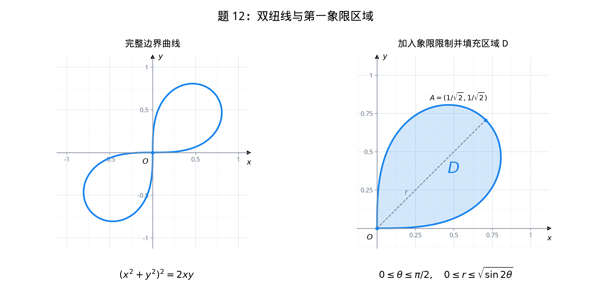
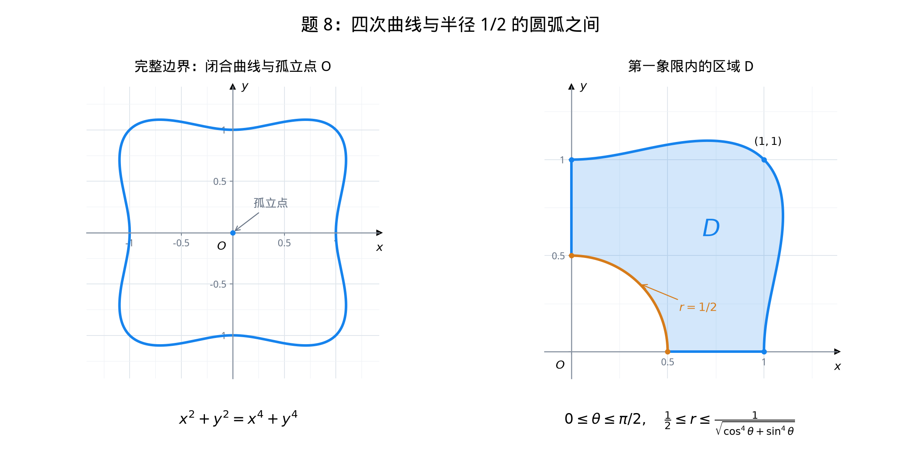
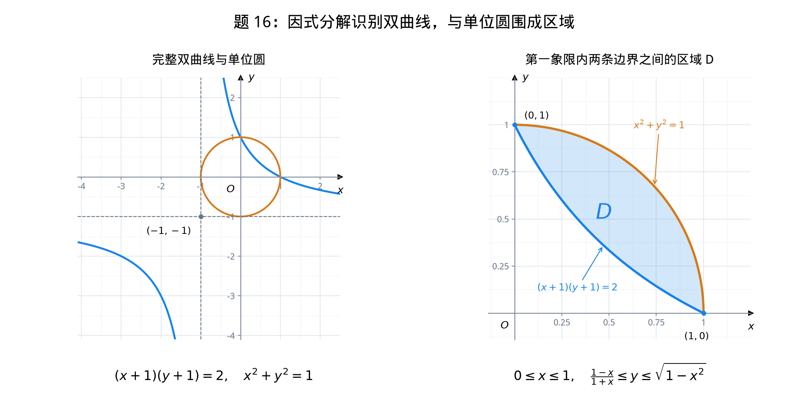

# 高等数学习题笔记

## 章节目录

- [第一章：函数、极限与连续](#chapter-1)
- [第二章：一元函数微分学及其应用](#chapter-2)
- [第三章：一元函数积分学及其应用](#chapter-3)
- [第四章：多元函数微分学](#chapter-4)
- [第五章：重积分](#chapter-5)
- [第六章：微分方程](#chapter-6)
- [第七章：无穷级数](#chapter-7)

## 第一章：函数、极限与连续 

### 已知极限求未知函数的极限（例 1.27） 

**题目：** 已知

$$
\lim_{x\to0}\frac{\tan2x+xf(x)}{\sin(x^3)}=0,
$$

求 $\displaystyle\lim_{x\to0}\frac{2+f(x)}{x^2}$。

**解：** 因 $\sin(x^3)\sim x^3$，令

$$
\frac{\tan2x+xf(x)}{x^3}=\alpha(x)\to0.
$$

由 $\tan2x=2x+\frac83x^3+o(x^3)$，得

$$
\frac{2+f(x)}{x^2}
=\frac{2x-\tan2x}{x^3}+\alpha(x)
\longrightarrow\boxed{-\frac83}.
$$

**要点：** 脱帽法——将极限为 $0$ 的式子记为无穷小 $\alpha(x)$，再整理、展开。

### 指数差的无穷小阶数（例 1.19） 

**题目：** $x\to0$ 时，$e^{\tan x}-e^{\sin x}$ 与 $x^n$ 为同阶无穷小，求 $n$。

**解：** 提取公因式，利用 $e^u-1\sim u$：

$$
\begin{aligned}
e^{\tan x}-e^{\sin x}
&=e^{\sin x}\bigl(e^{\tan x-\sin x}-1\bigr)\\
&\sim\tan x-\sin x\\
&=\tan x(1-\cos x)\\
&\sim x\cdot\frac{x^2}{2}=\frac{x^3}{2}.
\end{aligned}
$$

故 $\boxed{n=3}$。

### 幂和的 n 次方根极限（例 2.10） 

**题目：** 设 $m$ 为固定正整数，$a_1,\ldots,a_m$ 为固定非负数，求

$$
\lim_{n\to\infty}\sqrt[n]{a_1^n+a_2^n+\cdots+a_m^n}.
$$

**解：** 令 $a=\max\{a_1,\ldots,a_m\}$，则

$$
a^n\le a_1^n+a_2^n+\cdots+a_m^n\le ma^n,
$$

开 $n$ 次方得

$$
a\le\sqrt[n]{a_1^n+a_2^n+\cdots+a_m^n}\le a\,m^{1/n}.
$$

因 $m^{1/n}\to1$，由夹逼准则得

$$
\boxed{\lim_{n\to\infty}\sqrt[n]{a_1^n+a_2^n+\cdots+a_m^n}
=\max\{a_1,\ldots,a_m\}}.
$$

### 余弦关系确定的数列极限（例 2.11） 

**题目：** 设 $0<a_n,b_n<\frac\pi2$，$\cos a_n-a_n=\cos b_n$，且 $b_n\to0$，求

$$
\lim_{n\to\infty}a_n,\qquad\lim_{n\to\infty}\frac{a_n}{b_n^2}.
$$

**解：** 由 $\cos a_n-\cos b_n=a_n>0$，及 $\cos x$ 在 $(0,\pi/2)$ 上严格递减，得

$$
0<a_n<b_n\to0\quad\Rightarrow\quad\boxed{a_n\to0}.
$$

由 $1-\cos b_n=1-\cos a_n+a_n$，得

$$
\begin{aligned}
\frac{a_n}{b_n^2}
&=\frac{1-\cos b_n}{b_n^2}
\cdot\frac{a_n}{1-\cos a_n+a_n}\\
&=\frac{1-\cos b_n}{b_n^2}
\cdot\frac1{\dfrac{1-\cos a_n}{a_n}+1}
\longrightarrow\frac12\cdot1=\boxed{\frac12}.
\end{aligned}
$$

其中 $1-\cos t\sim t^2/2$，故 $(1-\cos a_n)/a_n\to0$。

### 对数递推数列：单调有界（例 2.14） 

**题目：**

1. 证明方程 $x=2\ln(1+x)$ 在 $(0,+\infty)$ 内有唯一实根 $\xi$。
2. 任取 $x_1>\xi$，定义 $x_{n+1}=2\ln(1+x_n)$，证明数列收敛并求极限。

**解：** 令 $F(x)=x-2\ln(1+x)$，则

$$
F'(x)=\frac{x-1}{x+1}.
$$

$F$ 在 $(0,1)$ 上递减，在 $(1,+\infty)$ 上递增。又

$$
F(0)=0,\qquad F(1)=1-2\ln2<0,\qquad
\lim_{x\to+\infty}F(x)=+\infty,
$$

故正根唯一，且 $\xi>1$。

若 $x_n>\xi$，由 $F(x_n)>0$ 及对数函数递增，得

$$
\xi=2\ln(1+\xi)<x_{n+1}=2\ln(1+x_n)<x_n.
$$

由归纳法，$\{x_n\}$ 递减且以下界 $\xi$ 有界，故存在极限 $L\ge\xi$。递推式两边取极限：

$$
L=2\ln(1+L).
$$

由正根唯一性，$\boxed{\lim_{n\to\infty}x_n=\xi}$。

### 余弦递推数列：压缩估计（例 2.15） 

**题目：**

1. 证明方程 $x=\cos x$ 在 $(0,\pi/3)$ 内有唯一实根 $a$。
2. 设 $-1\le x_1\le1$，定义 $x_{n+1}=\cos x_n$，证明 $x_n\to a$。

**解：** 令 $F(x)=\cos x-x$，则

$$
F(0)=1>0,\qquad F(\pi/3)=\frac12-\frac\pi3<0,
\qquad F'(x)=-\sin x-1<0.
$$

由零点定理及严格单调性，存在唯一 $a\in(0,\pi/3)$ 使 $a=\cos a$。

由 $x_1\in[-1,1]$，递推得 $x_n\in[\cos1,1]\subset(0,\pi/3)$（$n\ge2$）。由拉格朗日中值定理，

$$
|x_{n+1}-a|=|\cos x_n-\cos a|
\le\frac{\sqrt3}{2}|x_n-a|\qquad(n\ge2).
$$

反复迭代得

$$
|x_n-a|\le\left(\frac{\sqrt3}{2}\right)^{n-2}|x_2-a|
\longrightarrow0.
$$

故 $\boxed{\lim_{n\to\infty}x_n=a}$。

### 根式有理化求极限（题 1.7） 

**题目：** 求 $\displaystyle\lim_{x\to0^+}\frac{1-\sqrt{\cos x}}{x(1-\cos\sqrt{x})}$。

**解：** 分子有理化，利用 $1-\cos t\sim t^2/2$：

$$
\begin{aligned}
\lim_{x\to0^+}\frac{1-\sqrt{\cos x}}{x(1-\cos\sqrt{x})}
&=\lim_{x\to0^+}\frac{1-\cos x}{x(1-\cos\sqrt{x})(1+\sqrt{\cos x})}\\
&=\lim_{x\to0^+}\frac{x^2/2}{x\cdot(x/2)\cdot(1+\sqrt{\cos x})}
=\boxed{\frac12}.
\end{aligned}
$$

### 相邻项比值判断数列极限（题 2.2） 

**题目：** 设 $x_n>0$，且 $\displaystyle\lim_{n\to\infty}\frac{x_{n+1}}{x_n}=\frac12$，则（　）。

- A. $\lim x_n=0$
- B. $\lim x_n$ 存在，但不为零
- C. $\lim x_n$ 不存在
- D. $\lim x_n$ 可能存在，也可能不存在

**解：** 因 $x_{n+1}/x_n\to1/2<1$，充分大的 $n$ 满足

$$
0<x_{n+1}<x_n.
$$

故数列从某项起递减且有下界，存在极限 $A\ge0$。若 $A>0$，则

$$
\lim_{n\to\infty}\frac{x_{n+1}}{x_n}=\frac AA=1,
$$

与已知矛盾。因此 $\boxed{\lim_{n\to\infty}x_n=0}$，选 **A** 。

### 分式递推数列：单调有界（题 2.8） 

**题目：** 设 $x_1=2$，$x_n+(x_n-4)x_{n-1}=3$（$n\ge2$），证明 $\lim x_n$ 存在，并求其值。

**解：** 整理得

$$
x_n=\frac{3+4x_{n-1}}{1+x_{n-1}}.
$$

由 $x_1=2$ 归纳得 $x_n>0$，且 $x_2=11/3>x_1$。若 $x_n>x_{n-1}$，则

$$
x_{n+1}-x_n
=\frac{x_n-x_{n-1}}{(1+x_n)(1+x_{n-1})}>0.
$$

故数列严格递增。又

$$
x_n=4-\frac1{1+x_{n-1}}<4\qquad(n\ge2),
$$

故数列有上界，由单调有界准则，存在极限 $A\ge2$。递推式两边取极限：

$$
A=\frac{3+4A}{1+A}
\quad\Rightarrow\quad A^2-3A-3=0.
$$

舍去负根，得

$$
\boxed{\lim_{n\to\infty}x_n=\frac{3+\sqrt{21}}2}.
$$

### 由同阶无穷小确定参数（题 8） 

**题目：** 当 $x\to0$ 时，$e^x-\dfrac{1+ax^2}{1+bx}$ 与 $x^3$ 是同阶无穷小，则（　）。

- A. $a=\frac12,\ b=1$
- B. $a=-\frac12,\ b=1$
- C. $a=\frac12,\ b=-1$
- D. $a=-\frac12,\ b=-1$

**解：** 同阶要求与 $x^3$ 的比值趋于有限非零常数，因此一次项、二次项必须消失，三次项系数必须非零。先通分：

$$
e^x-\frac{1+ax^2}{1+bx}
=\frac{(1+bx)e^x-1-ax^2}{1+bx}.
$$

因分母趋于 $1$，只需展开分子：

$$
(1+bx)e^x-1-ax^2
=(1+b)x+\left(\frac12+b-a\right)x^2
+\left(\frac16+\frac b2\right)x^3+o(x^3).
$$

令前两项系数为零，得

$$
1+b=0,\qquad\frac12+b-a=0
\quad\Rightarrow\quad\boxed{b=-1,\quad a=-\frac12}.
$$

此时三次项系数为 $\frac16-\frac12=-\frac13\ne0$，故

$$
\lim_{x\to0}\frac{e^x-\dfrac{1-x^2/2}{1-x}}{x^3}=-\frac13.
$$

选 **D** 。

**要点：同阶要求比值极限有限且非零，不要求等于 $1$；确定参数后还须检查目标阶的系数非零。**

### 由函数列极限定义的函数：连续性（题 5） 

**题目：** 讨论函数

$$
f(x)=\lim_{n\to\infty}\frac{x^{n+2}-x^{-n}}{x^n+x^{-n}}
$$

的连续性。

**解：** 原式含 $x^{-n}$，故首先要求 $x\ne0$。对固定的 $x\ne0$，分子、分母同乘 $x^n$：

$$
\frac{x^{n+2}-x^{-n}}{x^n+x^{-n}}
=\frac{x^{2n+2}-1}{x^{2n}+1}.
$$

根据 $|x|$ 与 $1$ 的大小关系分类：

- $0<|x|<1$ 时，$x^{2n}\to0$，故 $f(x)=-1$。
- $|x|>1$ 时，同除以 $x^{2n}$，得 $f(x)=\lim\dfrac{x^2-x^{-2n}}{1+x^{-2n}}=x^2$。
- $x=\pm1$ 时，每一项的分子均为 $0$，故 $f(\pm1)=0$。

因此

$$
\boxed{
f(x)=\begin{cases}
x^2,&|x|>1,\\
0,&x=\pm1,\\
-1,&0<|x|<1.
\end{cases}}
$$

在 $x=1$ 处，

$$
\lim_{x\to1^-}f(x)=-1,\qquad
\lim_{x\to1^+}f(x)=1,\qquad f(1)=0.
$$

在 $x=-1$ 处，

$$
\lim_{x\to-1^-}f(x)=1,\qquad
\lim_{x\to-1^+}f(x)=-1,\qquad f(-1)=0.
$$

所以 $x=\pm1$ 都是跳跃间断点；函数在

$$
(-\infty,-1)\cup(-1,0)\cup(0,1)\cup(1,+\infty)
$$

上连续。

**关于 $x=0$：** 原函数在 $0$ 处无定义，但 $\lim_{x\to0}f(x)=-1$，故 $0$ 是一个可去的空缺点（按将无定义点纳入间断点的教材约定，称为可去间断点）。补定义 $f(0)=-1$ 后，函数在 $0$ 处连续。

**要点：先固定 $x$ 求 $n\to\infty$ 的极限，得到分段函数，再讨论连续性；约去负幂不能自动扩大原函数的定义域。**

## 第二章：一元函数微分学及其应用 

### 对数求导求最大值点（例 1.10） 

**题目：** $0<x<\frac12$，求 $y=x^6(1-x)^2(1-2x)^4$ 的最大值点。

**解：** 区间内 $y>0$，取对数求导：

$$
\ln y=6\ln x+2\ln(1-x)+4\ln(1-2x),
$$

$$
\frac{y'}y=\frac6x-\frac2{1-x}-\frac8{1-2x}
=\frac{24x^2-28x+6}{x(1-x)(1-2x)}.
$$

令 $y'=0$，得 $x=\frac{7\pm\sqrt{13}}{12}$，区间内仅有

$$
\boxed{x_0=\frac{7-\sqrt{13}}{12}}.
$$

$x<x_0$ 时 $y'>0$，$x>x_0$ 时 $y'<0$，故 $x_0$ 为最大值点。

**要点：** 多项乘除、乘方的正函数，可取对数后求导。

### 函数增量与微分之差的极限 

**题目：** 设函数 $f(x)$ 在 $x=1$ 处可导，且 $\Delta f(1)$ 是 $f(x)$ 在 $x=1$ 处、自变量增量为 $\Delta x$ 时的函数值增量，则

$$
\lim_{\Delta x\to0}\frac{\Delta f(1)-\left.df\right|_{x=1}}{\Delta x}=\text{（　）}.
$$

- A. $f'(1)$
- B. $1$
- C. $\infty$
- D. $0$

**解法一：利用增量与微分的关系。** 一元函数可导即在该点可微，因此

$$
\Delta y=dy+o(\Delta x)
\quad\Rightarrow\quad
\Delta f(1)-\left.df\right|_{x=1}=o(\Delta x).
$$

所以

$$
\lim_{\Delta x\to0}\frac{\Delta f(1)-\left.df\right|_{x=1}}{\Delta x}
=\lim_{\Delta x\to0}\frac{o(\Delta x)}{\Delta x}
=\boxed{0}.
$$

选 **D** 。

**解法二：分别计算两项。** 由增量与微分的定义，

$$
\Delta f(1)=f(1+\Delta x)-f(1),\qquad
\left.df\right|_{x=1}=f'(1)dx=f'(1)\Delta x.
$$

于是

$$
\lim_{\Delta x\to0}\frac{\Delta f(1)}{\Delta x}=f'(1),\qquad
\lim_{\Delta x\to0}\frac{\left.df\right|_{x=1}}{\Delta x}=f'(1).
$$

故原式 $=f'(1)-f'(1)=0$。

**关键：增量与微分一般不相等，但它们的差是关于 $\Delta x$ 的高阶无穷小。**

### 反函数的二阶导数（例 4.7） 

**题目：** 当 $x>0$ 时，设 $y=f(x)=3x^2+e^x$ 有反函数 $x=\varphi(y)$，则 $\varphi''(3+e)=$ **\_\_** 。

**解：** 使用反函数的二阶导数公式：

$$
\varphi''(y)=-\frac{f''(x)}{[f'(x)]^3},\qquad y=f(x).
$$

先找对应点。由于 $f(1)=3+e$，且 $x>0$ 时 $f'(x)=6x+e^x>0$，函数严格递增，所以 $y=3+e$ 唯一对应 $x=1$。

再求导：

$$
f'(x)=6x+e^x,\qquad f''(x)=6+e^x.
$$

代入得：

$$
\begin{aligned}
\varphi''(3+e)
&=-\frac{f''(1)}{[f'(1)]^3}\\
&=-\frac{6+e}{(6+e)^3}
=\boxed{-\frac1{(6+e)^2}}.
\end{aligned}
$$

**方法：不必求出反函数的显式表达式，先由 $y$ 找对应的 $x$，再代入反函数二阶导数公式。**

### 取对数求隐函数的二阶导数（例 4.11） 

**题目：** 设函数 $y=y(x)$ 由方程 $xe^{f(y)}=e^y\ln2$ 确定，其中 $f$ 具有二阶导数，且 $f'(y)\ne1$，则 $\dfrac{d^2y}{dx^2}=$ **\_\_** 。

**解：** 因为 $e^y\ln2>0$ 且 $e^{f(y)}>0$，所以 $x>0$，可对方程两端取对数：

$$
\ln x+f(y)=y+\ln(\ln2).
$$

两端关于 $x$ 求导，注意 $y=y(x)$，得

$$
\frac1x+f'(y)y'=y'.
$$

由 $f'(y)\ne1$，解得

$$
y'=\frac1{x[1-f'(y)]}.
$$

对一阶导数关系再次关于 $x$ 求导：

$$
-\frac1{x^2}+f''(y)(y')^2+f'(y)y''=y''.
$$

整理并代入 $y'$：

$$
\begin{aligned}
y''
&=\frac{-\dfrac1{x^2}+f''(y)(y')^2}{1-f'(y)}\\
&=\frac{-\dfrac1{x^2}+\dfrac{f''(y)}{x^2[1-f'(y)]^2}}{1-f'(y)}\\
&=\boxed{-\frac{[1-f'(y)]^2-f''(y)}{x^2[1-f'(y)]^3}}.
\end{aligned}
$$

**关键：指数形式可先取对数简化；对 $f'(y)y'$ 求导时，同时使用乘积法则和链式法则，得到 $f''(y)(y')^2+f'(y)y''$。条件 $f'(y)\ne1$ 保证分母不为零。**

### 构造乘积辅助函数应用罗尔定理（例 6.5） 

**题目：** 设 $f(x)$ 在 $[a,b]$ 上连续，在 $(a,b)$ 内可导，$f(a)=0$，$\alpha>0$。证明：存在 $\xi\in(a,b)$，使

$$
f(\xi)=\frac{b-\xi}{\alpha}f'(\xi).
$$

**分析：** 把结论改写为

$$
f'(\xi)-\frac{\alpha}{b-\xi}f(\xi)=0.
$$

这是 $f'+pf$ 的形式。希望构造 $F=wf$，使 $w'/w=-\alpha/(b-x)$，可取 $w(x)=(b-x)^\alpha$。

**证明：** 令

$$
F(x)=f(x)(b-x)^\alpha,\qquad x\in[a,b].
$$

因为 $\alpha>0$，$F$ 在 $[a,b]$ 上连续，在 $(a,b)$ 内可导，且

$$
F(a)=f(a)(b-a)^\alpha=0,\qquad F(b)=f(b)\cdot0^\alpha=0.
$$

由罗尔定理，存在 $\xi\in(a,b)$，使

$$
\begin{aligned}
0=F'(\xi)
&=f'(\xi)(b-\xi)^\alpha
-\alpha f(\xi)(b-\xi)^{\alpha-1}\\
&=(b-\xi)^{\alpha-1}\bigl[(b-\xi)f'(\xi)-\alpha f(\xi)\bigr].
\end{aligned}
$$

由于 $b-\xi>0$，可约去 $(b-\xi)^{\alpha-1}$，再除以 $\alpha>0$，得到

$$
\boxed{f(\xi)=\frac{b-\xi}{\alpha}f'(\xi)}.
$$

**要点：让 $f(a)=0$ 负责左端点，让因子 $(b-x)^\alpha$ 负责右端点，构造出两端同为零的辅助函数。即使 $0<\alpha<1$，也不必要求 $F$ 在端点 $b$ 可导；罗尔定理只要求开区间内可导。**

### 两次使用罗尔定理证明方程有两个根（例 6.7） 

**题目：** 设函数 $f(x)$ 在 $[0,1]$ 上具有二阶导数，且

$$
f(1)>0,\qquad\lim_{x\to0^+}\frac{f(x)}x<0.
$$

证明：方程

$$
f(x)f''(x)+[f'(x)]^2=0
$$

在 $(0,1)$ 内至少存在两个不同实根。（题设中的比值极限按有限负数理解；端点导数按单侧导数理解。）

**分析：** 注意乘积求导：

$$
\bigl[f(x)f'(x)\bigr]'=f(x)f''(x)+[f'(x)]^2.
$$

因此令 $F=ff'$，目标变为证明 $F'$ 有两个不同零点。只要先找到 $F$ 的三个依次排列的零点，就能在两个相邻区间分别使用罗尔定理。

**证明：** 记

$$
L=\lim_{x\to0^+}\frac{f(x)}x<0.
$$

由 $f$ 在 $0$ 处连续，得

$$
f(0)=\lim_{x\to0^+}f(x)
=\lim_{x\to0^+}\left(x\frac{f(x)}x\right)=0.
$$

又由局部保号性，充分小的 $x>0$ 满足 $f(x)/x<0$，因而 $f(x)<0$。取这样的 $d\in(0,1)$，由 $f(d)<0<f(1)$ 及零点定理，存在 $b\in(d,1)$，使 $f(b)=0$。

在 $[0,b]$ 上对 $f$ 应用罗尔定理，由 $f(0)=f(b)=0$，存在 $c\in(0,b)$，使 $f'(c)=0$。

令

$$
F(x)=f(x)f'(x).
$$

由题设，$F$ 在 $[0,b]$ 上连续，在 $(0,b)$ 内可导，且

$$
F(0)=0,\qquad F(c)=0,\qquad F(b)=0.
$$

分别在 $[0,c]$ 和 $[c,b]$ 上对 $F$ 应用罗尔定理，存在

$$
\xi\in(0,c),\qquad\eta\in(c,b),
$$

使 $F'(\xi)=F'(\eta)=0$，即

$$
f(\xi)f''(\xi)+[f'(\xi)]^2=0,\qquad
f(\eta)f''(\eta)+[f'(\eta)]^2=0.
$$

因为 $0<\xi<c<\eta<b<1$，所以 $\xi,\eta$ 是所求方程在 $(0,1)$ 内的两个不同实根。

**要点：先用局部保号性和零点定理找 $f$ 的零点，再用罗尔定理找 $f'$ 的零点；两类零点共同构成 $F=ff'$ 的三个零点，最后分段使用罗尔定理。**

### 有限区间内导数有界推出函数有界（例 6.8） 

**题目：** 若 $f(x)$ 在有限区间 $(a,b)$ 内可导，且 $f'(x)$ 有界，证明：$f(x)$ 在 $(a,b)$ 内有界。

**分析：** 遇到函数值与导数的关系，考虑拉格朗日中值定理。固定一个参考点 $x_0$，把任意 $f(x)$ 与固定值 $f(x_0)$ 联系起来。

**证明：** 因为 $f'$ 在 $(a,b)$ 内有界，存在常数 $K>0$，使

$$
|f'(t)|\le K,\qquad t\in(a,b).
$$

固定 $x_0\in(a,b)$。对任意 $x\in(a,b)$ 且 $x\ne x_0$，以 $x,x_0$ 为端点的闭区间包含于 $(a,b)$。$f$ 在这个闭区间上连续，在其内部可导，故由拉格朗日中值定理，存在介于 $x,x_0$ 之间的 $\xi$，使

$$
f(x)-f(x_0)=f'(\xi)(x-x_0).
$$

由三角不等式，

$$
\begin{aligned}
|f(x)|
&=\bigl|f(x_0)+f'(\xi)(x-x_0)\bigr|\\
&\le |f(x_0)|+|f'(\xi)|\,|x-x_0|\\
&\le |f(x_0)|+K|x-x_0|\\
&\le |f(x_0)|+K(b-a)=M.
\end{aligned}
$$

$x=x_0$ 时该估计也显然成立。由于 $M$ 为与 $x$ 无关的有限常数，故

$$
\boxed{|f(x)|\le M\quad\text{对所有 }x\in(a,b)\text{ 成立}},
$$

即 $f$ 在 $(a,b)$ 内有界。

**要点：不需要 $f$ 在端点 $a,b$ 有定义；在开区间内部截取闭区间即可使用中值定理。参考点 $x_0$ 必须固定，所得界 $M$ 不能依赖待估计的 $x$。**

**有限区间条件不能省略：** 在 $(0,+\infty)$ 上，$f(x)=x$ 的导数恒为 $1$，但函数无界。

### 构造乘积与商比较函数值（例 6.10） 

**题目：** 设函数 $f(x)$ 满足 $f(0)=0$，且当 $x>0$ 时，

$$
f(x)<0,\qquad f'(x)<0,\qquad f''(x)>0.
$$

则当 $0<a<x<b$ 时，有（　）。

- A. $xf(x)>af(a)$
- B. $bf(b)>xf(x)$
- C. $xf(a)>af(x)$
- D. $xf(b)>bf(x)$

**解：选 D。**

**① 比较乘积，令 $g(x)=xf(x)$。** 当 $x>0$ 时，

$$
g'(x)=f(x)+xf'(x)<0.
$$

因此 $g$ 严格递减，由 $0<a<x<b$ 得

$$
g(b)<g(x)<g(a),
$$

即

$$
\boxed{bf(b)<xf(x)<af(a)}.
$$

所以 **A、B 均错误** 。

**② 比较交叉乘积，令 $h(x)=f(x)/x$。** 当 $x>0$ 时，

$$
h'(x)=\frac{xf'(x)-f(x)}{x^2}.
$$

分子是两个负数之差，不能仅由 $f<0$、$f'<0$ 判断符号，需要利用 $f''>0$，即 $f'$ 严格递增。

按教材在 $0$ 处连续的默认情形，对 $f$ 在 $[0,x]$ 上应用拉格朗日中值定理，存在 $\xi\in(0,x)$，使

$$
f(x)=f(x)-f(0)=xf'(\xi).
$$

由 $f''>0$，有 $f'(x)>f'(\xi)$，所以

$$
h'(x)=\frac{f'(x)-f'(\xi)}x>0.
$$

因此 $h$ 严格递增，由 $0<a<x<b$ 得

$$
\frac{f(a)}a<\frac{f(x)}x<\frac{f(b)}b.
$$

由于 $a,x,b$ 都为正，交叉相乘不改变不等号方向，得到

$$
\boxed{xf(a)<af(x),\qquad bf(x)<xf(b)}.
$$

所以 **C 错误，D 正确** 。

**要点：看到 $xf(x)$ 型乘积，构造 $g(x)=xf(x)$；看到 $xf(a)$ 与 $af(x)$ 型交叉乘积，先除以正数 $ax$，转成 $f(a)/a$ 与 $f(x)/x$ 的比较。商的导数符号不明显时，可用中值定理把函数增量换成导数。**

**严谨性补充：题面只写 $f(0)=0$，并不能单独保证在 $0$ 处连续。** 上面的教材证明在 $[0,x]$ 上使用中值定理需要这一条件。不过本题即使不补连续性，结论仍然成立，可这样证明 $h'>0$：

因为 $f$ 在 $(0,+\infty)$ 上递减且为负，右极限

$$
L=\lim_{t\to0^+}f(t)
$$

存在且为有限数，满足 $L\le0$。固定 $x>0$，对任意 $0<t<x$，由中值定理和 $f'$ 严格递增，

$$
f(x)-f(t)=f'(\eta)(x-t)<f'(x)(x-t),\qquad\eta\in(t,x).
$$

令 $t\to0^+$，得 $f(x)-L\le xf'(x)$。因此，记

$$
q(x)=xf'(x)-f(x),
$$

则对所有 $x>0$ 都有 $q(x)\ge-L\ge0$。又

$$
q'(x)=xf''(x)>0,
$$

所以 $q(x)>q(x/2)\ge0$，从而 $h'(x)=q(x)/x^2>0$。这也证明了原题条件下的结论。

### 二阶可导函数在极大值点的必要条件（例 5.2） 

**题目：** 设函数 $f(x)$ 二阶可导，且在 $x=x_0$ 处取得极大值，则有（　）。

- A. $f''(x_0)<0$
- B. $f''(x_0)\le0$
- C. $f''(x_0)>0$
- D. $f''(x_0)\ge0$

**解：选 B。** 这里 $x_0$ 为定义域内点。由极值的必要条件，$f'(x_0)=0$。若 $f''(x_0)>0$，二阶导数判别法将推出该点为严格极小值点，与极大值矛盾，因此

$$
\boxed{f''(x_0)\le0}.
$$

等号可以成立：$f(x)=-x^4$ 在 $0$ 处取得极大值，但 $f''(0)=0$，所以不能选 A。

**要点：极大值加二阶可导，只能推出二阶导数非正；“驻点且二阶导数严格负”是极大值的充分条件。**

## 第三章：一元函数积分学及其应用 

### 含变上限积分的函数：第一类间断点个数（题 12） 

**题目：** 函数

$$
f(x)=\frac{(x^2-x)|x+1|e^{-1/x}}{\displaystyle\int_1^x t^2\sin t\,dt},
\qquad x\in[-\pi,\pi],
$$

的第一类间断点的个数为（　）。

- A. $0$
- B. $1$
- C. $2$
- D. $3$

**解：** 先找分母零点及指数项无定义的点。记

$$
F(x)=\int_1^x t^2\sin t\,dt.
$$

因 $t^2\sin t$ 为奇函数，$\int_0^x t^2\sin t\,dt$ 为偶函数，故 $F(-x)=F(x)$。在 $(0,\pi)$ 上，

$$
F'(x)=x^2\sin x>0,
$$

所以 $F$ 在 $[0,\pi]$ 上严格递增，且 $F(1)=0$。结合偶性可知，分母在 $[-\pi,\pi]$ 内仅在 $x=\pm1$ 处为零。因此只需检查 $-1,0,1$；其他点连续，端点按单侧连续理解。

**① $x=1$：可去间断点。** 由 $F'(1)=\sin1$，有 $F(x)\sim\sin1\,(x-1)$，于是

$$
\lim_{x\to1}f(x)
=\lim_{x\to1}\frac{x(x-1)|x+1|e^{-1/x}}{\sin1\,(x-1)}
=\frac{2}{e\sin1}.
$$

左右极限相等且有限，但原式在 $1$ 处无定义，故为可去间断点，属于第一类。

**② $x=-1$：跳跃间断点。** 由 $F'(-1)=-\sin1$，有

$$
F(x)\sim-\sin1\,(x+1),\qquad
(x^2-x)e^{-1/x}\to2e.
$$

因此

$$
\lim_{x\to-1^-}f(x)=\frac{2e}{\sin1},\qquad
\lim_{x\to-1^+}f(x)=-\frac{2e}{\sin1}.
$$

左右极限均有限但不相等，故为跳跃间断点，属于第一类。

**③ $x=0$：第二类间断点。** 分母满足

$$
F(0)=-\int_0^1t^2\sin t\,dt<0.
$$

当 $x\to0^+$ 时，$e^{-1/x}\to0$，故 $f(x)\to0$。当 $x\to0^-$ 时，令 $u=-1/x\to+\infty$，则

$$
(x^2-x)|x+1|e^{-1/x}\sim(-x)e^{-1/x}
=\frac{e^u}{u}\to+\infty.
$$

所以

$$
\lim_{x\to0^-}f(x)=-\infty,\qquad
\lim_{x\to0^+}f(x)=0.
$$

故 $0$ 为第二类间断点，不计入第一类。

综上，第一类间断点为 $-1$ 和 $1$，共 $\boxed{2}$ 个，选 **C** 。

**要点：先找全体可疑点；分母为零不一定是无穷间断点，还须比较分子的消失阶数。绝对值与 $e^{-1/x}$ 都要分别讨论左右极限。**

### 原函数与定积分的存在性（例 8.3） 

**题目：** 在区间 $[-1,2]$ 上，有以下四个结论：

① 函数

$$
f(x)=\begin{cases}
2,&x>0,\\
1,&x=0,\\
-1,&x<0
\end{cases}
$$

有原函数，但其定积分不存在。

② 函数

$$
f(x)=\begin{cases}
2x\sin\dfrac1{x^2}-\dfrac2x\cos\dfrac1{x^2},&x\ne0,\\
0,&x=0
\end{cases}
$$

有原函数，其定积分也存在。

③ 函数

$$
f(x)=\begin{cases}
\dfrac1x,&x\ne0,\\
0,&x=0
\end{cases}
$$

没有原函数，其定积分也不存在。

④ 函数

$$
f(x)=\begin{cases}
2x\cos\dfrac1x+\sin\dfrac1x,&x\ne0,\\
0,&x=0
\end{cases}
$$

有原函数，其定积分也存在。

正确结论的个数为（　）。

- A. $1$
- B. $2$
- C. $3$
- D. $4$

**解：** 本题的定积分指闭区间上的普通黎曼积分。

**① 错误：没有原函数，但定积分存在。** $x=0$ 是跳跃间断点，而导数具有介值性，不能出现跳跃间断点，所以 $f$ 在该区间上没有原函数。另一方面，$f$ 有界且只有一个间断点，故定积分存在，且

$$
\int_{-1}^2f(x)\,dx
=\int_{-1}^0(-1)\,dx+\int_0^2 2\,dx=3.
$$

**② 错误：有原函数，但定积分不存在。** 令

$$
F(x)=\begin{cases}
x^2\sin\dfrac1{x^2},&x\ne0,\\
0,&x=0.
\end{cases}
$$

当 $x\ne0$ 时直接求导得 $F'(x)=f(x)$；在 $0$ 处，

$$
F'(0)=\lim_{h\to0}\frac{F(h)-F(0)}h
=\lim_{h\to0}h\sin\frac1{h^2}=0=f(0).
$$

故 $F$ 是 $f$ 的原函数。但取 $x_n=1/\sqrt{2n\pi}\to0^+$，有

$$
f(x_n)=-\frac2{x_n}\to-\infty,
$$

所以 $f$ 在 $0$ 的邻域内无界，不满足黎曼可积的必要条件。

**③ 正确：没有原函数，定积分也不存在。** $f$ 在 $0$ 附近无界，故普通定积分不存在。若存在原函数 $F$，则在 $(0,2)$ 上必有

$$
F(x)=\ln x+C.
$$

当 $x\to0^+$ 时 $F(x)\to-\infty$，与 $F$ 在 $0$ 处可导从而连续矛盾，所以不存在跨越 $0$ 的原函数。

**④ 正确：有原函数，定积分也存在。** 令

$$
F(x)=\begin{cases}
x^2\cos\dfrac1x,&x\ne0,\\
0,&x=0.
\end{cases}
$$

当 $x\ne0$ 时 $F'(x)=f(x)$，且

$$
F'(0)=\lim_{h\to0}h\cos\frac1h=0=f(0).
$$

故 $F$ 是原函数。又在 $[-1,2]$ 上，

$$
|f(x)|\le2|x|+1\le5,
$$

且只有 $0$ 一个间断点，因此定积分存在。

综上，只有③④正确，共 $\boxed{2}$ 个，选 **B** 。

**要点：有原函数与黎曼可积不能相互推出。导数可以有振荡间断点；普通定积分存在则要求被积函数有界，不能直接用原函数代入端点来断言积分存在。**

### 函数与反函数的积分不等式（例 8.4） 

**题目：** 设可导函数 $y=f(x)$ 在 $[0,+\infty)$ 上的值域是 $[0,+\infty)$，$f(0)=0$，$f'(x)>0$，$x=\varphi(y)$ 是 $y=f(x)$ 的反函数。记

$$
I=\int_0^a f(x)\,dx+\int_0^b\varphi(y)\,dy,
$$

其中常数 $a,b>0$。当 $a<\varphi(b)$ 时，则（　）。

- A. $I>ab$
- B. $I<ab$
- C. $I=ab$
- D. $I$ 与 $ab$ 的大小关系不确定

**解：** 因 $f$ 严格递增，$a<\varphi(b)$ 等价于 $f(a)<b$。函数与反函数的面积关系给出

$$
\int_0^a f(x)\,dx+\int_0^{f(a)}\varphi(y)\,dy=af(a).
$$

于是

$$
\begin{aligned}
I-ab
&=af(a)+\int_{f(a)}^b\varphi(y)\,dy-ab\\
&=\int_{f(a)}^b[\varphi(y)-a]\,dy.
\end{aligned}
$$

当 $f(a)<y<b$ 时，$\varphi(y)>\varphi(f(a))=a$，因此上式严格大于 $0$，即

$$
\boxed{I>ab}.
$$

选 **A** 。

**几何理解：** 在同一坐标系中，$x=\varphi(y)$ 与 $y=f(x)$ 表示同一条曲线。两项积分所表示的面积之和，比宽为 $a$、高为 $b$ 的矩形面积多出一块正面积。

**要点：遇到函数与反函数的积分之和，先用 $\int_0^a f+\int_0^{f(a)}\varphi=af(a)$ 配对，再利用单调性判断剩余积分的符号。**

### 利用换元与积分保序性比较大小（例 8.10） 

**题目：** 设

$$
M=\int_0^{\pi/2}\sin(\sin x)\,dx,\qquad
N=\int_0^{\pi/2}\cos(\cos x)\,dx,
$$

则（　）。

- A. $M<1<N$
- B. $M<N<1$
- C. $N<M<1$
- D. $1<M<N$

**解：** 当 $x\in(0,\pi/2]$ 时，$\sin x>0$。由 $\sin u<u$（$u>0$），有

$$
\sin(\sin x)<\sin x.
$$

因此

$$
M<\int_0^{\pi/2}\sin x\,dx=1.
$$

对 $N$ 作换元 $x=\pi/2-t$，得

$$
N=\int_0^{\pi/2}\cos(\sin t)\,dt.
$$

当 $t\in(0,\pi/2]$ 时，$0\le\sin t<t\le\pi/2$，而余弦函数在 $[0,\pi/2]$ 上严格递减，所以

$$
\cos(\sin t)>\cos t.
$$

故

$$
N>\int_0^{\pi/2}\cos t\,dt=1.
$$

综上，$\boxed{M<1<N}$，选 **A** 。

**要点：不必求出积分值，选择容易计算的比较对象即可。换元 $x=\pi/2-t$ 可将正弦与余弦互换，从而得到
$\int_0^{\pi/2}g(\sin x)\,dx=\int_0^{\pi/2}g(\cos x)\,dx$（积分存在时）。**

### 含指数因子的变上限积分有界性（例 8.14） 

**题目：** 设 $a>0$，函数 $f(x)$ 在 $[0,+\infty)$ 内连续有界，$C$ 为任意常数。证明：

$$
y(x)=e^{-ax}\left[\int_0^x f(t)e^{at}\,dt+C\right]
$$

在 $[0,+\infty)$ 内有界。

**证明：** 由 $f$ 有界，存在常数 $M>0$，使对任意 $t\ge0$，都有 $|f(t)|\le M$。当 $x\ge0$ 时，由三角不等式及积分估计，

$$
\begin{aligned}
|y(x)|
&\le |C|e^{-ax}+e^{-ax}\left|\int_0^x f(t)e^{at}\,dt\right|\\
&\le |C|e^{-ax}+e^{-ax}\int_0^x|f(t)|e^{at}\,dt\\
&\le |C|e^{-ax}+Me^{-ax}\int_0^x e^{at}\,dt\\
&=|C|e^{-ax}+\frac Ma(1-e^{-ax})\\
&\le |C|+\frac Ma.
\end{aligned}
$$

最后一步使用了 $a>0$、$x\ge0$，从而 $0<e^{-ax}\le1$。因此

$$
\boxed{|y(x)|\le |C|+\frac Ma\qquad(x\ge0)},
$$

右端是与 $x$ 无关的有限常数，故 $y$ 有界。

**要点：证明有界时，先对整体取绝对值，再用 $|f(t)|\le M$ 估计积分。保留外面的 $e^{-ax}$ 与积分结果相乘，才能消去 $e^{ax}$ 的增长。实际上还可得到更紧的界 $|y(x)|\le\max\{|C|,M/a\}$。**

### 两端分别比较判断反常积分收敛（例 8.15） 

**题目：** 设 $a>b>0$，反常积分 $\displaystyle\int_0^{+\infty}\frac1{x^a+x^b}\,dx$ 收敛，则（　）。

- A. $a>1$ 且 $b>1$
- B. $a>1$ 且 $b<1$
- C. $a<1$ 且 $a+b>1$
- D. $a<1$ 且 $b<1$

**解：** 在 $x=1$ 处分成两段，分别考察 $0$ 和 $+\infty$：

$$
\frac1{x^a+x^b}\sim
\begin{cases}
\dfrac1{x^b},&x\to0^+,\\
\dfrac1{x^a},&x\to+\infty.
\end{cases}
$$

由 $p$ 型积分的判别结论，前一段收敛当且仅当 $b<1$，后一段收敛当且仅当 $a>1$。两段都收敛才行，故 $\boxed{a>1,\ b<1}$，选 **B** 。

**要点：分母中，零点附近由较小指数项主导，无穷远处由较大指数项主导。**

### 判断反常积分中发散的一项（例 8.17） 

**题目：** 以下反常积分发散的是（　）。

- A. $\displaystyle\int_1^{+\infty}\left[\ln\left(1+\frac1x\right)-\frac1{1+x}\right]\,dx$
- B. $\displaystyle\int_0^{+\infty}\frac{\ln x}{1+x^2}\,dx$
- C. $\displaystyle\int_{-1}^1\frac{dx}{\sin x}$
- D. $\displaystyle\int_{-\infty}^{+\infty}\frac{\sin x}{1+x^2}\,dx$

**解：选 C。**

- **A 收敛：** 当 $x\to+\infty$ 时，

  $$
  \ln\left(1+\frac1x\right)-\frac1{1+x}
  =\left(\frac1x-\frac1{2x^2}+O(x^{-3})\right)
  -\left(\frac1x-\frac1{x^2}+O(x^{-3})\right)
  \sim\frac1{2x^2}.
  $$

- **B 收敛：** 在 $0$ 附近，$\dfrac{|\ln x|}{1+x^2}\sim|\ln x|$；在 $+\infty$ 处，$\dfrac{\ln x}{1+x^2}\sim\dfrac{\ln x}{x^2}$。两端的比较积分均收敛，故绝对收敛。
- **C 发散：** $x=0$ 为瑕点，且 $\dfrac1{\sin x}\sim\dfrac1x$（$x\to0$），两侧积分分别发散。不能因被积函数为奇函数就把积分记为 $0$。
- **D 收敛：** $\left|\dfrac{\sin x}{1+x^2}\right|\le\dfrac1{1+x^2}$，而后者在整个实轴上的积分收敛，故绝对收敛。

### 展开后分部积分抵消（例 9.7） 

**题目：** 计算不定积分 $\displaystyle\int e^{2x}(\tan x+1)^2\,dx$。

**解：** 由 $\tan^2x+1=\sec^2x$，展开后分部积分：

$$
\begin{aligned}
\int e^{2x}(\tan x+1)^2\,dx
&=\int e^{2x}\sec^2x\,dx+2\int e^{2x}\tan x\,dx\\
&=\int e^{2x}\,d(\tan x)+2\int e^{2x}\tan x\,dx\\
&=e^{2x}\tan x-2\int e^{2x}\tan x\,dx
+2\int e^{2x}\tan x\,dx\\
&=\boxed{e^{2x}\tan x+C}.
\end{aligned}
$$

**要点：展开平方并用 $\tan^2x+1=\sec^2x$，分部积分后两项恰好抵消。**

### 换元后利用奇偶性计算定积分（例 9.15） 

**题目：** 计算 $\displaystyle\int_0^1x\arcsin\sqrt{4x-4x^2}\,dx$。

**分析：** 配方得 $4x-4x^2=1-(1-2x)^2$，令 $t=1-2x$，将积分区间化为 $[-1,1]$，再利用奇偶性。

**解：** 令 $t=1-2x$，则 $x=(1-t)/2$，$dx=-dt/2$，于是

$$
\begin{aligned}
I
&=\frac14\int_{-1}^1(1-t)\arcsin\sqrt{1-t^2}\,dt\\
&=\frac14\int_{-1}^1\arcsin\sqrt{1-t^2}\,dt
-\frac14\int_{-1}^1t\arcsin\sqrt{1-t^2}\,dt\\
&=\frac12\int_0^1\arcsin\sqrt{1-t^2}\,dt.
\end{aligned}
$$

这里 $\arcsin\sqrt{1-t^2}$ 为偶函数，$t\arcsin\sqrt{1-t^2}$ 为奇函数，故第二项为 $0$，第一项可化为半区间积分的两倍。

当 $0\le t\le1$ 时，$\arcsin\sqrt{1-t^2}=\arccos t$，所以

$$
\int_0^1\arcsin\sqrt{1-t^2}\,dt
=\int_0^1\arccos t\,dt
=\left[t\arccos t-\sqrt{1-t^2}\right]_0^1=1.
$$

因此 $\boxed{I=\frac12}$。

**要点：先配方，再换元得到对称区间；奇函数部分积分为零。恒等式 $\arcsin\sqrt{1-t^2}=\arccos t$ 在这里用于 $[0,1]$，不能直接套到整个 $[-1,1]$。**

### 区间再现消去 x 因子（例 9.18） 

**题目：** 设 $f(x)$ 在 $[0,1]$ 上连续，证明

$$
\int_0^\pi xf(\sin x)\,dx
=\frac\pi2\int_0^\pi f(\sin x)\,dx,
$$

并计算 $\displaystyle\int_0^\pi x\sin^9x\,dx$。

**证明：** 记 $I=\displaystyle\int_0^\pi xf(\sin x)\,dx$。令 $x=\pi-t$，利用 $\sin(\pi-t)=\sin t$，得

$$
\begin{aligned}
I
&=\int_\pi^0(\pi-t)f[\sin(\pi-t)](-dt)\\
&=\int_0^\pi(\pi-t)f(\sin t)\,dt\\
&=\pi\int_0^\pi f(\sin t)\,dt-\int_0^\pi tf(\sin t)\,dt\\
&=\pi\int_0^\pi f(\sin x)\,dx-I.
\end{aligned}
$$

移项得

$$
\boxed{\int_0^\pi xf(\sin x)\,dx
=\frac\pi2\int_0^\pi f(\sin x)\,dx}.
$$

**计算：** 取 $f(u)=u^9$，再利用对称性和华里士公式：

$$
\begin{aligned}
\int_0^\pi x\sin^9x\,dx
&=\frac\pi2\int_0^\pi\sin^9x\,dx\\
&=\pi\int_0^{\pi/2}\sin^9x\,dx\\
&=\pi\cdot\frac89\cdot\frac67\cdot\frac45\cdot\frac23\\
&=\boxed{\frac{128\pi}{315}}.
\end{aligned}
$$

**要点：$f(\sin x)$ 关于 $x=\pi/2$ 对称，令 $x=\pi-t$ 后与原积分相加，即可把因子 $x$ 换成区间中点 $\pi/2$。**

### 构造变限积分求函数平均值（例 10.8） 

**题目：** 设 $f(x)$ 连续，且

$$
f(x+2)-f(x)=x,\qquad \int_0^2 f(x)\,dx=0,
$$

求 $f(x)$ 在 $[1,3]$ 上的平均值。

**分析：** 先用函数平均值公式：

$$
\bar f=\frac1{3-1}\int_1^3 f(x)\,dx
=\frac12\int_1^3 f(x)\,dx.
$$

观察到已知积分区间 $[0,2]$ 与目标区间 $[1,3]$ 的长度均为 $2$，且函数关系中出现 $f(x+2)-f(x)$，因此构造长度固定、两端同时移动的变限积分。

**解：** 记

$$
F(x)=\int_x^{x+2}f(t)\,dt.
$$

由变限积分求导公式，

$$
F'(x)=f(x+2)-f(x)=x,
$$

故

$$
F(x)=\frac12x^2+C.
$$

由 $F(0)=\displaystyle\int_0^2f(t)\,dt=0$，得 $C=0$，于是

$$
\int_1^3f(x)\,dx=F(1)=\frac12.
$$

因此所求平均值为

$$
\boxed{\bar f=\frac12F(1)=\frac14}.
$$

**要点：看到 $f(x+h)-f(x)$，可考虑构造 $F(x)=\int_x^{x+h}f(t)\,dt$，使 $F'(x)=f(x+h)-f(x)$。本题无需求出 $f(x)$；求出积分后，还要除以区间长度，才是平均值。**

### 阿基米德螺线的弧长（例 10.11） 

**题目：** 求阿基米德螺线 $r=\theta$ 上，$\theta$ 从 $0$ 到 $2\pi$ 一段的弧长。

**分析：** 这是极坐标曲线的弧长问题，使用 [公式笔记](formula.md) 中的极坐标弧长公式：

$$
s=\int_\alpha^\beta\sqrt{r^2(\theta)+[r'(\theta)]^2}\,\mathrm d\theta.
$$

**解：** 因为 $r(\theta)=\theta$，$r'(\theta)=1$，所以

$$
s=\int_0^{2\pi}\sqrt{\theta^2+1}\,\mathrm d\theta.
$$

使用原函数

$$
\int\sqrt{1+\theta^2}\,\mathrm d\theta
=\frac12\left[\theta\sqrt{1+\theta^2}
+\ln\left|\theta+\sqrt{1+\theta^2}\right|\right]+C,
$$

得

$$
\begin{aligned}
s
&=\left[\frac\theta2\sqrt{1+\theta^2}
+\frac12\ln\left(\theta+\sqrt{1+\theta^2}\right)\right]_0^{2\pi}\\
&=\boxed{\pi\sqrt{1+4\pi^2}
+\frac12\ln\left(2\pi+\sqrt{1+4\pi^2}\right)}.
\end{aligned}
$$

这里 $\theta\ge0$，对数真数为正；下限 $\theta=0$ 时，两项均为 $0$，因为 $\ln1=0$。

#### 补充：原函数中的对数项怎样得到

对 $\sqrt{1+\theta^2}$，令 $\theta=\tan t$，取 $t\in(-\pi/2,\pi/2)$。本题对应 $0\le t\le\arctan(2\pi)$，于是

$$
\mathrm d\theta=\sec^2t\,\mathrm dt,
\qquad\sqrt{1+\theta^2}=\sqrt{1+\tan^2t}=\sec t.
$$

因此

$$
\int\sqrt{1+\theta^2}\,\mathrm d\theta=\int\sec^3t\,\mathrm dt.
$$

记 $J=\int\sec^3t\,\mathrm dt$，取 $u=\sec t$、$\mathrm dv=\sec^2t\,\mathrm dt$，分部积分并整理：

$$
\begin{aligned}
J
&=\sec t\tan t-\int\sec t\tan^2t\,\mathrm dt\\
&=\sec t\tan t-\int\sec t(\sec^2t-1)\,\mathrm dt\\
&=\sec t\tan t-J+\int\sec t\,\mathrm dt.
\end{aligned}
$$

利用 $\int\sec t\,\mathrm dt=\ln|\sec t+\tan t|+C$，得

$$
J=\frac12\sec t\tan t+\frac12\ln|\sec t+\tan t|+C.
$$

再由 $\tan t=\theta$、$\sec t=\sqrt{1+\theta^2}$ 反换元，即得到上面的原函数。

**要点：先认准求弧长，用 $\sqrt{r^2+(r')^2}$，不能套极坐标面积公式 $\frac12\int r^2\,\mathrm d\theta$。计算 $\int\sqrt{1+\theta^2}\,\mathrm d\theta$ 时，可用 $\theta=\tan t$ 化为 $\int\sec^3t\,\mathrm dt$，分部积分后移项求出。**

## 第四章：多元函数微分学 

### 含高斯积分的二元函数求导（例 13.5） 

**题目：** 设函数

$$
f(x,y)=\int_0^{xy}e^{-xt^2}\,\mathrm dt,
$$

求 $f'_x(1,+\infty)$。

**解：** 记 $f(x,+\infty)=\displaystyle\lim_{y\to+\infty}f(x,y)$。在 $x=1$ 附近有 $x>0$，令

$$
u=\sqrt{x}\,t,\qquad
t=\frac{u}{\sqrt{x}},\qquad
\mathrm dt=\frac1{\sqrt{x}}\,\mathrm du,
$$

则上限 $t=xy$ 对应 $u=x^{3/2}y$，所以

$$
f(x,y)=\frac1{\sqrt{x}}\int_0^{x^{3/2}y}e^{-u^2}\,\mathrm du.
$$

固定 $x>0$，当 $y\to+\infty$ 时，$x^{3/2}y\to+\infty$。利用高斯积分

$$
\int_0^{+\infty}e^{-u^2}\,\mathrm du=\frac{\sqrt{\pi}}2,
$$

得

$$
f(x,+\infty)=\frac1{\sqrt{x}}\int_0^{+\infty}e^{-u^2}\,\mathrm du
=\frac{\sqrt{\pi}}{2\sqrt{x}}.
$$

再对 $x$ 求导，并代入 $x=1$：

$$
f'_x(1,+\infty)
=\left.\frac{\mathrm d}{\mathrm dx}\left(\frac{\sqrt{\pi}}{2\sqrt{x}}\right)\right|_{x=1}
=\left.-\frac{\sqrt{\pi}}{4x^{3/2}}\right|_{x=1}
=\boxed{-\frac{\sqrt{\pi}}4}.
$$

**要点：令 $u=\sqrt{x}\,t$，把 $e^{-xt^2}$ 化为标准形式 $e^{-u^2}$；换元时同时改写微分和积分上限。先求出 $f(x,+\infty)$ 的表达式，再求它在 $x=1$ 处的导数。**

### 二元复合函数的二阶偏导数（例 13.9） 

**题目：** 设

$$
z=f(e^x\sin y,\ x^2+y^2),
$$

其中 $f$ 具有二阶连续偏导数，且 $f'_1(0,0)=1$、$f'_2(0,0)=-1$。求

$$
\left.\frac{\partial^2z}{\partial x\,\partial y}\right|_{(0,0)}.
$$

| 选项 | A   | B   | C   | D    |
| ---- | --- | --- | --- | ---- |
| 数值 | $0$ | $1$ | $2$ | $-1$ |

**解：** 令

$$
u=e^x\sin y,\qquad v=x^2+y^2,
$$

其中 $u$ 是 $f$ 的第一个位置，$v$ 是第二个位置。由链式法则，

$$
\frac{\partial z}{\partial x}
=e^x\sin y\,f'_1(u,v)+2x\,f'_2(u,v).
$$

再对 $y$ 求偏导，既要对乘在外面的系数求导，也要对 $f'_1,f'_2$ 求导：

$$
\begin{aligned}
\frac{\partial}{\partial y}\left(\frac{\partial z}{\partial x}\right)
={}&e^x\cos y\,f'_1(u,v)\\
&+e^x\sin y\left[e^x\cos y\,f''_{11}(u,v)+2y\,f''_{12}(u,v)\right]\\
&+2x\left[e^x\cos y\,f''_{21}(u,v)+2y\,f''_{22}(u,v)\right].
\end{aligned}
$$

在 $(x,y)=(0,0)$ 处，$u=v=0$，且

$$
e^x\sin y=0,\qquad 2x=0,\qquad e^x\cos y=1.
$$

因此含二阶偏导数的项全部消失。又因 $f$ 的二阶偏导数连续，混合偏导的次序可交换，故

$$
\left.\frac{\partial^2z}{\partial x\,\partial y}\right|_{(0,0)}
=f'_1(0,0)=\boxed{1},
$$

选 **B** 。

**要点：$f'_1,f'_2$ 表示对外层函数的第一个、第二个位置求偏导。连续求两次偏导时，每次都要使用乘积法则和链式法则；求导后再代入指定点，可利用为零的系数简化。**

### 沿曲线的复合函数求导与偏导数（例 13.10） 

**题目：** 设

$$
f(x,e^x)=x+e^x,
\qquad
\left.f'_x(x,y)\right|_{y=e^x}=1+2e^x,
$$

求 $\displaystyle\left.f'_y(x,y)\right|_{y=e^x}$。

**解：** 对恒等式 $f(x,e^x)=x+e^x$ 两边关于 $x$ 求导。左侧是两个位置都随 $x$ 变化的复合函数，因此

$$
\frac{\mathrm d}{\mathrm dx}f(x,e^x)
=\left.f'_x(x,y)\right|_{y=e^x}
+\left.f'_y(x,y)\right|_{y=e^x}\,e^x
=1+e^x.
$$

代入已知的偏导数值，得

$$
1+2e^x+\left.f'_y(x,y)\right|_{y=e^x}\,e^x=1+e^x.
$$

因为 $e^x>0$，所以

$$
\boxed{\left.f'_y(x,y)\right|_{y=e^x}=-1}.
$$

**要点：$\left.f'_x(x,y)\right|_{y=e^x}$ 是先把 $y$ 当作独立变量求偏导，再代入 $y=e^x$；$\frac{\mathrm d}{\mathrm dx}f(x,e^x)$ 则必须包含第二个位置变化产生的链式法则项。**

**不能由 $f(x,e^x)=x+e^x$ 推出 $f(x,y)=x+y$。** 题目只给出了曲线 $y=e^x$ 上的函数值；沿该曲线相等的二元函数，在曲线外可以不同。

### 由全微分还原函数并判断极值（13.5） 

**题目：** 设 $z_1=|x+y|$，$\mathrm dz_2=(3x^2+6x)\,\mathrm dx-(3y^2-6y)\,\mathrm dy$，则点 $(0,0)$（　）。

- A. 不是 $z_1$ 的极值点，也不是 $z_2$ 的极值点
- B. 是 $z_1$ 的极大值点，也是 $z_2$ 的极大值点
- C. 是 $z_1$ 的极小值点，是 $z_2$ 的极大值点
- D. 是 $z_1$ 的极小值点，也是 $z_2$ 的极小值点

**解：选 D。** 因为

$$
z_1(x,y)=|x+y|\ge0=z_1(0,0),
$$

所以原点是 $z_1$ 的极小值点。沿 $y=-x$ 时等号恒成立，故是**非严格极小值点** ；虽然原点处两个一阶偏导数均不存在，仍可由定义判断极值。

由全微分还原得

$$
z_2(x,y)=x^3+3x^2-y^3+3y^2+C.
$$

因此

$$
z_2(x,y)-z_2(0,0)=x^2(3+x)+y^2(3-y).
$$

当 $|x|<1$、$|y|<1$ 时，上式在非原点处严格大于 $0$，故原点是 $z_2$ 的严格极小值点。

也可用二阶判别法：原点处 $z_{2x}=z_{2y}=0$，且 $A=6$、$B=0$、$C=6$，故 $AC-B^2=36>0$、$A>0$，得到同样结论。

**要点：不可偏导的点也可能是极值点；由全微分还原函数时保留加法常数，比较函数值之差即可消去常数。**

### 给定向量方向的方向导数（例 17.10） 

**题目：** 求函数 $f(x,y,z)=x^2y+z^2$ 在点 $P_0=(1,2,0)$ 处沿向量 $\boldsymbol n=(1,2,2)$ 方向的方向导数。

**选法：** 多项式函数处处可微，使用梯度与单位方向向量的数量积。照片中的选项被截断，以下直接计算结果。

**解：** 先将方向向量单位化：

$$
|\boldsymbol n|=\sqrt{1^2+2^2+2^2}=3,\qquad
\boldsymbol e=\frac{\boldsymbol n}{|\boldsymbol n|}
=\left(\frac13,\frac23,\frac23\right).
$$

求梯度并代入点的坐标：

$$
\nabla f=(2xy,x^2,2z),\qquad
\nabla f(1,2,0)=(4,1,0).
$$

因此所求方向导数为

$$
\boxed{D_{\boldsymbol e}f(1,2,0)
=\nabla f(1,2,0)\cdot\boldsymbol e
=4\cdot\frac13+1\cdot\frac23+0\cdot\frac23=2}.
$$

**要点：** 直接与原向量 $(1,2,2)$ 作数量积会得到 $6$，须除以向量的模 $3$ 才是每单位距离的变化率。本题该点处方向导数的最大值为 $|\nabla f|=\sqrt{17}$，沿 $(4,1,0)$ 的方向取得。

来源：`Pictures/1/微信图片_20261028170403_1021_5.jpg`。

## 第五章：重积分 

### 利用被积函数的正负性比较二重积分（例 14.1） 

**题目：** 设平面闭区域 $D_i$（$i=1,2,3,4$）分别由下列曲线围成：

$$
\begin{aligned}
L_1&:\quad x^2+y^2=1,\\
L_2&:\quad x^2+y^2=2,\\
L_3&:\quad x^2+2y^2=2,\\
L_4&:\quad 2x^2+y^2=2.
\end{aligned}
$$

记

$$
I_i=\iint_{D_i}\left(1-x^2-\frac12y^2\right)\,\mathrm dx\,\mathrm dy,
$$

则 $\max\{I_1,I_2,I_3,I_4\}=$（　）。

| 选项 | A     | B     | C     | D     |
| ---- | ----- | ----- | ----- | ----- |
| 积分 | $I_1$ | $I_2$ | $I_3$ | $I_4$ |

**解：选 D。** 令

$$
f(x,y)=1-x^2-\frac12y^2.
$$

由 $f(x,y)=0$ 得 $2x^2+y^2=2$，恰为 $D_4$ 的边界。因此

$$
\begin{cases}
f(x,y)>0, & (x,y)\text{ 在 }D_4\text{ 内部},\\
f(x,y)=0, & (x,y)\text{ 在 }D_4\text{ 边界上},\\
f(x,y)<0, & (x,y)\text{ 在 }D_4\text{ 外部}.
\end{cases}
$$

**比较 $I_1$ 与 $I_4$：** 因 $D_1\subset D_4$，增加的区域位于 $f>0$ 的范围内，故

$$
I_4-I_1=\iint_{D_4\setminus D_1}f(x,y)\,\mathrm dx\,\mathrm dy>0.
$$

**比较 $I_2$ 与 $I_4$：** 因 $D_4\subset D_2$，增加的区域位于 $f<0$ 的范围内，故

$$
I_2-I_4=\iint_{D_2\setminus D_4}f(x,y)\,\mathrm dx\,\mathrm dy<0.
$$

**比较 $I_3$ 与 $I_4$：** 两个椭圆区域互不包含，先消去公共区域 $D_3\cap D_4$，再比较各自多出的部分：

$$
\begin{aligned}
I_4-I_3
&=\iint_{D_4\setminus D_3}f(x,y)\,\mathrm dx\,\mathrm dy
-\iint_{D_3\setminus D_4}f(x,y)\,\mathrm dx\,\mathrm dy\\
&>0.
\end{aligned}
$$

其中第一项在 $D_4$ 内部积分，为正；第二项在 $D_4$ 外部积分，为负。两块差集都有正面积，所以相减后严格为正。

综上，

$$
\boxed{\max\{I_1,I_2,I_3,I_4\}=I_4}.
$$

**要点：同一被积函数在不同区域上的积分比较，先看函数的正负性，再看区域的包含关系。** 本题的 $D_4$ 恰好包含全部正值区域、排除全部负值区域；扩大到负值区域会减小积分，删去正值区域也会减小积分。区域互不包含时，先消去交集，再比较两个差集上的积分，无需直接计算二重积分。

### 用极坐标画区域：双纽线的第一象限部分（题 12） 

**题目：** 画出平面区域

$$
D=\{(x,y)\mid(x^2+y^2)^2\le2xy,\ x\ge0,\ y\ge0\}.
$$

**解：** 令

$$
x=r\cos\theta,\qquad y=r\sin\theta,\qquad r\ge0.
$$

由 $x\ge0,y\ge0$，取 $0\le\theta\le\pi/2$。又

$$
(x^2+y^2)^2=r^4,\qquad
2xy=2r^2\cos\theta\sin\theta=r^2\sin2\theta,
$$

故原不等式化为

$$
r^4\le r^2\sin2\theta.
$$

当 $r>0$ 时，两边除以 $r^2$，得 $r^2\le\sin2\theta$；$r=0$ 即原点，也满足原不等式。因此

$$
\boxed{D:\quad0\le\theta\le\frac\pi2,\qquad
0\le r\le\sqrt{\sin2\theta}}.
$$

**画图过程：** 先画外边界 $r=\sqrt{\sin2\theta}$。取几个关键角度：

| $\theta$ | $0$ | $\pi/4$               | $\pi/2$ |
| -------- | --- | --------------------- | ------- |
| $r$      | $0$ | $1$                   | $0$     |
| 对应点   | $O$ | $(1/\sqrt2,1/\sqrt2)$ | $O$     |

当 $\theta$ 从 $0$ 增加到 $\pi/4$ 时，$r$ 从 $0$ 增加到 $1$；继续增加到 $\pi/2$ 时，$r$ 从 $1$ 减小到 $0$。曲线关于 $y=x$ 对称，在第一象限形成一个闭合叶瓣。每个方向都从原点填充至外边界，即为所求区域。

左图是等式 $(x^2+y^2)^2=2xy$ 的完整图形，在第一、第三象限各有一个叶瓣；右图加入 $x\ge0,y\ge0$ 的限制，并将满足不等式的区域涂色。坐标轴上只有原点属于该区域。

**要点：先用象限条件确定角度范围，再由不等式确定半径范围；除以 $r^2$ 时单独检查原点，避免漏掉边界点。**

### 用极坐标画区域：圆弧与四次曲线之间（题 8） 

**题目：** 画出平面区域

$$
D=\left\{(x,y)\ \middle|\ \frac14\le x^2+y^2,\quad
x^2+y^2\ge x^4+y^4,\quad x\ge0,\ y\ge0\right\}.
$$

**解：** 令 $x=r\cos\theta,y=r\sin\theta$，由第一象限条件取 $0\le\theta\le\pi/2$。

由 $\frac14\le x^2+y^2=r^2$，得

$$
r\ge\frac12.
$$

再将 $x^2+y^2\ge x^4+y^4$ 化为

$$
r^2\ge r^4(\cos^4\theta+\sin^4\theta).
$$

因为 $r\ge1/2>0$，可除以 $r^2$。又 $\cos^4\theta+\sin^4\theta>0$，所以

$$
r^2\le\frac1{\cos^4\theta+\sin^4\theta},\qquad
r\le\frac1{\sqrt{\cos^4\theta+\sin^4\theta}}.
$$

因此

$$
\boxed{D:\quad0\le\theta\le\frac\pi2,\qquad
\frac12\le r\le\frac1{\sqrt{\cos^4\theta+\sin^4\theta}}}.
$$

利用

$$
\cos^4\theta+\sin^4\theta
=1-\frac12\sin^22\theta
=\frac{3+\cos4\theta}{4},
$$

外边界也可写为

$$
r=\frac2{\sqrt{3+\cos4\theta}}.
$$

**画图过程：** 内边界是第一象限内半径为 $1/2$ 的圆弧；外边界取以下关键点：

| $\theta$     | $0$     | $\pi/4$  | $\pi/2$ |
| ------------ | ------- | -------- | ------- |
| 外边界的 $r$ | $1$     | $\sqrt2$ | $1$     |
| 对应点       | $(1,0)$ | $(1,1)$  | $(0,1)$ |

外边界关于 $y=x$ 对称，将这些点用平滑曲线连接。曲线在部分位置向 $x=1$ 或 $y=1$ 的外侧鼓出，例如 $\theta=\pi/6$ 时，边界点为 $(\sqrt{6/5},\sqrt{2/5})$，其横坐标大于 $1$，因此不能画成正方形的两条边。

最后，从每个方向上的 $r=1/2$ 填充至外边界；再用 $x$ 轴上 $1/2\le x\le1$、$y$ 轴上 $1/2\le y\le1$ 的线段封闭区域。

左图是等式 $x^2+y^2=x^4+y^4$ 的完整图形：一条闭合曲线，加上孤立点 $O$。原点满足原等式，但在除以 $r^2$ 后需另行补回。右图画出题目区域；条件 $r\ge1/2$ 已将原点及半径 $1/2$ 内的部分排除。

**要点：两个不等式分别给出半径的下界和上界；先检查两条边界是否相交。** 因为外边界始终满足 $1\le r\le\sqrt2$，大于内边界半径 $1/2$，所以整个 $[0,\pi/2]$ 都有区域，无需再分段讨论角度。

### 因式分解识别双曲线并画区域（题 16） 

**题目：** 画出平面区域

$$
D=\{(x,y)\mid x+y+xy\ge1,\quad x^2+y^2\le1,\quad x\ge0,\ y\ge0\}.
$$

**解：先因式分解，把第一条边界识别为双曲线。** 由

$$
x+y+xy=1
\quad\Longleftrightarrow\quad
xy+x+y+1=2
\quad\Longleftrightarrow\quad
\boxed{(x+1)(y+1)=2},
$$

令 $u=x+1,v=y+1$，即得到 $uv=2$。因此它是一条平移后的等轴双曲线，中心为 $(-1,-1)$，渐近线为 $x=-1$ 和 $y=-1$。

在第一象限内，$x+1>0$，可将边界写为

$$
y=\frac2{x+1}-1=\frac{1-x}{1+x}.
$$

这段双曲线从 $(0,1)$ 单调下降到 $(1,0)$。原不等式对应

$$
x+y+xy\ge1
\quad\Longleftrightarrow\quad
\boxed{y\ge\frac{1-x}{1+x}},
$$

即取双曲线上方。另一方面，$x^2+y^2\le1$ 配合第一象限条件，给出

$$
0\le x\le1,\qquad0\le y\le\sqrt{1-x^2},
$$

即取第一象限内的单位圆内部。

**确定两条边界的交点：** 将 $y=(1-x)/(1+x)$ 代入 $x^2+y^2=1$，得

$$
x^2+\left(\frac{1-x}{1+x}\right)^2=1
\quad\Longleftrightarrow\quad
x(x-1)(x^2+3x+4)=0.
$$

因 $x^2+3x+4=(x+3/2)^2+7/4>0$，故第一象限内只有两个交点 $(0,1)$、$(1,0)$。两条边界在 $0<x<1$ 内不相交；取 $x=1/2$，双曲线上的 $y=1/3$ 小于圆弧上的 $y=\sqrt3/2$，因此圆弧为上边界，双曲线为下边界。

所以所求区域为

$$
\boxed{D:\quad0\le x\le1,\qquad
\frac{1-x}{1+x}\le y\le\sqrt{1-x^2}}.
$$

左图画出完整双曲线、两条渐近线及单位圆；右图只保留第一象限，并将双曲线与圆弧之间的区域涂色。原点不在区域内，坐标轴上只有 $(0,1)$、$(1,0)$ 两个端点属于该区域。

**要点：遇到 $xy+x+y$，补上 $1$ 凑成 $(x+1)(y+1)$，识别平移后的双曲线；再结合象限条件判断不等式取曲线的哪一侧。**

### 设 u = x + y、v = y 计算二重积分（例 14.15） 

**题目：** 设平面区域

$$
D=\{(x,y)\mid 0\le x\le1-y,\ 0\le y\le1\},
$$

计算

$$
I=\iint_De^{\frac{y}{x+y}}\,\mathrm d\sigma.
$$

**解：按 $u=x+y,\ v=y$ 换元。** 由

$$
u=x+y,\qquad v=y,
$$

得反变换

$$
x=u-v,\qquad y=v,
$$

且雅可比的绝对值为

$$
\left|\frac{\partial(x,y)}{\partial(u,v)}\right|
=\left|\begin{vmatrix}1&-1\\0&1\end{vmatrix}\right|=1,
\qquad \mathrm dx\,\mathrm dy=\mathrm du\,\mathrm dv.
$$

将原区域的条件代入，得到

$$
0\le u-v\le1-v,\qquad 0\le v\le1,
$$

即 $v\le u\le1$、$0\le v\le1$。为先对 $v$ 积分，改写为

$$
\boxed{D'=\{(u,v)\mid0\le u\le1,\ 0\le v\le u\}}.
$$

这是 $uv$ 平面上由 $v=0$、$v=u$、$u=1$ 围成的三角形。又 $y/(x+y)=v/u$，故

$$
\begin{aligned}
I
&=\iint_{D'}e^{v/u}\,\mathrm du\,\mathrm dv\\
&=\int_0^1\mathrm du\int_0^u e^{v/u}\,\mathrm dv\\
&=\int_0^1\left[u e^{v/u}\right]_{v=0}^{v=u}\,\mathrm du\\
&=\int_0^1u(e-1)\,\mathrm du\\
&=(e-1)\left[\frac{u^2}{2}\right]_0^1
=\boxed{\frac{e-1}{2}}.
\end{aligned}
$$

**要点：对 $v$ 积分时，$u$ 是常数，$\int e^{v/u}\,\mathrm dv=u e^{v/u}+C$，不要漏掉系数 $u$。** 换元后先写出区域 $0\le v\le u\le1$，再确定累次积分的上下限。

原点处被积函数未定义，可任意补定义；单个点的取值不影响积分。

## 第六章：微分方程 

### 交换 x、y 求一阶线性方程的特解（例 15.8） 

**题目：** 微分方程

$$
y\,\mathrm dx+(x-3y^2)\,\mathrm dy=0
$$

满足初始条件 $y(1)=1$，求 $y$。

**选法：** 直接写成 $y'=y/(3y^2-x)$ 不便求解；把 $x$ 看成 $y$ 的函数，方程对 $x$ 为一阶线性。

**解：** 在初始点附近 $y\ne0$，将方程整理为

$$
\frac{\mathrm dx}{\mathrm dy}+\frac1y x=3y.
$$

利用一阶线性方程通解公式，取积分因子 $y$，得

$$
x=\frac1y\left(\int3y^2\,\mathrm dy+C\right)
=y^2+\frac Cy.
$$

代入 $x=1,y=1$，得到 $C=0$，所以 $x=y^2$，即 $y=\pm\sqrt{x}$。由 $y(1)=1$ 选择正分支，故

$$
\boxed{y=\sqrt{x}},\qquad x>0.
$$

**要点：初始条件既确定任意常数，也确定解的分支。** 遇到关于 $y(x)$ 难处理、关于 $x(y)$ 却线性的方程，可交换自变量与因变量。

### 一阶线性方程的解在无穷远处的极限（例 15.9） 

**题目：** 设 $y=\varphi(x)$ 是微分方程

$$
y'+ey=\left(1-\frac1x\right)^x
$$

的一个解，求 $\displaystyle\lim_{x\to+\infty}\varphi(x)$。

选项为：A. $e$；B. $e^2$；C. $1/e$；D. $1/e^2$。

**选法：** 先用一阶线性通解表示 $\varphi(x)$，再把极限化为可用洛必达法则处理的比值。

**解：** 令

$$
h(x)=\left(1-\frac1x\right)^x,\qquad
\lim_{x\to+\infty}h(x)=e^{-1}.
$$

在解所在区间中固定 $x_0>1$，由线性方程的通解可写成

$$
\varphi(x)=e^{-ex}\left[C+\int_{x_0}^{x}e^{et}h(t)\,\mathrm dt\right]
=\frac{C+\displaystyle\int_{x_0}^{x}e^{et}h(t)\,\mathrm dt}{e^{ex}}.
$$

当 $x\to+\infty$ 时，分子、分母均趋于 $+\infty$。由洛必达法则及变上限积分求导，得到

$$
\begin{aligned}
\lim_{x\to+\infty}\varphi(x)
&=\lim_{x\to+\infty}\frac{e^{ex}h(x)}{e\,e^{ex}}\\
&=\frac1e\lim_{x\to+\infty}\left(1-\frac1x\right)^x\\
&=\boxed{\frac1{e^2}}.
\end{aligned}
$$

故选 **D** 。任意常数项 $Ce^{-ex}\to0$，所以结果不依赖具体选取的解。

**要点：先解方程，再求极限；不能未经论证就直接设 $\varphi'(x)\to0$。** 用定下限的积分表示原函数，还能明确洛必达法则中分子的求导过程。

### 由已知解反求四阶常系数齐次方程（例 15.19） 

**题目：** 已知某四阶常系数齐次线性微分方程有特解

$$
y_1(x)=e^x\cos2x,\qquad y_2(x)=x,
$$

且方程中 $y^{(4)}$ 前的系数为 $1$，求该微分方程。

**选法：** 由解的形式识别特征根及其最低重数，再用“四阶”确定全部根。

**解：** 由 $e^x\cos2x$ 可知，特征方程必须包含一对共轭复根

$$
r=1\pm2i.
$$

又因为 $x=xe^{0x}$ 是解，$r=0$ 必须至少为二重根。上述根按重数已占满四阶方程的四个根，故特征多项式为

$$
\begin{aligned}
F(r)
&=r^2[r-(1+2i)][r-(1-2i)]\\
&=r^2[(r-1)^2+4]\\
&=r^4-2r^3+5r^2.
\end{aligned}
$$

由最高阶系数为 $1$，得到所求方程

$$
\boxed{y^{(4)}-2y^{(3)}+5y''=0}.
$$

**要点：解中出现 $x$，对应的是 $0$ 至少为二重根。** 一般地，出现 $x^{k-1}e^{rx}$，说明 $r$ 至少为 $k$ 重根；已知方程阶数后，要核对根的总重数。

### 欧拉方程化为常系数方程（例 15.20） 

**题目：** 求欧拉方程

$$
x^2\frac{\mathrm d^2y}{\mathrm dx^2}
+4x\frac{\mathrm dy}{\mathrm dx}+2y=0,
\qquad x>0
$$

的通解。

**选法：** 二阶、一次、零次导数的系数依次带 $x^2,x,1$，属于欧拉方程，令 $t=\ln x$ 化为常系数方程。

**解：** 令 $x=e^t$，记 $Y(t)=y(e^t)$。由

$$
xy'=Y',\qquad x^2y''=Y''-Y',
$$

原方程化为

$$
Y''-Y'+4Y'+2Y=0,
\quad\text{即}\quad Y''+3Y'+2Y=0.
$$

其特征方程为

$$
r^2+3r+2=(r+1)(r+2)=0,
$$

得到 $r_1=-1,r_2=-2$，所以

$$
Y(t)=C_1e^{-t}+C_2e^{-2t}.
$$

代回 $t=\ln x$，得

$$
\boxed{y=\frac{C_1}{x}+\frac{C_2}{x^2}},\qquad x>0.
$$

**快捷方法：** 直接试取 $y=x^r$，得到

$$
r(r-1)+4r+2=r^2+3r+2=0,
$$

同样可写出上述通解。

**要点：欧拉方程换元后，一阶导数的系数由 $p$ 变为 $p-1$；求解结束后要把 $t$ 换回 $\ln x$。**

## 第七章：无穷级数 

### 用部分和有界证明阶乘级数收敛（例 16.3） 

**题目：** 判别级数

$$
\sum_{n=0}^{\infty}\frac1{n!}
$$

的敛散性。

**选法：** 各项均为正，只需证明部分和数列有上界。用 $\dfrac1{k!}\le\dfrac1{(k-1)k}$ 放大各项，再裂项相消求出上界。

**解：** 因为级数从 $n=0$ 开始，记前 $n+1$ 项之和为

$$
S_{n+1}=\sum_{k=0}^{n}\frac1{k!}
=1+1+\frac1{2!}+\cdots+\frac1{n!},
$$

其中 $0!=1$。对 $k\ge2$，有 $k!\ge(k-1)k$，故

$$
\frac1{k!}\le\frac1{(k-1)k}
=\frac1{k-1}-\frac1k.
$$

于是，当 $n\ge2$ 时，

$$
\begin{aligned}
0<S_{n+1}
&=1+1+\frac1{2!}+\frac1{3!}+\cdots+\frac1{n!}\\
&\le1+1+\frac1{1\times2}+\frac1{2\times3}
+\cdots+\frac1{(n-1)n}\\
&=1+1+\left(1-\frac12\right)
+\left(\frac12-\frac13\right)
+\cdots+\left(\frac1{n-1}-\frac1n\right)\\
&=3-\frac1n<3.
\end{aligned}
$$

另外，$S_1=1$、$S_2=2$，也小于 $3$。因此，全部部分和均以上界 $3$ 为界。

又因各项为正，部分和数列单调递增，由正项级数的收敛原则可得

$$
\boxed{\sum_{n=0}^{\infty}\frac1{n!}\text{ 收敛}}.
$$

**要点：正项级数收敛 $\iff$ 部分和数列有上界。** 找不到部分和的精确表达式时，可先适当放大各项，用裂项相消找到与 $n$ 无关的上界。

### 两个收敛正项级数的逐项乘积仍收敛 

**题目：** 设 $\displaystyle\sum_{n=1}^{\infty}u_n$ 和 $\displaystyle\sum_{n=1}^{\infty}v_n$ 都是正项级数，且均收敛。证明：

$$
\sum_{n=1}^{\infty}u_nv_n\text{ 收敛}.
$$

**选法：** 由级数收敛推出通项趋于 $0$，从而可将其中一个因子控制在 $1$ 以内，再使用比较判别法。

**证明：** 因为 $\displaystyle\sum_{n=1}^{\infty}v_n$ 收敛，所以

$$
\lim_{n\to\infty}v_n=0.
$$

因此存在正整数 $N$，使得当 $n\ge N$ 时，$0\le v_n\le1$，于是

$$
\boxed{0\le u_nv_n\le u_n,\qquad n\ge N}.
$$

又因为 $\displaystyle\sum_{n=1}^{\infty}u_n$ 收敛，由比较判别法可知

$$
\boxed{\sum_{n=1}^{\infty}u_nv_n\text{ 收敛}}.
$$

**要点：先用一个级数收敛，得到对应通项最终不超过 $1$；再用另一个收敛级数作比较。** 有限项不影响敛散性，所以大小关系只需从某一项起成立。

### 方程的正根与比较判别法（例 16.7） 

**题目：** 设有方程

$$
x^n+nx-1=0,
$$

其中 $n$ 为正整数。证明此方程存在唯一的正实根 $x_n$，并证明当 $a>1$ 时，级数 $\displaystyle\sum_{n=1}^{\infty}x_n^a$ 收敛。

**选法：** 先用零点定理与单调性证明正根存在且唯一，再由方程本身估计 $x_n$，与 $p$ 级数比较。

**证明：** 令 $f_n(x)=x^n+nx-1$。由于

$$
f_n(0)=-1<0,\qquad f_n(1)=n>0,
$$

且 $f_n$ 连续，由零点定理知，存在 $x_n\in(0,1)$ 使 $f_n(x_n)=0$。

又对 $x>0$，有

$$
f_n'(x)=nx^{n-1}+n>0,
$$

所以 $f_n$ 在正半轴上严格递增，故正实根唯一。

由根满足的方程

$$
x_n^n+nx_n=1,
$$

得到

$$
\boxed{0<x_n=\frac{1-x_n^n}{n}<\frac1n}.
$$

当 $a>1$ 时，

$$
0<x_n^a<\frac1{n^a}.
$$

因为 $\displaystyle\sum_{n=1}^{\infty}\frac1{n^a}$ 是收敛的 $p$ 级数，由比较判别法可得

$$
\boxed{\sum_{n=1}^{\infty}x_n^a\text{ 收敛}\qquad(a>1)}.
$$

**要点：隐式定义的数列不一定要解出通项；利用原方程直接建立 $x_n<1/n$ 的估计即可。**

### 余弦关系与商级数的收敛性（例 16.10） 

**题目：** 设数列 $\{a_n\}$、$\{b_n\}$ 满足

$$
0<a_n<\frac\pi2,\qquad0<b_n<\frac\pi2,
\qquad\cos a_n-a_n=\cos b_n,
$$

且级数 $\displaystyle\sum_{n=1}^{\infty}b_n$ 收敛。证明：

1. $\displaystyle\lim_{n\to\infty}a_n=0$；
2. 级数 $\displaystyle\sum_{n=1}^{\infty}\frac{a_n}{b_n}$ 收敛。

**选法：** 先由 $\sum b_n$ 收敛推出 $b_n\to0$，再利用余弦的单调性夹逼 $a_n$；由原关系求出 $a_n$ 与 $b_n^2$ 的等价关系，最后使用比较判别法的极限形式。

**证明（1）：** 因为 $\sum b_n$ 收敛，所以 $b_n\to0$。由题设

$$
\cos a_n-\cos b_n=a_n>0,
$$

而 $\cos x$ 在 $(0,\pi/2)$ 内严格递减，故

$$
0<a_n<b_n\to0.
$$

由夹逼准则，得 $\boxed{a_n\to0}$。

**证明（2）：** 将原关系改写为

$$
1-\cos b_n=1-\cos a_n+a_n.
$$

于是

$$
\begin{aligned}
\frac{a_n}{b_n^2}
&=\frac{1-\cos b_n}{b_n^2}
\cdot\frac{a_n}{1-\cos a_n+a_n}\\
&=\frac{1-\cos b_n}{b_n^2}
\cdot\frac1{1+\dfrac{1-\cos a_n}{a_n}}
\longrightarrow\frac12\cdot1=\frac12,
\end{aligned}
$$

其中使用了 $1-\cos t\sim t^2/2$。因此

$$
\boxed{\lim_{n\to\infty}\frac{a_n/b_n}{b_n}
=\lim_{n\to\infty}\frac{a_n}{b_n^2}=\frac12}.
$$

因为 $\sum b_n$ 收敛，且上述比值极限是有限正数，由比较判别法的极限形式可得

$$
\boxed{\sum_{n=1}^{\infty}\frac{a_n}{b_n}\text{ 收敛}}.
$$

**要点：$a_n\sim\dfrac12b_n^2$，故 $a_n/b_n\sim b_n/2$；与已知收敛的 $\sum b_n$ 比较。** 仅有 $a_n<b_n$ 只能说明 $a_n/b_n<1$，不足以证明该级数收敛。

### 幅值不单调的交错级数：有理化拆项（例 16.16） 

**题目：** 判别级数

$$
\sum_{n=2}^{\infty}\frac{(-1)^n}{\sqrt n+(-1)^n}
$$

的敛散性。

**选法：** 原通项的绝对值不满足最终单调非增，不能直接使用莱布尼茨判别法。将分母有理化，拆出一个收敛的交错级数和一个发散的调和级数。

**分析：** 令幅值

$$
u_n=\frac1{\sqrt n+(-1)^n}>0.
$$

则

$$
u_{2k}=\frac1{\sqrt{2k}+1},\qquad
u_{2k+1}=\frac1{\sqrt{2k+1}-1}.
$$

因为

$$
(\sqrt{2k+1}-1)-(\sqrt{2k}+1)
=\frac1{\sqrt{2k+1}+\sqrt{2k}}-2<0,
$$

所以 $u_{2k}<u_{2k+1}$，幅值并非最终单调非增。**这只能说明不能直接套用莱布尼茨判别法，不能据此断言发散。**

**解：** 将通项有理化：

$$
\begin{aligned}
\frac{(-1)^n}{\sqrt n+(-1)^n}
&=\frac{(-1)^n[\sqrt n-(-1)^n]}{n-1}\\
&=(-1)^n\frac{\sqrt n}{n-1}-\frac1{n-1}.
\end{aligned}
$$

先判断交错级数 $\displaystyle\sum_{n=2}^{\infty}(-1)^n\frac{\sqrt n}{n-1}$。其幅值满足

$$
\frac{\sqrt n}{n-1}\longrightarrow0.
$$

令 $f(x)=\dfrac{\sqrt x}{x-1}$，则对 $x\ge2$，

$$
f'(x)
=\frac{\dfrac{x-1}{2\sqrt x}-\sqrt x}{(x-1)^2}
=-\frac{x+1}{2\sqrt x(x-1)^2}<0.
$$

故幅值单调递减，由莱布尼茨判别法知该交错级数收敛。

另一方面，$\displaystyle\sum_{n=2}^{\infty}\frac1{n-1}$ 是发散的调和级数。原级数的部分和为

$$
S_N=\sum_{n=2}^{N}(-1)^n\frac{\sqrt n}{n-1}
-\sum_{n=2}^{N}\frac1{n-1}.
$$

右侧第一项趋于有限值，第二项趋于 $+\infty$，因此 $S_N\to-\infty$，得到

$$
\boxed{\sum_{n=2}^{\infty}\frac{(-1)^n}{\sqrt n+(-1)^n}\text{ 发散}}.
$$

**要点：遇到分母含 $\sqrt n+(-1)^n$，可尝试有理化，拆成“收敛级数减去发散的正项级数”。** 交错级数的幅值不单调时，需要另找判别方法。

### 条件收敛级数的奇偶项与重新配系数（例 16.17） 

**题目：** 已知级数 $\displaystyle\sum_{n=1}^{\infty}(-1)^{n-1}u_n$ 条件收敛，$u_n>0$，则级数

$$
\sum_{n=1}^{\infty}(u_{2n}-2u_{2n-1})
$$

（　）。

- A. 发散
- B. 绝对收敛
- C. 条件收敛
- D. 敛散性无法判断

**选法：** 条件收敛说明正项总和与负项绝对值总和均为 $+\infty$。在有限部分和中拆项，把目标写成“收敛的部分和减去趋于 $+\infty$ 的部分和”。

**解：选 A。** 记

$$
O_N=\sum_{n=1}^{N}u_{2n-1},\qquad
E_N=\sum_{n=1}^{N}u_{2n}.
$$

设原交错级数的和为 $S$。由原级数收敛，得

$$
O_N-E_N\longrightarrow S.
$$

由原级数不绝对收敛，且 $u_n>0$，得

$$
O_N+E_N=\sum_{n=1}^{2N}u_n\longrightarrow+\infty.
$$

两式相加、相减可知

$$
O_N\longrightarrow+\infty,\qquad E_N\longrightarrow+\infty.
$$

目标级数的部分和为

$$
\begin{aligned}
T_N
&=\sum_{n=1}^{N}(u_{2n}-2u_{2n-1})\\
&=(E_N-O_N)-O_N\longrightarrow-\infty.
\end{aligned}
$$

因此

$$
\boxed{\sum_{n=1}^{\infty}(u_{2n}-2u_{2n-1})\text{ 发散，且部分和趋于 }-\infty}.
$$

**要点：条件收敛级数的全体正项之和、全体负项绝对值之和均发散到 $+\infty$。** 拆项时先写有限部分和，避免把两个发散级数的和直接相减。

### 绝对收敛级数与有界数列的逐项乘积（例 16.19） 

**题目：** 若 $\displaystyle\sum_{n=1}^{\infty}nu_n$ 绝对收敛，$\displaystyle\sum_{n=1}^{\infty}\frac{v_n}{n}$ 条件收敛，则（　）。

- A. $\displaystyle\sum_{n=1}^{\infty}u_nv_n$ 条件收敛
- B. $\displaystyle\sum_{n=1}^{\infty}u_nv_n$ 绝对收敛
- C. $\displaystyle\sum_{n=1}^{\infty}(u_n+v_n)$ 收敛
- D. $\displaystyle\sum_{n=1}^{\infty}(u_n+v_n)$ 发散

**选法：** 将乘积写成 $u_nv_n=(nu_n)(v_n/n)$。利用收敛级数的通项趋于 $0$，从而有界，再作绝对值比较。

**解：选 B。** 由 $\displaystyle\sum_{n=1}^{\infty}\frac{v_n}{n}$ 收敛，必要条件给出

$$
\frac{v_n}{n}\longrightarrow0.
$$

因此数列 $\{v_n/n\}$ 有界，存在常数 $M>0$，使得

$$
\left|\frac{v_n}{n}\right|\le M,\qquad n\ge1.
$$

于是

$$
0\le|u_nv_n|
=|nu_n|\left|\frac{v_n}{n}\right|
\le M|nu_n|.
$$

由题设 $\displaystyle\sum_{n=1}^{\infty}|nu_n|$ 收敛，使用比较判别法得

$$
\sum_{n=1}^{\infty}|u_nv_n|\text{ 收敛}.
$$

所以

$$
\boxed{\sum_{n=1}^{\infty}u_nv_n\text{ 绝对收敛}}.
$$

**要点：若 $\sum a_n$ 绝对收敛，且数列 $\{b_n\}$ 有界，则 $\sum a_nb_n$ 绝对收敛。** 本题只需用到 $\sum v_n/n$ 收敛；“条件收敛”中不绝对收敛的性质并非本证明所必需。注意由 $v_n/n\to0$ 得到的是 $\{v_n/n\}$ 有界，不能据此断言 $\{v_n\}$ 有界。

### 任意项收敛级数的相邻项相加（例 16.20） 

**题目：** 如果数项级数 $\displaystyle\sum_{n=1}^{\infty}u_n$ 收敛，则以下级数中必收敛的是（　）。

- A. $\displaystyle\sum_{n=1}^{\infty}(-1)^n\frac{u_n}{n}$
- B. $\displaystyle\sum_{n=1}^{\infty}u_n^2$
- C. $\displaystyle\sum_{n=1}^{\infty}(u_{2n-1}-u_{2n})$
- D. $\displaystyle\sum_{n=1}^{\infty}(u_n+u_{n+1})$

**选法：** $u_n$ 可以有正有负，不能按正项级数处理。对相邻项相加，直接用原级数的部分和表示目标部分和。

**解：选 D。** 设

$$
S_N=\sum_{n=1}^{N}u_n\longrightarrow S.
$$

则 D 中级数的部分和为

$$
\begin{aligned}
T_N
&=\sum_{n=1}^{N}(u_n+u_{n+1})\\
&=S_N+(S_{N+1}-u_1)\\
&\longrightarrow2S-u_1.
\end{aligned}
$$

因此

$$
\boxed{\sum_{n=1}^{\infty}(u_n+u_{n+1})\text{ 收敛，和为 }2S-u_1}.
$$

**其他选项的反例：**

- **A 不一定收敛。** 取 $u_n=\dfrac{(-1)^{n-1}}{\ln(n+1)}$，原级数由莱布尼茨判别法收敛，但

  $$
  (-1)^n\frac{u_n}{n}=-\frac1{n\ln(n+1)}.
  $$

  因 $\dfrac1{n\ln(n+1)}\sim\dfrac1{n\ln n}$，且 $\displaystyle\int_2^{+\infty}\frac{\mathrm dx}{x\ln x}=+\infty$，故 A 中级数发散。

- **B 不一定收敛。** 取 $u_n=\dfrac{(-1)^{n-1}}{\sqrt n}$，原级数收敛，但 $\displaystyle\sum u_n^2=\sum\frac1n$ 发散。

- **C 不一定收敛。** 仍取 $u_n=\dfrac{(-1)^{n-1}}{\sqrt n}$，则

  $$
  u_{2n-1}-u_{2n}
  =\frac1{\sqrt{2n-1}}+\frac1{\sqrt{2n}}
  \ge\frac1{\sqrt{2n}}.
  $$

  由 $p=1/2$ 的 $p$ 级数发散及比较判别法，知 C 中级数发散。

**要点：任意项级数收敛，不保证平方项级数收敛，也不能任意改变符号。** 遇到平移或相邻项相加，写出部分和，通常可以直接得到结论。

### 含参数的交错级数：条件收敛的范围（例 16.21） 

**题目：** 级数

$$
\sum_{n=1}^{\infty}(-1)^{n+1}\frac{\sqrt{n+1}-\sqrt n}{n^p}
$$

条件收敛，则 $p$ 的取值范围为 **\_\_** 。

**选法：** 先有理化，用 $p$ 级数判断绝对收敛；再验证幅值最终单调递减且趋于 $0$，用莱布尼茨判别法判断原级数收敛，最后取“收敛但不绝对收敛”的参数范围。

**解：** 令

$$
a_n=\frac{\sqrt{n+1}-\sqrt n}{n^p}
=\frac1{n^p(\sqrt{n+1}+\sqrt n)}>0.
$$

当 $n\to\infty$ 时，

$$
a_n
=\frac1{n^{p+1/2}\bigl(\sqrt{1+1/n}+1\bigr)}
\sim\frac1{2n^{p+1/2}}.
$$

**① 判断绝对收敛。** 由正项级数的极限比较判别法，$\sum a_n$ 与 $\sum 1/n^{p+1/2}$ 同敛散，因此

$$
\sum_{n=1}^{\infty}a_n\text{ 收敛}
\iff p+\frac12>1
\iff p>\frac12.
$$

故原级数在 $p>1/2$ 时绝对收敛，在 $p\le1/2$ 时不绝对收敛。

**② 判断原交错级数收敛。** 当 $p>-1/2$ 时，由上述等价式可知 $a_n\to0$。为验证单调性，令

$$
f(x)=x^p(\sqrt{x+1}+\sqrt x),\qquad x>0,
$$

则 $a_n=1/f(n)$，且

$$
f'(x)
=x^{p-1}(\sqrt{x+1}+\sqrt x)
\left(p+\frac{\sqrt x}{2\sqrt{x+1}}\right).
$$

因为

$$
\lim_{x\to+\infty}\left(p+\frac{\sqrt x}{2\sqrt{x+1}}\right)
=p+\frac12>0,
$$

所以当 $x$ 充分大时，$f'(x)>0$，即 $f$ 最终单调递增，从而 $a_n=1/f(n)$ 最终单调递减。由莱布尼茨判别法，原交错级数在 $p>-1/2$ 时收敛。

当 $p\le-1/2$ 时，幅值不趋于 $0$：

$$
\begin{cases}
a_n\to\dfrac12,&p=-\dfrac12,\\[4pt]
a_n\to+\infty,&p<-\dfrac12.
\end{cases}
$$

因此原级数在 $p\le-1/2$ 时发散。

**③ 合并结论。**

| 参数范围               | 原级数的敛散性         |
| ---------------------- | ---------------------- |
| $p\le-\frac12$         | 发散（通项不趋于 $0$） |
| $-\frac12<p\le\frac12$ | 条件收敛               |
| $p>\frac12$            | 绝对收敛               |

所求范围为

$$
\boxed{-\frac12<p\le\frac12}.
$$

**端点：** $p=-1/2$ 时幅值趋于 $1/2$，必须排除；$p=1/2$ 时 $a_n\sim1/(2n)$，绝对值级数发散，但原交错级数收敛，故应包含。

**要点：正项等价比较可判断绝对收敛，但不能仅凭 $a_n\sim1/(2n^{p+1/2})$ 就直接断定原交错级数收敛。** 使用莱布尼茨判别法时，还要验证幅值最终单调非增且趋于 $0$。

### 系数为调和部分和的幂级数：收敛半径（例 16.22） 

**题目：** 设

$$
a_n=\sum_{k=1}^{n}\frac1k,
$$

则幂级数 $\displaystyle\sum_{n=1}^{\infty}a_nx^n$ 的收敛半径为 **\_\_** 。

**选法：** 系数是部分和，先写出 $a_{n+1}=a_n+1/(n+1)$，再求相邻系数的比值。

**解：** 由于 $a_n\ge1$，有

$$
\frac{a_{n+1}}{a_n}
=\frac{a_n+\dfrac1{n+1}}{a_n}
=1+\frac1{(n+1)a_n},
$$

且

$$
0<\frac1{(n+1)a_n}\le\frac1{n+1}\longrightarrow0.
$$

所以

$$
\rho=\lim_{n\to\infty}\left|\frac{a_{n+1}}{a_n}\right|=1,
$$

从而收敛半径为

$$
\boxed{R=\frac1\rho=1}.
$$

**补充：** $|x|<1$ 时绝对收敛；$x=\pm1$ 时，通项的绝对值为 $a_n\ge1$，不趋于 $0$，故两端点均发散，收敛域为 $(-1,1)$。

**要点：系数本身可以趋于无穷，幂级数仍可能有正的收敛半径。** 本题只需用 $a_n\ge1$ 估计相邻项的相对增量，不必求出 $a_n$ 的渐近表达式。

### 条件收敛点确定半径，再平移与求导（例 16.26） 

**题目：** 设 $\displaystyle\sum_{n=1}^{\infty}a_n(x+1)^n$ 在点 $x=1$ 处条件收敛，则幂级数

$$
\sum_{n=1}^{\infty}na_n(x-1)^n
$$

在点 $x=2$ 处（　）。

- A. 绝对收敛
- B. 条件收敛
- C. 发散
- D. 敛散性不确定

**选法：** 先由条件收敛点到原展开中心的距离确定半径；再利用平移、逐项求导和乘以一次因子均不改变半径，判断目标点是否在新收敛区间内部。

**解：选 A。** 原级数的展开中心为 $-1$，在 $x=1$ 处条件收敛，故其收敛半径为

$$
R=|1-(-1)|=2.
$$

保持系数不变，将展开中心平移到 $1$，得到

$$
F(x)=\sum_{n=1}^{\infty}a_n(x-1)^n,
$$

其收敛半径仍为 $2$。在 $|x-1|<2$ 内逐项求导，再乘以 $x-1$：

$$
(x-1)F'(x)
=\sum_{n=1}^{\infty}na_n(x-1)^n.
$$

两步均不改变收敛半径，因此目标幂级数的半径为 $2$。由于

$$
|2-1|=1<2,
$$

点 $x=2$ 位于新收敛区间 $(-1,3)$ 的内部，故

$$
\boxed{\sum_{n=1}^{\infty}na_n(x-1)^n\text{ 在 }x=2\text{ 处绝对收敛}}.
$$

**也可直接比较：** 题设给出 $\sum a_n2^n$ 收敛，所以 $a_n2^n\to0$，从而存在 $M>0$ 使 $|a_n2^n|\le M$。目标级数在 $x=2$ 处为 $\sum na_n$，且

$$
0\le|na_n|\le M\frac{n}{2^n}.
$$

因 $\sum n/2^n$ 收敛，由比较判别法知 $\sum|na_n|$ 收敛。

**要点：距离应相对于各自的展开中心计算。** 原中心为 $-1$，新中心为 $1$；乘上 $n$ 不改变幂级数的收敛半径，目标点在新收敛区间内部，因此一定绝对收敛。

### 调和部分和作系数：用柯西乘积求和函数（例 16.28） 

**题目：** 求幂级数

$$
\sum_{n=1}^{\infty}\left(1+\frac12+\cdots+\frac1n\right)x^n
$$

的和函数。

**选法：** 系数是调和部分和，将其写成 $1/(k+1)$ 与常数 $1$ 的卷积，再用幂级数的柯西乘积。

**解：** 记 $H_n=1+1/2+\cdots+1/n$。当 $|x|<1$ 时，下面两个因子级数均绝对收敛，可使用

$$
\left(\sum_{n=0}^{\infty}a_nx^n\right)
\left(\sum_{n=0}^{\infty}b_nx^n\right)
=\sum_{n=0}^{\infty}\left(\sum_{k=0}^{n}a_kb_{n-k}\right)x^n.
$$

取 $a_k=1/(k+1)$、$b_k=1$，有

$$
\begin{aligned}
S(x)
&=\sum_{n=1}^{\infty}H_nx^n\\
&=x\sum_{n=0}^{\infty}\left(1+\frac12+\cdots+\frac1{n+1}\right)x^n\\
&=x\sum_{n=0}^{\infty}\left(\sum_{k=0}^{n}\frac1{k+1}\cdot1\right)x^n\\
&=x\left(\sum_{n=0}^{\infty}\frac{x^n}{n+1}\right)
\left(\sum_{n=0}^{\infty}x^n\right)\\
&=\left(\sum_{n=1}^{\infty}\frac{x^n}{n}\right)
\left(\sum_{n=0}^{\infty}x^n\right)\\
&=-\ln(1-x)\cdot\frac1{1-x}.
\end{aligned}
$$

因此

$$
\boxed{S(x)=-\frac{\ln(1-x)}{1-x}},\qquad -1<x<1.
$$

**收敛域：** 上述乘积在 $|x|<1$ 内绝对收敛；当 $|x|\ge1$ 时，因 $H_n\ge1$，有 $|H_nx^n|\ge1$，通项不趋于 $0$，故发散。收敛域为 $(-1,1)$，且 $S(0)=0$。

**要点：系数里的部分和可以看成与常数序列 $1$ 的卷积。** 先将起始下标统一为 $0$，再配成两个已知幂级数的乘积；本题先提出的 $x$ 最后用于把 $x^n/(n+1)$ 变成 $x^{n+1}/(n+1)$。

### 周期偶延拓与间断点处的级数和（例 16.38） 

**题目：** 设

$$
f(x)=\begin{cases}
x,&0\le x\le\dfrac12,\\[4pt]
2-2x,&\dfrac12<x\le1,
\end{cases}
$$

$$
S(x)=\frac{a_0}{2}+\sum_{n=1}^{\infty}a_n\cos n\pi x,
\qquad -\infty<x<+\infty,
$$

其中

$$
a_n=2\int_0^1 f(x)\cos n\pi x\,\mathrm dx,
\qquad n=0,1,2,\ldots.
$$

求 $S(-5/2)$。

**选法：** 由余弦级数识别周期偶延拓，先用周期性和偶性把求值点移入 $[0,1]$，再判断该点是否连续。

**解：** 余弦项 $\cos n\pi x$ 表明展开的半周期为 $l=1$，所以 $S$ 是周期为 $2$ 的偶函数：

$$
S(x+2)=S(x),\qquad S(-x)=S(x).
$$

因此

$$
S\left(-\frac52\right)
=S\left(-\frac52+2\right)
=S\left(-\frac12\right)
=S\left(\frac12\right).
$$

在 $x=1/2$ 处，左右极限分别为

$$
f\left(\frac12-0\right)=\frac12,
\qquad
f\left(\frac12+0\right)=2-2\cdot\frac12=1.
$$

该点为跳跃间断点，由狄利克雷收敛定理，级数和为左右极限的平均值：

$$
\boxed{
S\left(-\frac52\right)
=S\left(\frac12\right)
=\frac{f(1/2-0)+f(1/2+0)}2
=\frac{1/2+1}{2}=\frac34
}.
$$

**要点：** 余弦展开先偶延拓，再以 $2l$ 为周期延拓；间断点处取左右极限的平均值。本题虽然 $f(1/2)=1/2$，但 $S(1/2)=3/4$，不能直接把函数在该点的值当作级数和。

### 余弦展开求交错平方倒数级数的和（例 16.39） 

**题目：** 将 $f(x)=1-x^2$（$0\le x\le\pi$）展开成余弦级数，并求

$$
\sum_{n=1}^{\infty}\frac{(-1)^{n+1}}{n^2}.
$$

**选法：** 先求余弦系数，再选取能使三角函数化为常数的点。本题取 $x=0$，使 $\cos nx=1$。

**解：** 将 $f$ 偶延拓到 $[-\pi,\pi]$，再作 $2\pi$ 周期延拓。因为延拓后为偶函数，所以 $b_n=0$，余弦系数为

$$
a_0=\frac2\pi\int_0^\pi(1-x^2)\,\mathrm dx
=\frac2\pi\left(\pi-\frac{\pi^3}{3}\right)
=2\left(1-\frac{\pi^2}{3}\right).
$$

对 $n\ge1$，

$$
\begin{aligned}
a_n
&=\frac2\pi\int_0^\pi(1-x^2)\cos nx\,\mathrm dx\\
&=\frac2\pi\left(\int_0^\pi\cos nx\,\mathrm dx
-\int_0^\pi x^2\cos nx\,\mathrm dx\right)\\
&=-\frac2\pi\int_0^\pi x^2\cos nx\,\mathrm dx.
\end{aligned}
$$

其中 $\int_0^\pi\cos nx\,\mathrm dx=0$。对剩下的积分连续分部积分两次：

$$
\begin{aligned}
\int_0^\pi x^2\cos nx\,\mathrm dx
&=\left[\frac{x^2\sin nx}{n}\right]_0^\pi
-\frac2n\int_0^\pi x\sin nx\,\mathrm dx\\
&=-\frac2n\left(
\left[-\frac{x\cos nx}{n}\right]_0^\pi
+\frac1n\int_0^\pi\cos nx\,\mathrm dx\right)\\
&=-\frac2n\left(-\frac{\pi(-1)^n}{n}\right)
=\frac{2\pi(-1)^n}{n^2}.
\end{aligned}
$$

从而

$$
\boxed{a_n=-\frac2\pi\cdot\frac{2\pi(-1)^n}{n^2}
=\frac{4(-1)^{n+1}}{n^2}},\qquad n=1,2,\ldots.
$$

周期偶延拓后的函数连续，且满足狄利克雷条件，因此在 $[0,\pi]$ 上展开为

$$
\boxed{
1-x^2=1-\frac{\pi^2}{3}
+4\sum_{n=1}^{\infty}\frac{(-1)^{n+1}}{n^2}\cos nx
},\qquad0\le x\le\pi.
$$

取 $x=0$，得

$$
1=1-\frac{\pi^2}{3}
+4\sum_{n=1}^{\infty}\frac{(-1)^{n+1}}{n^2},
$$

故

$$
\boxed{\sum_{n=1}^{\infty}\frac{(-1)^{n+1}}{n^2}=\frac{\pi^2}{12}}.
$$

**要点：** 余弦级数的常数项是 $a_0/2$；求 $a_n$ 时两次分部积分，利用 $\sin n\pi=0$、$\cos n\pi=(-1)^n$。利用展开式求数项级数的和时，代入点的左侧应取该点的傅里叶级数和，先确认连续性。
