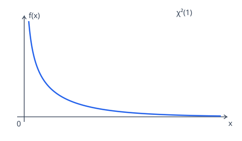
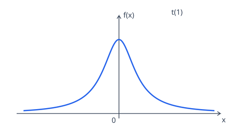
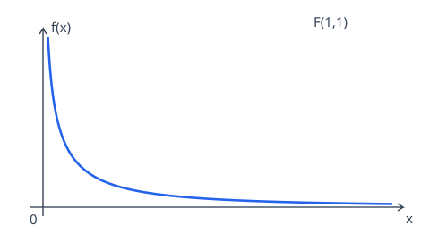

# 概率论公式笔记

## 章节目录

- [第一章：随机事件与概率](#section-1)
- [第二章：随机变量及其分布](#section-2)
- [第三章：多维随机变量及其分布](#section-3)
- [第四章：随机变量的数字特征](#section-4)
  - [常见分布的符号、期望与方差](#section-4-1)
  - [协方差](#section-4-2)
  - [相关系数与不相关](#section-4-3)
  - [独立性与不相关性的关系](#section-4-4)
  - [总体矩与混合矩](#section-4-5)
- [第五章：大数定律和中心极限定理](#section-5)
  - [切比雪夫不等式](#section-5-1)
  - [依概率收敛](#section-5-2)
  - [样本均值的期望与方差](#section-5-3)
  - [大数定律及其条件对比](#section-5-4)
  - [中心极限定理：和与均值的正态近似](#section-5-5)
- [第六章：数理统计的基本概念](#section-6)
  - [样本均值及其期望与方差](#section-6-1)
  - [样本方差与样本标准差](#section-6-2)
  - [样本原点矩与样本中心矩](#section-6-3)
  - [卡方分布的定义](#section-6-4)
  - [t 分布的定义](#section-6-5)
  - [F 分布的定义](#section-6-6)
  - [单正态总体的常用统计分布](#section-6-7)
  - [双正态总体的常用统计分布](#section-6-8)
- [第七章：参数估计](#section-7)
  - [点估计：矩估计](#section-7-1)
  - [点估计：最大似然估计](#section-7-2)
  - [估计量的评价标准](#section-7-3)
  - [区间估计：正态总体方差已知时估计均值](#section-7-4)
  - [区间估计：正态总体方差未知时估计均值](#section-7-5)
  - [区间估计：正态总体均值未知时估计方差](#section-7-6)
  - [区间估计：正态总体均值已知时估计方差](#section-7-7)
- [第八章：假设检验](#section-8)
  - [检验步骤与常用统计量](#section-8-1)
  - [例题：正态总体均值的双侧检验](#section-8-2)

## 第一章：随机事件与概率 

### 事件的包含：B 发生必然导致 A 发生

$$
\boxed{A\supseteq B\iff B\subseteq A
\iff B\text{ 发生必然导致 }A\text{ 发生}}.
$$

### 互不相容事件（互斥事件）：不能同时发生

$$
\boxed{A\cap B=\varnothing}.
$$

若 $A,B$ 互斥，则两者不能同时发生，但可以都不发生。

若 $A_1,A_2,\ldots,A_n$ **两两互不相容** ，即

$$
A_i\cap A_j=\varnothing,\qquad i\ne j,
$$

则它们并集的概率等于各事件概率之和：

$$
\boxed{P(A_1\cup A_2\cup\cdots\cup A_n)
=P(A_1)+P(A_2)+\cdots+P(A_n)
=\sum_{i=1}^{n}P(A_i)}.
$$

注意，这里要求两两交集都为空，仅有 $A_1\cap A_2\cap\cdots\cap A_n=\varnothing$ 不够。

### 对立事件：互斥且并集为全集

$A,B$ 互为对立事件，必须同时满足

$$
\boxed{A\cap B=\varnothing,\qquad A\cup B=\Omega}.
$$

此时 $B=\overline A$、$A=\overline B$，每次试验中两者**恰好发生一个** 。

### 分配律

交对并的分配律：

$$
\boxed{A\cap(B\cup C)=(A\cap B)\cup(A\cap C)}.
$$

并对交的分配律：

$$
\boxed{A\cup(B\cap C)=(A\cup B)\cap(A\cup C)}.
$$

### 德摩根律（对偶律）

$$
\boxed{\overline{A\cup B}=\overline A\cap\overline B},
$$

$$
\boxed{\overline{A\cap B}=\overline A\cup\overline B}.
$$

### 概率的加法公式

以下用 $AB$ 简记 $A\cap B$，$ABC$ 简记 $A\cap B\cap C$。

两个事件：

$$
\boxed{P(A\cup B)=P(A)+P(B)-P(AB)}.
$$

三个事件：

$$
\boxed{
\begin{aligned}
P(A\cup B\cup C)
&=P(A)+P(B)+P(C)\\
&\quad-P(AB)-P(AC)-P(BC)+P(ABC).
\end{aligned}}
$$

**记忆：单个相加，两两相减，三个相交再加回。** 加法公式适用于一般事件，不要求互不相容。

### 互斥与交集概率为零的区别

以下用 $A+B$ 简记 $A\cup B$，$AB$ 简记 $A\cap B$。

| 条件               | 能否推出 $A,B$ 互斥 | 原因                           |
| ------------------ | ------------------- | ------------------------------ |
| $AB=\varnothing$   | 能                  | 这就是互斥的定义               |
| $P(AB)=0$          | 不一定              | 概率为零的事件不一定是空集     |
| $P(A+B)=P(A)+P(B)$ | 不一定              | 由加法公式，只能推出 $P(AB)=0$ |

由概率的加法公式

$$
P(A+B)=P(A)+P(B)-P(AB),
$$

可得下列关系：

$$
\boxed{
AB=\varnothing
\ \Longrightarrow\ P(AB)=0
\ \Longleftrightarrow\ P(A+B)=P(A)+P(B)
}.
$$

**注意：第一个箭头一般不能反向。互斥要求交集为空，而交集概率为零不代表交集为空。**

#### 反例：交集非空，但交集概率为零

在 $\Omega=[0,1]$ 上均匀随机取一个数，令

$$
A=\left[0,\frac12\right],\qquad
B=\left[\frac12,1\right].
$$

此时

$$
AB=\left\{\frac12\right\}\ne\varnothing,
\qquad P(AB)=0,
$$

因此 $A,B$ **不互斥**，但仍满足

$$
P(A+B)=1=\frac12+\frac12=P(A)+P(B).
$$

这个反例同时说明表格中后两个条件都不足以推出互斥。

**补充：若样本空间有限，且每个样本点的概率都大于零，则 $P(AB)=0$ 可以推出 $AB=\varnothing$。** 例如，有限等可能的古典概型中，表格里的三个条件等价。

### 概率的减法公式

$A-B=A\cap\overline B$，表示 $A$ 发生而 $B$ 不发生，则

$$
\boxed{P(A-B)=P(A)-P(AB)}.
$$

若 $B\subseteq A$，则 $AB=B$，可简化为 $P(A-B)=P(A)-P(B)$。

### 条件概率与两个事件的乘法公式

当 $P(A)>0$ 时，$A$ 已发生条件下 $B$ 发生的条件概率为

$$
\boxed{P(B\mid A)=\frac{P(AB)}{P(A)}}.
$$

因此，乘法公式为

$$
\boxed{P(AB)=P(A)P(B\mid A)},\qquad P(A)>0.
$$

同理，也有

$$
\boxed{P(AB)=P(B)P(A\mid B)},\qquad P(B)>0.
$$

### 条件概率的加法与减法公式

设 $P(C)>0$，则在同一条件 $C$ 下，概率的加法、减法公式仍成立。

并事件：

$$
\boxed{P(A\cup B\mid C)
=P(A\mid C)+P(B\mid C)-P(AB\mid C)}.
$$

差事件：

$$
\boxed{P(A-B\mid C)=P(A\mid C)-P(AB\mid C)}.
$$

**记忆：把普通概率公式中的每一项都加上同一个条件 $C$。** $P(A\cup B\mid C)$ 表示在 $C$ 已发生的条件下，$A,B$ 至少发生一个的概率。

### n 个事件的乘法公式

设 $n\ge2$，若

$$
P(A_1A_2\cdots A_{n-1})>0,
$$

则

$$
\boxed{
\begin{aligned}
P(A_1A_2\cdots A_n)
&=P(A_1)P(A_2\mid A_1)P(A_3\mid A_1A_2)\\
&\quad\cdots P(A_n\mid A_1A_2\cdots A_{n-1}).
\end{aligned}}
$$

**记忆：第一个事件直接写概率；从第二个开始，每一项都以前面所有事件同时发生为条件。** 上述正概率条件保证公式中的各个条件概率都有定义。

### 完备事件组：两两不相容且并集为全集

若事件 $B_1,B_2,\ldots,B_n$ 同时满足

$$
\boxed{B_i\cap B_j=\varnothing\quad(i\ne j),\qquad
\bigcup_{i=1}^{n}B_i=\Omega},
$$

则称它们构成一个**完备事件组** ，也称样本空间的一个划分。

**记忆：两两不相容，合起来覆盖全集。** 每次试验中，$B_1,\ldots,B_n$ 恰好发生一个。用于下面的全概率公式和贝叶斯公式时，要求各 $P(B_i)>0$。

### 全概率公式

设 $B_1,B_2,\ldots,B_n$ 构成完备事件组，且 $P(B_i)>0$，则对任意事件 $A$，有

$$
\boxed{P(A)=\sum_{i=1}^{n}P(B_i)P(A\mid B_i)}.
$$

即

$$
P(A)=P(B_1)P(A\mid B_1)+\cdots+P(B_n)P(A\mid B_n).
$$

**记忆：按完备事件组分类，每类的概率乘该类中 $A$ 发生的条件概率，再把各类结果相加。**

### 贝叶斯公式

设 $B_1,B_2,\ldots,B_n$ 构成完备事件组，各 $P(B_i)>0$，且 $P(A)>0$，则

$$
\boxed{
P(B_i\mid A)
=\frac{P(B_iA)}{P(A)}
=\frac{P(B_i)P(A\mid B_i)}
{\displaystyle\sum_{j=1}^{n}P(B_j)P(A\mid B_j)}
},\qquad i=1,2,\ldots,n.
$$

分子对应指定的第 $i$ 类，分母按全概率公式对所有类别求和，因此用 $j$ 作为求和下标。

**记忆：已知结果 $A$ 发生，反求它来自第 $i$ 类 $B_i$ 的概率。** 全概率公式由各类算总体，贝叶斯公式在结果发生后重新计算各类的条件概率。

### 两个事件相互独立

$$
\boxed{A,B\text{ 相互独立}\iff P(AB)=P(A)P(B)}.
$$

即两个事件同时发生的概率，等于它们各自发生的概率之积。

#### 用条件概率判断独立的充要条件

当 $0<P(B)<1$ 时，$P(A\mid B)$ 与 $P(A\mid\overline B)$ 都有定义，此时

$$
\boxed{
A,B\text{ 相互独立}
\iff P(A\mid B)=P(A)=P(A\mid\overline B)
}.
$$

其中 $\overline B$ 表示 $B$ 不发生。**记忆：无论 $B$ 发生还是不发生，$A$ 发生的概率都不变。**

在 $0<P(B)<1$ 的前提下，其实只需验证其中任意一个等式：

$$
\boxed{
A,B\text{ 相互独立}
\iff P(A\mid B)=P(A)
\iff P(A\mid\overline B)=P(A)
}.
$$

理由是

$$
P(A\mid B)=P(A)
\iff \frac{P(AB)}{P(B)}=P(A)
\iff P(AB)=P(A)P(B),
$$

而独立时又有

$$
P(A\mid\overline B)
=\frac{P(A)-P(AB)}{1-P(B)}
=\frac{P(A)[1-P(B)]}{1-P(B)}
=P(A).
$$

**条件范围：** 单独使用 $P(A\mid B)=P(A)$ 判断独立，只需 $P(B)>0$；单独使用 $P(A\mid\overline B)=P(A)$，只需 $P(B)<1$。若 $P(B)=0$ 或 $1$，上述三个概率不能全部写在同一个等式中，此时可直接用 $P(AB)=P(A)P(B)$ 判断独立。

#### 独立事件取对立后仍独立

若 $A,B$ 相互独立，则下列各对事件也相互独立：

$$
\boxed{A,\overline B;\qquad\overline A,B;\qquad
\overline A,\overline B}.
$$

即

$$
\boxed{P(A\overline B)=P(A)[1-P(B)]},
$$

$$
\boxed{P(\overline A B)=[1-P(A)]P(B)},
$$

$$
\boxed{P(\overline A\,\overline B)=[1-P(A)][1-P(B)]}.
$$

**记忆：独立的两个事件，任意一个或两个换成对立事件后，仍然独立。**

### 伯努利试验与 n 重伯努利试验

若一次试验只区分 $A$ 发生与 $A$ 不发生这两种对立的结果，即 $A$ 与 $\overline A$，则称其为**伯努利试验** 。通常把 $A$ 发生称为“成功”，并记

$$
P(A)=p,\qquad P(\overline A)=1-p.
$$

将同一伯努利试验**独立重复进行 $n$ 次** ，且每次 $A$ 发生的概率均为 $p$，称为 **n 重伯努利试验** 。

**要点：每次只有两类结果、各次相互独立、成功概率 $p$ 保持不变。**

### n 重伯努利试验：二项分布概率公式

设 $X$ 表示 $n$ 次试验中事件 $A$ 发生的次数，则 $X$ 服从参数为 $n,p$ 的二项分布，记为

$$
\boxed{X\sim B(n,p)}.
$$

事件 $A$ **恰好发生 $k$ 次** 的概率为

$$
\boxed{P(X=k)=C_n^k p^k(1-p)^{n-k}},
\qquad k=0,1,\ldots,n,
$$

其中

$$
C_n^k=\frac{n!}{k!(n-k)!}.
$$

**记忆：选出 $k$ 次成功的位置，乘 $k$ 次成功与其余 $n-k$ 次失败的概率。** 上式通常在 $0<p<1$ 时使用；$p=0$ 时 $X=0$ 几乎必然成立，$p=1$ 时 $X=n$ 几乎必然成立。

## 第二章：随机变量及其分布 

### 分布函数的定义

设 $X$ 为随机变量，对任意实数 $x$，称

$$
\boxed{F(x)=P\{X\le x\}},\qquad -\infty<x<+\infty,
$$

为随机变量 $X$ 的**分布函数**。

**含义：$F(x)$ 表示随机变量 $X$ 取值不超过 $x$ 的概率。**

### 分布函数的基本性质

#### 单调非减

$$
\boxed{x_1<x_2\ \Longrightarrow\ F(x_1)\le F(x_2)}.
$$

随着 $x$ 增大，事件 $\{X\le x\}$ 的范围扩大，其概率不会减小。

#### 无穷远处的极限

$$
\boxed{F(-\infty):=\lim_{x\to-\infty}F(x)=0},
$$

$$
\boxed{F(+\infty):=\lim_{x\to+\infty}F(x)=1}.
$$

因此，对任意实数 $x$，都有 $0\le F(x)\le1$。

#### 右连续

对任意实数 $x_0$，有

$$
\boxed{\lim_{x\to x_0^+}F(x)=F(x_0)}.
$$

$$
\boxed{F(x_0+0)=F(x_0)}.
$$

### 用分布函数计算概率

记 $F(a^-)$ 为分布函数在 $a$ 处的左极限：

$$
F(a^-)=\lim_{x\to a^-}F(x).
$$

严格小于 $a$：

$$
\boxed{P\{X<a\}=F(a^-)}.
$$

恰好等于 $a$：

$$
\boxed{P\{X=a\}=F(a)-F(a^-)}.
$$

严格大于 $a$：

$$
\boxed{P\{X>a\}=1-P\{X\le a\}=1-F(a)}.
$$

### 离散型随机变量的分布律

若随机变量 $X$ 的可能取值为有限个或可列无穷个 $x_1,x_2,\ldots$，则称 $X$ 为**离散型随机变量**。

各个可能取值对应的概率

$$
\boxed{P\{X=x_i\}=p_i},\qquad i=1,2,\ldots,
$$

称为 $X$ 的**分布律**，满足

$$
\boxed{p_i\ge0,\qquad \sum_i p_i=1}.
$$

### 离散型随机变量的分布函数

$$
\boxed{
F(x)=P\{X\le x\}
=\sum_{x_i\le x}P\{X=x_i\}
=\sum_{x_i\le x}p_i
}.
$$

**含义：把所有不超过 $x$ 的可能取值对应的概率相加。** 若 $x$ 本身是可能取值，也要计入该点的概率。

### 二项分布

进行 $n$ 次相互独立的伯努利试验，每次成功的概率均为 $p$，令 $X$ 表示成功的次数，则

$$
\boxed{X\sim B(n,p)}.
$$

其分布律为

$$
\boxed{P\{X=k\}=C_n^k p^k(1-p)^{n-k}},
\qquad k=0,1,\ldots,n.
$$

**抽样背景：放回抽样。** 总体中有 $N$ 件物品，其中 $M$ 件为目标物品；每次等可能地抽取一件后放回，各次抽取相互独立。抽取 $n$ 次，令 $X$ 为抽到目标物品的次数，则

$$
\boxed{X\sim B\left(n,\frac{M}{N}\right)}.
$$

**记忆：固定试验次数 $n$，统计成功次数；各次独立，成功概率不变。** 放回抽样是二项分布的一种典型模型。

### 泊松分布

若随机变量 $X$ 的分布律为

$$
\boxed{P\{X=k\}=\frac{\lambda^k}{k!}e^{-\lambda}},
\qquad k=0,1,2,\ldots,\quad \lambda>0,
$$

则称 $X$ 服从参数为 $\lambda$ 的**泊松分布**，记为

$$
\boxed{X\sim P(\lambda)}.
$$

常用于描述一定时间或空间范围内某类事件发生的次数，如符合泊松模型的到达人数、来电次数等。

#### 泊松分布是二项分布的极限形式

设 $X_n\sim B(n,p_n)$，当

$$
\boxed{n\to\infty,\qquad p_n\to0,\qquad np_n\to\lambda},
\qquad 0<\lambda<\infty,
$$

则对每个固定的非负整数 $k$，有

$$
\boxed{
\lim_{n\to\infty}C_n^k p_n^k(1-p_n)^{n-k}
=\frac{\lambda^k}{k!}e^{-\lambda}
}.
$$

因此，**泊松分布是二项分布在试验次数趋于无穷、成功概率趋于零，且两者乘积趋于有限正数时的极限形式。**

实际计算时，若 $n$ 很大、$p$ 很小，且 $\lambda=np$ 大小适中，则可用泊松分布近似二项分布：

$$
\boxed{B(n,p)\approx P(\lambda),\qquad\lambda=np},
$$

即对于 $X\sim B(n,p)$，有

$$
\boxed{
P\{X=k\}=C_n^k p^k(1-p)^{n-k}
\approx\frac{(np)^k}{k!}e^{-np}
},\qquad k=0,1,\ldots,n.
$$

**记忆：$n$ 大、$p$ 小，取 $\lambda=np$，用泊松分布近似二项分布。**

### 几何分布

独立重复进行成功概率为 $p$（$0<p<1$）的伯努利试验，令 $X$ 表示**首次成功时的试验次数**，则 $X$ 服从几何分布，记为

$$
\boxed{X\sim G(p)}.
$$

其分布律为

$$
\boxed{P\{X=k\}=(1-p)^{k-1}p},
\qquad k=1,2,\ldots.
$$

**记忆：前 $k-1$ 次全部失败，第 $k$ 次首次成功。** 此处 $X$ 包含最后一次成功的试验；若改为统计首次成功前的失败次数 $Y=X-1$，则 $P\{Y=k\}=(1-p)^kp$，$k=0,1,2,\ldots$。

#### 几何分布的无记忆性

设 $X\sim G(p)$，$0<p<1$，$X$ 表示首次成功时的试验次数。对任意非负整数 $m,n$，有

$$
\boxed{P\{X>m+n\mid X>m\}=P\{X>n\}}.
$$

因为 $X>r$ 表示前 $r$ 次试验全部失败，所以

$$
P\{X>r\}=(1-p)^r,\qquad r=0,1,2,\ldots.
$$

于是

$$
\begin{aligned}
P\{X>m+n\mid X>m\}
&=\frac{P\{X>m+n\}}{P\{X>m\}}\\
&=\frac{(1-p)^{m+n}}{(1-p)^m}\\
&=(1-p)^n=P\{X>n\}.
\end{aligned}
$$

**含义：已知前 $m$ 次试验都失败，再经历 $n$ 次失败的概率，与从头开始连续失败 $n$ 次的概率相同。** 已经等待的试验次数不影响剩余等待次数的分布。

### 超几何分布：不放回抽样

总体中有 $N$ 件物品，其中 $M$ 件为目标物品，另有 $N-M$ 件非目标物品。等可能地**不放回抽取 $n$ 件**，令 $X$ 表示抽到的目标物品件数，则 $X$ 服从**超几何分布**。

其中 $N,M,n$ 均为整数，$N\ge1$，$0\le M\le N$，$0\le n\le N$。其分布律为

$$
\boxed{P\{X=k\}=\frac{C_M^k C_{N-M}^{n-k}}{C_N^n}},
$$

取值范围为整数

$$
\boxed{\max\{0,n-(N-M)\}\le k\le\min\{n,M\}}.
$$

**记忆：从 $M$ 件目标物品中选 $k$ 件，从 $N-M$ 件非目标物品中选 $n-k$ 件，再除以从全部 $N$ 件中选 $n$ 件的方法数。** 不放回抽样中，后续抽到目标物品的条件概率会随前面的抽取结果改变。

#### 超几何分布近似二项分布

当 $N\gg n$，即抽样比例 $n/N$ 很小时，不放回抽样对总体中目标物品比例的影响很小，可以近似按独立的放回抽样处理。因此

$$
\boxed{X\text{ 的分布近似为 }B\left(n,\frac{M}{N}\right)},
$$

即令 $p=\dfrac{M}{N}$，有

$$
\boxed{
\frac{C_M^k C_{N-M}^{n-k}}{C_N^n}
\approx C_n^k\left(\frac{M}{N}\right)^k
\left(1-\frac{M}{N}\right)^{n-k}
}.
$$

| 抽样方式                | 目标物品计数的分布      |
| ----------------------- | ----------------------- |
| 独立、等可能的放回抽样  | 二项分布 $B(n,M/N)$     |
| 等可能的不放回抽样      | 超几何分布              |
| 不放回抽样，且 $N\gg n$ | 近似二项分布 $B(n,M/N)$ |

### 常见离散分布的取值范围

| 分布                                  | $k$ 的取值范围                           |
| ------------------------------------- | ---------------------------------------- |
| 二项分布 $B(n,p)$                     | $k=0,1,2,\ldots,n$                       |
| 泊松分布 $P(\lambda)$                 | $k=0,1,2,\ldots$                         |
| 几何分布 $G(p)$（首次成功的试验次数） | $k=1,2,3,\ldots$                         |
| 超几何分布                            | $k=\max\{0,n-(N-M)\},\ldots,\min\{M,n\}$ |

**记忆：二项分布从 $0$ 到 $n$，泊松分布从 $0$ 起无上限，几何分布从 $1$ 起无上限，超几何分布最多取到 $\min\{M,n\}$。**

超几何分布的下限还取决于非目标物品的件数：若 $n\le N-M$，则可写为 $k=0,1,2,\ldots,\min\{M,n\}$；若 $n>N-M$，则至少抽到 $n-(N-M)$ 件目标物品，不能从 $0$ 开始。

### 连续型随机变量与概率密度

设随机变量 $X$ 的分布函数为 $F(x)$。若存在非负可积函数 $f(x)$，使得对任意实数 $x$，都有

$$
\boxed{F(x)=\int_{-\infty}^{x}f(t)\,\mathrm dt},
\qquad -\infty<x<+\infty,
$$

则称 $X$ 为**连续型随机变量**，$f(x)$ 称为 $X$ 的**概率密度函数**，简称概率密度。

**注意：连续型随机变量的分布函数 $F(x)$ 连续，但概率密度 $f(x)$ 不一定连续。**

#### 概率密度的基本性质

非负性：

$$
\boxed{f(x)\ge0}.
$$

归一性，即总概率为 $1$：

$$
\boxed{\int_{-\infty}^{+\infty}f(x)\,\mathrm dx=1}.
$$

**记忆：密度非负，整个实数轴下的总面积为 $1$。** $f(x)$ 本身不是单点概率，其值可以大于 $1$。

#### 分布函数与概率密度的关系

由密度积分得到分布函数：

$$
\boxed{F(x)=\int_{-\infty}^{x}f(t)\,\mathrm dt}.
$$

在 $f$ 的连续点 $x$ 处，对分布函数求导可得密度：

$$
\boxed{F'(x)=f(x)}.
$$

一般地，这个导数关系几乎处处成立，不要求在密度的每个间断点都成立。

#### 用密度计算区间概率

对任意 $x_1<x_2$，有

$$
\boxed{
P\{x_1<X\le x_2\}
=F(x_2)-F(x_1)
=\int_{x_1}^{x_2}f(x)\,\mathrm dx
}.
$$

连续型随机变量在任意单点处的概率为零，即

$$
\boxed{P\{X=a\}=0,\qquad\forall a\in\mathbb R}.
$$

因此，区间两端取不取等号都不影响概率：

$$
\boxed{
\begin{aligned}
P\{x_1<X<x_2\}
&=P\{x_1\le X<x_2\}\\
&=P\{x_1<X\le x_2\}\\
&=P\{x_1\le X\le x_2\}\\
&=\int_{x_1}^{x_2}f(x)\,\mathrm dx.
\end{aligned}
}
$$

### 均匀分布

设 $a<b$。若随机变量 $X$ 的概率密度为

$$
\boxed{
f(x)=\begin{cases}
\dfrac1{b-a},&a\le x\le b,\\[4pt]
0,&\text{其他},
\end{cases}
}
$$

则称 $X$ 在区间 $[a,b]$ 上服从**均匀分布**，记为

$$
\boxed{X\sim U(a,b)}.
$$

其分布函数为

$$
\boxed{
F(x)=\begin{cases}
0,&x<a,\\[2pt]
\dfrac{x-a}{b-a},&a\le x<b,\\[4pt]
1,&x\ge b.
\end{cases}
}
$$

**记忆：区间内密度为常数，区间概率等于长度之比。** 对 $a\le c<d\le b$，有

$$
\boxed{P\{c<X\le d\}=\frac{d-c}{b-a}}.
$$

### 指数分布

若随机变量 $X$ 的概率密度为

$$
\boxed{
f(x)=\begin{cases}
\lambda e^{-\lambda x},&x>0,\\
0,&\text{其他},
\end{cases}
\qquad\lambda>0,
}
$$

则称 $X$ 服从参数为 $\lambda$ 的**指数分布**，记为

$$
\boxed{X\sim E(\lambda)}.
$$

其分布函数为

$$
\boxed{
F(x)=\begin{cases}
0,&x<0,\\
1-e^{-\lambda x},&x\ge0.
\end{cases}
}
$$

因此，尾概率为

$$
\boxed{P\{X>x\}=1-F(x)=e^{-\lambda x}},\qquad x\ge0.
$$

#### 指数分布的无记忆性

设 $X\sim E(\lambda)$，则对任意 $a,b\ge0$，都有

$$
\boxed{P\{X>a+b\mid X>b\}=P\{X>a\}}.
$$

因为 $\{X>a+b\}\subseteq\{X>b\}$，由条件概率公式得

$$
\begin{aligned}
P\{X>a+b\mid X>b\}
&=\frac{P\{X>a+b\}}{P\{X>b\}}\\
&=\frac{e^{-\lambda(a+b)}}{e^{-\lambda b}}\\
&=e^{-\lambda a}=P\{X>a\}.
\end{aligned}
$$

**含义：已经等待 $b$ 时间仍未发生的条件下，继续等待超过 $a$ 时间的概率，与从头开始等待超过 $a$ 时间的概率相同。**

**对照记忆：几何分布描述首次成功所需的试验次数，指数分布描述等待时间；两者都具有无记忆性。** 几何分布公式中的等待次数取非负整数，指数分布公式中的等待时间取任意非负实数。

### 正态分布

若随机变量 $X$ 的概率密度为

$$
\boxed{
f(x)=\frac1{\sqrt{2\pi}\sigma}
e^{-\frac{(x-\mu)^2}{2\sigma^2}}
},\qquad -\infty<x<+\infty,
$$

其中 $\mu\in\mathbb R$、$\sigma>0$，则称 $X$ 服从参数为 $\mu,\sigma^2$ 的**正态分布**，记为

$$
\boxed{X\sim N(\mu,\sigma^2)}.
$$

其中 $\mu$ 为均值，$\sigma^2$ 为方差，$\sigma$ 为标准差。其分布函数为

$$
\boxed{
F(x)=\frac1{\sqrt{2\pi}\sigma}
\int_{-\infty}^{x}e^{-\frac{(t-\mu)^2}{2\sigma^2}}\,\mathrm dt
}.
$$

**图像特点：密度曲线呈钟形，关于 $x=\mu$ 对称，并在 $x=\mu$ 处达到最大值 $1/(\sqrt{2\pi}\sigma)$。** $\mu$ 决定中心位置；$\sigma$ 越小，曲线越高越窄，$\sigma$ 越大，曲线越低越宽，总面积始终为 $1$。

### 标准正态分布

当 $\mu=0$、$\sigma^2=1$ 时，称为**标准正态分布**，记为

$$
\boxed{Z\sim N(0,1)}.
$$

其概率密度通常记为小写 $\varphi$：

$$
\boxed{\varphi(x)=\frac1{\sqrt{2\pi}}e^{-x^2/2}},
\qquad -\infty<x<+\infty.
$$

其分布函数通常记为大写 $\Phi$：

$$
\boxed{
\Phi(x)=P\{Z\le x\}
=\frac1{\sqrt{2\pi}}\int_{-\infty}^{x}e^{-t^2/2}\,\mathrm dt
}.
$$

**注意：$\varphi(x)$ 是密度，$\Phi(x)$ 是累积概率，二者不要混淆。**

### 正态分布的常用性质

#### 标准化与区间概率

若 $X\sim N(\mu,\sigma^2)$，则

$$
\boxed{Z=\frac{X-\mu}{\sigma}\sim N(0,1)}.
$$

因此，$X$ 的分布函数为

$$
\boxed{F(x)=\Phi\left(\frac{x-\mu}{\sigma}\right)}.
$$

对任意 $a<b$，有

$$
\boxed{
P\{a<X\le b\}
=\Phi\left(\frac{b-\mu}{\sigma}\right)
-\Phi\left(\frac{a-\mu}{\sigma}\right)
}.
$$

**记忆：先减均值，再除以标准差；标准化时除以 $\sigma$，不是 $\sigma^2$。**

#### 标准正态分布的对称性

由标准正态密度关于 $0$ 对称，有

$$
\boxed{\Phi(-a)=1-\Phi(a)},\qquad a\in\mathbb R,
$$

$$
\boxed{\Phi(0)=\frac12}.
$$

对 $a>0$，左右两侧尾概率相等：

$$
\boxed{P\{Z<-a\}=P\{Z>a\}=1-\Phi(a)}.
$$

#### 非零线性变换仍服从正态分布

若 $X\sim N(\mu,\sigma^2)$，则对任意常数 $a\ne0$、$b$，有

$$
\boxed{aX+b\sim N(a\mu+b,a^2\sigma^2)}.
$$

**记忆：均值作相同的线性变换，方差乘系数的平方。** 若 $a=0$，则 $aX+b=b$ 是常量。

#### 关于中心对称区间的概率

若 $Z\sim N(0,1)$，则对 $a>0$，有

$$
\boxed{
\begin{aligned}
P\{|Z|\le a\}
&=2P\{0\le Z\le a\}\\
&=2[\Phi(a)-\Phi(0)]\\
&=2\Phi(a)-1.
\end{aligned}
}
$$

相应地，若 $X\sim N(\mu,\sigma^2)$，则

$$
\boxed{P\{|X-\mu|\le a\sigma\}=2\Phi(a)-1},\qquad a>0.
$$

### 离散型随机变量函数的分布

设 $X$ 的分布律为

$$
P\{X=x_k\}=p_k,\qquad k=1,2,\ldots,
$$

令 $Y=g(X)$。将 $g(x_k)$ 中互不相同的值记为 $y_1,y_2,\ldots$，则 $Y$ 的分布律为

$$
\boxed{
P\{Y=y_i\}
=P\{g(X)=y_i\}
=\sum_{\{k:\,g(x_k)=y_i\}}P\{X=x_k\}
=\sum_{\{k:\,g(x_k)=y_i\}}p_k
}.
$$

**步骤：列出 $X$ 的取值，逐个计算 $g(x_k)$，再把相同结果对应的概率相加。** $Y$ 的取值应互不相同，不能把重复值当成不同的取值分别列在分布律中。

### 连续型随机变量函数的分布

设 $X$ 的概率密度为 $f_X(x)$，令 $Y=g(X)$。

#### 方法一：分布函数法（定义法）

从分布函数的定义出发：

$$
\boxed{
\begin{aligned}
F_Y(y)
&=P\{Y\le y\}\\
&=P\{g(X)\le y\}\\
&=\int_{\{x:\,g(x)\le y\}}f_X(x)\,\mathrm dx.
\end{aligned}
}
$$

**步骤：先确定 $Y$ 的取值范围，再将 $g(X)\le y$ 化为关于 $X$ 的条件，与 $X$ 的密度非零范围取交集后积分。** 若解集由几个互不相交的区间组成，应把各区间上的积分相加。

求得 $F_Y(y)$ 后，若 $Y$ 为连续型随机变量，则由

$$
\boxed{f_Y(y)=F_Y'(y)}
$$

求其概率密度（在分布函数可导处使用）。

**注意：$X$ 连续并不保证任意变换 $g(X)$ 都有密度。** 若变换产生集中在某一点的正概率，$F_Y$ 会出现跳跃，不能只对各段求导就认为得到了完整分布。

#### 方法二：严格单调变换的密度公式

设 $P\{X\in(a,b)\}=1$，$g$ 在 $(a,b)$ 上连续可导，且恒有 $g'(x)>0$ 或恒有 $g'(x)<0$。记其反函数为

$$
x=h(y)=g^{-1}(y),
$$

并设 $g$ 在该区间上的值域为 $(\alpha,\beta)$，其中端点可以为无穷。则 $Y=g(X)$ 为连续型随机变量，其概率密度为

$$
\boxed{
f_Y(y)=\begin{cases}
f_X\bigl(h(y)\bigr)\,|h'(y)|,&\alpha<y<\beta,\\
0,&\text{其他}.
\end{cases}
}
$$

利用反函数求导，也可写成

$$
\boxed{
f_Y(y)=\frac{f_X\bigl(h(y)\bigr)}{|g'\bigl(h(y)\bigr)|}
},\qquad \alpha<y<\beta.
$$

当 $\alpha<y<\beta$ 时，对应的分布函数关系为

$$
F_Y(y)=\begin{cases}
F_X\bigl(h(y)\bigr),&g\text{ 严格递增},\\
1-F_X\bigl(h(y)\bigr),&g\text{ 严格递减}.
\end{cases}
$$

**记忆：先求值域，再求反函数，代入原密度，最后乘反函数导数的绝对值。** 递减时也必须得到非负密度，不能漏掉绝对值；若 $g$ 不单调，不能直接用一个反函数覆盖所有情况，可改用分布函数法。

## 第三章：多维随机变量及其分布 

### 二维联合分布函数 

设 $(X,Y)$ 为二维随机变量，称

$$
\boxed{F(x,y)=P\{X\le x,\ Y\le y\}},\qquad x,y\in\mathbb R
$$

为 $(X,Y)$ 的联合分布函数，表示随机点落在 $(-\infty,x]\times(-\infty,y]$ 内的概率。

其基本性质为：

1. $0\le F(x,y)\le1$。
2. 固定一个自变量时，关于另一个自变量单调非减。
3. 分别关于 $x,y$ 右连续。
4. 无穷远处满足

$$
F(x,-\infty)=F(-\infty,y)=0,\qquad F(+\infty,+\infty)=1.
$$

这里带无穷的写法表示相应的极限。对任意 $x_1<x_2$、$y_1<y_2$，矩形区域的概率为

$$
\boxed{
\begin{aligned}
&P\{x_1<X\le x_2,\ y_1<Y\le y_2\}\\
&\quad=F(x_2,y_2)-F(x_2,y_1)-F(x_1,y_2)+F(x_1,y_1)\ge0.
\end{aligned}
}
$$

**记忆：右上减右下，减左上，再加左下。** 判断二元函数能否作为联合分布函数时，还须检查矩形增量非负，不能仅检查它分别单调非减。

### 边缘分布函数 

由联合分布函数消去另一个变量的限制：

$$
\boxed{
\begin{aligned}
F_X(x)
&=P\{X\le x\}\\
&=P\{X\le x,\ Y\le+\infty\}\\
&=F(x,+\infty)=\lim_{y\to+\infty}F(x,y),
\end{aligned}
}
$$

$$
\boxed{
\begin{aligned}
F_Y(y)
&=P\{Y\le y\}\\
&=P\{X\le+\infty,\ Y\le y\}\\
&=F(+\infty,y)=\lim_{x\to+\infty}F(x,y).
\end{aligned}
}
$$

**记忆：求谁的边缘分布，就保留谁，将另一个变量趋于正无穷。**

### 二维离散型随机变量的联合分布律 

设 $(X,Y)$ 的可能取值为 $(x_i,y_j)$，记

$$
\boxed{p_{ij}=P\{X=x_i,\ Y=y_j\}},\qquad i,j=1,2,\ldots.
$$

全体 $p_{ij}$ 构成联合分布律，满足

$$
\boxed{p_{ij}\ge0,\qquad
\sum_i\sum_jp_{ij}=1}.
$$

联合分布函数可由联合分布律累加得到：

$$
\boxed{F(x,y)=\sum_{i:\,x_i\le x}\ \sum_{j:\,y_j\le y}p_{ij}}.
$$

**记忆：联合分布律给出每个取值点的概率；联合分布函数累加左下方所有取值点的概率。**

### 离散型随机变量的边缘分布律 

对联合分布律按另一个变量求和：

$$
\boxed{p_{i\cdot}=P\{X=x_i\}=\sum_jp_{ij}},\qquad i=1,2,\ldots,
$$

$$
\boxed{p_{\cdot j}=P\{Y=y_j\}=\sum_ip_{ij}},\qquad j=1,2,\ldots.
$$

若表格以 $X=x_i$ 为行、$Y=y_j$ 为列，则各行之和给出 $X$ 的边缘分布，各列之和给出 $Y$ 的边缘分布。

**记忆：求谁就保留谁，另一个下标全部求和。**

### 离散型随机变量的条件分布律 

固定 $j$，若 $p_{\cdot j}=P\{Y=y_j\}>0$，则在 $Y=y_j$ 条件下，$X$ 的分布律为

$$
\boxed{
P\{X=x_i\mid Y=y_j\}
=\frac{P\{X=x_i,\ Y=y_j\}}{P\{Y=y_j\}}
=\frac{p_{ij}}{p_{\cdot j}}
},\qquad i=1,2,\ldots.
$$

固定 $i$，若 $p_{i\cdot}=P\{X=x_i\}>0$，则在 $X=x_i$ 条件下，$Y$ 的分布律为

$$
\boxed{
P\{Y=y_j\mid X=x_i\}
=\frac{P\{X=x_i,\ Y=y_j\}}{P\{X=x_i\}}
=\frac{p_{ij}}{p_{i\cdot}}
},\qquad j=1,2,\ldots.
$$

**记忆：联合概率除以条件事件的边缘概率。** 分母必须大于 $0$；固定条件后，对剩余变量的全部条件概率求和为 $1$。

### 二维连续型随机变量的联合概率密度 

若存在非负函数 $f(x,y)$，使对任意实数 $x,y$ 都有

$$
\boxed{F(x,y)=\int_{-\infty}^{y}\int_{-\infty}^{x}
f(u,v)\,\mathrm du\,\mathrm dv},
$$

则称 $(X,Y)$ 为二维连续型随机变量，称 $f(x,y)$ 为联合概率密度。

联合密度满足非负性和规范性：

$$
\boxed{f(x,y)\ge0,\qquad
\int_{-\infty}^{+\infty}\int_{-\infty}^{+\infty}
f(x,y)\,\mathrm dx\,\mathrm dy=1}.
$$

随机点落在平面区域 $D$ 内的概率为

$$
\boxed{P\{(X,Y)\in D\}=\iint_D f(x,y)\,\mathrm dx\,\mathrm dy}.
$$

若 $f$ 在 $(x,y)$ 处连续，则

$$
\boxed{f(x,y)=\frac{\partial^2F(x,y)}{\partial x\,\partial y}}.
$$

**记忆：密度积分得到概率，联合分布函数求混合偏导得到密度。** 计算时先确定密度非零区域，再与所求事件的区域取交集。

### 连续型随机变量的边缘概率密度 

由边缘分布函数与联合分布函数的关系，有

$$
\boxed{F_X(x)=F(x,+\infty)
=\int_{-\infty}^{x}\left[\int_{-\infty}^{+\infty}
f(u,v)\,\mathrm dv\right]\mathrm du},
$$

$$
\boxed{F_Y(y)=F(+\infty,y)
=\int_{-\infty}^{y}\left[\int_{-\infty}^{+\infty}
f(u,v)\,\mathrm du\right]\mathrm dv}.
$$

因此 $X,Y$ 也都是连续型随机变量，其边缘密度可通过对相应的边缘分布函数求导得到。

把联合密度对另一个变量积分：

$$
\boxed{f_X(x)=\int_{-\infty}^{+\infty}f(x,y)\,\mathrm dy},
$$

$$
\boxed{f_Y(y)=\int_{-\infty}^{+\infty}f(x,y)\,\mathrm dx}.
$$

**记忆：求谁就保留谁，将另一个变量积分消去。** 积分限要结合联合密度非零区域确定，不一定是常数。

### 连续型随机变量的条件概率密度 

若 $f_Y(y)>0$，则在 $Y=y$ 条件下，$X$ 的条件密度为

$$
\boxed{f_{X\mid Y}(x\mid y)=\frac{f(x,y)}{f_Y(y)}}.
$$

若 $f_X(x)>0$，则在 $X=x$ 条件下，$Y$ 的条件密度为

$$
\boxed{f_{Y\mid X}(y\mid x)=\frac{f(x,y)}{f_X(x)}}.
$$

相应的条件分布函数为

$$
\boxed{F_{X\mid Y}(x\mid y)
=\int_{-\infty}^{x}\frac{f(u,y)}{f_Y(y)}\,\mathrm du},
\qquad f_Y(y)>0,
$$

$$
\boxed{F_{Y\mid X}(y\mid x)
=\int_{-\infty}^{y}\frac{f(x,v)}{f_X(x)}\,\mathrm dv},
\qquad f_X(x)>0.
$$

固定条件后，条件密度关于剩余变量的积分为 $1$，例如

$$
\int_{-\infty}^{+\infty}f_{X\mid Y}(x\mid y)\,\mathrm dx=1.
$$

**记忆：联合密度除以条件变量的边缘密度。** 给定 $Y=y$，分母是 $f_Y(y)$；给定 $X=x$，分母是 $f_X(x)$。连续型变量在单点的概率为 $0$，此处用密度之比定义条件密度，不能直接套用两个单点概率相除。

### 二维随机变量的独立性 

设 $F(x,y)$ 为联合分布函数，$F_X(x),F_Y(y)$ 为边缘分布函数。若对任意 $x,y\in\mathbb R$ 都有

$$
\boxed{F(x,y)=F_X(x)F_Y(y)},
$$

则称 $X,Y$ 相互独立。这是适用于一般二维随机变量的充要条件，其含义为

$$
P\{X\le x,\ Y\le y\}=P\{X\le x\}P\{Y\le y\}.
$$

#### 离散型随机变量的判别

$$
\boxed{X\text{ 与 }Y\text{ 独立}
\iff p_{ij}=p_{i\cdot}p_{\cdot j}\quad\text{对所有 }i,j\text{ 成立}}.
$$

即每个取值点的联合概率都等于对应的两个边缘概率之积。

#### 连续型随机变量的判别

$$
\boxed{X\text{ 与 }Y\text{ 独立}
\iff f(x,y)=f_X(x)f_Y(y)\quad\text{几乎处处成立}}.
$$

若相互独立，则在 $f,f_X,f_Y$ 都连续的点有 $f(x,y)=f_X(x)f_Y(y)$。“几乎处处”允许忽略零面积集合上的密度取值差异。

**记忆：联合分布等于边缘分布的乘积。** 判断密度能否分解时，要把非零区域也一起检查，不能只看密度表达式。

### 二维均匀分布 

#### 定义与区域概率

设平面区域 $D$ 的面积为 $S(D)$，且 $0<S(D)<+\infty$。若联合密度为

$$
\boxed{
f_{X,Y}(x,y)=\begin{cases}
\dfrac1{S(D)},&(x,y)\in D,\\[4pt]
0,&(x,y)\notin D,
\end{cases}
}
$$

则称 $(X,Y)$ 在 $D$ 上服从二维均匀分布。

对任意可测子区域 $A\subseteq D$，有

$$
\boxed{P\{(X,Y)\in A\}=\frac{S(A)}{S(D)}}.
$$

一般区域 $A$ 则先与 $D$ 取交集，用 $S(A\cap D)/S(D)$ 计算概率。

#### 矩形区域与独立性

若 $D=[a,b]\times[c,d]$，其中 $a<b$、$c<d$，则

$$
f_{X,Y}(x,y)=\frac1{(b-a)(d-c)},\qquad (x,y)\in D,
$$

且

$$
\boxed{X\sim U(a,b),\qquad Y\sim U(c,d),\qquad X,Y\text{ 相互独立}}.
$$

若 $D$ 是圆、三角形等非矩形区域，$X,Y$ 通常不独立，边缘分布也通常不是一维均匀分布。应由边缘密度与联合密度的乘积关系判断。

#### 可逆线性变换

若 $(X,Y)$ 在 $D$ 上均匀分布，令

$$
U=aX+bY+r,\qquad V=cX+dY+s,\qquad ad-bc\ne0,
$$

则 $(U,V)$ 在变换后的区域 $D'$ 上仍均匀分布，且

$$
\boxed{S(D')=|ad-bc|\,S(D)},
$$

$$
\boxed{f_{U,V}(u,v)=\frac1{|ad-bc|\,S(D)}},\qquad (u,v)\in D',
$$

在 $D'$ 外密度为 $0$。矩形一般变为平行四边形，变换后 $U,V$ 不一定独立。

**记忆：均匀分布的区域概率等于面积比；可逆线性变换保持二维均匀性。** 若 $ad-bc=0$，图形可能压缩到直线上，不能套用二维密度公式。

### 二维正态分布 

#### 定义

若 $(X,Y)$ 的联合概率密度为

$$
\begin{aligned}
f(x,y)
&=\frac1{2\pi\sigma_1\sigma_2\sqrt{1-\rho^2}}\\
&\quad\times\exp\left\{-\frac1{2(1-\rho^2)}
\left[\frac{(x-\mu_1)^2}{\sigma_1^2}
-2\rho\frac{(x-\mu_1)(y-\mu_2)}{\sigma_1\sigma_2}
+\frac{(y-\mu_2)^2}{\sigma_2^2}\right]\right\},
\end{aligned}
$$

其中 $x,y\in\mathbb R$，$\mu_1,\mu_2\in\mathbb R$，$\sigma_1>0$、$\sigma_2>0$、$|\rho|<1$，则称 $(X,Y)$ 服从二维正态分布，记作

$$
\boxed{(X,Y)\sim N(\mu_1,\mu_2;\sigma_1^2,\sigma_2^2;\rho)}.
$$

$\mu_1,\mu_2$ 为均值，$\sigma_1^2,\sigma_2^2$ 为方差，$\rho$ 为相关系数，且 $\operatorname{Cov}(X,Y)=\rho\sigma_1\sigma_2$。

#### 边缘分布与独立性

两个边缘分布均为一维正态分布：

$$
\boxed{X\sim N(\mu_1,\sigma_1^2),\qquad
Y\sim N(\mu_2,\sigma_2^2)}.
$$

对于二维正态随机变量，

$$
\boxed{X\text{ 与 }Y\text{ 独立}\iff\rho=0}.
$$

**注意：不相关推出独立，须有二维正态的前提。** 对一般随机变量，相关系数为 $0$ 不保证独立。

#### 一维线性组合

若 $(a,b)\ne(0,0)$，则

$$
\boxed{
aX+bY\sim N\left(a\mu_1+b\mu_2,
a^2\sigma_1^2+b^2\sigma_2^2+2ab\rho\sigma_1\sigma_2\right)
}.
$$

特别地，当 $X,Y$ 相互独立时，

$$
\boxed{aX+bY\sim N\left(a\mu_1+b\mu_2,
a^2\sigma_1^2+b^2\sigma_2^2\right)}.
$$

#### 二维线性变换

令 $U=aX+bY$、$V=cX+dY$。当

$$
\boxed{\begin{vmatrix}a&b\\c&d\end{vmatrix}=ad-bc\ne0}
$$

时，$(U,V)$ 仍服从具有二维密度的二维正态分布；若行列式为 $0$，变换可能产生退化正态分布，不能直接套用上面的二维密度表达式。

#### 两个边缘正态不保证联合正态

仅由

$$
X\sim N(\mu_1,\sigma_1^2),\qquad Y\sim N(\mu_2,\sigma_2^2)
$$

**不能推出 $(X,Y)$ 服从二维正态分布。** 还须有联合分布条件；若再已知 $X,Y$ 相互独立，才可确定它们组成相关系数为 $0$ 的二维正态随机变量。

## 第四章：随机变量的数字特征 

### 常见分布的符号、期望与方差 

| 分布       | 符号                                                                | 数学期望 $E(X)$  | 方差 $D(X)$                                          |
| ---------- | ------------------------------------------------------------------- | ---------------- | ---------------------------------------------------- |
| 0—1 分布   | $\vphantom{\left(\dfrac{(b-a)^2}{N-1}\right)}X\sim B(1,p)$          | $p$              | $p(1-p)$                                             |
| 二项分布   | $\vphantom{\left(\dfrac{(b-a)^2}{N-1}\right)}X\sim B(n,p)$          | $np$             | $np(1-p)$                                            |
| 泊松分布   | $\vphantom{\left(\dfrac{(b-a)^2}{N-1}\right)}X\sim P(\lambda)$      | $\lambda$        | $\lambda$                                            |
| 几何分布   | $\vphantom{\left(\dfrac{(b-a)^2}{N-1}\right)}X\sim G(p)$            | $\dfrac1p$       | $\dfrac{1-p}{p^2}$                                   |
| 超几何分布 | $\vphantom{\left(\dfrac{(b-a)^2}{N-1}\right)}X\sim H(N,M,n)$        | $\dfrac{nM}{N}$  | $n\dfrac MN\left(1-\dfrac MN\right)\dfrac{N-n}{N-1}$ |
| 均匀分布   | $\vphantom{\left(\dfrac{(b-a)^2}{N-1}\right)}X\sim U(a,b)$          | $\dfrac{a+b}{2}$ | $\dfrac{(b-a)^2}{12}$                                |
| 指数分布   | $\vphantom{\left(\dfrac{(b-a)^2}{N-1}\right)}X\sim E(\lambda)$      | $\dfrac1\lambda$ | $\dfrac1{\lambda^2}$                                 |
| 正态分布   | $\vphantom{\left(\dfrac{(b-a)^2}{N-1}\right)}X\sim N(\mu,\sigma^2)$ | $\mu$            | $\sigma^2$                                           |

**参数与记号约定：**

- **0—1 分布：** $P\{X=1\}=p$，$P\{X=0\}=1-p$，$0\le p\le1$；它是 $n=1$ 的二项分布。二项分布中 $n$ 为正整数。
- **泊松分布：** $\lambda>0$，其期望与方差相等。
- **几何分布：** $0<p<1$，$X=1,2,\ldots$，包含最后一次成功的试验。若改记首次成功前的失败次数 $Y=X-1$，则 $E(Y)=(1-p)/p$，方差仍为 $(1-p)/p^2$。
- **超几何分布：** $N$ 为总体件数，$M$ 为目标物品件数，$n$ 为不放回抽取件数；$N,M,n$ 均为整数，$0\le M,n\le N$。表中方差公式要求 $N>1$；$N=1$ 时合法抽样结果为常量，方差为 $0$。$H$ 的参数顺序并不统一，使用时以此处定义为准。
- **均匀分布：** $a<b$。
- **指数分布：** $\lambda>0$ 为率参数，密度为 $f(x)=\lambda e^{-\lambda x}$（$x>0$），与第二章约定一致。
- **正态分布：** $\mu\in\mathbb R$，$\sigma>0$；记号 $N(\mu,\sigma^2)$ 的第二个参数是方差。标准正态 $N(0,1)$ 的期望为 $0$、方差为 $1$。

**记忆：** 超几何分布令 $p=M/N$，期望仍为 $np$，方差是在二项分布的 $np(1-p)$ 上乘以不放回抽样的修正因子 $(N-n)/(N-1)$。

### 协方差 

以下协方差及其性质在有关随机变量的二阶矩有限时使用。

#### 定义与计算公式

$$
\boxed{\operatorname{Cov}(X,Y)=E\big[(X-E(X))(Y-E(Y))\big]}
$$

$$
\boxed{\operatorname{Cov}(X,Y)=E(XY)-E(X)E(Y)}.
$$

#### 性质

其中 $a,b,c$ 为常数。

1. 对称性：$\operatorname{Cov}(X,Y)=\operatorname{Cov}(Y,X)$。
2. 与自身的协方差：$\operatorname{Cov}(X,X)=D(X)$。
3. 与常数的协方差：$\operatorname{Cov}(X,c)=0$。
4. 常数可提出：$\operatorname{Cov}(aX,bY)=ab\operatorname{Cov}(X,Y)$。
5. 对和可拆开：$\operatorname{Cov}(X_1+X_2,Y)=\operatorname{Cov}(X_1,Y)+\operatorname{Cov}(X_2,Y)$。
6. 两边都是和时，逐项配对展开：

$$
\boxed{\begin{aligned}
\operatorname{Cov}(X_1+X_2,Y_1+Y_2)
&=\operatorname{Cov}(X_1,Y_1)+\operatorname{Cov}(X_1,Y_2)\\
&\quad+\operatorname{Cov}(X_2,Y_1)+\operatorname{Cov}(X_2,Y_2).
\end{aligned}}
$$

1. 若 $X,Y$ 相互独立，则 $\operatorname{Cov}(X,Y)=0$。

**常用方法：先展开协方差，再利用独立性将相应项化为 $0$。**

### 相关系数与不相关 

当 $0<D(X),D(Y)<\infty$ 时，定义相关系数

$$
\boxed{\rho_{XY}=\frac{\operatorname{Cov}(X,Y)}{\sqrt{D(X)}\sqrt{D(Y)}}}.
$$

#### 性质

$$
\boxed{|\rho_{XY}|\le1}.
$$

完全线性相关的充要条件：

$$
\boxed{|\rho_{XY}|=1
\iff \text{存在常数 }a\ne0,b,\ P\{Y=aX+b\}=1}.
$$

其中 $a>0$ 时 $\rho_{XY}=1$，$a<0$ 时 $\rho_{XY}=-1$。

**注意：$Y=aX+b$ 是以概率 $1$ 成立，不要求对所有样本点都成立。**

#### 不相关

$$
\boxed{X,Y\text{ 不相关}\iff\rho_{XY}=0
\iff\operatorname{Cov}(X,Y)=0
\iff E(XY)=E(X)E(Y)}.
$$

上述含相关系数的等价关系要求两者方差均为正且有限。

### 独立性与不相关性的关系 

独立性是分布的性质：对任意适当集合 $A,B$，有

$$
P\{X\in A,Y\in B\}=P\{X\in A\}P\{Y\in B\}.
$$

不相关是数字特征的性质，体现为 $E(XY)=E(X)E(Y)$。在方差为正且有限的条件下：

- **独立 $\Longrightarrow$ 不相关**；不相关一般不能推出独立。
- **相关 $\Longrightarrow$ 不独立**。
- 若 $(X,Y)$ **联合服从二维正态分布**，则独立与不相关等价：

$$
\boxed{X,Y\text{ 相互独立}\iff\rho_{XY}=0}.
$$

**注意：仅有两个边缘分布分别为正态分布，不足以使用最后这条等价关系。**

### 总体矩与混合矩 

以下各矩均要求相应期望存在且有限，$k,l$ 为正整数。

#### k 阶原点矩

$$
\boxed{E(X^k)}.
$$

**一阶原点矩就是数学期望：**

$$
\boxed{E(X^1)=E(X)=\mu}.
$$

#### k 阶中心矩

$$
\boxed{E\big[(X-E(X))^k\big]}.
$$

一阶中心矩为 $0$。**二阶中心矩就是方差：**

$$
\boxed{E\big[(X-E(X))^2\big]=D(X)=\sigma^2}.
$$

#### k+l 阶混合原点矩

$$
\boxed{E(X^kY^l)}.
$$

#### k+l 阶混合中心矩

$$
\boxed{E\big[(X-E(X))^k(Y-E(Y))^l\big]}.
$$

当 $k=l=1$ 时，混合中心矩就是协方差 $\operatorname{Cov}(X,Y)$。

## 第五章：大数定律和中心极限定理 

### 切比雪夫不等式 

设随机变量 $X$ 的数学期望 $E(X)=\mu$、方差 $D(X)=\sigma^2$ 均存在且有限，则对任意 $\varepsilon>0$，有下面两个等价公式：

$$
\boxed{P\{|X-E(X)|\ge\varepsilon\}
\le\frac{D(X)}{\varepsilon^2}},
$$

$$
\boxed{P\{|X-E(X)|<\varepsilon\}
\ge1-\frac{D(X)}{\varepsilon^2}}.
$$

两式中的事件互为对立事件，因此一个给出偏差较大的概率上界，另一个给出落在期望附近的概率下界。

**记忆：偏离期望至少 $\varepsilon$ 的概率，不超过“方差除以 $\varepsilon$ 的平方”。** 无须知道 $X$ 的具体分布。若第二式右侧为负，则该下界没有提供比概率非负更强的信息。

### 依概率收敛 

设 $X_1,X_2,\ldots$ 为随机变量序列，$a$ 为常数。若对任意 $\varepsilon>0$，都有

$$
\boxed{\lim_{n\to\infty}P\{|X_n-a|<\varepsilon\}=1},
$$

则称 $X_n$ **依概率收敛于 $a$**，记为

$$
\boxed{X_n\xrightarrow{P}a\qquad(n\to\infty)}.
$$

等价地，

$$
\boxed{\lim_{n\to\infty}P\{|X_n-a|\ge\varepsilon\}=0,
\qquad\forall\varepsilon>0}.
$$

**含义：当 $n$ 足够大时，$X_n$ 落在 $a$ 的任意小邻域内的概率趋于 $1$。** 记号上的 $P$ 表示“依概率”，不是 $X_n-a>0$；趋于 $1$ 的是偏差小于 $\varepsilon$ 的概率。

### 样本均值的期望与方差 

记前 $n$ 个随机变量的平均值为

$$
\boxed{\overline X_n=\frac1n\sum_{i=1}^{n}X_i}.
$$

只要各期望存在，就有

$$
\boxed{E(\overline X_n)=\frac1n\sum_{i=1}^{n}E(X_i)}.
$$

若每个 $E(X_i)=\mu$，则

$$
\boxed{E(\overline X_n)=E(X_i)=\mu}.
$$

若各方差有限且 $X_i$ **两两不相关**，则

$$
\boxed{D(\overline X_n)=\frac1{n^2}\sum_{i=1}^{n}D(X_i)}.
$$

若进一步每个 $D(X_i)=\sigma^2$，则

$$
\boxed{D(\overline X_n)=\frac{D(X_i)}n=\frac{\sigma^2}{n}}.
$$

**适用条件：** 独立同分布且方差有限时，上述两个简化公式都成立。期望相同才能把 $E(\overline X_n)$ 写成同一个 $\mu$；方差相同且两两不相关，才能把 $D(\overline X_n)$ 写成 $\sigma^2/n$。

### 大数定律及其条件对比 

**核心：大量随机变量的平均值与其期望的平均值之差，依概率收敛于 $0$。** 即

$$
\boxed{\overline X_n-E(\overline X_n)
=\frac1n\sum_{i=1}^{n}[X_i-E(X_i)]\xrightarrow{P}0}.
$$

若每个 $E(X_i)=\mu$，则简化为

$$
\boxed{\overline X_n\xrightarrow{P}\mu}.
$$

当 $E(\overline X_n)$ 随 $n$ 改变时，用“差依概率收敛于 $0$”的写法最清楚。

#### 三种常用大数定律的条件

| 大数定律         | 独立性             | 同分布                   | 数学期望                   | 方差                                                |
| ---------------- | ------------------ | ------------------------ | -------------------------- | --------------------------------------------------- |
| 切比雪夫大数定律 | 两两不相关即可     | 不要求                   | 各自存在，不要求相同       | 一致有界：存在常数 $C<\infty$，使所有 $D(X_i)\le C$ |
| 伯努利大数定律   | 独立重复伯努利试验 | 同分布，成功概率均为 $p$ | 存在，指示变量的期望为 $p$ | 存在，指示变量的方差为 $p(1-p)$                     |
| 辛钦大数定律     | 相互独立           | 必须同分布               | 有限期望 $E(X_i)=\mu$ 存在 | 不要求存在有限方差                                  |

**注意：“方差一致有界”要求有同一个常数界住所有方差，仅有每个方差分别有限还不够。**

#### 切比雪夫大数定律：用不等式证明

两两不相关且 $D(X_i)\le C$ 时，

$$
D(\overline X_n)=\frac1{n^2}\sum_{i=1}^{n}D(X_i)
\le\frac Cn\longrightarrow0.
$$

由切比雪夫不等式，对任意 $\varepsilon>0$，

$$
P\{|\overline X_n-E(\overline X_n)|\ge\varepsilon\}
\le\frac{D(\overline X_n)}{\varepsilon^2}
\le\frac{C}{n\varepsilon^2}\longrightarrow0.
$$

特别地，若共同期望为 $\mu$、共同方差为 $\sigma^2$，则

$$
\boxed{P\{|\overline X_n-\mu|<\varepsilon\}
\ge1-\frac{\sigma^2}{n\varepsilon^2}\longrightarrow1}.
$$

#### 伯努利大数定律：频率依概率收敛于概率

设 $n$ 次独立重复试验中，事件 $A$ 每次发生的概率均为 $p$，$n_A$ 表示发生次数，则

$$
\boxed{\frac{n_A}{n}\xrightarrow{P}p}.
$$

即对任意 $\varepsilon>0$，

$$
\boxed{\lim_{n\to\infty}P\left\{\left|\frac{n_A}{n}-p\right|<\varepsilon\right\}=1}.
$$

取指示变量 $X_i=1$（第 $i$ 次 $A$ 发生），否则 $X_i=0$，便有 $n_A/n=\overline X_n$，因此它是平均值趋于期望的具体形式。

#### 辛钦大数定律：独立同分布，有限期望即可

若 $X_1,X_2,\ldots$ 相互独立、同分布，且有限数学期望 $E(X_i)=\mu$ 存在，则

$$
\boxed{\frac1n\sum_{i=1}^{n}X_i\xrightarrow{P}\mu}.
$$

不要求方差存在，因此不能在辛钦大数定律的一般条件下直接写 $D(\overline X_n)=\sigma^2/n$。

### 中心极限定理：和与均值的正态近似 

以下为**独立同分布中心极限定理（林德伯格—列维定理）**。设 $X_1,X_2,\ldots$ 相互独立、同分布，且

$$
\boxed{E(X_i)=\mu,\qquad D(X_i)=\sigma^2,\qquad0<\sigma^2<\infty}.
$$

记 $S_n=\sum_{i=1}^{n}X_i$，则对任意实数 $x$，

$$
\boxed{\lim_{n\to\infty}P\left\{
\frac{S_n-n\mu}{\sigma\sqrt n}\le x\right\}=\Phi(x)}.
$$

等价地，标准化后的和或均值依分布收敛于标准正态分布：

$$
\boxed{\frac{S_n-n\mu}{\sigma\sqrt n}
=\frac{\overline X_n-\mu}{\sigma/\sqrt n}
\xrightarrow{d}N(0,1)}.
$$

因此，在 $n$ 足够大、正态近似适用时，常简记为

$$
\boxed{\sum_{i=1}^{n}X_i\ \text{近似服从}\ N(n\mu,n\sigma^2)},
$$

$$
\boxed{\overline X_n\ \text{近似服从}\ N\left(\mu,\frac{\sigma^2}{n}\right)}.
$$

**记忆：和的均值、方差都乘 $n$；均值的期望不变，方差除以 $n$。** 标准化时除以标准差：和除以 $\sigma\sqrt n$，均值除以 $\sigma/\sqrt n$。

例如，用中心极限定理近似计算区间概率：

$$
\boxed{P\{a<S_n\le b\}\approx
\Phi\left(\frac{b-n\mu}{\sigma\sqrt n}\right)
-\Phi\left(\frac{a-n\mu}{\sigma\sqrt n}\right)}.
$$

**区别：** 大数定律说明 $\overline X_n$ 越来越集中在 $\mu$ 附近；中心极限定理描述其标准化波动趋于正态分布。一般 $X_i$ 下有限 $n$ 时是近似；若各 $X_i$ 本身独立且服从 $N(\mu,\sigma^2)$，则和与均值对任意 $n$ 都精确服从上述正态分布。

## 第六章：数理统计的基本概念 

设 $X_1,X_2,\ldots,X_n$ 是来自总体 $X$ 的**简单随机样本**，即各样本变量相互独立且与总体同分布。记

$$
E(X)=\mu,\qquad D(X)=\sigma^2<\infty.
$$

大写 $X_i$ 表示样本随机变量，小写 $x_i$ 表示实际观测值；相应地，$\overline X$ 是样本均值统计量，$\overline x$ 是它的观测值。

### 样本均值及其期望与方差 

$$
\boxed{\overline X=\frac1n\sum_{i=1}^{n}X_i},\qquad
\boxed{\overline x=\frac1n\sum_{i=1}^{n}x_i}.
$$

样本均值的期望与方差：

$$
\boxed{E(\overline X)=E(X)=\mu},\qquad
\boxed{D(\overline X)=\frac{D(X)}n=\frac{\sigma^2}n}.
$$

由期望的线性性质和样本的独立性，

$$
E(\overline X)=\frac1n\sum_{i=1}^{n}E(X_i)=\mu,
\qquad
D(\overline X)=\frac1{n^2}\sum_{i=1}^{n}D(X_i)=\frac{\sigma^2}n.
$$

**记忆：均值的期望不变，方差除以 $n$。**

### 样本方差与样本标准差 

当 $n\ge2$ 时，样本方差定义为

$$
\boxed{S^2=\frac1{n-1}\sum_{i=1}^{n}(X_i-\overline X)^2}.
$$

样本方差的期望等于总体方差：

$$
\boxed{E(S^2)=D(X)=\sigma^2}.
$$

因此 $S^2$ 是总体方差 $\sigma^2$ 的无偏估计。

计算样本方差时，也可用展开式：

$$
\boxed{S^2=\frac1{n-1}\left(\sum_{i=1}^{n}X_i^2-n\overline X^{\,2}\right)}.
$$

这是因为 $\sum_{i=1}^{n}X_i=n\overline X$，所以

$$
\sum_{i=1}^{n}(X_i-\overline X)^2
=\sum_{i=1}^{n}X_i^2-2\overline X\sum_{i=1}^{n}X_i+n\overline X^{\,2}
=\sum_{i=1}^{n}X_i^2-n\overline X^{\,2}.
$$

**注意：样本方差的分母是 $n-1$，且括号内的整个差都要除以 $n-1$。**

样本标准差是样本方差的算术平方根：

$$
\boxed{S=\sqrt{S^2}=\sqrt{\frac1{n-1}\sum_{i=1}^{n}(X_i-\overline X)^2}}.
$$

代入观测值时，将 $X_i,\overline X$ 换为 $x_i,\overline x$，分别得到 $s^2,s$。

### 样本原点矩与样本中心矩 

对正整数 $k$，样本的 **$k$ 阶原点矩**记为 $A_k$：

$$
\boxed{A_k=\frac1n\sum_{i=1}^{n}X_i^k}.
$$

**样本均值 $\overline X$ 就是样本的一阶原点矩：**

$$
\boxed{A_1=\frac1n\sum_{i=1}^{n}X_i=\overline X}.
$$

样本的 **$k$ 阶中心矩**记为 $B_k$：

$$
\boxed{B_k=\frac1n\sum_{i=1}^{n}(X_i-\overline X)^k}.
$$

**记忆：原点矩以 $0$ 为中心，中心矩以样本均值 $\overline X$ 为中心；两者分母都是 $n$。** 这里的“矩”不是“距离”的“距”。

常用关系：

$$
\boxed{A_1=\overline X},\qquad
\boxed{B_1=0},\qquad
\boxed{B_2=A_2-A_1^2}.
$$

当 $n\ge2$ 时，二阶样本中心矩与样本方差的关系为

$$
\boxed{S^2=\frac{n}{n-1}B_2},\qquad
\boxed{B_2=\frac{n-1}{n}S^2}.
$$

**注意：$B_2$ 的分母是 $n$，$S^2$ 的分母是 $n-1$，二者不能混用。**

### 卡方分布的定义 

设 $X_1,X_2,\ldots,X_n$ **相互独立**，且都服从标准正态分布：

$$
X_i\sim N(0,1),\qquad i=1,2,\ldots,n.
$$

则它们的平方和服从**自由度为 $n$ 的卡方分布**，记为

$$
\boxed{\chi^2=X_1^2+X_2^2+\cdots+X_n^2
=\sum_{i=1}^{n}X_i^2\sim\chi^2(n)}.
$$

其中 $\chi$ 是希腊字母，$\chi^2(n)$ 也可记作 $\chi_n^2$；自由度 $n$ 就是参与平方求和的独立标准正态随机变量的个数。

**记忆：独立、标准正态、平方求和；有 $n$ 项，自由度就是 $n$。**

#### 卡方分布的密度图像

以 $n=1$ 为例：曲线位于正半轴，单调下降，向右拖尾。

#### 卡方分布的性质

##### 1. 期望与方差

若 $Y\sim\chi^2(n)$，则

$$
\boxed{E(Y)=n},\qquad \boxed{D(Y)=2n}.
$$

也可沿用定义中的 $\chi^2$ 记号：

$$
\boxed{\chi^2\sim\chi^2(n)
\quad\Longrightarrow\quad E(\chi^2)=n,\quad D(\chi^2)=2n}.
$$

**记忆：期望等于自由度，方差等于自由度的两倍。**

##### 2. 可加性

若 $U\sim\chi^2(n)$、$V\sim\chi^2(m)$，且 $U,V$ **相互独立**，则

$$
\boxed{U+V\sim\chi^2(n+m)}.
$$

沿用平方形式的记号，若 $X^2\sim\chi^2(n)$、$Y^2\sim\chi^2(m)$，且 $X,Y$ 相互独立，则 $X^2,Y^2$ 也相互独立，因此

$$
\boxed{X^2+Y^2\sim\chi^2(n+m)}.
$$

若原来的自由度分别记为 $n_1,n_2$，则相加后的自由度写作 $n_1+n_2$。

**记忆：独立的卡方变量相加，仍为卡方分布，自由度相加。**

#### 卡方分布的上侧分位点

设 $Y\sim\chi^2(n)$，$0<\alpha<1$。若 $\chi^2_{\alpha}(n)$ 满足

$$
\boxed{P\{Y>\chi^2_{\alpha}(n)\}=\alpha},
$$

则称 $\chi^2_{\alpha}(n)$ 为自由度为 $n$ 的卡方分布的**上侧 $\alpha$ 分位点**。

图形含义：在横轴上取 $\chi^2_{\alpha}(n)$，该点**右侧**密度曲线下的面积为 $\alpha$，左侧面积为 $1-\alpha$，即

$$
\boxed{P\{Y\le\chi^2_{\alpha}(n)\}=1-\alpha},\qquad
\boxed{\int_{\chi^2_{\alpha}(n)}^{+\infty}f(x)\,\mathrm dx=\alpha}.
$$

**记忆：下标 $\alpha$ 表示右尾概率；$\alpha$ 越小，分位点越靠右。** 查表时注意表格采用的是右尾概率还是左侧累计概率。

### t 分布的定义 

设

$$
X\sim N(0,1),\qquad Y\sim\chi^2(n),
$$

且 $X,Y$ **相互独立**，则随机变量

$$
\boxed{T=\frac{X}{\sqrt{Y/n}}\sim t(n)}
$$

服从**自由度为 $n$ 的 $t$ 分布**，也称学生氏 $t$ 分布。

**记忆：标准正态变量，除以“独立卡方变量除以自由度”的平方根。** 分母是 $\sqrt{Y/n}$，自由度 $n$ 来自分母中的卡方分布。

#### t 分布的密度图像

以 $n=1$ 为例：曲线呈钟形，关于 $y$ 轴对称。

#### t 分布的上侧分位点

与卡方分布一样，采用**右尾概率**定义。设 $T\sim t(n)$，$0<\alpha<1$，则上侧 $\alpha$ 分位点 $t_{\alpha}(n)$ 满足

$$
\boxed{P\{T>t_{\alpha}(n)\}=\alpha},\qquad
\boxed{P\{T\le t_{\alpha}(n)\}=1-\alpha}.
$$

即 $t_{\alpha}(n)$ **右侧曲线下的面积为 $\alpha$**。

#### t 分布的性质

##### 1. 上侧分位点的对称关系

由密度曲线关于 $y$ 轴的对称性，有

$$
\boxed{t_{1-\alpha}(n)=-t_{\alpha}(n)},\qquad
\boxed{t_{1/2}(n)=0}.
$$

特别地，$0<\alpha<1/2$ 时，$t_{\alpha}(n)>0$。双侧总尾概率为 $\alpha$ 时，左右两尾各占 $\alpha/2$，因此

$$
\boxed{P\{|T|>t_{\alpha/2}(n)\}=\alpha}.
$$

##### 2. 平方后服从 F 分布

若 $T\sim t(n)$，由定义可写为

$$
T=\frac{X}{\sqrt{Y/n}},\qquad
X\sim N(0,1),\quad Y\sim\chi^2(n),\quad X,Y\text{ 相互独立}.
$$

两边平方，得到

$$
\boxed{T^2=\frac{X^2}{Y/n}
=\frac{X^2/1}{Y/n}\sim F(1,n)}.
$$

这是因为 $X^2\sim\chi^2(1)$，且 $X^2,Y$ 相互独立；两个独立卡方变量分别除以各自的自由度后，其比值服从 $F$ 分布。

**记忆：$t(n)$ 变量的平方服从 $F(1,n)$，分子自由度为 $1$，分母自由度为 $n$。** 注意分母是整个 $Y/n$，所以 $T^2=nX^2/Y$。

### F 分布的定义 

设

$$
X\sim\chi^2(m),\qquad Y\sim\chi^2(n),
$$

且 $X,Y$ **相互独立**，则随机变量

$$
\boxed{F=\frac{X/m}{Y/n}\sim F(m,n)}
$$

服从自由度为 $(m,n)$ 的 **$F$ 分布**。其中 $m$ 是**分子自由度**，$n$ 是**分母自由度**，顺序不能随意交换。

**记忆：两个独立卡方变量，各自除以自己的自由度，再作比值。** $F$ 变量几乎必然大于 $0$。

#### F 分布的密度图像

以 $F(1,1)$ 为例：曲线位于正半轴，单调下降，向右拖尾。

#### F 分布的上侧分位点

设 $F\sim F(m,n)$，$0<\alpha<1$，上侧 $\alpha$ 分位点 $F_{\alpha}(m,n)$ 满足

$$
\boxed{P\{F>F_{\alpha}(m,n)\}=\alpha}.
$$

即 $F_{\alpha}(m,n)$ **右侧曲线下的面积为 $\alpha$**，左侧面积为 $1-\alpha$。

#### F 分布的性质

##### 1. 倒数性质

$$
\boxed{F\sim F(m,n)\quad\Longrightarrow\quad\frac1F\sim F(n,m)}.
$$

因为取倒数后，$\frac{X/m}{Y/n}$ 变为 $\frac{Y/n}{X/m}$，所以分子与分母的自由度交换。

##### 2. 上侧分位点的倒数关系

$$
\boxed{F_{1-\alpha}(m,n)=\frac1{F_{\alpha}(n,m)}},\qquad 0<\alpha<1.
$$

**记忆：分位点取倒数，尾概率换成 $1-\alpha$，两个自由度交换。** 这是由倒数性质及上侧分位点定义得到的。

### 单正态总体的常用统计分布 

设 $X_1,\ldots,X_n$ 是来自正态总体 $N(\mu,\sigma^2)$ 的简单随机样本，$\sigma^2>0$、$n\ge2$，记

$$
\overline X=\frac1n\sum_{i=1}^{n}X_i,\qquad
S^2=\frac1{n-1}\sum_{i=1}^{n}(X_i-\overline X)^2.
$$

#### 1. 样本均值与样本方差独立

$$
\boxed{\overline X\text{ 与 }S^2\text{ 相互独立}}.
$$

#### 2. 样本均值的正态分布

$$
\boxed{\overline X\sim N\left(\mu,\frac{\sigma^2}{n}\right)},\qquad
\boxed{\frac{\overline X-\mu}{\sigma/\sqrt n}\sim N(0,1)}.
$$

#### 3. 围绕总体均值的平方和

$$
\boxed{\sum_{i=1}^{n}\left(\frac{X_i-\mu}{\sigma}\right)^2
=\frac1{\sigma^2}\sum_{i=1}^{n}(X_i-\mu)^2\sim\chi^2(n)}.
$$

#### 4. 围绕样本均值的平方和

$$
\boxed{\frac1{\sigma^2}\sum_{i=1}^{n}(X_i-\overline X)^2
=\frac{(n-1)S^2}{\sigma^2}\sim\chi^2(n-1)}.
$$

**记忆：减总体均值 $\mu$，自由度为 $n$；减样本均值 $\overline X$，自由度为 $n-1$。**

#### 5. 用样本标准差构造 t 统计量

$$
\boxed{\frac{(\overline X-\mu)/(\sigma/\sqrt n)}
{\sqrt{\big[(n-1)S^2/\sigma^2\big]/(n-1)}}
=\frac{\overline X-\mu}{S/\sqrt n}\sim t(n-1)}.
$$

### 双正态总体的常用统计分布 

设 $X_1,\ldots,X_{n_1}$ 与 $Y_1,\ldots,Y_{n_2}$ 分别是来自 $N(\mu_1,\sigma_1^2)$ 与 $N(\mu_2,\sigma_2^2)$ 的简单随机样本，且**两个样本之间相互独立**。设 $\sigma_1^2,\sigma_2^2>0$，$n_1,n_2\ge2$，记

$$
\overline X=\frac1{n_1}\sum_{i=1}^{n_1}X_i,\qquad
S_1^2=\frac1{n_1-1}\sum_{i=1}^{n_1}(X_i-\overline X)^2,
$$

$$
\overline Y=\frac1{n_2}\sum_{j=1}^{n_2}Y_j,\qquad
S_2^2=\frac1{n_2-1}\sum_{j=1}^{n_2}(Y_j-\overline Y)^2.
$$

#### 1. 两个样本均值的和与差

$$
\boxed{\overline X\pm\overline Y\sim
N\left(\mu_1\pm\mu_2,\frac{\sigma_1^2}{n_1}+\frac{\sigma_2^2}{n_2}\right)}.
$$

特别地，均值差标准化后有

$$
\boxed{\frac{(\overline X-\overline Y)-(\mu_1-\mu_2)}
{\sqrt{\sigma_1^2/n_1+\sigma_2^2/n_2}}\sim N(0,1)}.
$$

**记忆：独立时，无论均值相加还是相减，方差都相加。**

#### 2. 两个独立卡方统计量相加

$$
\boxed{\frac{(n_1-1)S_1^2}{\sigma_1^2}
+\frac{(n_2-1)S_2^2}{\sigma_2^2}
\sim\chi^2(n_1+n_2-2)}.
$$

#### 3. 围绕总体均值构造 F 统计量

$$
\boxed{\frac{\displaystyle\frac1{n_1\sigma_1^2}\sum_{i=1}^{n_1}(X_i-\mu_1)^2}
{\displaystyle\frac1{n_2\sigma_2^2}\sum_{j=1}^{n_2}(Y_j-\mu_2)^2}
\sim F(n_1,n_2)}.
$$

#### 4. 用样本方差构造 F 统计量

$$
\boxed{\frac{\big[(n_1-1)S_1^2/\sigma_1^2\big]/(n_1-1)}
{\big[(n_2-1)S_2^2/\sigma_2^2\big]/(n_2-1)}
=\frac{S_1^2/\sigma_1^2}{S_2^2/\sigma_2^2}
=\frac{S_1^2/S_2^2}{\sigma_1^2/\sigma_2^2}
\sim F(n_1-1,n_2-1)}.
$$

#### 5. 等方差时的合并样本 t 统计量

**额外要求：$\sigma_1^2=\sigma_2^2=\sigma^2$。** 定义合并样本方差

$$
\boxed{S_w^2=\frac{(n_1-1)S_1^2+(n_2-1)S_2^2}{n_1+n_2-2}},
\qquad S_w=\sqrt{S_w^2}.
$$

此时

$$
\boxed{T=\frac{(\overline X-\overline Y)-(\mu_1-\mu_2)}
{S_w\sqrt{1/n_1+1/n_2}}\sim t(n_1+n_2-2)}.
$$

它来自标准正态变量除以独立卡方变量的标准化平方根：

$$
T=\frac{\displaystyle\frac{(\overline X-\overline Y)-(\mu_1-\mu_2)}
{\sqrt{\sigma^2/n_1+\sigma^2/n_2}}}
{\displaystyle\sqrt{\frac{(n_1-1)S_1^2/\sigma^2+(n_2-1)S_2^2/\sigma^2}
{n_1+n_2-2}}}.
$$

**注意：该合并样本公式需要两个总体方差相等。**

## 第七章：参数估计 

### 点估计 

用样本构造统计量 $\widehat\theta$ 来估计总体的未知参数 $\theta$，称为**点估计**。

#### 矩估计

**本质：用样本矩估计总体矩，令二者相等建立方程，再解出未知参数。** 可以使用原点矩，也可以使用中心矩。

##### 1. 原点矩法

总体的 $j$ 阶原点矩为 $E(X^j)$，样本的 $j$ 阶原点矩为 $A_j=\frac1n\sum_{i=1}^{n}X_i^j$。矩估计方程为

$$
\boxed{E(X^j)=\frac1n\sum_{i=1}^{n}X_i^j},\qquad j=1,2,\ldots.
$$

代入观测值时写为

$$
\boxed{E(X^j)=\frac1n\sum_{i=1}^{n}x_i^j}.
$$

常用前两阶：

$$
\boxed{E(X)=\overline X},\qquad
\boxed{E(X^2)=\frac1n\sum_{i=1}^{n}X_i^2}.
$$

##### 2. 中心矩法

总体的 $j$ 阶中心矩为 $E[(X-E(X))^j]$，样本的 $j$ 阶中心矩为 $B_j=\frac1n\sum_{i=1}^{n}(X_i-\overline X)^j$。对应的矩估计方程为

$$
\boxed{E\big[(X-E(X))^j\big]
=\frac1n\sum_{i=1}^{n}(X_i-\overline X)^j}.
$$

其中一阶中心矩恒为 $0$，不能单独用来确定参数。常用二阶中心矩，即令

$$
\boxed{D(X)=B_2=\frac1n\sum_{i=1}^{n}(X_i-\overline X)^2}.
$$

**注意：这里的等号用于建立估计方程，并非总体矩与样本矩恒等。** 有多个未知参数时，需要选取足够多、能确定参数的矩方程；样本二阶中心矩的分母为 $n$。

#### 最大似然估计 

**思想：已观察到样本 $x_1,\ldots,x_n$，选择使这组样本出现的概率最大的参数值 $\theta$。** 样本观测值固定，把似然函数看作 $\theta$ 的函数。

##### 离散型总体

设总体的分布律为 $p(x;\theta)=P_{\theta}\{X=x\}$，$X_1,\ldots,X_n$ 为简单随机样本，观测值为 $x_1,\ldots,x_n$。

**第一步：构造似然函数。** 由样本相互独立，

$$
\boxed{\begin{aligned}
L(\theta)
&=P_{\theta}\{X_1=x_1,\ldots,X_n=x_n\}\\
&=\prod_{i=1}^{n}P_{\theta}\{X_i=x_i\}
=\prod_{i=1}^{n}p(x_i;\theta).
\end{aligned}}
$$

**第二步：求使 $L(\theta)$ 最大的参数值。** 若在参数范围 $\Theta$ 内，$\widehat\theta$ 满足

$$
\boxed{L(\widehat\theta)=\max_{\theta\in\Theta}L(\theta)},
$$

则称 $\widehat\theta$ 为 $\theta$ 的**最大似然估计值**；将其中的观测值 $x_i$ 换为样本变量 $X_i$，得到最大似然估计量。

**常用技巧：先取自然对数，将连乘化为求和。** 当 $L(\theta)>0$ 时，定义对数似然函数

$$
\boxed{\ell(\theta)=\ln L(\theta)=\sum_{i=1}^{n}\ln p(x_i;\theta)}.
$$

因为 $\ln$ 严格递增，最大化 $L(\theta)$ 与最大化 $\ell(\theta)$ 等价。对可导的内部候选点，通常先解

$$
\boxed{\ell'(\theta)=0},
$$

再检查是否取得最大值，并比较参数边界。**导数为 $0$ 只是候选条件，最终要求似然函数在允许的参数范围内最大。**

##### 连续型总体

设总体 $X$ 的概率密度为 $f(x;\theta)$，$X_1,\ldots,X_n$ 为简单随机样本，观测值为 $x_1,\ldots,x_n$。

**第一步：构造似然函数。** 由样本相互独立，联合密度为各密度的乘积：

$$
\boxed{L(\theta)=f(x_1;\theta)f(x_2;\theta)\cdots f(x_n;\theta)
=\prod_{i=1}^{n}f(x_i;\theta)}.
$$

这里使用的是**密度的乘积**。连续型随机变量取某个指定值的概率为 $0$，因此不能把这个乘积写成样本恰好取这些值的概率。

**第二步：依旧求使 $L(\theta)$ 最大的参数值。** 通常在 $L(\theta)>0$ 时先取对数：

$$
\boxed{\ell(\theta)=\ln L(\theta)=\sum_{i=1}^{n}\ln f(x_i;\theta)},
$$

再求最大值；可导的内部候选点可由 $\ell'(\theta)=0$ 求出，最后检查最大值及参数边界。

**注意：若密度的取值范围依赖 $\theta$，要保留样本对 $\theta$ 的限制，再在允许范围内求最大值。**

##### 最大似然估计量与估计值的区别

**估计量用大写样本变量 $X_i$ 表示；估计值用小写观测数据 $x_i$ 表示。** 例如，某题求得的最大似然估计为样本均值时：

| 题目要求         | 最后答案                                                           |
| ---------------- | ------------------------------------------------------------------ |
| 求最大似然估计量 | $\displaystyle\widehat\theta=\frac1n\sum_{i=1}^{n}X_i=\overline X$ |
| 求最大似然估计值 | $\displaystyle\widehat\theta=\frac1n\sum_{i=1}^{n}x_i=\overline x$ |

估计量是统计量，代入实际观测数据后得到估计值。**这里的样本均值仅为示例，最大似然估计的具体形式由总体分布决定。**

### 估计量的评价标准 

#### 1. 无偏性

若对参数范围内的每个 $\theta$，都有

$$
\boxed{E_{\theta}(\widehat\theta)=\theta},
$$

则称 $\widehat\theta$ 是 $\theta$ 的**无偏估计量**。即估计量的期望等于被估计的真实参数。

#### 2. 有效性

设 $\widehat\theta_1,\widehat\theta_2$ 都是 $\theta$ 的**无偏估计量**，方差均有限。若对所有允许的 $\theta$，

$$
\boxed{D_{\theta}(\widehat\theta_1)\le D_{\theta}(\widehat\theta_2)},
$$

且至少在一个参数值处严格小于，则称 $\widehat\theta_1$ 比 $\widehat\theta_2$ **更有效**。特别地，若始终有 $D_{\theta}(\widehat\theta_1)<D_{\theta}(\widehat\theta_2)$，则前者更有效。

**记忆：比较无偏估计量，方差越小，估计越集中，也就越有效。**

#### 3. 一致性（相合性）

设 $\widehat\theta_n$ 是基于容量为 $n$ 的样本构造的估计量。若对每个允许的 $\theta$ 及任意 $\varepsilon>0$，都有

$$
\boxed{\lim_{n\to\infty}P_{\theta}\big\{|\widehat\theta_n-\theta|<\varepsilon\big\}=1},
$$

即

$$
\boxed{\widehat\theta_n\xrightarrow{P}\theta},
$$

则称 $\widehat\theta_n$ 是 $\theta$ 的**一致估计量（相合估计量）**。

**记忆：样本量越大，估计值落在真实参数任意小邻域内的概率趋于 $1$。**

### 区间估计 

#### 置信区间与置信度

设未知参数为 $\theta$，用样本构造区间 $[\widehat\theta_1,\widehat\theta_2]$。若

$$
\boxed{P_{\theta}\{\widehat\theta_1\le\theta\le\widehat\theta_2\}=\alpha},
\qquad 0<\alpha<1,
$$

则称其为 $\theta$ 的**置信度为 $\alpha$ 的置信区间**。这里 $\theta$ 是固定的未知参数，区间端点随样本变化；置信度表示反复抽样时，这种方法构造的区间覆盖真参数的比例。

**本节按置信度为 $\alpha$ 记号书写。** 若题目将置信度记为 $1-\alpha$，则应相应改用两侧各 $\alpha/2$ 的尾概率。

#### 对均值 μ 的区间估计

##### 1. 方差已知

设 $X_1,\ldots,X_n$ 是来自 $N(\mu,\sigma^2)$ 的简单随机样本，**$\sigma^2$ 已知，$\mu$ 未知**，要求 $\mu$ 的置信度为 $\alpha$ 的双侧置信区间。

**第一步：构造标准正态统计量。**

$$
\boxed{U=\frac{\overline X-\mu}{\sigma/\sqrt n}\sim N(0,1)}.
$$

**第二步：令中间概率为 $\alpha$。** 由对称性，左右两侧剩余概率各为 $\frac{1-\alpha}{2}$。设标准正态分布的上侧 $\beta$ 分位点满足

$$
P\{U>u_{\beta}\}=\beta.
$$

于是

$$
\boxed{P\left\{-u_{\frac{1-\alpha}{2}}\le U\le u_{\frac{1-\alpha}{2}}\right\}=\alpha}.
$$

**注意：下标是 $(1-\alpha)/2$，不是 $1-\alpha/2$。**

**第三步：代入 $U$，将不等式整理成关于 $\mu$ 的区间。**

$$
P\left\{-u_{\frac{1-\alpha}{2}}
\le\frac{\overline X-\mu}{\sigma/\sqrt n}
\le u_{\frac{1-\alpha}{2}}\right\}=\alpha,
$$

即

$$
\boxed{P\left\{\overline X-u_{\frac{1-\alpha}{2}}\frac{\sigma}{\sqrt n}
\le\mu\le
\overline X+u_{\frac{1-\alpha}{2}}\frac{\sigma}{\sqrt n}\right\}=\alpha}.
$$

因此，$\mu$ 的置信度为 $\alpha$ 的置信区间为

$$
\boxed{\left[\overline X-u_{\frac{1-\alpha}{2}}\frac{\sigma}{\sqrt n},\quad
\overline X+u_{\frac{1-\alpha}{2}}\frac{\sigma}{\sqrt n}\right]}.
$$

代入实际观测值后，将 $\overline X$ 换成 $\overline x$ 即可。

**记忆：样本均值 $\pm$ 上侧分位点 $\times$ 均值的标准差。**

##### 2. 方差未知 

设 $X_1,\ldots,X_n$ 是来自 $N(\mu,\sigma^2)$ 的简单随机样本，$n\ge2$，**$\sigma^2$ 未知**。用样本标准差 $S$ 替代 $\sigma$，要求 $\mu$ 的置信度为 $1-\alpha$ 的双侧置信区间。

**第一步：构造 t 统计量。**

$$
\boxed{T=\frac{\overline X-\mu}{S/\sqrt n}\sim t(n-1)}.
$$

**第二步：令中间概率为 $1-\alpha$。** 左右尾概率各为 $\alpha/2$，所以

$$
\boxed{P\left\{-t_{\alpha/2}(n-1)\le T\le t_{\alpha/2}(n-1)\right\}=1-\alpha}.
$$

**第三步：代入 $T$，整理成关于 $\mu$ 的区间。**

$$
P\left\{-t_{\alpha/2}(n-1)
\le\frac{\overline X-\mu}{S/\sqrt n}
\le t_{\alpha/2}(n-1)\right\}=1-\alpha,
$$

即

$$
\boxed{P\left\{\overline X-t_{\alpha/2}(n-1)\frac S{\sqrt n}
\le\mu\le
\overline X+t_{\alpha/2}(n-1)\frac S{\sqrt n}\right\}=1-\alpha}.
$$

因此，$\mu$ 的置信度为 $1-\alpha$ 的置信区间为

$$
\boxed{\left[\overline X-t_{\alpha/2}(n-1)\frac S{\sqrt n},\quad
\overline X+t_{\alpha/2}(n-1)\frac S{\sqrt n}\right]}.
$$

代入实际观测值时，将 $\overline X,S$ 换成 $\overline x,s$。

**记忆：方差未知，用 $S$ 替代 $\sigma$，用自由度为 $n-1$ 的 $t$ 分位点；置信度为 $1-\alpha$，上侧分位点下标为 $\alpha/2$。**

#### 对方差 σ² 的区间估计 

##### 1. 均值未知

设 $X_1,\ldots,X_n$ 是来自正态总体 $N(\mu,\sigma^2)$ 的简单随机样本，$n\ge2$，**$\mu$ 未知**，求 $\sigma^2$ 的置信度为 $1-\alpha$ 的双侧置信区间。

**第一步：构造卡方统计量。**

$$
\boxed{Q=\frac{(n-1)S^2}{\sigma^2}\sim\chi^2(n-1)}.
$$

**第二步：令中间概率为 $1-\alpha$。** 左右两尾各为 $\alpha/2$。按上侧分位点的定义，左端点为 $\chi^2_{1-\alpha/2}(n-1)$，右端点为 $\chi^2_{\alpha/2}(n-1)$，因此

$$
\boxed{P\left\{\chi^2_{1-\alpha/2}(n-1)
\le Q\le\chi^2_{\alpha/2}(n-1)\right\}=1-\alpha}.
$$

**第三步：代入 $Q$，整理成关于 $\sigma^2$ 的区间。**

$$
P\left\{\chi^2_{1-\alpha/2}(n-1)
\le\frac{(n-1)S^2}{\sigma^2}
\le\chi^2_{\alpha/2}(n-1)\right\}=1-\alpha,
$$

即

$$
\boxed{P\left\{\frac{(n-1)S^2}{\chi^2_{\alpha/2}(n-1)}
\le\sigma^2\le
\frac{(n-1)S^2}{\chi^2_{1-\alpha/2}(n-1)}\right\}=1-\alpha}.
$$

所以 $\sigma^2$ 的置信度为 $1-\alpha$ 的置信区间为

$$
\boxed{\left[\frac{(n-1)S^2}{\chi^2_{\alpha/2}(n-1)},\quad
\frac{(n-1)S^2}{\chi^2_{1-\alpha/2}(n-1)}\right]}.
$$

代入实际观测值时，将 $S^2$ 换成 $s^2$。

**记忆：先夹住卡方统计量，再取倒数整理；置信区间下限除以较大的卡方分位点，上限除以较小的卡方分位点。**

##### 2. 均值已知 

设 $X_1,\ldots,X_n$ 是来自正态总体 $N(\mu,\sigma^2)$ 的简单随机样本，**$\mu$ 已知**，求 $\sigma^2$ 的置信度为 $1-\alpha$ 的双侧置信区间。

**第一步：构造卡方统计量。**

$$
\boxed{Q=\sum_{i=1}^{n}\left(\frac{X_i-\mu}{\sigma}\right)^2
=\frac{\sum_{i=1}^{n}(X_i-\mu)^2}{\sigma^2}\sim\chi^2(n)}.
$$

**第二步：令中间概率为 $1-\alpha$。**

$$
\boxed{P\left\{\chi^2_{1-\alpha/2}(n)
\le\frac{\sum_{i=1}^{n}(X_i-\mu)^2}{\sigma^2}
\le\chi^2_{\alpha/2}(n)\right\}=1-\alpha}.
$$

**第三步：整理成关于 $\sigma^2$ 的区间。** 因此 $\sigma^2$ 的置信度为 $1-\alpha$ 的置信区间为

$$
\boxed{\left[\frac{\sum_{i=1}^{n}(X_i-\mu)^2}{\chi^2_{\alpha/2}(n)},\quad
\frac{\sum_{i=1}^{n}(X_i-\mu)^2}{\chi^2_{1-\alpha/2}(n)}\right]}.
$$

代入实际观测值时，将 $X_i$ 换成 $x_i$。

**记忆：$\mu$ 已知，用 $\sum(X_i-\mu)^2$，自由度为 $n$；$\mu$ 未知，用 $(n-1)S^2$，自由度为 $n-1$。**

## 第八章：假设检验 

### 检验步骤与常用统计量 

假设检验可以针对总体均值 $\mu$，也可以针对总体方差 $\sigma^2$。以下以正态总体的**双侧检验**为例。

#### 1. 提出原假设与备择假设

- 对均值检验：$H_0:\mu=\mu_0$，$H_1:\mu\ne\mu_0$。
- 对方差检验：$H_0:\sigma^2=\sigma_0^2$，$H_1:\sigma^2\ne\sigma_0^2$。

其中 $H_0$ 称为原假设（原始假设），$H_1$ 称为备择假设。

#### 2. 确定显著性水平 α，选择统计量

设 $X_1,\ldots,X_n$ 是来自 $N(\mu,\sigma^2)$ 的简单随机样本。**在 $H_0$ 成立时**，常用统计量为：

| 检验对象与条件              | 统计量及其分布                                                              |
| --------------------------- | --------------------------------------------------------------------------- |
| 检验 $\mu$，$\sigma^2$ 已知 | $\displaystyle U=\frac{\overline X-\mu_0}{\sigma/\sqrt n}\sim N(0,1)$       |
| 检验 $\mu$，$\sigma^2$ 未知 | $\displaystyle T=\frac{\overline X-\mu_0}{S/\sqrt n}\sim t(n-1)$            |
| 检验 $\sigma^2$，$\mu$ 未知 | $\displaystyle Q=\frac{(n-1)S^2}{\sigma_0^2}\sim\chi^2(n-1)$                |
| 检验 $\sigma^2$，$\mu$ 已知 | $\displaystyle Q=\frac{\sum_{i=1}^{n}(X_i-\mu)^2}{\sigma_0^2}\sim\chi^2(n)$ |

显著性水平 $\alpha$ 控制“$H_0$ 本来成立，却将它拒绝”的概率。

#### 3. 确定接受域与拒绝域

与区间估计同样，取中间概率为 $1-\alpha$ 的区域作为接受域，两侧各留 $\alpha/2$ 作为拒绝域。以下分位点均采用**上侧分位点**记号。

| 统计量             | 接受域（不拒绝域）                                       | 拒绝域                                                     |
| ------------------ | -------------------------------------------------------- | ---------------------------------------------------------- |
| $U\sim N(0,1)$     | $\lvert U\rvert\le u_{\alpha/2}$                         | $\lvert U\rvert>u_{\alpha/2}$                              |
| $T\sim t(n-1)$     | $\lvert T\rvert\le t_{\alpha/2}(n-1)$                    | $\lvert T\rvert>t_{\alpha/2}(n-1)$                         |
| $Q\sim\chi^2(\nu)$ | $\chi^2_{1-\alpha/2}(\nu)\le Q\le\chi^2_{\alpha/2}(\nu)$ | $Q<\chi^2_{1-\alpha/2}(\nu)$ 或 $Q>\chi^2_{\alpha/2}(\nu)$ |

卡方统计量的自由度 $\nu$ 按上表取 $n-1$ 或 $n$。

#### 4. 代入样本，作出结论

- 落入接受域：**不拒绝 $H_0$**，说明目前样本没有提供足够的反对证据。
- 落入拒绝域：**在显著性水平 $\alpha$ 下拒绝 $H_0$**，支持备择假设。

**与区间估计的联系：对于对应的双侧检验，假设参数值落在置信度为 $1-\alpha$ 的置信区间内，则不拒绝 $H_0$；落在区间外，则拒绝 $H_0$。**

### 例题：正态总体均值的双侧检验 

设产品重量 $X\sim N(\mu,6^2)$，总体标准差已知为 $6$。随机抽取 $36$ 件，测得样本均值 $\overline x=52.5$。在显著性水平 $\alpha=0.05$ 下，检验总体均值是否为 $50$。

**① 提出假设。**

$$
H_0:\mu=50,\qquad H_1:\mu\ne50.
$$

**② 确定统计量。** $\sigma=6$ 已知，在 $H_0$ 成立时，

$$
U=\frac{\overline X-50}{6/\sqrt{36}}\sim N(0,1).
$$

**③ 确定拒绝域。** $u_{\alpha/2}=u_{0.025}\approx1.96$，故拒绝域为

$$
|U|>1.96.
$$

**④ 代入数据并下结论。**

$$
u=\frac{52.5-50}{6/\sqrt{36}}=2.5>1.96.
$$

因此，**在显著性水平 $0.05$ 下拒绝 $H_0$，认为总体均值与 $50$ 有显著差异。**

也可用对应的 $95\%$ 置信区间判断：

$$
\left[52.5-1.96\frac6{\sqrt{36}},\quad52.5+1.96\frac6{\sqrt{36}}\right]
=[50.54,54.46].
$$

假设值 $50$ 不在区间内，因此同样拒绝 $H_0$。
